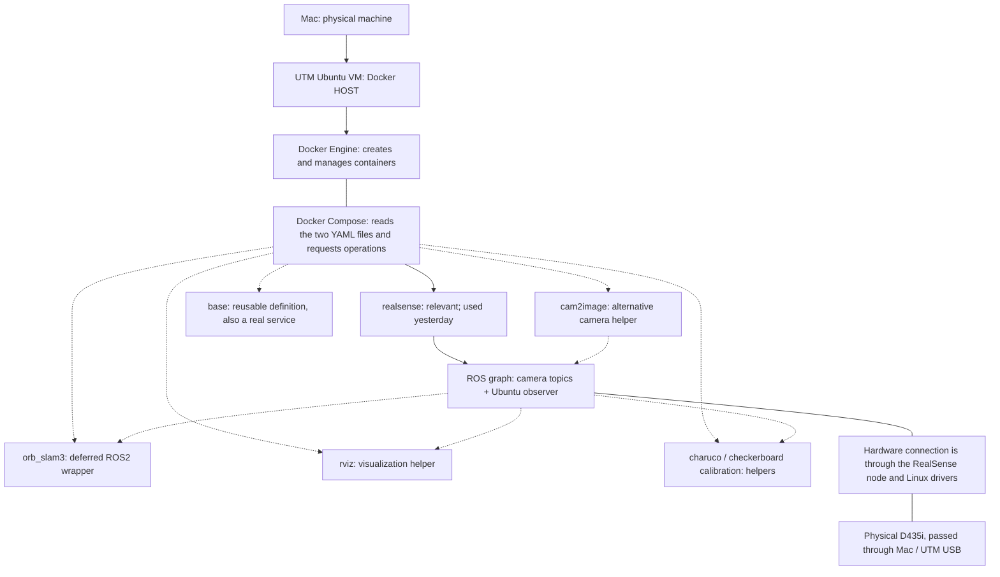
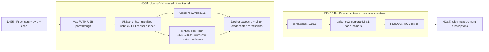

# 1. System overview

**Yesterday we operated a RealSense sensor publisher in Docker on the Ubuntu VM, and measured its ROS messages from Ubuntu. We did not operate an end-to-end SLAM system.** Root could access the camera, but image delivery remained unstable. The separate non-root experiment exposed an IMU permission failure. ORB-SLAM3, validated bags, and VIO remain untested.

This review was reconstructed on **2026-09-09** from current source files and the evidence recorded on **2026-09-08**. All experiment times below are Asia/Ho_Chi_Minh, UTC+07, unless explicitly marked UTC. No camera, SLAM process, container, build, package installation, or experiment script was started for this review. Only this document was created.

Use three distinct meanings throughout:

- **Configured:** what the files currently instruct Docker or ROS to do.
- **Observed:** what yesterday's saved logs, messages, and container metadata establish.
- **UNCERTAIN / NOT TESTED:** what those sources cannot establish. Source code establishes an intended execution path, not a successful run.

The Mac → UTM arrangement is the project context supplied by the owner. Saved Linux evidence independently identifies a QEMU-style USB topology, Ubuntu x86_64, and the camera's guest-visible USB speed; it does not record the Mac model or UTM settings.



Solid links identify the relevant arrangement or measured publisher path; dashed links identify configured helpers or future consumers. This is an ownership/deployment diagram, not a claim that bytes travel through Compose. Compose is a client of Docker Engine. Neither Compose nor Docker Engine relays ROS image messages. The actual sensor-data direction is **D435i → Ubuntu kernel → container's driver process → ROS subscribers**, expanded in sections 4–5.

Here, **HOST means Ubuntu inside UTM**, unless explicitly saying “Mac host.” Containers share that Ubuntu kernel. They do not each boot another Linux kernel, and `network_mode: host` refers to Ubuntu's network namespace, not directly to macOS networking.

The entry configuration is [the wrapper Compose file](../third_party/ORB_SLAM3_ROS2/docker-compose.yaml). It includes [the calibration repository's Compose file](../third_party/ORB_SLAM3_ROS2/ros2_realsense_d435i_camera_calibration/docker-compose.yaml). The current rendered configuration contains seven services:

| Service | Intended job | Relevance to yesterday |
|---|---|---|
| `realsense` | Start `realsense2_camera_node`; publish IR and motion messages | The service recipe and its image were used for the audit |
| `orb_slam3` | Build the mounted ROS2 wrapper, then launch mapping | Deferred; never launched in the audit |
| `base` | Supply common ORB build/runtime settings; default interactive shell | Helper definition, but still an ordinary Compose service, not an abstract class |
| `rviz` | Run `rviz2` to visualize ROS data | Helper; no successful visualization established |
| `charuco-calibration` | Run ROS camera calibration using a 5×7 ChArUco target | Deferred helper; image calibration, not a demonstrated camera–IMU VIO calibration |
| `checkerboard-calibration` | Run ROS camera calibration using a 5×8 checkerboard | Deferred helper |
| `cam2image` | Run `image_tools cam2image`, remapped to `/camera/image_raw` | Alternative image source, not the D435i IMU driver |

No profiles hide these helpers, and no `depends_on` establishes a camera-ready condition. Their presence in the configuration does not mean they ran yesterday. An unqualified future `up` would include services beyond the baseline camera task. `extends: realsense` copies configuration into helpers; their replacement `command` runs RViz/calibration rather than also starting a second RealSense node in that same container.

The audit's final saved check at 19:16:57 shows no running containers and no attached D435i. That is **yesterday's final state**, not a new live hardware check today.

Evidence: [baseline audit](../D435I_BASELINE_AUDIT.md), [host/package/image evidence](../experiments/2026-09-08-d435i-baseline/HOST.txt), [USB evidence](../experiments/2026-09-08-d435i-baseline/USB.txt), [final resumed check](../experiments/2026-09-08-d435i-baseline/RESUME_FINAL_CHECKS.txt). The parent repository's [README](../README.md) places this work before robot integration; STM32 control was outside the experiment.

# 2. Docker concepts mapped to this project

The most useful distinction is **recipe → image → container**. The recipe specifies how to assemble files. The image contains the assembled filesystem and default process settings. A container combines that image with a writable layer, process identity, mounts, network settings, and an actual command. Several containers can use exactly the same image and behave differently because their runtime settings differ.

For concise path references below:

- **W** = [`third_party/ORB_SLAM3_ROS2/`](../third_party/ORB_SLAM3_ROS2/).
- **C** = [`third_party/ORB_SLAM3_ROS2/ros2_realsense_d435i_camera_calibration/`](../third_party/ORB_SLAM3_ROS2/ros2_realsense_d435i_camera_calibration/).
- **E** = [`experiments/2026-09-08-d435i-baseline/`](../experiments/2026-09-08-d435i-baseline/).

These are path abbreviations in this document, not environment variables configured in the project.

| Concept | Concrete meaning here | Actual file demonstrating it |
|---|---|---|
| Dockerfile | Ordered image-building instructions. The camera recipe starts from ROS Jazzy, installs Debian packages, creates a user, and copies two configuration files. It is not a running driver. | [C/camera.Dockerfile](../third_party/ORB_SLAM3_ROS2/ros2_realsense_d435i_camera_calibration/camera.Dockerfile) |
| Image | `realsense:latest` names the assembled camera environment. Yesterday its ID was `sha256:f05425cd25e92f1e1a54d0e5a255d87d781251f0f9dc6579296a98458c7364e8`. Read-only image inspection today found the same ID, architecture `amd64`, and default user `richard`. `latest` itself is a movable tag, not a version guarantee. | [E/HOST.txt](../experiments/2026-09-08-d435i-baseline/HOST.txt); tag declared in C/docker-compose.yaml |
| Container | `d435i-audit-root` and `d435i-resume-b` were separate process/filesystem instances. The latter selected root and IR1-only while using the same image bytes as A and C. A stopped container can retain its metadata and logs. | [E/B_COMMAND.json](../experiments/2026-09-08-d435i-baseline/B_COMMAND.json), [E/B_STATE_AFTER.json](../experiments/2026-09-08-d435i-baseline/B_STATE_AFTER.json) |
| Docker Compose | A declarative description of service builds and runtime settings. The outer file includes the calibration file; Compose resolves relative paths, environment substitutions, and `extends`. It requests actions from Engine. | [W/docker-compose.yaml](../third_party/ORB_SLAM3_ROS2/docker-compose.yaml) and C/docker-compose.yaml |
| Service | A named recipe such as `realsense` or `rviz`, not a Linux service account and not necessarily one particular existing container. Audit container names were explicitly chosen. | C/docker-compose.yaml; E/A_COMMAND.json |
| Volume / bind mount | `.:/ros2_ws/src/ORB_SLAM3_ROS2` exposes the Ubuntu checkout inside the ORB container. These Compose `volumes` entries are **bind mounts**, not Docker-managed named storage volumes. Host-side edits become visible inside; writes inside this mounted tree affect the checkout. | W/docker-compose.yaml, `orb_slam3.volumes` |
| `/dev` mapping | `/dev:/dev` exposes Ubuntu's device-node filesystem inside the container. It does not copy camera hardware, supply a kernel driver, pass USB from the Mac into UTM, or change file permissions. | C/docker-compose.yaml, `realsense.volumes` |
| Privileged mode | `privileged: true` broadens container device/capability access. It does not change the selected username into root. Yesterday a privileged container running UID 1001 still got `EACCES`. | C/docker-compose.yaml; [E/DOCKER_DEVICE_ACCESS.txt](../experiments/2026-09-08-d435i-baseline/DOCKER_DEVICE_ACCESS.txt) |
| User UID/GID | The Dockerfiles default build arguments to 1000/1000, but Compose supplies **1001/1001**, with `USERNAME` resolving to `richard`. `USER $USERNAME` selects that account for runtime. `--user 0:0` overrode it for root experiments without rebuilding. | C/camera.Dockerfile; C/docker-compose.yaml; E/A_COMMAND.json |
| Supplementary groups | Additional numeric groups attached to the container process. Normal image identity had `[1001]`; `--group-add 44` produced `[44,1001]`. Host login groups are not implicitly copied. Current Compose has no `group_add`. | E/DOCKER_DEVICE_ACCESS.txt; [E/C_COMMAND.json](../experiments/2026-09-08-d435i-baseline/C_COMMAND.json) |
| Host networking | `network_mode: host` places these services on Ubuntu's network stack, simplifying local DDS communication without per-topic port mappings. It does not supply ROS domain or middleware settings. | Both Compose files |
| Environment variables | Image `ROS_DISTRO=jazzy` identifies the ROS installation; service `FASTDDS_BUILTIN_TRANSPORTS=UDPv4` configures FastDDS; audit `-e ROS_DOMAIN_ID=42` supplies a runtime variable absent from Compose. `${USERNAME}` is Compose-side interpolation into a build argument, not automatic host-environment inheritance. | C/camera.Dockerfile; both Compose files; E/A_COMMAND.json |
| Entrypoint | The camera image selects `/ros_entrypoint.sh`, inherited from `ros:jazzy-ros-base`, to enter the ROS environment. ORB uses a repository-owned script that sources ROS and an existing workspace overlay, then `exec "$@"`. | C/camera.Dockerfile; [W/entrypoint.sh](../third_party/ORB_SLAM3_ROS2/entrypoint.sh); [W/Dockerfile](../third_party/ORB_SLAM3_ROS2/Dockerfile) |
| Command | The service supplies the program/arguments passed to the entrypoint: RealSense runs `ros2 run ...`; ORB supplies `bash -c` with `colcon build` followed by launch. This is distinct from Dockerfile `RUN`, which executes during image construction. | Both Compose files; W/Dockerfile's default `CMD ["/bin/bash"]` |

Three related settings are useful to recognize. `ipc: host` shares Ubuntu's IPC namespace; it is different from network sharing. `init: true` requests a small init process to handle process reaping/signals; the later direct audit `docker run` commands did **not** include `--init`. `/tmp/.X11-unix:/tmp/.X11-unix`, `DISPLAY`, and `QT_X11_NO_MITSHM=1` are GUI plumbing for X11/Qt. They do not prove a working display; today's rendered `DISPLAY` was empty, as yesterday's saved render also showed.

The camera entrypoint's pathname is confirmed by image metadata; its script body is inherited, not stored in this checkout or re-read inside a running container today. The ORB entrypoint body is directly inspectable in the repository.

# 3. Build-time architecture

## Which Compose project does “build” mean?

There is no Compose file at the parent repository root. In this repository, the explicit form is:

```text
docker compose -f third_party/ORB_SLAM3_ROS2/docker-compose.yaml build
```

The shorter `docker compose build` refers to this project when run from `third_party/ORB_SLAM3_ROS2`, as its README assumes. This review **did not execute a build**. Read-only `docker compose ... config` confirmed the resolved definitions.

Conceptually, Compose first reads the outer file, loads the included project's services, resolves `extends`, and substitutes build arguments. Engine's builder then assembles the selected images, reusing cached layers when available. A build can execute Dockerfile `RUN` steps in build environments, but it does not launch the service's camera or mapping command. It also does not automatically initialize or update Git submodules.

The included file has its own project directory: its `context: .` resolves to **C**, while the outer file's `context: .` resolves to **W**. This is why the camera Dockerfile sees `advanced.json` but does not see the sibling `third_party/realsense-ros` as build input.

## Image families

| Service(s) | Image name | Dockerfile and context | What is assembled |
|---|---|---|---|
| `realsense` | `realsense:latest` | C/camera.Dockerfile; C context | Camera, SDK, calibration, image tools, and RViz binary packages; two copied configs |
| `cam2image` | `cam2image:latest` | Same camera Dockerfile/context | Same recipe; different runtime command |
| `rviz` | `rviz:latest` | Inherits the camera build from `realsense` | Same recipe; runtime command becomes RViz |
| `charuco-calibration` | `charuco_calibration:latest` | Inherits the camera build | Same recipe; ChArUco calibration command |
| `checkerboard-calibration` | `checkerboard_calibration:latest` | Inherits the camera build | Same recipe; checkerboard calibration command |
| `base` | Compose-generated project/service image name | W/Dockerfile; W context | ROS and ORB wrapper build dependencies plus entrypoint; no active source compilation |
| `orb_slam3` | `orb_slam3:latest` | Inherits W/Dockerfile build from `base` | Same dependency recipe; source mount and runtime build are supplied by Compose |

All seven resolved services have build definitions, but there are only **two Dockerfile recipes**. Docker can reuse common layers. Separate service/image names do not imply separately implemented camera stacks or prove every image is already built locally. Only the RealSense image was inspected in this review.

## Camera recipe: binary installation, not a source build

[C/camera.Dockerfile](../third_party/ORB_SLAM3_ROS2/ros2_realsense_d435i_camera_calibration/camera.Dockerfile) starts from **`ros:jazzy-ros-base`**. It installs these explicit binary packages with `apt-get`:

- `python3-colcon-common-extensions` and `python3-pydantic`.
- `ros-jazzy-camera-calibration`.
- `ros-jazzy-librealsense2`, `ros-jazzy-realsense2-camera`, and `ros-jazzy-realsense2-description`.
- `ros-jazzy-image-tools` and `ros-jazzy-rviz2`.

The package manager also resolves their dependencies. No exact package versions appear in the install instruction. There is no `git clone`, source `COPY` of realsense-ros, `colcon build`, or librealsense compilation step. Installing `colcon` makes the build tool available; it does not mean the camera was compiled with it.

From the pinned calibration submodule, the recipe copies:

```text
C/advanced.json          → image /config/advanced.json
C/cam2image_params.yaml  → image /config/cam2image_params.yaml
```

These are build-time copies, not live configuration bind mounts. Editing the checkout later would not update those files in an existing image. The SDK and ROS driver binaries come from the ROS package repository, not from either checked-out RealSense source tree. Camera calibration and RViz are also installed as binaries; the calibration repository supplies recipes and configuration, not a source build of ROS `camera_calibration`.

The helper commands select different functions from this environment. `cam2image_params.yaml` specifies device ID 6, 320×240, and 30 Hz for that helper. Those settings are not the RealSense audit profile. ChArUco uses square size 0.0320 m, marker size 0.0246 m, dictionary `6x6_250`; checkerboard uses square size 0.0257 m. These are target assumptions, not calibration results.

## ORB recipe: dependencies now, source compilation later

[W/Dockerfile](../third_party/ORB_SLAM3_ROS2/Dockerfile) also starts from **`ros:jazzy-ros-base`**. Its explicit binary dependencies are:

| Purpose | Packages explicitly requested |
|---|---|
| Build tools | `build-essential`, `cmake`, `ccache`, `ninja-build`, `git`, `g++`, `wget`, `unzip`, `pybind11-dev`, `python3-pip` |
| Native libraries | `libyaml-cpp-dev`, `libpcl-dev` |
| ROS mapping / point clouds / visualization / build support | `ros-jazzy-nav2-map-server`, `pcl-ros`, `pcl-conversions`, `pangolin`, `cv-bridge`, `xacro`, `ament-cmake-python` (all with `ros-jazzy-` prefix) |
| RealSense support | `ros-jazzy-librealsense2`, `ros-jazzy-realsense2-camera`, `ros-jazzy-realsense2-description` |

The active file copies only `entrypoint.sh`, creates the user, sets `/ros2_ws` as its working directory, and selects the entrypoint. The instructions that would copy all wrapper source, run the embedded ORB `build.sh`, and run `colcon build` are **commented out**.

Therefore `docker compose build` does not currently build an ORB-SLAM3 library or compile this wrapper. Compose supplies a source bind mount and puts `colcon build` in the **startup command** instead. The wrapper CMake then expects an already configured/built embedded ORB library. The separate source-build path in section 6 is a prerequisite, not a step automatically performed by the current Dockerfile.

Pangolin is requested as a ROS binary package here, even though upstream instructions discuss building dependencies manually. The complete installed dependency closure and the ability to build ORB in an actual ORB image are **UNCERTAIN / NOT TESTED**. In particular, CMake requests Sophus and other libraries; a package declaration or a README instruction does not prove the current image satisfies every requirement.

## Why checkout 4.58.4 produced runtime 4.58.1

These are two independent provenance paths:

```text
Parent Git submodule pin
  → third_party/realsense-ros @ 9a111217... (4.58.4)
  → source available for inspection
  → NOT copied, mounted, or built by the camera service

C/camera.Dockerfile
  → FROM ros:jazzy-ros-base
  → apt-get install ros-jazzy-realsense2-camera
  → installed package 4.58.1-1noble.20260615.150439
  → /opt/ros/jazzy RealSense executable used yesterday
```

The corresponding SDK package was `2.58.1-1noble.20260524.190754`, and startup reported built/running SDK **2.58.1**. [E/HOST.txt](../experiments/2026-09-08-d435i-baseline/HOST.txt) contains the package query and installed package XML; [E/CURRENT_ROOT_LOG.txt](../experiments/2026-09-08-d435i-baseline/CURRENT_ROOT_LOG.txt) independently reports ROS driver **4.58.1**.

Nothing “downgraded” the 4.58.4 checkout. That checkout was bypassed by this build recipe. The exact apt-index/cache history at the original image build is not recorded here, but the installation mechanism and installed version are established. Git pinning, base-image pinning, apt-package pinning, and runtime image identity are separate reproducibility controls. Neither Dockerfile uses a base-image digest or exact apt version. Rebuilding later is not guaranteed to reproduce yesterday's binaries.

The ORB dependency image also installs RealSense binaries via apt. It likewise does not build `third_party/realsense-ros`; its own installed versions were not verified today and should not be inferred from the camera image.

# 4. Runtime architecture

The following is a reconstruction of service startup, not instructions executed for this review.

1. **Docker Engine on Ubuntu** creates a container from the image, applies mounts, host network/IPC, privileged access, process identity, and environment. The standard service selects the image's non-root user. Yesterday root tests overrode that selection.
2. **Inside the container**, `/ros_entrypoint.sh` is the selected entrypoint and the Compose command selects the ROS executable. ROS remappings name the node `/camera` at the root namespace and rename the IR1 image and camera-info topics.
3. **Inside the container**, `realsense2_camera_node` uses the installed librealsense SDK to enumerate the host-exposed device, load `/config/advanced.json`, choose profiles, and start sensors. The preset is actively loaded by the existing startup command; starting a camera service is more than merely listing USB hardware.
4. The SDK's system calls reach the **shared Ubuntu kernel**. Kernel drivers and host-created device nodes determine whether video and motion access succeeds. An apt-installed SDK in the container does not replace Ubuntu's running kernel or supply a separate container kernel.
5. SDK callbacks reach **the ROS driver inside the container**, which publishes messages via ROS middleware. The audit observer on **Ubuntu outside the container** receives them.



Saved topology shows camera interfaces 0–4 using `uvcvideo` at **480M**; interface 5 was HID using `usbhid`. Kernel logs also mention `hid-sensor-hub`. The resumed C log exposes the concrete IIO scan-control path used by the SDK. We should not invent a complete successfully enumerated IMU endpoint inventory: the initial/final IIO directory checks were empty, and no complete recreated-node permission inventory was collected after the second disconnect.

`/dev:/dev` covers the device-node filesystem. **It does not mount `/sys` through that same mapping.** Sysfs is the kernel's device/control view, exposed through the container's system mounts and affected by its runtime privileges. C's error establishes that the SDK reached a `/sys/devices/.../iio:device1/scan_elements/...` pathname and was denied access. Knowing that pathname exists is different from having permission to configure it.

The service also specifies device-cgroup rules `c 81:* rmw` and `c 189:* rmw`: character-device major 81 covers video devices, and 189 covers USB bus devices. The flags allow read, write, and node creation at that control layer. Privileged mode already broadly relaxes device-cgroup restrictions. Neither setting rewrites the owner, group, or mode of a video node or an IIO sysfs attribute.

Yesterday's device identity was D435i serial **243322073847**, firmware **5.17.3.10**, with SDK-reported USB **2.1**. A guest USB3 root hub at 5000M existed, but the camera was beneath the 480M bus. The relevant speed is the camera's negotiated path, not the best speed printed for any root hub.

# 5. ROS data flow

These are actual names from [E/ROS_TOPICS.txt](../experiments/2026-09-08-d435i-baseline/ROS_TOPICS.txt) and the measurement records:

```text
D435i IR1 ── SDK / ROS image publisher ── remap ──→ /camera/image_raw
                                                 /camera/camera_info

D435i IR2 ── SDK / ROS image publisher ──────────→ /camera/infra2/image_rect_raw
                                                  (initial root run and A)

D435i gyro ── raw motion callback ──────────────→ /camera/gyro/sample
                           └──────┐
                                  ├─ ROS driver IMU combination → /camera/imu
D435i accel ─ raw motion callback ┘
             └────────────────────────────────→ /camera/accel/sample
```

| Topic | Message content observed |
|---|---|
| `/camera/image_raw` | `sensor_msgs/msg/Image`, 640×480, `mono8`, step 640, `camera_infra1_optical_frame` |
| `/camera/camera_info` | `sensor_msgs/msg/CameraInfo`, IR1 intrinsics and rectified-stream information |
| `/camera/gyro/sample` | `sensor_msgs/msg/Imu`, angular velocity in rad/s, frame `camera_gyro_optical_frame` |
| `/camera/accel/sample` | `sensor_msgs/msg/Imu`, acceleration in m/s², frame `camera_accel_optical_frame` |
| `/camera/imu` | `sensor_msgs/msg/Imu`, both motion vectors, frame `camera_imu_optical_frame` |
| `/tf_static` | Received static transform message with 11 transforms |

The raw motion messages reuse the `Imu` type: unused acceleration fields in gyro-only messages and unused angular fields in accel-only messages are zeros. This does not mean those sensors failed. Combined IMU orientation covariance starts with `-1`: the message does not supply an estimated orientation. Combining gyro and accel fields is not an attitude estimator or VIO.

The topic name `/camera/image_raw` is created by this explicit remapping:

```text
/camera/infra1/image_rect_raw := /camera/image_raw
```

Its shortened name does not change the originating stream: yesterday it was rectified grayscale IR1, not RGB. IR2 retained its original name. Camera-info was similarly remapped from `/camera/infra1/camera_info`.

The conceptual future consumer is [W/src/imu_mono_realsense.cpp](../third_party/ORB_SLAM3_ROS2/src/imu_mono_realsense.cpp):

```text
/camera/image_raw ── [topic reconciliation REQUIRED, currently absent] ──→ wrapper image callback
/camera/imu ───────────────────────────────────────────────────────────→ wrapper IMU buffer
image + buffered motion ── if imu-monocular mode is selected ──────────→ ORB TrackMonocular(...)
```

The source currently subscribes to relative `camera/infra1/image_rect_raw`, resolving to **`/camera/infra1/image_rect_raw`** in the launch's root namespace. That does **not** match the current RealSense remap. Its `camera/imu` subscription does resolve to `/camera/imu`. `mapping.launch.py` supplies no image remapping to bridge this gap. These are static findings, not a failed runtime test. No correction was applied.

Motion/IR metadata, `/camera/{gyro,accel}/imu_info`, and `/camera/extrinsics/depth_to_{accel,gyro,infra1,infra2}` were also discovered. `/tf` and `/diagnostics` were not discovered in the baseline; a future wrapper's TF publisher must not be described as something measured yesterday.

# 6. ORB-SLAM3 container architecture

## Two ORB-SLAM3 copies with different roles

The parent [.gitmodules](../.gitmodules) and [W/.gitmodules](../third_party/ORB_SLAM3_ROS2/.gitmodules) establish these distinct dependencies. Current read-only submodule status matches yesterday's audit:

| Path | Source / pinned revision | Role in this Docker setup |
|---|---|---|
| `third_party/ORB_SLAM3` | Official `UZ-SLAMLab/ORB_SLAM3`, `4452a3c4ab75b1cde34e5505a36ec3f9edcdc4c4` | Separate official baseline source; not selected by the wrapper CMake or mounted as a sibling in its container |
| `third_party/ORB_SLAM3_ROS2` | `gjcliff/ORB_SLAM3_ROS2`, `efd7acd9ea31bfdbcd843a4c90eeaa85f7e80dd8` | ROS2 wrapper, Compose recipes, launch files and configs |
| `third_party/ORB_SLAM3_ROS2/ORB_SLAM3` | Embedded `gjcliff/ORB_SLAM3` fork, `0f29ad5f563269a13109d81eb886916cc5960136` | The ORB source/library explicitly selected by the wrapper |
| `.../ros2_realsense_d435i_camera_calibration` | `gjcliff` calibration repository, `92ad7a5b4ad9616b98221ae140301f8bbc0a0782` | Camera/helper Dockerfile, Compose and configuration |
| `third_party/realsense-ros` | `9a11121700cb4780e273e34141f6402fe184321d`, tag 4.58.4 | Inspected source; not camera runtime build input |

The wrapper binds **W** to `/ros2_ws/src/ORB_SLAM3_ROS2`. Consequently its embedded fork is visible at `/ros2_ws/src/ORB_SLAM3_ROS2/ORB_SLAM3`. The separate official copy is outside this mount.

## Exact intended build/link path

[W/CMakeLists.txt](../third_party/ORB_SLAM3_ROS2/CMakeLists.txt) says:

```cmake
set(ORB_SLAM3_ROOT_DIR ${CMAKE_CURRENT_SOURCE_DIR}/ORB_SLAM3)
find_package(ORB_SLAM3 REQUIRED CONFIG
    PATHS ${ORB_SLAM3_ROOT_DIR}/build
    NO_DEFAULT_PATH
)
target_link_libraries(imu_mono_node_cpp PUBLIC ORB_SLAM3::ORB_SLAM3 ...)
```

This is a positive selection of the **embedded fork's build directory**, not a search for whichever ORB source happens to be pinned elsewhere. It also installs `ORB_SLAM3/lib/libORB_SLAM3.so` and the embedded DBoW2/g2o shared libraries into the ROS installation.

The intended prerequisite is [the embedded build.sh](../third_party/ORB_SLAM3_ROS2/ORB_SLAM3/build.sh). It builds bundled **DBoW2**, **g2o**, and **Sophus**, unpacks `Vocabulary/ORBvoc.txt.tar.gz`, then configures and builds ORB-SLAM3 and its examples. [The fork's CMakeLists.txt](../third_party/ORB_SLAM3_ROS2/ORB_SLAM3/CMakeLists.txt) creates `lib/libORB_SLAM3.so`, links OpenCV, Eigen/Pangolin/PCL and bundled libraries, and exports **`build/ORB_SLAM3Config.cmake`** with namespace `ORB_SLAM3::`. RealSense-linked examples are conditional on finding the SDK.

However, the current Dockerfile does not invoke that prerequisite, and the service startup command only runs `colcon build`. Today the mounted checkout has **no embedded `build/`, no embedded `lib/`, and no unpacked `Vocabulary/ORBvoc.txt`**. The wrapper's required CMake config therefore is not present at the specified location. No successful build was attempted or established; additional dependencies, permissions, and launch prerequisites are **UNCERTAIN**. “Which source is linked?” has a definite configured answer—the embedded fork—but “which working binary did we run?” has the answer **none was run yesterday**.

The fork also exposes `GetMapPCL()` and `GetFrameDrawerImage()` in its `include/System.h`, and the wrapper calls them. Those declarations are absent from the inspected official copy's `System.h`. This reinforces why the two libraries cannot be treated as interchangeable solely because both are named ORB_SLAM3.

## Startup and launch defaults

The intended `orb_slam3` startup sequence is:

```text
W/Dockerfile → dependency image
W bind-mounted into /ros2_ws/src/ORB_SLAM3_ROS2
/entrypoint.sh → source ROS; source existing overlay if present; exec command
bash -c → source ROS → colcon build → source install/setup.bash
        → ros2 launch orb_slam3_ros2 mapping.launch.py
```

`&&` means a failed build prevents the launch. The main workspace `build/`, `install/`, and `log/` under `/ros2_ws` are not given explicit persistence mounts in this Compose file; they belong to the container's writable filesystem. The wrapper source and anything written beneath its mounted tree belong to the Ubuntu checkout. The embedded build script would write under that source tree. This distinction matters when interpreting a container recreation or a source-tree modification.

[W/launch/mapping.launch.py](../third_party/ORB_SLAM3_ROS2/launch/mapping.launch.py) launches `imu_mono_node_cpp` plus `robot_state_publisher` with the D435i description and a static `world → map` transform. Its defaults are:

| Argument | Default | Consequence |
|---|---|---|
| `sensor_type` | `monocular` | Selects non-inertial ORB mode, even though the executable's name contains `imu` |
| `use_pangolin` | `true` | Requests the ORB viewer |
| `use_rviz` | `false` | Does not launch its optional RViz node by default |
| `playback_bag` | `changeme` | Does not execute the optional bag player |
| `record_bag` | `false` | Does not execute the optional recorder |

The C++ node's own default is `imu-monocular`, but the launch supplies `monocular` and overrides it. Its RealSense launch inclusion is commented out; a camera publisher must be provided separately. The optional recorder lists `/camera/camera/imu` and `/camera/camera/color/image_raw`, which differ from yesterday's actual IR1/IMU topics. Their presence is not proof of a useful recording path.

[W/launch/visualize.launch.py](../third_party/ORB_SLAM3_ROS2/launch/visualize.launch.py) launches a separate `visualize_node`, RViz with `visualization.rviz`, and a static transform. It is a helper launch, not the `orb_slam3` service's selected launch. `orb_camera_info_node`, `visualize_node`, and `orb_alt` are additional executables listed in CMake; mapping selects `imu_mono_node_cpp`. Their existence does not establish a tested alternative pipeline.

The wrapper README contains older `.xml` launch references and says the publisher uses the original infrared topic. The actual `.py` launch and included Compose remapping take precedence for this review.

## Input handling and calibration selection

The main source uses sensor-data QoS for both subscriptions, converts images to MONO8, queues finite-valued IMU messages, and uses their original header timestamps. A local `msg_out` gets a changed timestamp/frame, but that object is not what is queued: the code queues a copy of the original message.

For each image callback it drains the available IMU queue and passes the resulting vector to `TrackMonocular` in inertial mode when more than one IMU sample is available. There is no visible per-sample `tIMU <= tImage` filter in that drain loop. This is an input-handling fact from source; synchronization correctness and resulting VIO behavior are **NOT TESTED**.

The paths for vocabulary and YAML derive from compile-time `PROJECT_PATH`, set to the wrapper source directory. The main node does not subscribe to `/camera/camera_info` to automatically rewrite its camera model.

| Selected mode | Actual YAML | Comparison with yesterday |
|---|---|---|
| `monocular` | [config/Monocular/RealSense_D435i.yaml](../third_party/ORB_SLAM3_ROS2/config/Monocular/RealSense_D435i.yaml) | 848×480, 30 FPS, fx≈614.672 and fy≈617.635; different from 640×480 IR1 at 15 FPS |
| `imu-monocular` | [config/Monocular-Inertial/RealSense_D435i.yaml](../third_party/ORB_SLAM3_ROS2/config/Monocular-Inertial/RealSense_D435i.yaml) | 640×480, 30 FPS, fx=fy=382.613, cx=320.183, cy=236.455; live IR1 fx=fy≈388.527, cx≈319.104, cy≈239.556 |

The inertial YAML also supplies `IMU.T_b_c1`, nominal 200 Hz, noise and random-walk values, and `loopClosing: 0`. These are static example choices, not measurements of this serial number. Its matrix comment alone is insufficient to establish the transform convention needed when comparing ROS TF with ORB's body/camera transform. Calibration direction, axes, units and timing suitability remain **UNCERTAIN**.

## Expected outputs: declared versus actually published in source

| Output | What the selected source currently does | Evidence limit |
|---|---|---|
| `/orb_odom` | Active `nav_msgs/msg/Odometry` publication in a 100 ms timer; uses inverted `Tcw`, frame `odom`, child `base_link` | No runtime messages or pose accuracy tested |
| `/tf` | Active broadcasts for `odom → base_link`, `map → point_cloud`, and `map → live_map` | Frame consistency, initialization and physical interpretation unvalidated |
| `/live_point_cloud` | Publisher constructed, but the conversion/publication block is commented out | Do not promise point-cloud messages from this node as currently written |
| `/live_occupancy_grid` | Publisher constructed, but timer generation/publication block is commented out | Do not promise an occupancy map |
| `/camera/pretty` | Image publisher constructed; no active publish call in this source | Existence of a publisher is not delivery of images |
| Files under `W/output/<timestamp>/` | Code attempts MP4 output and shutdown PCD/map saving | `cloud`, `grid`, and `video` subdirectory creation is commented out; successful saving is NOT TESTED |

The ORB service also inherits an NVIDIA GPU reservation from `base`. This describes a host prerequisite, not evidence that the Mac/UTM Ubuntu environment provides a usable NVIDIA device. Viewer/display support and the reservation's feasibility here are **UNCERTAIN**. These are architecture findings only; no launch or repair was attempted.

# 7. Host ↔ container boundary

Yesterday's permissions follow from numeric Linux credentials:

```text
Ubuntu host login: richard → UID 1000, primary GID 1000, video GID 44 among its groups
Camera image user: richard → UID 1001, primary GID 1001, initially groups [1001]

Same text username ≠ same numeric identity ≠ same supplementary group list
```

`/dev/video0..5` belonged to `root:video`, numeric group 44, mode **0660** with an ACL marker. Mode 0660 grants read/write to the owner and owning group, with no mode-bit access for everyone else. A process in supplementary group 44 satisfies the group check even if its primary group remains 1001. Aligning the username, or changing only UID 1001 to 1000, is not the demonstrated video-group fix.

The isolated open/close probes preserved image, privileged setting, and `/dev` mount while changing credentials:

| Process identity | `/dev/video0..5` | Camera `/dev/hidraw3` |
|---|---|---|
| UID/GID 1001, groups `[1001]` | All denied | Denied |
| Root 0:0, groups `[0]` | All opened | Opened |
| UID/GID 1001, groups `[44,1001]` | All opened | Denied |

The camera hidraw endpoint was **root:root 0600**, so video group membership did not grant access to it. Other hidraw endpoints belonged to QEMU tablet devices; “a hidraw device exists” does not identify the camera.

Root succeeded in this privileged runtime because its effective access could pass/bypass the filesystem restrictions that blocked the non-root process. Root made the device accessible; it did not repair transport corruption. The root runs still produced incomplete frames and unusable sustained image rates.

Motion acquisition has additional surfaces beyond V4L2 video nodes. In resumed C, the user with group 44 opened IR1, then the SDK failed while starting Motion Module:

```text
/sys/devices/pci0000:00/0000:00:04.0/usb5/5-3/5-3:1.5/
0003:8086:0B3A.0005/HID-SENSOR-200076.4.auto/iio:device1/
scan_elements/in_anglvel_x_en
Last Error: Permission denied
```

This line is wrapped for readability. The saved [C_LOG.txt](../experiments/2026-09-08-d435i-baseline/C_LOG.txt) also identifies y/z/timestamp scan controls and trigger warnings. An IIO scan-element attribute selects a channel for sensor capture; access to that control is not granted merely by being allowed to open `/dev/video0`.

Therefore group 44 established **video access only**. The complete non-root motion path was not fixed. The hidraw open failure was a useful clue, but the later IIO error is stronger evidence of the specific backend access blocker. Changing hidraw permissions alone was not demonstrated to solve it.

Host kernel/device management creates these objects. Installing a package containing udev rules inside an image does not prove the Ubuntu host's udev applied those rules to its device nodes. No host udev, chmod, or group membership changes were made yesterday. The temporary root and supplementary-group flags changed container credentials only; current Compose still contains neither a root override nor group 44.

# 8. ROS networking/discovery

The relevant boundary is between **host ROS processes on Ubuntu** and **ROS processes inside the camera container**. Both use ROS Jazzy. The ROS graph is distributed middleware discovery plus endpoints; it is not a central process inside Docker Compose.

| Setting | Host / initial audit | Camera container / resumed audit | Meaning here |
|---|---|---|---|
| `ROS_DOMAIN_ID` | `42` | Explicitly injected as `42` in audit runs | Participants must use the same DDS domain to discover/communicate as intended; ordinary default when unset is 0 |
| `RMW_IMPLEMENTATION` | Initially `rmw_cyclonedds_cpp` | Initially no override, FastDDS default; resumed runs explicitly `rmw_fastrtps_cpp` | Selects the ROS middleware implementation |
| `FASTDDS_BUILTIN_TRANSPORTS` | `UDPv4` in the shell | `UDPv4` in Compose and explicit audit environments | Configures FastDDS to use UDPv4; does not configure CycloneDDS or select the RMW |
| `network_mode: host` | Ubuntu is the shared network namespace | Set by both service families and resumed direct runs | Removes a separate container network namespace for these processes, not domain/QoS requirements |

The checked-in RealSense service supplies **UDPv4 but no domain ID and no RMW override**. The image metadata also contains no domain 42. A host `export ROS_DOMAIN_ID=42` does not automatically enter a Docker container; yesterday's `-e ROS_DOMAIN_ID=42` is part of the experiment configuration. Likewise the ORB service's environment contains GUI settings but no explicit domain/UDPv4/RMW settings. The current two-service recipe does not itself reproduce all of the audit's discovery settings.

Matching domain IDs prevents an obvious discovery separation. Matching RMWs is a useful experimental control, but different DDS implementations are not inherently proof of incompatibility. Yesterday messages were received while the host used CycloneDDS and the camera used FastDDS.

Early CLI graph behavior was confusing: `ros2 node list` was empty while topic discovery and real subscriptions worked, and a parameter dump stalled. Later bounded, no-daemon checks found `/camera` using **both** host CycloneDDS and a temporary FastDDS override. Those checks occurred after device loss; a `Parameter not set` reply then did not measure the earlier initialized camera's IMU setting. Resumed A/B queries on initialized nodes did return method 2.

This separates three observations: discovering a process, successfully calling its parameter service, and receiving sustained sensor data. One does not imply the others. Matching FastDDS in resumed A/B removed the cross-RMW difference, yet gyro/combined subscriber rates remained below nominal and images still failed. The middleware difference did not explain away those failures; the original CLI stall's exact cause remains **UNCERTAIN**.

Evidence: [E/HOST.txt](../experiments/2026-09-08-d435i-baseline/HOST.txt), [E/ROS_TOPICS.txt](../experiments/2026-09-08-d435i-baseline/ROS_TOPICS.txt), [E/run_resume.py](../experiments/2026-09-08-d435i-baseline/run_resume.py), A/B command and parameter records. Today these scripts were read, not executed.

# 9. Reconstruction of yesterday's experiment

## Reading the sequence and the measurements

The initial audit ran approximately 18:50–19:01. After reattachment, the controlled sequence resumed approximately 19:13–19:17. The first attempt to compare single-IR streaming changed identity and overlapped another camera container; it was confounded. **The later isolated root A/B runs supersede it for the IR2 comparison.**

Measurements used simultaneous host `rclpy` subscriptions with sensor-data best-effort QoS. They measured **messages received by the observer**, not directly every sample produced by the physical sensor. The original rate calculation used `(N−1)/(last arrival−first arrival)`. The resumed analysis also calculated **count / entire measurement duration**, which includes leading and trailing silence. Image-pixel quality was not assessed.

The most instructive example is B: `arrival_hz ≈ 14.959` and inter-received-frame gaps around 0.066 s describe a short burst of **15 images**. Across the full 30 seconds, delivery was only **0.500 images/s**. The inter-frame maximum does not measure silence after the final received image. “15 Hz” alone would therefore misrepresent this failed run.

| Measurement | Initial root | Resumed A: root, IR1+IR2+IMU | Resumed B: root, IR1+IMU |
|---|---:|---:|---:|
| Observer window | 18:52:52–18:53:22 | 19:13:33–19:14:03 | 19:14:48–19:15:18 |
| IR1 images in ~30 s | 45 | 23 | 15 |
| IR2 images in ~30 s | 45 | 22 | 0, disabled |
| IR1 count / full window, images/s | ≈1.500 | ≈0.767 | ≈0.500 |
| Incomplete-frame notifications in window | 17 | 18 | 15 |
| Gyro count | 5018 | 4903 | 5016 |
| Accel count | 3021 | 2996 | 3024 |
| Combined IMU count | 4634 | 4580 | 4658 |

The profile was 640×480 Y8 at 15 FPS, gyro 200 Hz, accel 100 Hz. Initial startup actually opened both IR streams even though Compose only explicitly enabled IR1; A/B made the IR2 switch explicit. Approximately 450 images would correspond to an uninterrupted 15 FPS stream over 30 seconds, making the failure clear without mistaking an opened profile for delivered throughput.

The log strings `Incomplete video frame detected` and `Frame Corrupted` can be two parts of the same notification. The initial window had 17 paired occurrences, not 34 independently counted corrupt frames. Notifications are not a complete count of lost frames.

Source of numbers: [E/CURRENT_ROOT_RATES.json](../experiments/2026-09-08-d435i-baseline/CURRENT_ROOT_RATES.json), [E/RESUME_SUMMARY.json](../experiments/2026-09-08-d435i-baseline/RESUME_SUMMARY.json), [E/measure_topics.py](../experiments/2026-09-08-d435i-baseline/measure_topics.py), [E/analyze_resume.py](../experiments/2026-09-08-d435i-baseline/analyze_resume.py). The latter writes the summary when run; it was only inspected for this review.

## Experiment 1 — Normal user versus root device access

- **Research question:** Was normal-user device failure caused by access control rather than complete camera absence?
- **Hypothesis:** The container user lacks access to host device nodes; root can access the same exposed device.
- **Controlled variable:** Same attached D435i, camera image, privileged setting and `/dev` mount in the direct probes. Initial normal/root service runs retained the camera command and domain override.
- **Changed variable:** Effective runtime identity: UID/GID 1001 versus 0:0.
- **Measurement:** Numeric credentials; nonblocking read/write `os.open` followed by close, without streaming ioctls; then actual driver startup logs.
- **Result:** Normal user was denied all six video nodes and camera hidraw; root opened them. Normal service failed to enumerate usable devices due to permissions; root detected the camera and published streams.
- **Conclusion:** Device permissions were a confirmed startup barrier. Root's successful access did not establish image stability or identify the cause of later USB failure.

Evidence: [DOCKER_DEVICE_ACCESS.txt](../experiments/2026-09-08-d435i-baseline/DOCKER_DEVICE_ACCESS.txt), [CURRENT_NORMAL_LOG.txt](../experiments/2026-09-08-d435i-baseline/CURRENT_NORMAL_LOG.txt), [CURRENT_ROOT_LOG.txt](../experiments/2026-09-08-d435i-baseline/CURRENT_ROOT_LOG.txt).

## Experiment 2 — Supplementary video GID

- **Research question:** Could non-root access be restored by adding the video device's owning group? Would that suffice for IMU too?
- **Hypothesis:** Supplementary GID 44 fixes video access; motion may require separate permissions.
- **Controlled variable:** The isolated open probes retained the image, UID/GID 1001 and device exposure. Resumed C retained B's IR1-only profile, SDK/preset, middleware and image.
- **Changed variable:** Add supplementary GID 44 in the non-root probe. B→C changes the runtime identity from root to the image user plus GID 44; it is not a pure streaming comparison of non-root without/with the group.
- **Measurement:** Open results and numeric groups; C startup sequence and subsequent observer window.
- **Result:** Group 44 enabled all video opens but not camera hidraw. C opened IR1 at 19:15:50.910, then hit IIO scan-control permission errors at about 19:15:50.978. USB disappeared; C's later observer received zero messages on all measured topics.
- **Conclusion:** The non-root video mechanism is established; group 44 does not complete motion access. C is a failed-start/permission observation, not a valid sensor-rate comparison. The error preceding the disconnect does not prove it caused the disconnect.

Evidence: DOCKER_DEVICE_ACCESS.txt, [C_COMMAND.json](../experiments/2026-09-08-d435i-baseline/C_COMMAND.json), [C_LOG.txt](../experiments/2026-09-08-d435i-baseline/C_LOG.txt), RESUME_SUMMARY.json.

## Experiment 3 — IR1+IR2+IMU versus IR1+IMU

- **Research question:** Was the second IR stream enough extra load to explain the unusable image baseline?
- **Hypothesis:** Disabling IR2 would restore stable IR1 delivery on the existing connection.
- **Controlled variable:** Isolated sequential runs, root identity, immutable image ID, USB 480M path, `/dev` exposure, host network/IPC, preset, 640×480×15 profile, gyro 200/accel 100 Hz, method 2, domain 42, FastDDS/UDPv4, and 30-second measurement design.
- **Changed variable:** Only `enable_infra2`: A true; B false.
- **Measurement:** Opened profiles, initialized parameter readbacks, image/motion counts, timestamp gaps and time-matched notifications.
- **Result:** A received 23 IR1 and 22 IR2 images with 18 incomplete notifications. B received 15 IR1 images, no IR2, and 15 notifications. Both are far from sustained 15 FPS.
- **Conclusion:** Disabling IR2 alone did not restore a usable baseline on this setup. The result does not prove USB bandwidth is irrelevant or that single-IR is intrinsically worse; these were short sequential runs with uncontrolled residual device state, not a replicated randomized study.

Both A and B exited with code 137 after the five-second stop timeout. They were stopped before the next start, but graceful SDK shutdown was not established. Evidence: A/B command, parameter, log and state records; RESUME_SUMMARY.json.

## Experiment 4 — Container-overlap hypothesis

- **Research question:** Did competing camera processes explain the first failed comparison and disconnect? Is overlap required for recurrence?
- **Hypothesis:** Simultaneous camera owners could interfere; eliminating overlap should remove that contributor.
- **Controlled variable:** Resumed runs used the same image/device path and explicit configurations. A/B held root identity; C was the separate permission condition.
- **Changed variable:** Replace the initial overlapping attempt with enforced sequential starts and host ownership checks. This changes the procedure, not just a sensor parameter.
- **Measurement:** The runner refused starts when any container was running; saved host process/device-owner checks; container start/finish times; recurrence of errors.
- **Result:** A finished at 19:14:16.807 before B started at 19:14:34.527; B finished at 19:15:30.810 before C started at 19:15:47.380. No competing camera process was evidenced. Image failure persisted in A/B and USB disconnected during isolated C.
- **Conclusion:** Overlap confounded the first attempt, but overlap is not necessary for recurrence. Residual sensor state after forced stops remains a limitation, so isolation did not identify the underlying transport/device cause.

Evidence: [run_resume.py](../experiments/2026-09-08-d435i-baseline/run_resume.py), `{A,B,C}_HOST_OWNERS.txt`, `{A,B,C}_STATE_AFTER.json`, RESUME_KERNEL_LOG.txt. These filenames are under E.

## Observation study 5 — USB disconnect

- **Research question:** Was ROS simply losing discovery, or did the device disappear from the Ubuntu USB/device layer?
- **Hypothesis:** A lower-level device/passthrough failure could explain loss of all camera messages.
- **Controlled variable:** No controlled native-USB3 comparison was performed; both recorded episodes used the same general VM/480M path.
- **Changed variable:** Device state before/after failure and after reattachment. The disconnect was observed, not deliberately induced as an experiment.
- **Measurement:** Guest USB topology, kernel logs, node disappearance and SDK logs.
- **Result:** At 18:54:31 UVC probe errors appeared; at 18:54:32 the USB device disconnected and a RealSense process segfaulted in librealsense. After reattachment, kernel logged another disconnect at 19:15:51 during isolated C. Final saved checks lacked the camera and video nodes.
- **Conclusion:** These were actual guest-visible USB losses, not merely missing ROS topic names. The exact physical or virtual cause remains **UNCERTAIN**. A kernel “disconnect” does not prove someone physically unplugged a cable. Cable/port, Mac/UTM passthrough, device/firmware, and residual teardown state were not separated.

Evidence: [USB.txt](../experiments/2026-09-08-d435i-baseline/USB.txt), [KERNEL_LOG.txt](../experiments/2026-09-08-d435i-baseline/KERNEL_LOG.txt), [RESUME_KERNEL_LOG.txt](../experiments/2026-09-08-d435i-baseline/RESUME_KERNEL_LOG.txt), RESUME_FINAL_CHECKS.txt. A Left MIPI error was also recorded during initial root startup; its occurrence does not by itself diagnose faulty hardware.

## Investigation 6 — Method 2 versus COPY-like IMU behavior

- **Research question:** Did `unite_imu_method=2` actually interpolate acceleration at gyro timestamps?
- **Hypothesis:** Method 2 should select linear interpolation, but a callback default might bypass the selected value.
- **Controlled variable:** Both resumed runs requested method 2, used the same binary image, and preserved raw/combined motion values and timestamps. Source comparisons used the pinned checkout and the local runtime-matching 4.58.1 tag without switching revisions.
- **Changed variable:** The analytical model: latest acceleration COPY versus bracketed linear interpolation. This was **not** a live method-1 versus method-2 A/B experiment.
- **Measurement:** Initialized parameter readbacks, source callback trace, exact raw gyro/combined comparisons, and acceleration comparisons against both models.
- **Result:** A and B both returned `Integer value is: 2`. In each inspected version, the ordinary motion callback calls `imu_callback_sync(frame)` without passing `_imu_sync_method`; the header's default argument is COPY. The sync implementation switches on its passed argument. In A/B, 4578/4580 and 4655/4658 united acceleration vectors exactly equaled some captured raw acceleration vector. Among 4557/4648 cases where COPY and interpolation differed meaningfully, 3471/3353 matched the timestamp-preceding raw sample exactly; **zero** matched the bracketed interpolation within 1e-6 m/s².
- **Conclusion:** Source and sample correlation strongly support COPY-like behavior despite method 2. Parameter readback proves stored configuration, not which code branch ran. Incomplete raw-topic delivery, callback order, repeated quantized vectors and floating-point timestamps limit classification of every sample. Exact binary patch provenance was not independently reconstructed.

The intended algorithms are different: COPY emits a gyro reading with cached latest acceleration; interpolation waits for surrounding accel samples and estimates acceleration at the gyro timestamp. A separate multiple-message callback does pass the configured method, so the finding is about the ordinary inspected motion path, not every possible RealSense device/callback mode.

Evidence: [IMU_SOURCE.txt](../experiments/2026-09-08-d435i-baseline/IMU_SOURCE.txt), A/B_PARAMETERS.txt, RESUME_SUMMARY.json, analyze_resume.py. Relevant source files are `third_party/realsense-ros/realsense2_camera/{src/rs_node_setup.cpp,src/parameters.cpp,src/base_realsense_node.cpp,src/ros_sensor.cpp,include/base_realsense_node.h}`. The saved excerpts cover both revisions. No driver source fix or method-1 trial was performed.

## Investigation 7 — Calibration warning

- **Research question:** Did the warning mean all camera calibration was unusable, or specifically that the SDK fell back for motion calibration?
- **Hypothesis:** Failure retrieving IMU EEPROM data triggers default IMU parameters while image intrinsics remain available.
- **Controlled variable:** Same SDK version 2.58.1; inspection used yesterday's saved matching SDK source, camera-info and TF evidence. No calibration replacement or firmware write was tested.
- **Changed variable:** Evidence examined: generic warning versus its source exception/fallback path and independently received calibration-related messages. This is a source/evidence investigation, not an intervention trial.
- **Measurement:** The `mm_calib_handler` EEPROM/MMER retrieval and exception handling; fallback parser constants; IR1 K/D/R/P and static transforms.
- **Result:** The SDK catches an exception during EEPROM retrieval and omits the exception detail in its warning. The fallback provides default motion scale/bias and mechanical extrinsics. Camera-info still had plausible nonzero focal lengths, and `/tf_static` contained motion transforms compatible with fallback geometry. Warning persisted in A/B/C.
- **Conclusion:** Default IMU calibration was used in these runs. Why retrieval failed is **UNCERTAIN**; this does not prove permanently missing factory calibration. The warning alone neither invalidates all image intrinsics nor validates VIO calibration. Static transforms existing is not evidence of a per-device calibrated transform.

Evidence: [LIBREALSENSE_CALIB_SOURCE.txt](../experiments/2026-09-08-d435i-baseline/LIBREALSENSE_CALIB_SOURCE.txt), [CAMERA_INFO.txt](../experiments/2026-09-08-d435i-baseline/CAMERA_INFO.txt), TF_STATIC.json and the baseline audit. The SDK source was fetched during yesterday's audit and inspected from the saved file today; no new SDK fetch or hardware calibration request was needed.

## Investigation 8 — Runtime package/source mismatch

- **Research question:** Which driver version did the camera process actually execute?
- **Hypothesis:** The Dockerfile's apt installation bypasses the pinned 4.58.4 source.
- **Controlled variable:** Existing image and unchanged Git revisions; no rebuild, package upgrade or checkout switch.
- **Changed variable:** Provenance source inspected: Git revision, Dockerfile instructions, installed Debian version/package XML, and startup self-report.
- **Measurement:** Compare all four records rather than treating a submodule tag as executable provenance.
- **Result:** Checkout 4.58.4; apt-installed package 4.58.1; runtime log 4.58.1. Dockerfile has no path that consumes the pinned driver checkout.
- **Conclusion:** The mismatch is confirmed and explained by the build path. Inspecting a newer checkout can help analysis, but runtime claims must be checked against the installed version. The audit therefore also inspected local Git tag 4.58.1 (`53aceeac29e2e848e5e1ede5430124f07b2fe924`) without changing checkout.

Evidence: HOST.txt, C/camera.Dockerfile, CURRENT_ROOT_LOG.txt and IMU_SOURCE.txt.

## Investigation 9 — Discovery and middleware control

- **Research question:** Did host/container middleware differences explain the inconsistent ROS CLI results or low measured rates?
- **Hypothesis:** CLI daemon/discovery timing or cross-RMW behavior might contribute; matched middleware would remove one variable.
- **Controlled variable:** Domain 42; later bounded queries to the same `/camera` node. Resumed A/B explicitly matched FastDDS on both observer and publisher.
- **Changed variable:** No-daemon bounded checks and temporary host RMW override from CycloneDDS to FastDDS; no global shell configuration change.
- **Measurement:** Node visibility, parameter responses, and resumed subscriber delivery.
- **Result:** Both middleware checks later discovered `/camera`; initialized A/B parameters were readable. Matched-FastDDS A/B still had low gyro/combined delivered rates and failed images.
- **Conclusion:** Discovery worked, and matching middleware did not restore sensor stability. The first stalled query's cause and the exact location of message loss remain **UNCERTAIN**.

Evidence: ROS_TOPICS.txt, HOST.txt, run_resume.py, A/B_PARAMETERS.txt, RESUME_SUMMARY.json. Restarting the host ROS daemon yesterday was a diagnostic process action, not a Docker image change.

# 10. What yesterday did NOT prove

- **Whether the physical D435i is faulty.** Corruption, MIPI warnings and disconnects are observations; they do not isolate camera hardware from cable, host USB, firmware, VM passthrough, or shutdown state.
- **Whether native USB3 fixes the issue.** The camera was observed on a 480M guest path. No controlled native-host/verified-USB3 comparison exists.
- **Whether Raspberry Pi 5 will work.** No Pi run, ARM image build, native USB test, performance measurement or sustained sensor capture was performed. The inspected camera image is amd64.
- **Whether official ORB-SLAM3 builds or runs correctly here.** The official source is present; no local benchmark was validated. A saved EuRoC benchmark is conceptually independent of D435i availability, but the audit had no validated local dataset/executable run.
- **Whether the ROS2 wrapper works end to end.** No wrapper launch, real tracking, initialization, relocalization, output validation or camera-to-wrapper integration was tested. Static topic/mode/build issues exist in the current configuration.
- **Whether the current Docker build is sufficient for ORB.** The embedded library build artifacts and unpacked vocabulary are absent in the mounted checkout. Package closure, build permissions, GPU reservation and GUI prerequisites are unverified.
- **Whether any calibration is suitable for VIO.** Available image intrinsics and fallback-compatible TF do not establish camera–IMU extrinsics, noise/bias/scale, timing or frame convention accuracy. Neither example YAML is demonstrated calibration for this serial and profile.
- **Whether `unite_imu_method=2` reliably interpolates.** The evidence supports COPY-like behavior in the audited binary; no corrected build or method-1 A/B validates a repair.
- **Whether full non-root motion access can be achieved by one permission change.** GID 44 solved the video check; the complete IIO/control/data permission set was not inventoried and repaired.
- **Where the missing gyro/combined samples were lost.** Observer rates include SDK delivery, DDS/QoS, scheduling and subscriber behavior. Matching FastDDS did not locate the loss.
- **Whether image pixels are geometrically or visually sound.** Message counts and corruption logs do not replace inspecting actual imagery; no artifact-free image-quality result exists.
- **Whether timestamps are synchronized sufficiently for VIO.** Increasing per-topic timestamps and epoch-scale values do not validate inter-sensor offset, latency, drift or wrapper synchronization.
- **Whether long-duration streaming and graceful teardown work.** Tests were short; A/B/C exit codes were 137. Non-overlap was established, clean SDK shutdown was not.
- **Whether recording and replay work.** No validated bag was recorded, inspected or replayed because image stability failed. Zero-message C is not a dataset.
- **Whether any future ORB odometry/TF is metrically or physically correct.** The source's frame labels and inverse pose calculation have not been validated against real motion or robot conventions.

The remaining uncertainty is part of the result. Yesterday isolated some boundaries—numeric permissions, binary provenance, actual topic names, and sustained delivery failure—without validating the entire chain.

# 11. My teach-back checklist

## Files to open manually in VS Code, in learning order

Read these twelve files in this order. Follow the references within this document for deeper evidence when a claim is unclear.

| Order | Actual project file | What to look for |
|---:|---|---|
| 1 | [D435I_BASELINE_AUDIT.md](../D435I_BASELINE_AUDIT.md) | Separate observations from hypotheses; section 16 updates the initial findings |
| 2 | [W/docker-compose.yaml](../third_party/ORB_SLAM3_ROS2/docker-compose.yaml) | `include`, `extends`, source mount, GPU reservation, startup `colcon build` |
| 3 | [C/docker-compose.yaml](../third_party/ORB_SLAM3_ROS2/ros2_realsense_d435i_camera_calibration/docker-compose.yaml) | Camera command, remapping, credentials and helper services |
| 4 | [C/camera.Dockerfile](../third_party/ORB_SLAM3_ROS2/ros2_realsense_d435i_camera_calibration/camera.Dockerfile) | Binary apt installation, build arguments, copied configs, entrypoint |
| 5 | [E/RESUME_SUMMARY.json](../experiments/2026-09-08-d435i-baseline/RESUME_SUMMARY.json) | Counts versus burst rates; IMU correlation; why C is not a rate test |
| 6 | [W/Dockerfile](../third_party/ORB_SLAM3_ROS2/Dockerfile) | Active dependency installation versus commented source-build instructions |
| 7 | [W/ORB_SLAM3/build.sh](../third_party/ORB_SLAM3_ROS2/ORB_SLAM3/build.sh) | Separate native dependencies, vocabulary unpack and ORB library build; read only |
| 8 | [W/ORB_SLAM3/CMakeLists.txt](../third_party/ORB_SLAM3_ROS2/ORB_SLAM3/CMakeLists.txt) | Library target, linked dependencies, exported CMake package |
| 9 | [W/CMakeLists.txt](../third_party/ORB_SLAM3_ROS2/CMakeLists.txt) | Exact embedded-library search path, executable selection and install rules |
| 10 | [W/launch/mapping.launch.py](../third_party/ORB_SLAM3_ROS2/launch/mapping.launch.py) | `monocular` default, optional viewers/bags, commented camera launch |
| 11 | [W/src/imu_mono_realsense.cpp](../third_party/ORB_SLAM3_ROS2/src/imu_mono_realsense.cpp) | Actual subscriptions, IMU queue, YAML selection, active versus inactive outputs |
| 12 | [W/config/Monocular-Inertial/RealSense_D435i.yaml](../third_party/ORB_SLAM3_ROS2/config/Monocular-Inertial/RealSense_D435i.yaml) | Intrinsics, timing, noise, transform and mode assumptions that require validation |

Other inspected sources supporting this report include parent and wrapper `.gitmodules`, parent/wrapper/calibration READMEs, `W/entrypoint.sh`, `W/package.xml`, `W/.dockerignore`, the monocular YAML, `visualize.launch.py`, embedded and official `include/System.h` declarations, and the camera helper preset/parameter files. Evidence inspection covered HOST, USB, DOCKER_DEVICE_ACCESS, ROS_TOPICS, CAMERA_INFO, IMU_SOURCE, LIBREALSENSE_CALIB_SOURCE, initial/root/C log excerpts, kernel records, A/B/C command/parameter/ownership/state records, RESUME_SUMMARY, RESUME_FINAL_CHECKS, and the measurement/runner/analysis source files cited above. Source/version conclusions also used current `git submodule status --recursive`; current configuration was checked with read-only Compose rendering and RealSense image metadata inspection.

## Questions I should be able to answer before moving on

1. What is the difference between the RealSense Dockerfile, `realsense:latest`, the Compose service `realsense`, and yesterday's container `d435i-resume-b`?
2. Which machine is “host” in `/dev:/dev` and `network_mode: host`, and which kernel actually drives the camera?
3. Why did pinning `third_party/realsense-ros` to 4.58.4 not mean we ran 4.58.4? What evidence identifies the actual binary?
4. Which files are copied into the camera image at build time, and which directory is mounted into the ORB container at runtime?
5. What exactly does `/dev:/dev` achieve, and why does it neither pass USB into UTM nor grant access to every IIO control?
6. Why did host `richard ∈ video GID 44` not imply the container process had that group? Which numeric credentials did the image actually use?
7. Why was root able to open the camera, and why did that not make image streaming reliable?
8. Why did group 44 fix video opens while the complete IMU path still failed? Which recorded pathname demonstrates the remaining blocker?
9. Where do `/camera/gyro/sample`, `/camera/accel/sample`, and `/camera/imu` come from, and why does a combined IMU message not mean orientation was estimated?
10. Why can `unite_imu_method=2` be visible in a parameter query while captured samples behave like COPY? What are the limits of that conclusion?
11. Why can a reported arrival rate near 15 Hz coexist with only 15 images in a 30-second window? Which metric includes trailing silence?
12. Which ORB-SLAM3 copy does the ROS wrapper select, and what separate build artifact does its CMake require before the wrapper can build?
13. Which image topic does the wrapper subscribe to, which image topic did the camera actually publish, and what mode does the current launch select?
14. Why must the audit's domain 42 be explicitly supplied to containers, and why was comparing host CycloneDDS with container FastDDS useful without proving either was the cause?
15. What did the isolated A/B/C sequence rule out, and which claims about hardware fault, USB3, Raspberry Pi, calibration, bags and end-to-end SLAM still require evidence?
