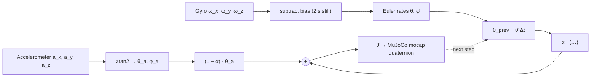

# Lesson: tilt from an IMU (the balance loop's input)

Demo: `tools/imu_view` (README there). You tilt the MPU6050; a 3D WBR on the Mac tilts with it.
The solid robot uses our complementary filter. The blue ghost uses the accelerometer only, the orange
ghost the gyro only. This lesson explains why the three disagree.

## 1. Conventions used everywhere here

- Robot frame: x forward, y left, z up.
- **Pitch θ** is a rotation about +y; **θ > 0 means nose down**.
- **Roll φ** is a rotation about +x; **φ > 0 means left side up**.
- Order is ZYX (yaw, then pitch, then roll). Yaw is not estimated.

A still accelerometer measures *specific force*: the floor pushing up, i.e. +1 g along world z,
expressed in the body frame:

$$
\mathbf{a} = g\begin{bmatrix}-\sin\theta \\ \cos\theta\sin\phi \\ \cos\theta\cos\phi\end{bmatrix}
\quad\Rightarrow\quad
\phi_a = \operatorname{atan2}(a_y, a_z), \qquad
\theta_a = \operatorname{atan2}\!\left(-a_x, \sqrt{a_y^2 + a_z^2}\right)
$$

Nose down by 20° gives a_x = −0.342 g: the "up" reaction leans backwards in the body frame.

## 2. The accelerometer is noisy; the gyro drifts

| Sensor | Gives | Good at | Fails because |
|---|---|---|---|
| Accelerometer | Angle directly, from the gravity direction | Long-term truth: no drift | It also measures *every other acceleration*. Braking at 1 m/s² tilts the measured "down" by atan(1/9.81) = 5.8°. Vibration from wheels/motors adds noise. |
| Gyroscope | Angular *rate* ω | Short-term: smooth, unaffected by linear acceleration | You must integrate it, θ = ∫ω dt. A constant bias b becomes an error b·t that grows forever. |

Bench numbers (MEASURED, imu_can_bench, 29 Oct, board still):

- Gyro bias on x: −3.25 °/s. Integrated for 10 s, that is −32.5° of fake roll. The demo shows exactly this.
- Accelerometer noise ≈ 0.01 g, i.e. about 0.57° of angle noise per sample.

## 3. The complementary filter

Idea: trust the gyro for fast changes and the accelerometer for the slow average. Per sample:

$$
\hat\theta_k = \alpha\left(\hat\theta_{k-1} + \dot\theta_{\text{gyro}}\,\Delta t\right) + (1-\alpha)\,\theta_{a,k},
\qquad \alpha = \frac{\tau}{\tau + \Delta t}
$$

- The gyro term is a **high-pass** path, the accelerometer term a **low-pass** path. Their
  crossover is at f_c = 1/(2πτ).
- With τ = 0.5 s and Δt = 0.01 s (100 Hz): α = 0.980 and f_c = 0.32 Hz.
- The gyro rate is converted to Euler-angle rates first (`filter.euler_rates`). For small roll,
  θ̇ ≈ ω_y and φ̇ ≈ ω_x.

### Worked example (bench numbers)

Steady error used in step 3:

$$
\hat\theta - \theta = \frac{\alpha}{1-\alpha}\, b\,\Delta t = b\,\tau = 3.25 \times 0.5 = 1.6^\circ
$$

The board is held still at θ = 20° nose down, the estimate is θ̂ = 19.0°, and the bias was **not** removed:
the gyro reads b = 3.25 °/s on the pitch axis. The accelerometer gives θ_a = 20.3° (true 20° plus 0.3° of noise).

1. Predict with the gyro: 19.0 + 3.25 × 0.01 = 19.0325°.
2. Blend: 0.98039 × 19.0325 + 0.01961 × 20.3 = **19.057°**. The estimate moves toward the accelerometer.
   It moves only 2 % of the way per sample, so 0.3° of noise moves it by just 0.006°.
3. Where does it settle? At the fixed point the gyro push α·b·Δt equals the accelerometer pull
   (1 − α)(θ̂ − θ_a). That gives the steady error below.
   Compare: gyro-only error is unbounded (32.5° after 10 s); the complementary error stays at 1.6°.
   The 2 s still-calibration at start-up removes most of b, which shrinks this to near zero.
   The unit test `test_static_tilt_with_gyro_bias` checks exactly these numbers.
4. Noise: white accelerometer noise is scaled by √((1−α)/(1+α)) ≈ 0.0995. So 0.57° per sample becomes ≈ 0.06°.

Choosing τ is a trade-off. A larger τ means less vibration and acceleration error, but a larger
bias × τ offset and a slower recovery from gyro errors. **Madgwick** (shown as numbers in the overlay)
does the same blending on a quaternion, with gain β instead of τ. It avoids Euler-angle singularities
near ±90° pitch, which a balancing robot never reaches.

## 4. Why axis and sign errors make a balancing robot fall the wrong way

The balance controller is state feedback, u = −K x, with x containing θ and θ̇ (the LQR in `sim/`).
For a WBR, nose down (θ > 0) must make the wheels roll **forward**, under the centre of mass.

| Error | What the controller sees | Result on the robot |
|---|---|---|
| Pitch sign flipped (accel and gyro both) | Nose down reads as nose up | Wheels roll backwards, away from the CoM. This is positive feedback: it falls *faster* than with no controller. |
| Gyro sign flipped only | θ right, θ̇ wrong | The damping term pushes the wrong way, so the oscillation grows. The complementary filter also fights itself: the gyro pulls one way, the accelerometer the other. |
| Pitch and roll axes swapped | Leaning forward reads as roll | No balance reaction at all to forward lean; the robot just falls. Meanwhile the roll/leg loop reacts to a lean that isn't there. |
| Bias not removed | θ offset of b·τ | The robot balances "leaning". To hold that tilt it must keep accelerating, so it drifts forward or backward. |

The real robot (DM-jump firmware) takes its pitch rate from `ins->Gyro[0]`, i.e. the BMI088 **x**
axis (`VMC_calc.c`, SOURCE-SUPPORTED). So on that board, pitch is about the IMU's x axis. INFERRED:
the board is mounted with x along the wheel axle. This is exactly the mapping that `--axes` expresses.
It must be checked on the real robot before any balance attempt. The README's axis-check table is the procedure.

## 5. What this demo does NOT show

- **No balance and no dynamics.** The model is a picture (mocap body) rotated by the estimate. It cannot fall,
  roll or push back. Control claims stay with `sim/` and the hardware.
- **No yaw.** Without a magnetometer the z-gyro integral only drifts, so heading is not displayed.
- **No acceleration rejection test.** Tilting by hand is slow. Driving or bumping the board would show the
  accelerometer's 5.8°-per-m/s² error, and the filter only partly hides it.
- **Not the real IMU or mounting.** MPU6050 on a bench, not the robot's BMI088. The five-bar lengths are from
  the team report, but the body size and IMU location are assumed (README parameter table).
- **One fixed leg pose.** The five-bar is drawn at l0 = 0.12 m; leg motion is not driven.
