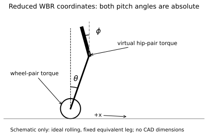
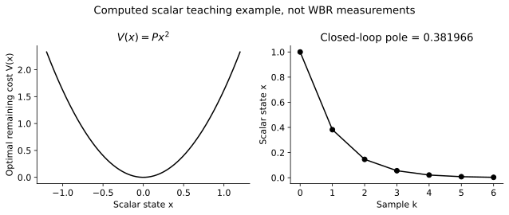
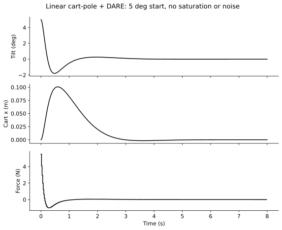

# LQR — from Bellman to our WBR

**What you should be able to explain afterwards:** where $u=-Kx$ comes from,
what the Riccati equation solves, what a stability check does and does not prove,
and which gain matrix our robot simulation actually uses.

You already know embedded systems and some reinforcement learning (RL). This
pack develops the missing control mathematics; it does not assume prior mastery
of Linear Quadratic Regulation (LQR). Keep [[Toolkit]] beside you if needed.

## Reading map

1. [[#1. What is being controlled?|What is being controlled?]]
2. [[#2. From nonlinear dynamics to a sampled model|From nonlinear dynamics to a sampled model]]
3. [[#3. Specify the optimization problem|Specify the optimization problem]]
4. [[#4. Derive feedback using Bellman|Derive feedback using Bellman]]
5. [[#5. Work a scalar example by hand|Work a scalar example by hand]]
6. [[#6. What stability means|What stability means]]
7. [[#7. Continuous versus discrete LQR|Continuous versus discrete LQR]]
8. [[#8. Apply DARE to a cart-pole|Apply DARE to a cart-pole]]
9. [[#9. Read the real WBR simulation gains|Read the real WBR simulation gains]]
10. [[#10. Run the exercise|Run the exercise]]
11. [[#11. Questions, answers and the next experiment|Questions, answers and the next experiment]]

> [!important] Scope
> **SIMULATION / ASSUMED.** Our reduced WBR is an illustrative planar model,
> not an identified CAD digital twin. The cart-pole and scalar system below are
> teaching examples. None of these results authorizes deployment to the robot.

## 1. What is being controlled?

A balancing robot must move its support to manage the motion of an unstable
body. Correcting tilt alone is insufficient: it can remain upright while
travelling away from its desired position. We want **balance and settling**.

Our reduced model uses

$$
x=
\begin{bmatrix}
p & \theta & \phi & \dot p & \dot\theta & \dot\phi
\end{bmatrix}^{T},
\qquad
u=\begin{bmatrix}\tau_w & \tau_h\end{bmatrix}^{T}.
$$

| Symbol | Meaning | Unit |
| --- | --- | --- |
| $p$ | Horizontal axle displacement from target | m |
| $\theta$ | Equivalent leg pitch from upright, absolute | rad |
| $\phi$ | Body pitch from upright, absolute | rad |
| $\dot p,\dot\theta,\dot\phi$ | Corresponding velocities | m/s, rad/s, rad/s |
| $\tau_w$ | Aggregate wheel-pair torque | N m |
| $\tau_h$ | Aggregate virtual hip-pair torque | N m |

The simulator's hip joint angle is $\phi-\theta$, although the controller state
contains **absolute** body pitch $\phi$. Confusing those coordinates changes the
meaning of the gain columns. Aggregate pair torques are not per-motor commands.



*Figure 1. A coordinate schematic, not a CAD drawing. Leader arrows identify torque inputs; they do not define a motor wiring/sign convention. The two pitch angles are referenced to world vertical.*

For a stationary upright target, $x^\star=0$ and the ideal model has
$u^\star=0$. More generally use errors $e=x-x^\star$ and $v=u-u^\star$.
The feedback law then becomes $u=u^\star-Ke$.

> [!note] Must Know
> LQR needs a **state**, not just the angle visible in an animation. In the
> ideal derivation the state is available exactly. Actual controllers use noisy
> measurements or estimates; that extra problem is not solved by calculating $K$.

## 2. From nonlinear dynamics to a sampled model

Write the nonlinear dynamics as

$$
\dot x=f(x,u).
$$

At an equilibrium, $f(x^\star,u^\star)=0$. A first-order Taylor expansion gives

$$
\dot e\approx A_c e+B_c v,
\qquad
A_c=\left.\frac{\partial f}{\partial x}\right|_\star,
\quad B_c=\left.\frac{\partial f}{\partial u}\right|_\star.
$$

The subscript $c$ means continuous time. Terms quadratic and higher in the
deviations are omitted. That is why a controller derived near upright cannot
automatically swing up a fallen robot.

For a digital controller with sample period $h$ and constant command within
each interval, the exact sampled **linear** dynamics are

$$
e_{k+1}=A_d e_k+B_d v_k,
\qquad
A_d=e^{A_ch},
\quad
B_d=\int_0^h e^{A_c\tau}B_c\,d\tau.
$$

This is zero-order hold (ZOH). It is not the same as assuming
$A_d=I+hA_c$, $B_d=hB_c$; those are first-order approximations.

Our nominal WBR synthesis also differentiates the simulator's actual held-input
transition $F_h(x,u)$ to obtain $A_d,B_d$. It compares those matrices with ZOH.
Differentiating the actual transition matches the numerical dynamics being
controlled, including its integration method. We **read** existing gains here;
we do not launch another synthesis or simulation campaign.

From now on, write $A=A_d$, $B=B_d$, and $x=e$ to simplify notation.

## 3. Specify the optimization problem

Choose a finite horizon $N$ and minimize

$$
J=\sum_{k=0}^{N-1}
\left(x_k^TQx_k+u_k^TRu_k\right)+x_N^TP_Nx_N,
\qquad x_{k+1}=Ax_k+Bu_k.
$$

Assume $Q=Q^T\succeq0$, $R=R^T\succ0$ and terminal weight
$P_N=P_N^T\succeq0$. The input is unconstrained in this derivation.

| Quantity | Shape | Meaning |
| --- | --- | --- |
| $x,u$ | $n\times1$, $m\times1$ | State and action |
| $A,B$ | $n\times n$, $n\times m$ | Sampled dynamics |
| $Q,R$ | $n\times n$, $m\times m$ | Immediate state/action cost weights |
| $P_k$ | $n\times n$ | Optimal remaining-cost matrix |
| $K_k$ | $m\times n$ | Feedback gain |

**Why quadratic?** It penalizes both signs of an error, strongly penalizes large
errors, and gives a tractable optimization. It is a design choice, not a law of
robotics. The weights encode the trade-off between tracking and effort.

For our nominal WBR configuration,

$$
Q_c=\operatorname{diag}(40,200,200,8,8,8),
\qquad R_c=\operatorname{diag}(0.8,0.6).
$$

These weights act on SI-valued states/torques. The code uses
$Q_d=hQ_c$, $R_d=hR_c$ with $h=0.002\,\mathrm{s}$; it declares a sampled
cost, not exact integration of the continuous-time cost.

Example: a $2\,\mathrm{cm}$ position error contributes
$40(0.02)^2=0.016$ to the instantaneous quadratic expression. A
$1^\circ$ leg error contributes $200(\pi/180)^2\approx0.0609$.
Numbers such as 40 and 200 cannot be compared without the state units/scales.

Multiplying **both** $Q$ and $R$ by the same positive constant scales $P$ and
$J$, but leaves the unconstrained optimal $K$ unchanged. Changing only $Q$ or
only $R$ changes the trade-off. A scalar RL reward rescaling need not behave
identically because its optimizer and critic introduce additional effects.

## 4. Derive feedback using Bellman

### 4.1 The value function

Define $V_k(x)$ as the minimum cost still to come when we start at state $x$
at sample $k$. Terminal condition: $V_N(x)=x^TP_Nx$.

The principle of optimality says: choose today's action, pay today's cost,
then act optimally from tomorrow's resulting state:

$$
V_k(x)=\min_u\left[
x^TQx+u^TRu+V_{k+1}(Ax+Bu)
\right].
$$

This is the **Bellman equation**. It is the bridge to RL: the definition of
future value exists before a neural network is involved.

### 4.2 Substitute a quadratic future value

Suppose $V_{k+1}(x)=x^TP_{k+1}x$. Let $P=P_{k+1}$ temporarily.
Expanding the expression inside the minimum gives

$$
\begin{aligned}
&x^TQx+u^TRu+(Ax+Bu)^TP(Ax+Bu)\\
&=x^T(Q+A^TPA)x
  +2u^TB^TPAx
  +u^T(R+B^TPB)u.
\end{aligned}
$$

For fixed $x$, this is a quadratic function of $u$. Its Hessian is
$2(R+B^TPB)\succ0$, so setting the gradient to zero gives the unique minimum:

$$
2(R+B^TPB)u+2B^TPAx=0.
$$

Therefore

$$
\boxed{u_k^\star=-K_kx_k},
\qquad
\boxed{K_k=(R+B^TP_{k+1}B)^{-1}B^TP_{k+1}A}.
$$

**Interpretation:** action has two costs: immediate effort $R$ and the future
state cost it creates, $B^TPB$. The term $B^TPA$ measures how action can counter
the state's natural evolution. The feedback gain balances those effects.

### 4.3 Substitute the minimum back

Putting $u=-K_kx$ into Bellman gives a quadratic value again:

$$
\boxed{
P_k=Q+A^TP_{k+1}A
-A^TP_{k+1}B(R+B^TP_{k+1}B)^{-1}B^TP_{k+1}A
}.
$$

That is the **Riccati recursion**. Start with $P_N$, work backwards, and obtain
$P_k,K_k$. The quadratic assumption is self-consistent: the terminal value is
quadratic and every preceding Bellman step preserves that form.

### 4.4 Infinite horizon

For a time-invariant problem, under appropriate conditions the backwards
recursion converges to a constant stabilizing solution $P$. Its fixed-point
equation is the discrete algebraic Riccati equation (**DARE**):

$$
\boxed{
P=Q+A^TPA-A^TPB(R+B^TPB)^{-1}B^TPA
}.
$$

Then $K=(R+B^TPB)^{-1}B^TPA$ is constant. **Offline**: solve for $P,K$.
**At each control tick**: compute $-Kx$. You do not solve an optimization
problem again at every tick of a fixed-gain LQR controller.

> [!tip] A way to test your understanding
> Cover the boxed equations. Starting with Bellman and $V(x)=x^TPx$, recover
> the coefficient of $u^Tu$, differentiate with respect to $u$, and derive $K$.
> If you can do this, DARE is no longer a mysterious library call.

## 5. Work a scalar example by hand

Use an intentionally dimensionless system:

$$
x_{k+1}=x_k+u_k,
\qquad J=\sum_{k=0}^{\infty}(x_k^2+u_k^2).
$$

Here $A=B=Q=R=1$. DARE becomes

$$
P=1+P-\frac{P^2}{1+P}
\quad\Rightarrow\quad P^2-P-1=0.
$$

Choose the positive stabilizing root:

$$
P=\frac{1+\sqrt5}{2}\approx1.618034,
\quad K=\frac{P}{1+P}\approx0.618034,
\quad A-BK\approx0.381966.
$$

With $x_0=1$, the first action is $u_0=-0.618034$ and the next state is
$x_1=0.381966$. Bellman numerically checks out:

$$
\underbrace{x_0^2+u_0^2}_{1.381966}
+\underbrace{P x_1^2}_{0.236068}
=\underbrace{P x_0^2}_{1.618034}.
$$

Why not apply $u_0=-1$ and reach zero immediately? That costs 2 in one step.
The LQR solution accepts a small remaining error to spend less total effort.
The negative Riccati root is not the desired value function; it produces an
unstable closed-loop pole. Merely satisfying a polynomial equation is insufficient.



*Figure 2. Computed from the scalar example by the included script. The parabola
is remaining optimal cost, not a learned reward curve. The right panel uses samples, not seconds.*

## 6. What stability means

With feedback, $x_{k+1}=(A-BK)x_k$. Discrete asymptotic stability requires

$$
\rho(A-BK)=\max_i|\lambda_i(A-BK)|<1.
$$

For infinite-horizon LQR, standard sufficient conditions are:

- $(A,B)$ is **stabilizable**: every unstable or marginal mode can be influenced by the input.
- $(Q^{1/2},A)$ is **detectable**: any mode invisible to the state cost is already stable.
- $Q\succeq0$ and $R\succ0$.

Full controllability is stronger than stabilizability. Its matrix is
$\mathcal C=[B\;AB\;\cdots\;A^{n-1}B]$; rank $n$ means all modes are
controllable. Raw rank is sensitive to scaling/tolerance, so inspect conditioning
on a serious robot model. The tiny teaching system is well behaved.

There is also a value-function explanation. DARE implies

$$
(A-BK)^TP(A-BK)-P=-(Q+K^TRK).
$$

Thus along the ideal closed loop,

$$
V(x_{k+1})-V(x_k)=-x_k^TQx_k-u_k^TRu_k\le0.
$$

The optimal remaining cost decreases by exactly the cost just paid. When $P$
is positive definite and the decrement is strictly positive away from zero,
this is a direct Lyapunov argument. Semidefinite cases require the extra
detectability/invariance reasoning; nonincrease alone is not always enough.

> [!warning] The boundary of the result
> This concerns the specified linear, unconstrained system. Saturation, delay,
> a different sign convention, modelling errors or a large nonlinear excursion
> can invalidate its assumptions. Stable poles are not proof of global WBR balance.

## 7. Continuous versus discrete LQR

For the continuous-time problem,

$$
\dot x=A_cx+B_cu,
\qquad J_c=\int_0^\infty(x^TQ_cx+u^TR_cu)\,dt,
$$

the Hamilton–Jacobi–Bellman equation is

$$
0=\min_u\left[x^TQ_cx+u^TR_cu+
(\nabla_xV)^T(A_cx+B_cu)\right].
$$

With $V=x^TP_cx$, differentiating with respect to $u$ gives
$u=-R_c^{-1}B_c^TP_cx$. Substitution gives the continuous algebraic Riccati
equation (**CARE**):

$$
A_c^TP_c+P_cA_c-P_cB_cR_c^{-1}B_c^TP_c+Q_c=0.
$$

This is a different equation from DARE, with a different gain formula.
Continuous stability uses negative real parts of poles; sampled stability uses
pole magnitudes below one. Under ZOH, open-loop modes map as
$\lambda_d=e^{\lambda_ch}$, but a continuously varying feedback command and
a sampled-and-held feedback command are different implementations.

**Good to Know:** exact discretization of the continuous cost generally produces
$Q_d,R_d$ **and a state–input cross term**. Setting $Q_d=hQ_c$, $R_d=hR_c$
is a simple rectangle approximation, not that exact transformation. The exercise
explicitly chooses this approximate sampled cost, matching our nominal WBR convention.

## 8. Apply DARE to a cart-pole

To see a real matrix without WBR complexity, use a cart of mass $M$, a point
mass $m$ at the end of a massless rod of length $l$, and horizontal force $F$.
Choose $\alpha=0$ upright, positive when the pole leans **right**. The tip has
horizontal coordinate $p+l\sin\alpha$.

Near upright, the coupled equations are

$$
(M+m)\ddot p+ml\ddot\alpha=F,
\qquad ml\ddot p+ml^2\ddot\alpha-mgl\alpha=0.
$$

Solving them gives

$$
\ddot p=\frac{F}{M}-\frac{mg}{M}\alpha,
\qquad
\ddot\alpha=-\frac{F}{Ml}+\frac{(M+m)g}{Ml}\alpha.
$$

Notice the unstable gravitational term and the negative force-to-angle sign:
moving the support right can reduce a rightward lean.
With $x=[p,\dot p,\alpha,\dot\alpha]^T$,

$$
A_c=\begin{bmatrix}
0&1&0&0\\
0&0&-mg/M&0\\
0&0&0&1\\
0&0&(M+m)g/(Ml)&0
\end{bmatrix},
\qquad
B_c=\begin{bmatrix}0\\1/M\\0\\-1/(Ml)\end{bmatrix}.
$$

The script uses $M=1\,\mathrm{kg}$, $m=0.1\,\mathrm{kg}$,
$l=0.5\,\mathrm{m}$, $g=9.81\,\mathrm{m/s^2}$, $h=0.02\,\mathrm{s}$,
$Q_d=h\operatorname{diag}(10,1,100,1)$ and $R_d=0.1h$.
It performs ZOH discretization, solves DARE, checks controllability and poles,
then propagates only 400 linear steps from a $5^\circ$ tilt.



*Figure 3. The actual calculated response of the included linear toy model.
There is no force limit, contact model, delay or sensor noise. These are not
experimental WBR traces or a nonlinear swing-up demonstration.*

The gain's sign depends on the coordinate convention. A website using positive
leftward tilt can have different angle-column signs and still describe the same
physical controller. Never copy gains without copying their state/input definitions.

## 9. Read the real WBR simulation gains

The nominal frozen DARE gain in `sim/configs/assumed_actuator_noise.json` is

$$
K_{\mathrm{nom}}\approx
\begin{bmatrix}
-4.529102&-15.788951&-7.401367&-5.582295&-2.677155&-1.481871\\
1.191661&-0.430952&15.023835&1.548874&-0.036645&2.899251
\end{bmatrix}.
$$

This displayed matrix is rounded for reading. The script reads full saved
precision from [the included snapshot](data/wbr_gains.json).
Row 1 produces wheel-pair torque; row 2 produces virtual hip-pair torque.
Column order is the six-state order in Section 1. Each column has the torque
units divided by the corresponding state unit; $K$ is not dimensionless.

For leg tilt alone, $\theta=5^\circ=0.0872665\,\mathrm{rad}$,

$$
-K_{\mathrm{nom}}
\begin{bmatrix}0&0.0872665&0&0&0&0\end{bmatrix}^T
\approx\begin{bmatrix}1.377846\\0.037608\end{bmatrix}\,\mathrm{N\,m}.
$$

That is one matrix multiplication, **not evidence that this state will recover**.
The issued command is also clipped to the assumed pair limits $[2,4]\,\mathrm{N\,m}$.

### Delay-aware LQR is a different state-space controller

The robot does not instantly receive a newly issued command. With transport
delay and motor lag, six mechanical coordinates are insufficient to predict
the future: queued commands and current motor torque matter.

The augmented state has the structure

$$
z_k=\begin{bmatrix}
\hat x_k\\\hat\tau_k\\u_{k-1}\\\vdots\\u_{k-H}
\end{bmatrix},
\qquad \dim z=6+2+2H.
$$

Here $\hat x$ is measured, $\hat\tau$ is reconstructed causally from commands
using the assumed actuator model, and command history is clipped issued history.
It is not a torque sensor or privileged simulator truth.
For 2/3/4/5 ms transport delays and a 2 ms control tick, saved matrices have
respectively 10/12/12/14 columns. The runtime represents fractional-tick arrivals;
it does not round a 3 ms delay to 2 or 4 ms.

The historical comparison first observed nominal-gain failures with imperfections,
then froze delay-specific augmented gains with unchanged Q/R. **That delay-aware
controller is the LQR baseline in our PPO comparison.** The script only reads its
archived gain matrices from the committed host-controller fixture. It does not
recreate the protected gain schedule or claim those matrices match firmware.

Source map, pinned at the commit in [[Sources]]:

| Repository file | What to inspect later |
| --- | --- |
| `sim/planar.py` | State order, coordinate transformation and assumed reduced plant |
| `sim/lqr.py` | Nominal CARE/DARE, finite differences, residuals and poles |
| `sim/augmented_lqr.py` | DARE on the delay/lag augmented runtime state |
| `sim/configs/assumed_actuator_noise.json` | Saved nominal gain and actuator assumptions |
| `sim/control_c/fixtures/recorded.json` | Archived delay-aware gains and recorded arithmetic fixtures |
| `sim/rl/v2.py` | 100 Hz policy, 500 Hz plant/LQR; recomputes LQR feedback on each plant tick |

Do not edit `sim/parity/student.py::gain_schedule`; it remains the owner's exercise.

## 10. Run the exercise

Use a separate environment; do not alter an active PPO environment. From the
extracted `pack1-lqr/` directory:

```sh
python3 -m venv .venv
source .venv/bin/activate
python -m pip install numpy==1.26.4 scipy==1.15.3 matplotlib==3.10.3
python lqr_exercise.py
```

Python 3.11 or 3.12 is suitable for these pinned dependencies. There is no need
for PyTorch, MuJoCo, CUDA, ROS or a GPU. Default execution uses only NumPy/SciPy;
Matplotlib is used only when regenerating figures:

```sh
python lqr_exercise.py --figures assets
```

Compare the console output with [expected-output.txt](expected-output.txt).
The scalar values should match to six decimals; the cart-pole gain and radius
should be close to the printed reference, and the relative DARE residual must
be below $10^{-9}$. Small last-digit differences across numerical libraries are
normal. Missing dependencies, failed assertions, a nonfinite gain or a pole
outside the unit circle are failures to investigate, not results to hide.

The script checks the scalar Bellman identity, solves a real 4-state DARE,
checks decay of the toy trajectory, and checks the dimensions of the saved WBR
matrices. It does **not** verify the WBR's nonlinear stability, hardware parameters
or delay robustness. The tiny CPU work has no training loop or rendering window.

> [!example] Learn by changing one thing
> On a personal copy, increase only cart-pole $R$ tenfold and rerun. Compare
> peak force and settling with the original. Then multiply both $Q$ and $R$
> tenfold: the gain should stay equal within numerical precision. Predict each
> outcome first; a larger $R$ does not guarantee every individual peak decreases.

## 11. Questions, answers and the next experiment

### Self-check

1. Which equation tells you why $u=-Kx$ is optimal?
2. What is the distinction between $Q$ and $P$?
3. Why does a stable $A-BK$ not prove recovery from a $60^\circ$ tilt?
4. Would a $2\times6$ gain multiply our 14-element augmented state correctly?
5. If commands arrive late, why does position/tilt alone not determine the next state?
6. Is an LQR solved with negative reward automatically equivalent to discounted PPO?

> [!success]- Answers
> 1. Bellman minimization: expand the quadratic future value and set its action gradient to zero.
> 2. $Q$ is an immediate design penalty; $P$ is the optimal total remaining-cost matrix obtained from the dynamics and weights.
> 3. The proof concerns local linear dynamics with unconstrained input, not the saturated nonlinear robot far from upright.
> 4. No. The dimensions and state meanings differ; truncating or padding silently invents another controller.
> 5. Two mechanically identical robots with different queued commands or realized motor torques can evolve differently.
> 6. No. Discount, time discretization, reward terms, horizon, action constraints, observations and optimization differ.

### The path into our project

**Now:** finish the hand derivation, run the exercise, and explain one row of
the WBR matrix in physical units. **Next:** [[Pack 2 - RL to PPO]] replaces known
quadratic value optimization with learned values and sampled policy updates.
Then [[Pack 3 - Residual and experiment]] connects a learned correction to LQR.

The approved candidate question is **residual PPO versus delay-aware LQR under
delay mismatch: train on 2–5 ms, test on 6–10 ms**. It is not a research-gap claim.
Before a later experiment, define what delay the controller is told and which
delay-specific gain is used outside the training range. Retuning an oracle LQR
for every test delay changes the question. The current frozen v2 panel does not
by itself test this new mismatch design.

The later pack will specify paired disturbances, seeds, strict settling versus
survival, recovery time, tracking RMSE, commanded/applied torque effort, saturation
and compute. New training must follow the current project pilot rule; this pack
does not launch it. Saved legacy v2 optimizer losses are not return/episode-length
curves, and unavailable learning curves must remain labelled unavailable.

### What you must know versus what can wait

| Must Know | Good to Know | Skip For Now |
| --- | --- | --- |
| State definitions, sampled dynamics, Bellman expansion, DARE, gain multiplication, poles, units and limits | CARE/HJB, exact cost discretization, Lyapunov details and numerical conditioning | MPC implementation, global swing-up design, drone dynamics and hardware deployment |

Read [[Sources]] for primary references, figure provenance and the exact source
snapshot. The lesson's mathematical derivations are educational explanations;
the saved WBR gains remain facts about an assumed simulation, not measured hardware.
