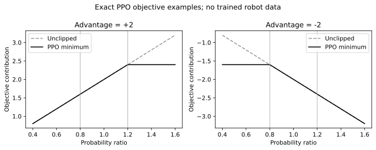

# RL → PPO — what is the optimizer doing?

Start after [[Pack 1 - LQR]]. The aim is to derive a learning update you can
inspect, not simply remember PPO settings. Our robot still has two torque inputs;
the neural network changes how we choose them.

## Reading map

- [[#1. The shared idea: future value|Future value]]
- [[#2. Derive the policy gradient|Policy gradient]]
- [[#3. TD residual → GAE|TD and GAE]]
- [[#4. Why PPO uses a probability ratio|PPO ratio and clipping]]
- [[#5. What is actually optimized and sampled?|Loss and sampling]]
- [[#6. Inspect the reward before believing a curve|Reward interpretation]]
- [[#7. Run and test understanding|Exercise]]

## 1. The shared idea: future value

In LQR, known linear dynamics and quadratic costs let us solve the optimal value
function analytically. In reinforcement learning we use sampled transitions to
estimate future value and improve a policy. A **Markov decision process (MDP)**
specifies states, actions, transition probabilities, rewards and discount.

$$
G_t=\sum_{j=0}^{\infty}\gamma^j r_{t+j},
\qquad J(\theta)=\mathbb E_{\tau\sim\pi_\theta}[G_0].
$$

Here $\theta$ denotes network parameters, not the WBR leg angle. We use $s$ for
RL state, $o$ for its observation, $a$ for a sampled action, and $r$ for reward.
The WBR policy receives a 15-component **causal observation**, not perfect state:
six measured coordinates, two torque estimates, three pairs of command history
and a delay value. Noise/hidden dynamics can make this a partially observed problem.

> [!important] Model-free does not mean model-free simulation
> PPO does not require a dynamics equation for its gradient update. MuJoCo still
> requires masses, inertias, geometry and actuator assumptions to generate data.

For a policy $\pi$, define

$$
\begin{aligned}
V^\pi(s)&=\mathbb E_\pi[G_t\mid s_t=s],\\
Q^\pi(s,a)&=\mathbb E_\pi[G_t\mid s_t=s,a_t=a],\\
A^\pi(s,a)&=Q^\pi(s,a)-V^\pi(s).
\end{aligned}
$$

The RL $Q$-function is **not** the LQR cost-weight matrix $Q$.
Bellman's expectation equation is

$$
V^\pi(s)=\mathbb E_{a\sim\pi,s'\sim p}[r+\gamma V^\pi(s')].
$$

Bellman optimality replaces the policy average over actions by a maximum:
$V^\star(s)=\max_a\mathbb E[r+\gamma V^\star(s')]$.
Unlike our LQR solution, PPO does not solve that equation exactly or guarantee
the globally optimal controller.

For $\gamma=0.99$ at 100 Hz, $1/(1-\gamma)=100$ samples is an approximate 1 s
discount timescale, not a hard planning cutoff. At a different control frequency
the same discount represents a different physical preference. Discounted RL,
finite episodes and an alive bonus do not equal undiscounted LQR just because
one reward term is negative quadratic cost.

## 2. Derive the policy gradient

For a trajectory $\tau=(s_0,a_0,s_1,a_1,\ldots)$,

$$
p_\theta(\tau)=p(s_0)\prod_t
\pi_\theta(a_t\mid s_t)p(s_{t+1}\mid s_t,a_t).
$$

Assume transitions do not depend directly on network parameters. Use
$\nabla p=p\nabla\log p$ to differentiate an expectation:

$$
\nabla_\theta J
=\mathbb E_\tau\left[G_0\nabla_\theta\log p_\theta(\tau)\right],
\qquad
\nabla_\theta\log p_\theta(\tau)
=\sum_t\nabla_\theta\log\pi_\theta(a_t\mid s_t).
$$

The transition factors disappear from this derivative. We need samples from
the environment, not differentiation through MuJoCo. Causality allows a
reward-to-go estimator instead of assigning rewards before an action to it.
For a discounted episodic start-state objective, one form is

$$
\nabla_\theta J
=\mathbb E\left[\sum_t\gamma^t
G_t\nabla_\theta\log\pi_\theta(a_t\mid s_t)\right].
$$

Practical actor–critic algorithms often express an average under an on-policy
state distribution and omit an explicit outer $\gamma^t$ in the minibatch loss.
Do not mistake a library's surrogate loss for an exact finite-sample identity
for every possible objective/distribution.

### Why subtract a baseline?

For an action-independent $b(s)$,

$$
\mathbb E_{a\sim\pi}[b(s)\nabla_\theta\log\pi_\theta(a\mid s)]
=b(s)\nabla_\theta\int\pi_\theta(a\mid s)\,da=0.
$$

Subtracting that baseline does not change the ideal expected policy gradient.
It can reduce variance. Choosing a learned $V_\phi(s)$ gives advantage estimates.
The actor parameters are $\theta$; critic parameters are $\phi$.
When updating the actor, treat the stored advantage as a constant training
target, rather than backpropagating through its construction.

## 3. TD residual → GAE

The temporal-difference (TD) residual asks whether a one-step outcome was better
than the critic predicted:

$$
\delta_t=r_t+\gamma V_\phi(s_{t+1})-V_\phi(s_t).
$$

Generalized Advantage Estimation (GAE) combines future residuals:

$$
\hat A_t^{\mathrm{GAE}}=
\sum_{l=0}^{T-t-1}(\gamma\lambda)^l\delta_{t+l},
\qquad
\hat A_t=\delta_t+\gamma\lambda\hat A_{t+1}.
$$

The reverse recursion is what the tiny exercise implements. Here $\lambda$
is a bias/variance control, not a closed-loop eigenvalue. At $\lambda=0$ use
one TD residual; at 1 telescope towards a bootstrapped return minus the value.
An inaccurate critic can bias short-horizon estimates; a longer sum may be noisy.

### Work all three transitions by hand

Set $\gamma=0.9$, $\lambda=0.8$, rewards $[1,0,2]$ and predicted values
$[0.5,0.4,0.2,0]$. The last transition truly terminates.

| $t$ | $r_t$ | $V_t$ | $V_{t+1}$ | $\delta_t$ | $\hat A_t$ |
| --- | ---: | ---: | ---: | ---: | ---: |
| 0 | 1 | 0.5 | 0.4 | 0.86 | 1.63472 |
| 1 | 0 | 0.4 | 0.2 | -0.22 | 1.076 |
| 2 | 2 | 0.2 | 0 | 1.8 | 1.8 |

For example, $\hat A_1=-0.22+0.72(1.8)=1.076$ and
$\hat A_0=0.86+0.72(1.076)=1.63472$.
The critic targets $\hat V_t=V_t+\hat A_t$ are $[2.13472,1.476,2]$.
They are estimates, not ground-truth infinite future values.

### Falls and timeouts differ

A true terminal state has no continuation in the task, so its bootstrap is zero.
A time limit imposed on an otherwise continuing task can bootstrap from the
**final pre-reset observation**. For the last row above, a timeout with critic
value 0.7 would give $\delta_2=2+0.9(0.7)-0.2=2.43$ instead of1.8.
Do not bootstrap from the reset robot's new initial state. Also stop the GAE
recursion at episode boundaries so the next episode's residuals do not leak back.

> [!note] WBR implementation
> A fall/displacement violation is termination. The 10 s limit is truncation.
> Gymnasium supplies the distinction; SB3 handles terminal-observation timeout
> bootstrapping. The toy script explicitly contrasts the arithmetic without
> pretending to implement an entire vector-environment wrapper.

## 4. Why PPO uses a probability ratio

Experience was collected using $\pi_{\mathrm{old}}$. During repeated optimizer
epochs, the actor becomes $\pi_\theta$. At a sampled state/action define

$$
\rho_t(\theta)=
\frac{\pi_\theta(a_t\mid s_t)}{\pi_{\mathrm{old}}(a_t\mid s_t)}
=\exp\left(\log\pi_\theta(a_t\mid s_t)
-\log\pi_{\mathrm{old}}(a_t\mid s_t)\right).
$$

The ratio corrects action likelihoods at sampled states; it does not make old
state-distribution data valid forever. PPO remains an on-policy method using
fresh rollouts after a limited number of updates.

The clipped surrogate to **maximize** is

$$
L^{\mathrm{clip}}=
\frac1T\sum_t\min\left[
\rho_t\hat A_t,
\operatorname{clip}(\rho_t,1-\epsilon,1+\epsilon)\hat A_t
\right].
$$

### Both signs matter

For $\epsilon=0.2$:

| Advantage | Ratio | Unclipped | Clipped branch | PPO minimum | Meaning |
| --- | ---: | ---: | ---: | ---: | --- |
| +2 | 1.3 | 2.6 | 2.4 | 2.4 | No further objective reward for increasing a good action's probability past 1.2 |
| +2 | 0.7 | 1.4 | 1.6 | 1.4 | Making a good action less likely is still penalized |
| -2 | 0.7 | -1.4 | -1.6 | -1.6 | No further objective reward for decreasing a bad action's probability below 0.8 |
| -2 | 1.3 | -2.6 | -2.4 | -2.6 | Making a bad action more likely is still penalized |



*Exact mathematical curves from the included script, not a learning result.*

Clipping removes an incentive in particular directions. It does **not** project
all ratios into the interval, impose a torque bound, cap KL divergence, guarantee
improved return, or prove robot stability. Other samples/shared network parameters
can still move a probability. A small learning rate controls weight-space steps;
the ratio addresses behaviour at sampled actions. They are complementary controls.

## 5. What is actually optimized and sampled?

A common implementation minimizes a combined loss of the form

$$
\mathcal L=-L^{\mathrm{clip}}
+c_V\mathbb E[(V_\phi-\hat V)^2]
-c_H\mathbb E[\mathcal H(\pi_\theta)].
$$

The negative sign converts maximization into gradient descent. Implementations
may normalize advantages, clip gradients or optionally clip values; read the
pinned implementation rather than assuming the original paper specifies every
detail. Our SB3 version is 2.3.2. In v2, entropy coefficient 0 removes the explicit
entropy bonus; a Gaussian policy still samples exploration noise.

For a two-dimensional diagonal Gaussian, means depend on observations and the
joint log-probability is the **sum** of the two component log-probabilities.
Initial `log_std=-1` means $\sigma=e^{-1}\approx0.368$ in normalized action
units, not N m. The environment clips action components to[-1,1], then scales
them by torque limits. This is not a tanh-squashed Gaussian. For deterministic
evaluation, use the mean with the same clipping, scaling and saved normalization.

**One v2 iteration:** 8 environments × 250 transitions = 2000 total transitions;
batch size 250 gives 8 minibatches; 10 epochs give 80 optimizer minibatch steps.
Repeated optimizer use does not create more environment transitions. 3M total
transitions means 1500 such rollouts per seed, not 24M because 8 robots run in parallel.
The plant/LQR ticks at 500 Hz while policy commands are held for 5 ticks (100 Hz).

## 6. Inspect the reward before believing a curve

V2 uses an alive bonus minus a scaled quadratic state/total-command cost, with
a termination penalty. Reward depends on simulator truth for scoring; the policy
does not thereby receive that truth as an input. Survival and strict settling
are different endpoints. High reward or long episodes alone can hide drift.

The old v2 logs did not retain episode-length/return histories. Optimizer losses
are not substitutes for those unavailable learning curves. For a future pilot,
record return, episode length and each reward term, including the cost of a
tolerance-sized error, before authorizing a full campaign. A larger precision
weight is a hypothesis, not a demonstrated explanation/fix for all failures.

## 7. Run and test understanding

From the extracted pack, use the separate environment from Pack1 or install
NumPy1.26.4 and optional Matplotlib3.10.3 in another environment:

```sh
python gae_ppo_exercise.py
python gae_ppo_exercise.py --figure assets/ppo-clipping.svg
```

Compare with [expected-output.txt](expected-output.txt). Every printed advantage
and objective above should match to six decimals; failed assertions signal a
calculation problem. This is three transitions, no network and no training.

> [!question] Before moving on
> Why can $\delta_1<0$ while $\hat A_1>0$? Why is the PPO objective -2.6 rather
> than-2.4 when $A=-2$ and ratio 1.3? Why is `ent_coef=0` still stochastic?

> [!success]- Answers
> Later positive residuals outweigh the negative one-step surprise. PPO takes
> the smaller branch, preserving a penalty for increasing a bad action's
> likelihood. Gaussian sampling remains present without an entropy bonus.

Continue to [[Pack 3 - Residual and experiment]], where the action becomes a
bounded correction to LQR. Sources: [PPO](https://arxiv.org/abs/1707.06347),
[GAE](https://arxiv.org/abs/1506.02438),
[SB3 2.3.2](https://stable-baselines3.readthedocs.io/en/v2.3.2/modules/ppo.html),
[Gymnasium time limits](https://gymnasium.farama.org/tutorials/gymnasium_basics/handling_time_limits/),
and Hugging Face [policy gradient](https://huggingface.co/learn/deep-rl-course/en/unit4/introduction),
[actor–critic](https://huggingface.co/learn/deep-rl-course/en/unit6/introduction),
[PPO](https://huggingface.co/learn/deep-rl-course/en/unit8/introduction).
Project mapping is pinned to the same source snapshot as Pack1; the tiny rollout
is newly authored illustrative data. No measured WBR result is inferred from it.
