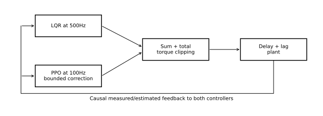
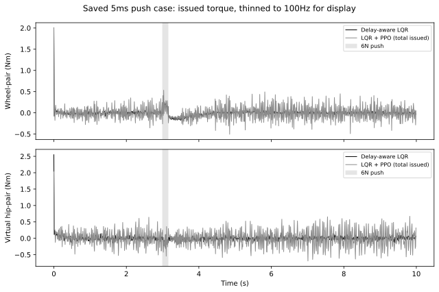

# Residual PPO — combine a controller with a learned correction

This pack uses [[Pack 1 - LQR]] and [[Pack 2 - RL to PPO]]. It explains the
composition, plots **saved simulation runs**, and defines a candidate experiment.
It does not train a model or claim a research gap.

## Reading map

- [[#1. Define the command precisely|Command definition]]
- [[#2. Why a small residual can cause drift|Drift and stability]]
- [[#3. Read a saved comparison honestly|Saved-run plot]]
- [[#4. Candidate study: unseen delay mismatch|Delay-mismatch study]]
- [[#5. Literature boundary and self-check|Literature and self-check]]

## 1. Define the command precisely

Let $u_b$ be the delay-aware LQR command using the causal controller state $z$.
Our existing v2 residual implementation is

$$
\begin{aligned}
u_b(z_k)&=-K_dz_k,\\
\Delta u_j&=c\odot\operatorname{clip}(a_j,-1,1),\\
u_k&=\operatorname{clip}(u_b(z_k)+\Delta u_j,-u_{\max},u_{\max}),
\end{aligned}
$$

where $c=0.2u_{\max}=[0.4,0.8]^T\,\mathrm{N\,m}$, $\odot$ denotes
elementwise multiplication, and the policy command indexed by $j$ is held for
five 500 Hz plant ticks. LQR feedback is recomputed at every tick. The outer
clip acts on the **sum**. Realized motor torque then depends on delay and lag.



*Deterministic signal diagram of the current schedule. No AI illustration.*

The baseline makes a useful initial policy available. Learning can focus on
corrections, but it may also damage a good controller. A20% residual cap limits
the correction, not the closed-loop state or the total input to 20%.

> [!example] Saturation changes the effective correction
> If wheel LQR asks for 1.9 Nm and RL adds 0.4 Nm, the 2 Nm total cap leaves only 0.1 Nm
> extra applied to the issued command. The policy proposed 0.4 Nm, but its effect
> on the saturated command was 0.1 Nm. Log proposed residual, baseline command,
> total requested/clipped command and realized torque separately in a future run.

## 2. Why a small residual can cause drift

For intuition, consider a linear sampled plant and constant correction $d$:

$$
x_{k+1}=(A-BK)x_k+Bd.
$$

If $A-BK$ is stable, the new equilibrium is

$$
x_\infty=(I-A+BK)^{-1}Bd.
$$

It need not be zero. A controller can remain upright while sitting off-target
or moving within an insufficiently penalized direction. This calculation is an
explanation of a possible mechanism, not a diagnosis of our trained network.
For an actual drifting trajectory, distinguish constant bias, noisy feedback,
periodic corrections, saturation and estimator error using logs.

With ideal unsaturated LQR value $V=x^TPx$, define $A_{cl}=A-BK$.
Adding a residual changes its one-step decrement by

$$
\Delta V=-x^T(Q+K^TRK)x
+2x^TA_{cl}^TPB\Delta u
+\Delta u^TB^TPB\Delta u.
$$

The extra terms can be positive. Near zero, the baseline decrease is small;
a bounded nonzero correction can increase value. This directly explains why
**bounded residual does not imply stability or hardware safety**. With delay,
the appropriate analysis needs the augmented model as well.

### Three learning-design hypotheses

1. **Zero mean-output initialization:** initialize the actor's final mean layer
   to zero. Deterministic inference starts with $\Delta u=0$, but stochastic
   training still has Gaussian exploration. It is not a guarantee of a pass count.
2. **Correction penalty:** discourage unnecessary additions, for example
   $r\leftarrow r-\beta\sum_i(\Delta u_i/c_i)^2$. Define whether this uses the
   proposed capped residual or its effective post-saturation contribution.
3. **Precision-aware cost:** make tolerance-sized state errors matter relative
   to the alive reward. Test separately before claiming which change helped.

These are hypotheses for a later version, not changes to the frozen v2 run.

## 3. Read a saved comparison honestly



The plot uses a preselected case: 5 ms delay, push scenario, noise seed 1000, and
residual training seed 0. It was chosen as the first noise seed in the highest
existing delay condition, not as a best-result seed. The baseline and residual
use matching initial conditions, noise samples and 6 N push for 0.15 s at 3 s.
Both records cover 10 s. LQR is the prior 500 Hz delay-aware baseline; the residual
includes a 100 Hz learned addition. That scheduling difference must be disclosed.

The plotted signals are **total clipped issued torques** from two separate
closed-loop trajectories. Their difference is not the learned $\Delta u$,
because $u_b(z)$ differs as the trajectories diverge. The saved compact residual
record does not directly log the additive channel; we do not invent it.
The plot shows every fifth tick for readability, without anti-alias filtering.
It can miss peaks/high-frequency behaviour. Metrics below come from the original
full-resolution records, not integration of the thinned plot.

| This single case | Strict settling | Survived | Wheel command effort | Hip command effort |
| --- | --- | --- | ---: | ---: |
| Delay-aware LQR | Pass | Yes | 0.032303 | 0.045308 |
| LQR + residual PPO seed 0 | Fail | Yes | 0.091412 | 0.206968 |

Effort units are $\mathrm{N^2m^2s}$, the integral of squared issued torque;
this is **not electrical energy**. Applied torque effort is a separate metric
because the actuator filters commands. The residual case fails the held final
settling window and recovery deadline. That does not establish the cause, nor
does one case estimate performance over all training seeds.

### Run the one small script

Use a separate environment with NumPy1.26.4 and Matplotlib3.10.3:

```sh
python plot_saved_torque.py --out assets/saved-torque.svg
```

It also regenerates `assets/residual-signal-path.svg`. Compare the console with
[expected-output.txt](expected-output.txt). It checks finite values, monotonic
time and torque caps; it reads only the included small CSV/JSON. No MuJoCo,
network, model checkpoint or GPU is used. Missing files, NaNs or failed checks
must be diagnosed rather than replacing data with synthetic lines.

The CSV is a thinned teaching extract; source commits, logical archive paths,
selection rule and copied full-resolution metrics are in [evidence.json](data/evidence.json).
This is an **assumed simulation**, not measured robot hardware data.

## 4. Candidate study: unseen delay mismatch

**Question:** does residual PPO improve recovery/effort over delay-aware LQR
when trained with 2–5 ms delay and tested with 6–10 ms delay, while preserving strict
settling? This is a proposed experiment, not an established contribution.

### Define what is mismatched

Transport delay means when a submitted command arrives. Motor time constant
means how quickly realized torque approaches the arrived command. They are
different mechanisms; vary transport delay first and freeze lag/noise/plant.
Training/test delays here are **not** the100Hz policy period.

The controller's delay knowledge is a required part of the question. A concrete
primary design for review is:

| Item | Proposed rule |
| --- | --- |
| Training delay | Uniformly choose2,3,4,5ms per episode; known matching controller delay/model in training |
| Held-out physical delay |6,7,8,9,10ms; never use these outcomes for reward tuning or seed selection |
| Controller's test delay hint | Freeze at5ms for both methods: actual delay is larger than their believed value |
| LQR comparator | Frozen existing5ms augmented K/estimator, without retuning for the hidden test delay |
| Residual comparator | Same baseline/estimator plus learned correction, same observations and total caps |
| Additional reference | Separately labelled oracle delay-aware controller if later authorized; never silently replace the primary baseline |

This tests stale delay knowledge. Giving exact6–10ms hints to the residual while
holding LQR's hint at5ms would be unfair. Re-synthesizing LQR at every true delay
would instead ask whether learning beats a model-aware oracle. Both questions
may be useful, but they require separate named comparisons.

### Integration work required before execution

Current v2 validates four known delays and has only three command-history pairs.
It is not a ready-made6–10ms benchmark. A separately reviewed v3 environment
must represent exact arrivals through10ms, define observation history and reset
behaviour, and distinguish hidden physical delay from the controller's hint.
For the primary stale-hint comparison, keep both controllers' belief-state
representation identical; acknowledge it is not a full true Markov state under
mismatch. Do not quietly give RL extra past commands or privileged torque truth.
If longer observation history is studied, declare it as another arm and grant
the same information to baselines. No owner-protected gain-scheduling solution
is part of this work.

### Stage the work without losing evidence

1. **Specification and baseline:** freeze scenarios, tolerance definitions,
   delay knowledge, gain selection, observation encoding, rates and endpoints.
   Check delay arrivals numerically and reproduce original in-range LQR cases.
2. **Reward arithmetic:** at each relevant tolerance, show a visible few-percent
   cost relative to the alive reward. Check units and total versus residual effort.
3. **Required pilot:** one 10–20 min CPU pilot, about 200k policy steps. Record actual
   duration/steps, return, episode length and individual reward magnitudes; plot
   return/episode length against steps. Proceed to a full run only if learning
   clearly improves, following current control rules. Otherwise diagnose first.
4. **Ablations on training/validation only:** zero mean-output initialization,
   residual penalty and precision scale one at a time, then their combination.
   Fix the final recipe and budget before opening held-out6–10ms results.
5. **Final evaluation:** use all declared training seeds (for example five),
   paired held-out noise/push cases, final checkpoints, frozen normalization and
   deterministic actions. Report missing/failed seeds and all cases.

### Measure what answers the question

- **Primary:** strict settling success at each held-out delay and across delays;
  do not replace it with survival. Use the same tolerances/deadlines across arms.
- **Secondary:** recovery time with failures retained (or explicitly censored),
  state RMSE, displacement/tilt maxima, commanded/applied squared-torque effort,
  saturation, physical failures and numerical failures.
- **Learning/compute:** return and episode-length curves, reward components,
  transitions, wall time, CPU/RAM and inference latency. Never compare a short
  failed episode's low effort directly with a successful full 10 s recovery.
- **Uncertainty:** aggregate across independent training seeds; do not treat
  repeated baseline episodes as new training replicates. Show per-delay/seed
  values and paired differences. If both always pass, compare recovery/effort
  without inventing a success-rate improvement.
- **Reproducibility:** goal/hypothesis, source commit, configuration, versions,
  hardware, commands, selection rules, lean raw metrics/required curves and paths.
  No mass hashing or large raw logging by default.

Keep evaluation probes/tuning separate from final held-out tests. A negative
result can show that delay-aware LQR remains the stronger method under this
recipe; it is not evidence that all RL fails or that the code never learned.

## 5. Literature boundary and self-check

The general residual idea already appears in [Johannink et al.,2018](https://arxiv.org/abs/1812.03201)
and [Silver et al.,2018](https://arxiv.org/abs/1812.06298). These original works
combine existing policies/controllers with learned additions, including settings
with imperfect modelling. They do not establish novelty for our delay benchmark.

A targeted literature check must still compare wheeled-biped balancing,
delay-aware LQR, residual policies, robust/delay-mismatch control and evaluation
protocols. An IEEE search also located a wheel-legged residual-policy paper
(document11202537), but its full text was inaccessible here; it is an unread lead,
not evidence for a technical claim. No research gap is asserted in this pack.

> [!question] Check your understanding
> If two total-torque traces differ by0.1Nm, is that the learned residual? If
> a policy is trained on2–5ms and tested on8ms but receives the exact8ms hint,
> are you testing the same mismatch as a controller believing5ms? Can a capped
> residual invalidate the baseline value-function decrease near equilibrium?

> [!success]- Answers
> No: the trajectories and baseline terms differ. No: exact delay knowledge is
> another information regime. Yes: the cross and quadratic residual terms can
> dominate the small nominal decrease.

**Next practical step:** review the experiment specification and the current
environment's delay assumptions before implementing a v3 pilot. This lesson
provides understanding and saved-data plots; no new training has been started.
