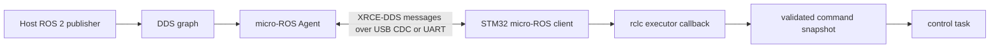

# 02 — micro-ROS on an STM32

## Learning goals

This lesson connects familiar STM32 tasks and buffers to ROS 2 graph concepts.
You will learn what the Agent does, how an XRCE-DDS session is formed, how an
executor dispatches subscription callbacks, and why QoS mismatch can look like
a dead topic.

The concrete firmware is `Microros_H723_USB`, with USB CDC ACM to a host-side
micro-ROS Agent (`docs/topics.md:3-12`). The local repository also contains an
F446 build configuration in `tools/microros_f446/colcon.meta:1-22`.

## 1. ROS 2 graph and the MCU boundary

In full ROS 2, nodes normally use DDS middleware to discover endpoints and
exchange serialized messages. The STM32 has much less memory and often cannot
run the full DDS stack.

micro-ROS places a small client on the MCU. The client creates ROS entities,
serializes message data, and carries it over a constrained transport. The
micro-ROS Agent runs on Linux and translates the client-side XRCE-DDS protocol
into the ROS 2/DDS environment used by ordinary host nodes.



The Agent is not a motor controller. It relays messages and manages the remote
representation of MCU entities. Application validation, freshness rules, and
actuator safety remain firmware responsibilities.

In the H723 topic contract, `/cmd_vel` is a subscriber and `/motor_fb` is a
publisher; the topic table also assigns reliability and expected rates
(`docs/topics.md:15-26`). The motor application separately documents how command
topics select actuator modes (`User/APP/motor_task.c:4-33`).

## 2. XRCE-DDS session lifecycle

DDS-XRCE (eXtremely Resource Constrained Environments DDS) is a client-agent
protocol designed for constrained devices. The MCU client opens a session with
the Agent, creates remote ROS entities, and exchanges data through that session.
A transport reconnect alone does not guarantee that the old remote session and
its entities are still valid.

The H723 ROS task pings the Agent before creating entities and calls
`rclc_executor_spin_some` while connected (`Core/Src/freertos.c:334-365`).
The code has a cleanup/recreate path when a session is lost, rather than
assuming a dead session will repair itself (`freertos.c:745-753`).

```text
transport bytes available
          ↓
XRCE client session ── create node / publishers / subscriptions
          ↓                         ↓
        Agent                 executor waits for data
                                    ↓
                             typed callback runs
```

A ping answers “is the Agent reachable?” It does not prove that every topic is
present, QoS-compatible, fresh, or safely acted upon. Those are separate checks.
The firmware's ping and time-synchronization calls are visible in
`freertos.c:334-341, 480-499`.

## 3. Transport: USB CDC and UART

USB CDC ACM presents a byte stream as a serial device such as `/dev/ttyACM0`.
The H723 topic document identifies USB CDC ACM as its Agent transport
(`docs/topics.md:7-12`). The stream framing layer lets the receiver recover
message boundaries even though USB transfers themselves are packetized.

UART is also a byte stream, commonly carried over a TTL-level serial link or a
USB-to-UART bridge. Baud rate, framing, flow control, grounding, and electrical
levels must match. The F446 example uses USART2 at 115200 baud, 8-N-1, an
interrupt-driven 512-byte ring buffer, and XRCE stream framing
(`tools/microros_f446/README.md:3-7`).

USB CDC and UART are transports, not different ROS message semantics.
Choosing a transport changes the driver, buffering, latency, and electrical
integration. It does not change the meaning of `/cmd_vel` or QoS compatibility.

```text
ROS message -> XRCE stream framing -> transport driver -> byte stream
           <-             same path in reverse              <-
```

A CDC receive callback or UART ISR should do bounded byte movement and flag
work for a task. Parsing a full topic message and running motor logic inside a
high-priority ISR risks long interrupt latency. **INFERRED:** this is the
appropriate design boundary for the H7 because its callbacks and control tasks
share a real-time MCU; confirm exact ISR behavior in the selected transport.

## 4. Nodes, publishers, subscriptions, and handles

A node groups ROS entities under a name. A publisher advertises a message
type/topic and sends samples. A subscription requests samples from a topic and
calls a user callback when data is taken.

A publisher or subscription is represented in C by an initialized handle.
Message objects backing callbacks need valid storage for the entity lifetime.
Strings and sequences in generated C messages may need explicit backing buffers;
a message struct alone does not allocate arbitrary dynamic capacity.

An `rclc_executor_t` is a dispatcher: initialize it with a capacity, add
subscription handles and callback/message-storage pairs, then repeatedly spin
it. The H723 executor is initialized with capacity four and four subscriptions
are added (`Core/Src/freertos.c:655-672`). Capacity counts executor handles,
not the publisher count.

```text
subscription handle ─┐
subscription handle ─┼─ executor spin → take message → callback(msg)
subscription handle ─┤
publisher handle   ─┘   (publisher is managed separately)
```

The callback should validate the message, then publish a compact snapshot or
request to the task that owns motor writes. In `motor_task.c`, the ROS callback
records the enable request; it does not enqueue CAN frames from executor
context (`User/APP/motor_task.c:147-155`). This prevents concurrent use of the
same non-reentrant CAN transmit handle.

## 5. QoS: Best Effort and Reliable

Quality of Service (QoS) describes delivery expectations. Reliability can be
Best Effort or Reliable.

Best Effort sends fresh samples without retransmission guarantees. It fits
high-rate state or perception streams where the next sample supersedes a lost
one. Reliable delivery uses acknowledgments and history/retry mechanisms, but
can add delay and retain old data while trying to deliver it.

ROS 2 endpoint compatibility is directional: a Reliable subscriber requires a
publisher that offers Reliable. A Best Effort publisher cannot satisfy that
request. A Best Effort subscriber can accept either Best Effort or Reliable.

```text
Publisher offers BEST_EFFORT ──X── Subscriber requests RELIABLE
Publisher offers BEST_EFFORT ───── Subscriber requests BEST_EFFORT
Publisher offers RELIABLE     ───── Subscriber requests BEST_EFFORT or RELIABLE
```

The topic contract configures `/cmd_vel` and `/motor_fb` as Best Effort, while
`/motor_status` is Reliable (`docs/topics.md:17-26`). The local F446 receiver
also creates `/terrain_advisory` as Best Effort according to its README
(`tools/microros_f446/README.md:42-49`).

**Reported integration bug:** the requested `safety_filter` Reliable subscriber
was incompatible with a Best Effort publisher. This concrete subscriber source
is not present in the named paths available in this checkout, so the mismatch
comes from the task brief; the publisher policy is independently documented in
`docs/interfaces/TERRAIN_ADVISORY_TOPIC.md:7-11`.

For a topic that appears silent, check name, message type, namespace, Agent
session, and offered/requested QoS before debugging the callback body.
QoS incompatibility usually prevents endpoint matching; it is not repaired by
increasing executor spin frequency.

## 6. Memory limits and static sizing

On an MCU, memory is a budget. Message buffers, entity pools, XRCE history,
transport buffers, stacks, and application state all compete for RAM.
Generated static-library options let the build remove unused features and set
maximum entity and history counts.

The H723 `colcon.meta` disables filesystem/thread support and dynamic allocation
in `rcutils`, enables custom stream transport, and sets entity/history maxima
(`micro_ros_stm32cubemx_utils/microros_static_library/library_generation/colcon.meta:21-49`).
The local F446 profile is more constrained: one node, one publisher,
one subscription, one service/client, history one, and custom transport
(`tools/microros_f446/colcon.meta:9-20`).

These are compile-time pool capacities, not observed runtime peak usage.
A change that adds an entity may require both increasing the middleware pool
limit and increasing executor handle capacity. The next step is to inspect
linker map, static RAM, stack watermarks, and allocation behavior on target.

The local F446 build documentation reports a 48 KiB heap and 8 KiB stack
reservation, but explicitly says actual peak use was not measured
(`tools/microros_f446/README.md:20-38`). Do not mistake reserved memory for
measured high-water use.

## 7. Stale data is an application rule

A living Agent session does not make the last command fresh. If the publisher
stops, the MCU may still hold the previous value in RAM.
The AGV firmware sets a 500 ms command watchdog and reports a timeout
(`User/Config/robot_config.h:64-69`; `docs/topics.md:50-52`).

A robust receiver timestamps each valid message with its own monotonic tick.
It should reject malformed messages without updating that timestamp, and use
wrap-safe unsigned elapsed-time subtraction.
For terrain advisory, the interface requires valid finite arrays, records MCU
receive time, and changes the effective state to UNCERTAIN after 300 ms
(`docs/interfaces/TERRAIN_ADVISORY_TOPIC.md:30-42`).

The Pi's `detection_age_s` is diagnostic and uses the Pi monotonic clock.
It must not be subtracted from an STM32 tick or ROS epoch timestamp
(`docs/interfaces/TERRAIN_ADVISORY_TOPIC.md:23-28`).
Compare age only within its clock domain unless a measured clock mapping exists.

## How this applies in our project

Keep the micro-ROS executor task separate from the hard real-time balance loop.
Treat callbacks as validated request publishers; let one task own each CAN
handle. Verify endpoint QoS, the active Agent session, and MCU-local freshness
before interpreting a missing or stale command. Size middleware pools and
executor handles together when adding entities.

<details>
<summary>Self-check questions and answers</summary>

1. **What does the Agent do?**
   It bridges the constrained XRCE-DDS client session to the host ROS 2/DDS graph.
2. **Can an Agent ping prove the `/cmd_vel` endpoints match?**
   No. Ping proves reachability, not topic discovery, QoS compatibility, or data freshness.
3. **Why can Reliable subscriber + Best Effort publisher yield no samples?**
   The requested reliability is stronger than the offered reliability, so the endpoints are incompatible.
4. **What must grow when adding an executor subscription?**
   The executor handle capacity and, when necessary, the middleware's compiled subscription pool.
5. **Which clock should determine a 300 ms STM32 stale transition?**
   The STM32's own monotonic tick, using wrap-safe elapsed-time arithmetic.

</details>
