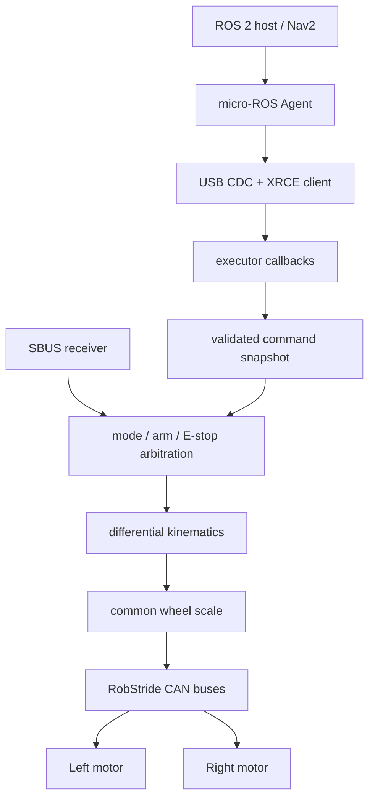

# 03 — Differential-drive AGV base firmware

## Learning goals

This lesson follows a host velocity command all the way to two wheel setpoints.
It covers differential-drive inverse kinematics, proportional wheel scaling,
watchdog behavior, and the RC layer that can override ROS commands.

The source here is the lab's STM32H723 micro-ROS firmware. It is distinct from
the H7 five-bar jumping WBR described in lesson 04.

## 1. Software layers

The base firmware separates communication, command arbitration, actuator
commands, and sensor reporting. Its RTOS task set includes a micro-ROS task,
a motor task, INS and observation work, plus display and support tasks
(`Core/Src/freertos.c:273-282, 297-310`; these are task definitions, not timing measurements).



The ROS executor owns subscriptions and snapshots incoming values.
The motor task owns the periodic motor-side actuation path and samples shared
command state under a critical section (`User/APP/motor_task.c:120-155, 463-475`).
This gives a clean rule: callbacks request changes; the motor task applies them.

`/cmd_vel` accepts forward speed `linear.x` in m/s and yaw rate `angular.z`
in rad/s. The topic contract identifies this as Velocity mode, `run_mode=2`
(`docs/topics.md:30-43, 54-65`). The RobStride drive closes its wheel-speed PI
loop, so this firmware streams speed references rather than high-rate torque
feedback (`User/APP/motor_task.c:7-15, 210-214`).

## 2. Differential-drive inverse kinematics

Let $v$ be the robot's forward speed, $\omega$ its yaw rate, $R$ the effective
wheel radius, and $W$ the distance between wheel contact centers.
For a no-slip differential-drive model, left/right tangential speeds are
$v_L=v-\omega W/2$ and $v_R=v+\omega W/2$.
Dividing by radius gives wheel angular speeds:

$$\omega_L=\frac{v-\omega W/2}{R},\qquad
\omega_R=\frac{v+\omega W/2}{R}$$

The implementation computes exactly this pair and then multiplies each side
by its motor installation sign (`User/Algorithm/Kinematics/kinematics.c:8-23`).
The interface profile gives $R=0.060\text{ m}$ and $W=0.345\text{ m}$
(`docs/topics.md:60-63`).

### Worked example: forward plus turn

Choose $v=0.30\text{ m/s}$ and $\omega=0.80\text{ rad/s}$.
The half-track yaw contribution at each wheel is

$$\omega W/2 = 0.80\cdot0.345/2=0.138\text{ m/s}.$$

Then

$$\omega_L=(0.300-0.138)/0.060=2.70\text{ rad/s},$$

$$\omega_R=(0.300+0.138)/0.060=7.30\text{ rad/s}.$$

The right wheel runs faster, so the robot curves left under the chosen positive
yaw convention. Wheel speed is shaft radians per second after sign correction.

The forward speed and yaw rate can be recovered from measured wheel rates:

$$v=\frac{R}{2}(\omega_R+\omega_L),\qquad
\omega=\frac{R}{W}(\omega_R-\omega_L).$$

Check units: $R\omega_i$ is m/s; $R/W$ is dimensionless, leaving rad/s for yaw.

## 3. Saturation that preserves curvature

Each motor command is limited to ±20 rad/s. If either computed wheel exceeds
that range, the motor task scales both by one common positive factor
(`User/APP/motor_task.c:543-563`).

$$s=\min\left(1,\frac{20}{\max(|\omega_L|,|\omega_R|)}\right),
\quad \omega'_L=s\omega_L,\quad \omega'_R=s\omega_R.$$

The ratio between wheel speeds stays unchanged. Since
$\omega/v=(\omega_R-\omega_L)/(W(\omega_R+\omega_L)/2)$, this common scaling
preserves the commanded curvature while reducing linear speed.
Independent clipping changes the ratio and therefore changes the path.

### Worked example: fast turn

Take $v=1.0\text{ m/s}$ and $\omega=4.0\text{ rad/s}$.
Then $\omega W/2=0.690\text{ m/s}$, giving
$\omega_L=5.167\text{ rad/s}$ and $\omega_R=28.167\text{ rad/s}$.

The common factor is $s=20/28.167\approx0.710$.
The applied values become approximately $3.67$ and $20.00\text{ rad/s}$.
The normalized wheel ratio is preserved; the robot follows the same ideal arc
more slowly.

If instead only the right wheel were clipped to 20, the ratio would be
$5.167/20$ rather than $5.167/28.167$. The resulting curvature is smaller and
would not match the requested yaw-to-forward-speed ratio.

The profile gives 20 rad/s as approximately 1.2491 m/s at the wheel
(`docs/topics.md:60-65`). This conversion is $20R$ for the 0.060 m wheel.

## 4. Periodic motor task and timing

The motor task uses a 2 ms period, nominally 500 Hz, and calls `osDelayUntil`
to hold cadence (`User/APP/motor_task.c:93-104, 420-434`).
If it overruns, the code re-anchors its next wake rather than executing a burst
of catch-up cycles (`motor_task.c:426-434`).

The task checks for CAN bus-off recovery, handles RC arm changes, snapshots
command state, checks staleness, applies RC arbitration, and then sends wheel
setpoints (`motor_task.c:436-475, 479-529, 533-566`).
This is an ordering in the source, not a guarantee that every iteration meets
its deadline under all interrupt and bus loads.

A motor task rate of 500 Hz does not imply the motor's internal speed loop runs
at 500 Hz. The code comments describe the MCU task as a setpoint streamer while
the actuator closes its own loop (`motor_task.c:97-104`).

## 5. Command watchdog

The active command timestamp is refreshed by `/cmd_vel` or MIT callbacks
(`User/APP/motor_task.c:120-145`). The motor task compares its local tick with
the saved timestamp; if the command is older than 500 ms, it declares timeout
(`motor_task.c:479-489`; `User/Config/robot_config.h:63-69`).

When disabled or stale outside manual RC operation, it sends a mode-appropriate
stop (`motor_task.c:526-530`). Velocity mode commands zero speed; MIT mode uses
velocity damping (`motor_task.c:222-240`). Stale-command response therefore
depends on active actuator mode; the watchdog is not equivalent to physical
power isolation.

The timeout uses unsigned tick subtraction, which naturally handles ordinary
32-bit timer wrap for elapsed intervals shorter than half the counter range.
The chosen 500 ms is an application policy, not a CAN-layer feature.

## 6. RC control and emergency stop

SBUS gives the operator manual velocity commands, arm/disarm, mode selection,
and a latched E-stop. The control mode logic maps a missing RC link or receiver
failsafe to emergency stop; the code explicitly avoids falling back to AUTO
(`User/Bsp/bsp_sbus.c:162-204`).

The RC feed is considered offline if no frame arrives for over 300 ms
(`bsp_sbus.c:162-170`). Switch F latches the E-stop. The latch clears only after
a deliberate E off-to-on cycle while F is released (`bsp_sbus.c:216-260`).

```text
No link / failsafe ───────────────→ E-stop
F pressed ────────────────────────→ latched E-stop
E switch disarmed ────────────────→ outputs disabled
A selects MANUAL ─────────────────→ sticks provide (v, yaw)
A selects AUTO and armed ─────────→ ROS command path
```

Switch A requires a clear high value for AUTO; other positions select MANUAL
(`bsp_sbus.c:202-204`). The motor task checks emergency-stop state first,
then manual RC override, and separately enforces that switch E is armed
(`motor_task.c:492-518`).

Manual sticks are bounded to 1.0 m/s and 2.5 rad/s in the motor task
(`motor_task.c:502-508`). The SBUS command function zeros outputs when the
receiver is offline and maps centered/deadband-corrected channels into those
limits (`bsp_sbus.c:268-294`).

The H723 topic docs also describe `/motor_enable`; it is a request path, not a
replacement for the local RC safety logic (`docs/topics.md:44-52, 117-122`).

## 7. Debugging from the bottom up

Start with board power, transceiver supply, CAN_H/CAN_L wiring, and termination.
Then establish that the MCU and actuator agree on nominal bitrate and frame
format. Only then inspect extended identifier fields and application values.

For command flow, verify the ROS topic name and type, Agent session, endpoint
QoS, and executor callback. Next verify the callback updates the command tick,
then check motor-task mode, timeout, enable state, and RC arbitration.

For motion, check the pre-saturation wheel values, computed common scale, motor
signs, feedback freshness, and the wheel's actual no-load direction. Avoid
starting with gain or control tuning when a sign, stale command, or bus issue
could explain the symptom.

## How this applies in our project

Use the equations and logs to separate host command, wheel kinematics,
actuator speed reference, and measured feedback. Preserve the common scale when
limiting wheel rates. Treat RC no-link and E-stop as local authority that can
veto the ROS command. The AGV motor task and the WBR balance controller serve
different plants and must not be merged conceptually.

<details>
<summary>Self-check questions and answers</summary>

1. **For $v=0.30$ m/s, $\omega=0.80$ rad/s, what are the wheel speeds?**
   Approximately 2.70 rad/s left and 7.30 rad/s right.
2. **Why scale both wheel speeds together?**
   It preserves their ratio and the ideal path curvature while slowing down.
3. **What happens if ROS stops publishing for longer than 500 ms?**
   The motor task marks the active command stale and sends its mode-specific stop.
4. **Does an RC link loss select AUTO?**
   No. It maps to emergency stop.
5. **How is the latched E-stop reset?**
   Release F, then deliberately switch E off and back on.

</details>
