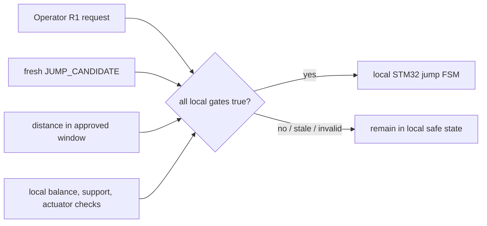

# 05 — WBR jump sequence and a perception gate

## Learning goals

This lesson turns the legacy jump code into a phase diagram. It identifies the
PS2 trigger, the two-side transition condition, and a safe conceptual boundary
for a future terrain advisory input.

The code discussed is the previous team's STM32H723 WBR firmware. The terrain
advisory interface in this repository remains advisory and has no authority to
command motion (`docs/interfaces/TERRAIN_ADVISORY_TOPIC.md:30-42`).

## 1. The jump as a hybrid sequence

A jump is a hybrid control problem: continuous feedback operates inside
several discrete phases. The phase changes when geometry measurements and
per-side progress conditions become true.

```mermaid
stateDiagram-v2
  [*] --> Stand
  Stand --> Crouch: operator trigger / jump_flag
  Crouch --> Thrust: both sides qualify
  Thrust --> Retract: both sides qualify
  Retract --> Landed: both sides qualify
  Landed --> Stand: both status values are 3; clear flag/reset
```



This diagram is a source-level summary. The exact contact and phase behavior
must be checked against the original hardware and full task scheduling.

## 2. Trigger: PS2 R1

The PS2 key enumeration comments key value 12 as R1, and `jump_key` tests that
value (`User/APP/ps2_task.c:39-42, 303-309`). The trigger is level-held: each
valid PS2 processing pass increments a counter while R1 remains pressed.
When the counter exceeds 10 and no jump is active, it sets `jump_flag` and
captures the current leg setpoint (`ps2_task.c:308-316`). Releasing the key
resets the counter (`ps2_task.c:319-322`).

The PS2 task polls nominally every 10 ms according to the integration analysis,
so more than ten polls is approximately 100 ms (`docs/proposals/DM_JUMP_INTEGRATION_ANALYSIS.md:13-18`).
This is an approximate hold duration, not a timestamp-based debounce.

The trigger is only a request. It does not itself check terrain, obstacle
height, distance, contact state, or that both sides are healthy.

## 3. Four phases and source targets

### Phase 0 — crouch

Both sides command a virtual leg length target of 0.08 m through their leg PID.
The right code increments its phase counter while $L_0<0.10$ m; the left uses
the same threshold (`chassisR_task.c:276-290`; `chassisL_task.c:205-213`).

### Phase 1 — thrust

Both sides command 0.21 m. The phase counter increments when measured length
exceeds 0.18 m (`chassisR_task.c:292-306`; `chassisL_task.c:214-222`).
This is a position-threshold transition, not a fixed-duration thrust pulse.

### Phase 2 — retract / prepare to land

Both sides command the shared `chassis->leg_right_set` target. Their counters
advance when $L_0 < leg\_right\_set+0.01$ m
(`chassisR_task.c:308-322`; `chassisL_task.c:223-230`).

**Source observation:** the left retract code also uses `leg_right_set`, while
its normal standing target uses `leg_left_set` (`chassisL_task.c:223-240`).
Whether that is intentional left/right synchronization or a copy error is
**UNKNOWN** from this source alone; do not silently “correct” it in a lesson or
port without owner review.

### Phase 3 — landed / settle

When both statuses reach 3, the right-side loop clears the shared jump flag and
resets both side counters and statuses (`chassisR_task.c:329-337`). The source
calls the phase transition “landed,” but the checks shown are leg-length
criteria, not an independent contact sensor assertion.

Each phase adds a gravity compensation term of the form
$Mg/\cos(\theta)$ to the leg PID output (`chassisR_task.c:279, 295, 311`; left
counterpart `chassisL_task.c:208, 217, 226`). The axial virtual force is later
clamped and mapped into joint torques through VMC (lesson 04).

## 4. Synchronization between sides

Both chassis tasks run side-specific control functions. The right loop updates
both status values when each side's progress counter is at least 10
(`chassisR_task.c:284-290, 300-306, 316-322`).
The left loop increments its own counter when its threshold is satisfied
(`chassisL_task.c:209-211, 218-220, 227-229`).

```text
Right condition satisfied? ──┐
                              ├─ both counters >= 10 → advance both statuses
Left condition satisfied? ───┘
```

This is a shared-memory barrier implemented through fields in
`chassis_move`. It is not a hardware-timestamp synchronization barrier.
**INFERRED:** if each loop is delayed differently, the transition waits for the
slower side, but the code does not by itself prove atomic or race-free field
updates. The previous integration review calls out shared `chassis_move`
fields as a concurrency risk (`docs/proposals/DM_JUMP_INTEGRATION_ANALYSIS.md:47`).

The control tasks compute three actuator torques and then send three frames
with separate delays (`chassisR_task.c:71-95`; left side
`chassisL_task.c:48-75`). Thus status synchronization does not mean both
physical legs receive their next torque at exactly the same instant.

## 5. Perception advisory gate concept

The repository interface describes an advisory with code, distance, confidence,
plane validity, sequence, and Pi-side detection age (`docs/interfaces/TERRAIN_ADVISORY_TOPIC.md:13-28`).
The receiver must accept exactly eight finite values and use its own tick for
freshness (`TERRAIN_ADVISORY_TOPIC.md:30-37`).

If a future owner-approved jump gate is added, its logical form is

$$\text{jump request} = \text{operator request}\;\land\;
\text{fresh advisory is JUMP\_CANDIDATE}\;\land\;
d_{min}<d<d_{max}.$$

The interface explicitly leaves the distance window to the owner
(`TERRAIN_ADVISORY_TOPIC.md:38-42`). A concrete distance interval, required
confidence, valid-plane requirement, and local balance/contact guards are not
defined here. Those parameters must not be invented in firmware documentation.



The Pi should never directly command leg forces or set the jump phase.
The STM32 retains balance, state transitions, and actuator authority
(`TERRAIN_ADVISORY_TOPIC.md:38-42`).

## 6. Risks that the source makes visible

A perception candidate can be stale, geometrically wrong, or outside the
hardware's actual jump envelope. A stale message must become UNCERTAIN rather
than leaving the last candidate latched (`TERRAIN_ADVISORY_TOPIC.md:30-37`).

A two-side threshold barrier can wait forever if one leg cannot reach its
threshold. The cited jump code has no timeout or explicit phase abort in the
shown transition blocks (`chassisR_task.c:276-322`; `chassisL_task.c:205-230`).
**INFERRED:** an owner-reviewed recovery or timeout path should be evaluated.

Ground contact, balance margin, actuator temperature/current, and motor fault
state matter during landing. The trigger source alone does not demonstrate all
of these interlocks. Torque saturation and linkage singularities can alter
realized thrust (see `chassisR_task.c:244-249` and
`User/Algorithm/VMC/VMC_calc.c:165-175`).

The legacy R1 trigger remains a working operator path. Integrating perception
should not silently bypass, replace, or reinterpret it. Any new gate changes
behavior and requires explicit firmware-owner review and motors-off validation.

## How this applies in our project

Treat the legacy phase targets and counter thresholds as source facts, not as a
validated jump envelope. Keep perception output advisory. If the project later
adds a gate, combine a deliberate operator request, a locally fresh candidate,
an owner-defined distance window, and local mechanical/controller guards.
Test the receiver and stale transition with motors off before changing any
jump-state code.

<details>
<summary>Self-check questions and answers</summary>

1. **What leg lengths are used for crouch and thrust?**
   0.08 m for crouch and 0.21 m for thrust; transition thresholds are 0.10 m and 0.18 m.
2. **How does the code synchronize sides?**
   Each side increments its own counter; the right loop advances both statuses when both counters reach 10.
3. **What exactly triggers a jump in the legacy path?**
   PS2 key value 12 (R1) held for more than ten processing counts while no jump is active.
4. **Who should own the jump FSM if perception is added?**
   The STM32; perception may only contribute a fresh advisory to a local gate.
5. **Is `leg_right_set` in the left retract phase proven to be correct?**
   No. The source shows it, but intent is unknown and requires owner review.

</details>
