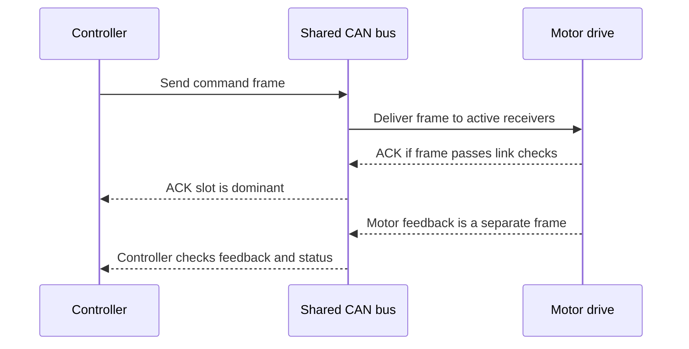
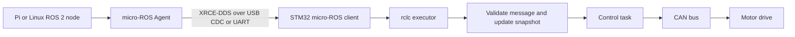
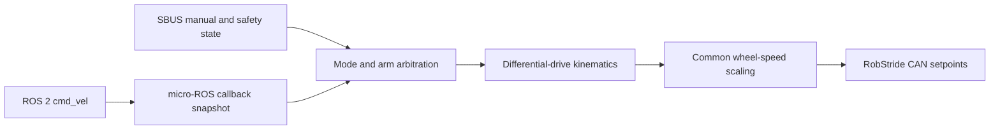
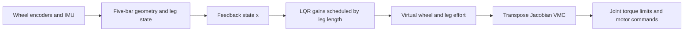
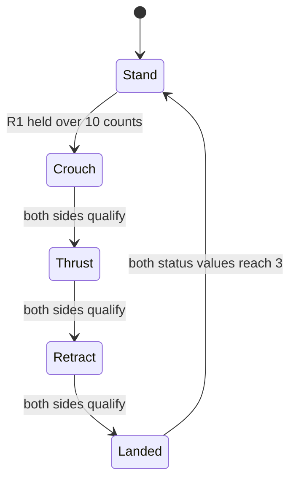
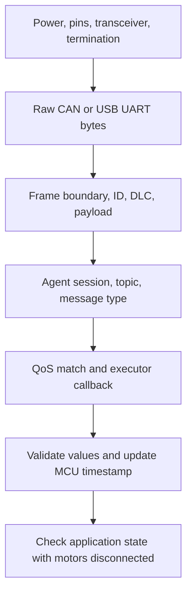

# Beginner Lessons: CAN, micro-ROS, and WBR Firmware

These six lessons explain selected firmware concepts for a fourth-year electronics student familiar with STM32, C, and UART. They use source-level facts from the full lessons and cited repository code; they do not claim that old firmware is running on the current robot or that nominal timings are measured guarantees.

## Table of contents

1. [CAN and RobStride motors](#1-can-and-robstride-motors)
2. [micro-ROS on an STM32](#2-micro-ros-on-an-stm32)
3. [Differential-drive AGV firmware](#3-differential-drive-agv-firmware)
4. [WBR balance: LQR and VMC](#4-wbr-balance-lqr-and-vmc)
5. [WBR jump sequence](#5-wbr-jump-sequence)
6. [Bench tests](#6-bench-tests)

## Short glossary

| Term | Meaning |
|---|---|
| CAN (Controller Area Network) | A shared two-wire network for short control and feedback messages. |
| Frame | One complete CAN message, including identifier, data, and error-checking fields. |
| Identifier (ID) | A number that labels a frame for arbitration and protocol interpretation; it is not automatically a destination address. |
| ACK (acknowledgement) | A CAN link-layer indication that at least one active receiver accepted a frame's format and checksum. |
| RobStride | The motor protocol used in the cited AGV firmware to send motor commands and read feedback over CAN. |
| ROS 2 | A software framework in which robot programs exchange typed messages. |
| micro-ROS Agent | A Linux program that connects a microcontroller's small ROS client to the host ROS 2 system. |
| Topic | A named stream of typed messages, such as `/cmd_vel`. |
| Callback / executor | A callback is a function run for a received message; an executor dispatches those callbacks. |
| QoS (Quality of Service) | Rules for message delivery, including whether delivery is Best Effort or Reliable. |
| AGV (Automated Guided Vehicle) | The differential-drive mobile base described in the AGV lesson. |
| WBR (wheeled-biped robot) | The separate two-wheel robot with variable-length legs described in the WBR lessons. |
| LQR (Linear Quadratic Regulator) | A feedback method designed from a linear model and a quadratic penalty on state and control effort. |
| VMC (Virtual Model Control) | A method that maps desired virtual leg forces into physical joint torques. |
| State machine | A program structure with named phases and rules for changing between them. |
| Stale data | A value that remains stored after its source has stopped providing valid updates. |
| Advisory | Information that a controller may consider but that does not itself command an actuator. |

> **Note:** The AGV and WBR code are separate systems. A fact about the AGV's USB connection, watchdog, or motor task does not establish the same behavior for the WBR.

## 1. CAN and RobStride motors

### Why it matters

CAN carries motor commands and feedback between controllers and motor drives. Knowing the frame format and the RobStride field scaling helps separate a wiring or timing fault from a decoding mistake. A passive monitor can observe the bus without acknowledging frames or sending commands.

### How it works

CAN uses a differential pair, CAN_H and CAN_L. When nodes start transmitting together, the dominant bit wins over the recessive bit; a losing node stops without corrupting the winning message. A classic CAN frame carries up to eight data bytes. Its ACK says that some active receiver accepted the frame at link level; it does not confirm that a motor executed a command.

The cited RobStride command uses an extended 29-bit identifier. Its identifier is divided into communication type, data/source information, and target motor ID. The payload packs position, velocity, proportional gain, and derivative gain as 16-bit codes; feed-forward torque is carried in the identifier's 16-bit data field.

| Identifier bits | Width | RobStride meaning |
|---|---:|---|
| 28–24 | 5 bits | Communication type |
| 23–8 | 16 bits | Data field or source information, depending on message type |
| 7–0 | 8 bits | Target motor ID |

The extended MIT command uses all eight payload bytes for four packed 16-bit values. This table shows the logical grouping; byte order is defined by the driver implementation.

| Payload bytes | Packed command value |
|---|---|
| 0–1 | Position |
| 2–3 | Velocity |
| 4–5 | Proportional gain $K_p$ |
| 6–7 | Derivative gain $K_d$ |

For a 16-bit unsigned code $c$ over a physical range $[x_{min},x_{max}]$, decoding is

$$
x=x_{min}+\frac{c}{65535}(x_{max}-x_{min}).
$$

The monitor's cited 42 MHz bxCAN configuration uses a divider of 3 and 14 time quanta per bit, so its calculated nominal bitrate is 1 Mbit/s. Its silent mode receives frames but does not provide ACK or error flags. High-speed CAN normally has 120 Ω termination at each physical end; with power removed, those two parallel resistors measure about 60 Ω across CAN_H and CAN_L. (See `docs/lessons/01_can_and_robstride.md` and `tools/can_monitor/firmware/can_rx.c`.)

### Worked example

The driver maps $K_p$ from 0 to 5000 into a 16-bit code. For $K_p=1000$, the code is $1000/5000\times65535\approx13107$, or `0x3333`. The drive reconstructs a quantized value near 1000; the wire carries the integer code, not the decimal value. (Source values: `docs/lessons/01_can_and_robstride.md`; implementation details are cited there as `robstride_drv.c:12-26,84-108`.)

### Self-check

Three questions and answers

1. How many data bytes can a classic CAN frame carry?
2. What does a CAN ACK prove, and what does it not prove?
3. What 16-bit code represents $K_p=1000$ over the source range 0–5000?

**Answers:** 1. Up to 8 bytes. 2. At least one active receiver accepted the frame's link-level format and checksum; it does not prove the intended motor acted. 3. Approximately 13107 (`0x3333`).

## 2. micro-ROS on an STM32

### Why it matters

ROS 2 commonly runs on a Linux computer, while a small STM32 has tighter memory and processing limits. micro-ROS lets the STM32 exchange ROS messages through a host-side Agent, while keeping command validation and actuator safety in firmware.

### How it works

The STM32 micro-ROS client sends XRCE-DDS session traffic over a byte transport such as USB CDC or UART. The Agent connects that client session to the ROS 2 graph. A subscription receives a topic; the executor calls the associated callback. A good boundary is for the callback to validate the message and update a small command snapshot, while a separate motor task owns motor writes.

USB CDC and UART transport bytes; they do not change the meaning of a ROS topic. UART settings still need to match at both ends. An Agent ping shows that the Agent is reachable, not that the topic name, message type, QoS, or data freshness is correct.

QoS reliability can be Best Effort or Reliable. A Reliable subscriber requires a publisher offering Reliable; a Best Effort publisher cannot satisfy that requirement. A Best Effort subscriber can receive from either kind of publisher. In the cited AGV configuration, `/cmd_vel` uses Best Effort, and its command watchdog is 500 ms. For stale-data decisions the MCU should use its own receive tick, not compare a Pi monotonic timestamp with an STM32 timer. (See `docs/lessons/02_micro_ros_on_stm32.md`, `docs/topics.md`, and `docs/interfaces/TERRAIN_ADVISORY_TOPIC.md`.)

### Worked example

Suppose the AGV last received `/cmd_vel` at local tick time $t_0$. At $t_0+500$ ms without a newer command, the source-defined watchdog marks the command timed out. The ping may still succeed because the Agent is reachable; the motor task must separately apply the mode-appropriate stop. The 500 ms threshold comes from `docs/lessons/03_agv_base_firmware.md` and its cited AGV configuration; it is not a universal micro-ROS timeout.

### Self-check

Three questions and answers

1. Does the Agent itself calculate motor torque or speed commands?
2. Can an Agent ping prove that a topic's QoS endpoints match?
3. Can a Best Effort publisher satisfy a Reliable subscription?

**Answers:** 1. No; application firmware owns that behavior. 2. No; ping proves reachability only. 3. No; the offered reliability is weaker than the requested reliability.

## 3. Differential-drive AGV firmware

### Why it matters

The AGV converts a forward-speed and turn-rate request into left and right wheel-speed references. Understanding that conversion helps identify sign, geometry, saturation, and stale-command problems before changing control gains. Local RC and emergency-stop logic can also override host commands.

### How it works

For wheel radius $R$ and wheel separation $W$, the no-slip differential-drive model gives

$$
\omega_L=\frac{v-\Omega W/2}{R},\qquad
\omega_R=\frac{v+\Omega W/2}{R},
$$

where $v$ is forward speed, $\Omega$ is yaw rate, and $\omega_L,\omega_R$ are wheel angular speeds. The AGV source uses $R=0.060$ m and $W=0.345$ m. If a wheel command exceeds the cited ±20 rad/s limit, the motor task scales both wheel speeds by one common factor, preserving their ratio and ideal turning curvature.

The motor task is configured for a 2 ms period (nominally 500 Hz); this is a source setting, not evidence of a measured worst-case deadline. The AGV command watchdog threshold is 500 ms. SBUS loss or receiver failsafe maps to emergency stop rather than automatic mode. (See `docs/lessons/03_agv_base_firmware.md` and its cited `kinematics.c`, `motor_task.c`, and `bsp_sbus.c`.)

### Worked example

Use the source geometry with $v=0.30$ m/s and $\Omega=0.80$ rad/s. The yaw contribution is $0.80\times0.345/2=0.138$ m/s, so $\omega_L=(0.300-0.138)/0.060=2.70$ rad/s and $\omega_R=(0.300+0.138)/0.060=7.30$ rad/s. These values are within the source's ±20 rad/s wheel limit.

### Self-check

Three questions and answers

1. What happens when both wheel speeds are equal under this model?
2. Why does the firmware scale both wheel speeds together when one is too high?
3. What does the AGV do when its command is older than 500 ms?

**Answers:** 1. It travels straight in the ideal model. 2. It preserves their ratio and the ideal path curvature. 3. It declares a timeout and sends a stop appropriate to the active mode.

## 4. WBR balance: LQR and VMC

### Why it matters

A wheeled-biped robot must keep its body balanced while its wheel support point and leg geometry change. LQR combines measured state errors into virtual wheel and leg efforts; VMC maps leg effort through the five-bar linkage into motor joint torques. The cited code is a legacy source reference, not proof that its gains are safe for the current hardware.

### How it works

LQR starts from a linearized model $x_{k+1}=Ax_k+Bu_k$ and chooses feedback to minimize a quadratic cost:

$$
J=\sum_{k=0}^{\infty}(x_k^TQx_k+u_k^TRu_k).
$$

Here $x$ is the state vector, $u$ is the control input, and $Q$ and $R$ weight state error and control effort. A common feedback form is $u=-Kx$. The legacy source sums six feedback signals for wheel torque and another six for virtual tangential leg effort; state order and side-specific signs must be preserved when reading or porting it.

Because the five-bar linkage geometry changes with leg length $L_0$, the source evaluates each of 12 gains as a cubic function $K_i(L_0)=a_{i3}L_0^3+a_{i2}L_0^2+a_{i1}L_0+a_{i0}$. VMC uses the Jacobian $J=\partial y/\partial q$ between joint coordinates $q$ and virtual leg coordinates $y$. Power consistency gives $\tau_q=J^TF_y$, mapping virtual forces to joint torques.

The source clips wheel torque to ±2, axial leg force to ±100, and joint torque to ±7 (units as used by that code). Its timing analysis gives three sequential 1 ms motor-frame delays, or a nominal 3 ms interval before computation and scheduling overhead; this is not a measured jitter bound. (See `docs/lessons/04_wbr_balance_lqr_vmc.md` and `sim/parity/vendor/dm_jump/User/Algorithm/VMC/VMC_calc.c`.)

### Worked example

The source's three 1 ms sequential send delays add to $1+1+1=3$ ms, corresponding to a nominal $1/0.003\approx333$ control passes per second before overhead. The 1 kHz IMU task comment does not make the chassis balance loop a measured 1 kHz loop. (Timing facts: `docs/lessons/04_wbr_balance_lqr_vmc.md`; source references include `chassisR_task.c:71-95`.)

### Self-check

Three questions and answers

1. In the LQR cost, what do $Q$ and $R$ weight?
2. What physical quantities does $\tau_q=J^TF_y$ map between?
3. Does a 1 kHz IMU task setting establish a 1 kHz balance loop?

**Answers:** 1. State error and control effort. 2. Virtual leg effort and actuator joint torque. 3. No; the chassis loop has its own task and sequential CAN delays, and its actual timing needs measurement.

## 5. WBR jump sequence

### Why it matters

The jump code changes targets in distinct phases, so the same controller is not always operating in ordinary standing mode. Reading the phase conditions explains what the firmware actually checks and which parts remain unknown. A camera advisory must not take actuator authority away from the STM32.

### How it works

The legacy trigger is PS2 R1 held for more than 10 processing counts while no jump is active; the source analysis describes a nominal 10 ms poll, or approximately 100 ms. The state machine then uses four phases: crouch, thrust, retract, and landed/settle. Crouch targets 0.08 m and advances when measured length is below 0.10 m; thrust targets 0.21 m and advances above 0.18 m. Each side counts progress, and the right-side loop advances the shared phase after both counters reach 10.

The source calls the final phase “landed,” but the cited conditions are leg-length and phase-status checks, not an independent contact sensor. The left retract code uses `leg_right_set`; whether that is intentional or a source error is unknown. A proposed terrain gate is only a concept: operator request AND fresh `JUMP_CANDIDATE` AND an owner-defined distance window. The interface defines no distance window, and the Pi advisory does not command motion. (See `docs/lessons/05_wbr_jump_sequence.md` and `docs/interfaces/TERRAIN_ADVISORY_TOPIC.md`.)

### Worked example

At the crouch target of 0.08 m, the phase condition is reached only when the measured leg length is below 0.10 m. The gap between target and threshold is $0.10-0.08=0.02$ m. This is a source-level position criterion, not a fixed-duration phase or an assertion that ground contact has occurred.

### Self-check

Three questions and answers

1. What target lengths are used for crouch and thrust?
2. How many progress counts must both sides reach before the shared phase advances?
3. Does the “landed” label prove that a contact sensor detected landing?

**Answers:** 1. 0.08 m and 0.21 m. 2. 10 counts on both sides. 3. No; the cited transition uses phase/status and leg-length conditions.

## 6. Bench tests

### Why it matters

Testing one layer at a time helps locate whether a failure is in wiring, frame capture, message transport, QoS, or application validation. The cited scenarios are proposed procedures, not results claimed to have been run. Keep motors disconnected for receiver and parser checks so those checks do not become actuation tests.

### How it works

Start with board power, transceiver state, wiring, and termination. Then verify raw bytes and frame ID/DLC before decoding fields. For micro-ROS, verify Agent session, topic name and type, endpoint QoS, callback, validation, and freshness in that order. A Best Effort diagnostic subscriber matches the cited Best Effort advisory publisher; a Reliable subscriber does not. The F446 advisory receiver accepts exactly eight finite values and reports `UNCERTAIN` after 300 ms without a valid message, using its MCU tick.

For a CAN monitor test, use an isolated fixture and known frames first. On a live robot bus, the cited monitor is listen-only and must not be treated as an ACK partner. For the H7 advisory test, the AGV's USB setup does not prove that the WBR H7 has the same transport configured. Keep expected results separate from observed results in test notes. (See `docs/lessons/06_test_scenarios.md`, `tools/can_monitor/firmware/can_rx.c`, and `tools/microros_f446/README.md`.)

### Worked example

The F446 receiver's freshness rule uses 300 ms. If it receives a valid eight-number message and then receives no further valid message for more than 300 ms, its effective advisory state becomes `UNCERTAIN`. A malformed array does not refresh the receive time. This is the receiver specification, not a report that the bench test passed. (Source: `docs/interfaces/TERRAIN_ADVISORY_TOPIC.md`.)

### Self-check

Three questions and answers

1. What should be checked before interpreting a captured CAN payload?
2. Does a Reliable subscriber match the cited Best Effort advisory publisher?
3. What happens to F446 advisory freshness after 300 ms without a valid message?

**Answers:** 1. Confirm physical capture, frame format/ID, and data length. 2. No. 3. The effective state becomes `UNCERTAIN`; malformed input must not refresh the MCU receive time.

