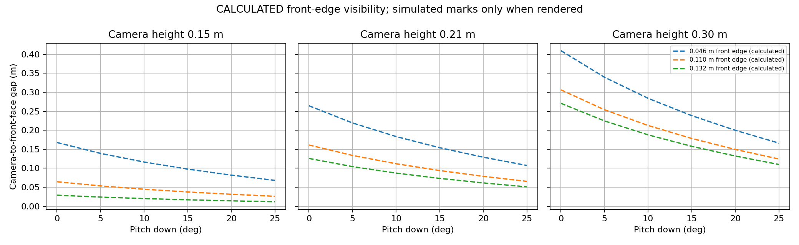
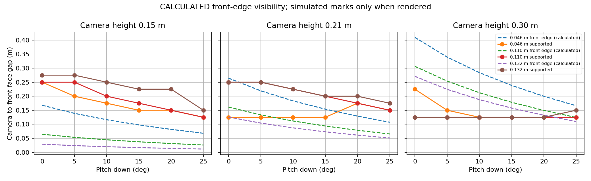

# D435 mount study

Status: analytic results **CALCULATED**; mounts and scene **ASSUMED**;
rendered detection limits and floor validity **PENDING_RENDER**. No hardware
measurements, renderer attempts, commits, pushes or PRs were made by this worker.

## Scope and current answer

The requested 18 mounts × three boxes are implemented. The full
[54-row table](../../tools/mount_study/results/TABLE.md),
[CSV](../../tools/mount_study/results/metrics.csv), and
[JSON](../../tools/mount_study/results/summary.json) contain calculated front-edge
visibility limits and explicit pending simulation fields. The conductor must run
`--render` outside the sandbox to obtain measured blind distances, far distances
and floor validity. No calculated distance is a detection guarantee.

**INFERRED recommendation:** use a front-centred, unobstructed optical centre near
0.21 m above the floor and evaluate 10–15° down as the initial mounting bracket
range. This is a provisional comparison candidate, not a selected hardware mount.
At 0.21 m, 10° down moves the nearest visible floor point inside the detector's
0.30 m exclusion boundary; 15° adds pitch margin. A lower mount reduces geometric
blind distance, but the existing floor estimator may reject its initial height.
A 0.30 m mount needs a riser and sees the smallest box's front edge leave sooner.
Select a final mount only after the rendered table and real depth checks exist.

More downward pitch reduces the geometric blind zone. The general trade-off is
less distant scene coverage and possible shorter measured detection range.
However, all requested pitches retain an upper ray above the horizon: **this
model does not predict a finite far top-edge limit for any of these 18 mounts**.
Nor does more pitch necessarily mean less floor: it adds nearby floor coverage,
while box occlusion can remove floor evidence at close range. Floor pixels,
correct floor fitting and distant usable depth must be distinguished. A blanket
claim that increasing pitch always reduces visible floor or maximum detection
range would be unsupported here.

## Analytic model and worked check

[geometry.py](../../tools/mount_study/geometry.py) uses a vertical pinhole slice,
level floor and robot, no occlusion, no depth minimum, and camera height greater
than box height. Pitch down is positive. Distances are horizontal camera-to-front
face gaps, not Euclidean range, body clearance, or the decision filter's distance.
The intrinsics are `FY = 386.953`, 480 rows from
[ground_plane/synth.py](../../tools/ground_plane/synth.py):

$$
\phi = 2\arctan\left(\frac{480}{2F_y}\right) = 63.616892^\circ,
\qquad \alpha = p + \phi/2.
$$

For the bottom ray, vertical drop equals horizontal distance times its slope:

$$
H = d_{\mathrm{floor}}\tan\alpha,
\qquad H-h = d_{\mathrm{top}}\tan\alpha.
$$

Thus the closest visible floor point and front top edge are:

$$
d_{\mathrm{floor}} = \frac{H}{\tan\alpha},
\qquad d_{\mathrm{top}} = \frac{H-h}{\tan\alpha}.
$$

If the upper ray has downward angle $\beta=p-\phi/2>0$, the front top edge also
has a far limit $(H-h)/\tan\beta$. Otherwise that geometric limit is unbounded
(JSON `top_far_m=null`). Detector `max_forward=3.0` m and rendering clip distance
6 m still bound usable evidence; this study begins at only 2 m.

Worked example: $H=0.21$ m, $h=0.132$ m and $p=3^\circ$ give
$\alpha=34.808446^\circ$, $d_{\mathrm{floor}}\approx0.302$ m and
$d_{\mathrm{top}}\approx0.112$ m. The reported disappearance around 0.32 m
therefore cannot be explained solely by the front top edge leaving the image.
The detector's 0.30 m minimum forward coordinate, floor fitting, top-surface
classification, and temporal policy are candidate causes; the sweep does not
change these parameters. A box has 0.20 m depth: its rear top edge can remain
visible until a front gap of $\max(0,d_{\mathrm{top}}-0.20)$ even after its front
edge leaves. A measured cluster can therefore lie behind the nominal front face.





The second plot has no simulated marks until rendering is completed. Differences
from the analytic curves are expected: a visible edge does not imply enough
points for a cluster, a valid floor fit, or a correct advisory.

## Geometry and mount mapping

The source body's half-size is `(0.15, 0.10, 0.06)` m; its dimensions are
ASSUMED/INFERRED, not measured CAD. Wheel radius is 0.0603 m and the hip is 0.03 m
below the body top. For neutral standing, body centre height is
`0.0603 + l0 + 0.03 - 0.06`. We retain the existing front optical offset
`x=0.15`, `y=0` and set the camera's body-local z explicitly in our XML wrapper.
The camera is attached to the existing animated body; no source module is edited.

| Camera H (m) | l0 (m) | Body-local camera z (m) | Offset from body top (m) |
| --- | --- | --- | --- |
| 0.150 | 0.0600 | 0.0597 | -0.0003 |
| 0.210 | 0.1197 | 0.0600 | 0.0000 |
| 0.300 | 0.2000 | 0.0697 | 0.0097 |

We choose l0 nearest a top-mounted lens within the team's 0.06–0.20 m range.
The low case is effectively flush with the top; the high case uses a 9.7 mm
riser. The optical centre and camera enclosure have no physical volume here;
clearance for the real D435 housing, cables and nose must be measured. This
varies standing leg extension as well as height, not only bracket location.
No crouch, body pitch, vibration, collision dynamics or self-shadowing envelope
beyond the existing visual robot geometry is modelled.

## Render method and metrics

[sweep.py](../../tools/mount_study/sweep.py) wraps `simcam.scenario.build_xml`
and changes only its camera attributes. It reuses `pose_at`, `place_robot`,
`update_camera`, depth conversion and `PerceptionLoop` from `simcam.run`.
MuJoCo is imported only inside `render_timeline`; unit tests need no renderer.
The untracked scenario library is left untouched.

Each case has one centred box: 0.40 m wide, 0.20 m deep and 0.046, 0.110 or
0.132 m high. The first two should yield `JUMP_CANDIDATE`; the last should yield
`STOP_CANDIDATE` under the unchanged assumed decision thresholds. The robot
approaches from a 2.0 m optical-centre gap at 0.25 m/s for 7.9 s, leaving a
0.025 m final gap. At 10 Hz the spatial sampling is 0.025 m. The visual body's
0.020 m nose extension is included in the precontact check; ticks at or beyond
that conservative model contact are excluded from aggregation. The scene is
kinematic and advisory-only: nothing commands motors or simulates stopping.

Depth is ideal rendered optical depth using the existing off-centre intrinsics
and near/far clipping, without stereo noise, missing returns or hardware min-depth
mask. Each case starts fresh detector and decision state. Partial timelines are
flushed tick by tick; exceptions propagate. Rerunning overwrites that output
folder, so preserve a failed run in a separate folder before a retry.

The CSV and JSON distinguish these quantities:

- `advisory_*`: first/last correct raw advisory ticks and far/closest true gaps.
  These can include held output, stale exponential moving average or plane failure.
- `detection_*`: fresh, geometrically supported obstacle observation, regardless
  of advisory confirmation. Height must match the box within 0.015 m; cluster
  distance must lie between front gap minus 0.02 m and rear gap plus 0.02 m.
- `supported_*`: correct raw advisory AND fresh correct observation AND a correct
  fresh floor plane. These define the table's supported far and blind distances.
  `supported_runs` reveals interruptions hidden by first/last endpoints; inspect
  the retained timelines before claiming continuous detection.
- `plane_valid_fraction`: fraction of precontact ticks that the detector labels
  valid. `plane_truth_fraction` additionally requires no reuse, fitted camera
  height within 0.02 m and pitch/roll within 2° of simulation truth. Those
  tolerances are ASSUMED diagnostics. Reused-plane ticks are counted separately.
  A detector-valid box-top plane is not accepted as floor truth.
- First/last ticks are seconds on the 10 Hz grid; far/blind gaps are true geometry,
  not smoothed estimated range. Timeline files also retain cluster measurements,
  plane errors and raw/gated advisory output for diagnosis.

These are observed sampled limits, not exact transition locations. A loss
between adjacent ticks has at least 0.025 m quantization uncertainty; temporal
confirmation/hysteresis adds delay. Blank metrics after a completed render mean
no qualifying evidence, never zero blind distance. `start_censored` and
`end_censored` mark support at the first or last sampled tick. Even if the first
supported advisory comes later due to confirmation, **all far limits remain
bounded by the 2 m start**: this run cannot establish absolute maximum detection
range or validate the detector's full 3 m setting.

The detector excludes heights at/below 0.020 m and forward coordinates below
0.30 m or above 3 m. A rear top surface can still be detected after the front face
passes the 0.30 m boundary. The initial plane prior is 0.30 m with a ±0.12 m gate;
the 0.15 m case is outside that initial true-height gate, so expect possible
initialization failure. Parameters remain unchanged to measure that limitation.

## Hardware unknowns and handoff

**UNKNOWN:** the suggested D435 minimum depth of approximately 0.28 m at
848×480 has not been verified against an available Intel datasheet offline.
No verified citation is available in this worktree. The simulated image is
640×480 with the repository's FY; it is not a validated 848×480 D435 mode.
Do not impose the suggested value as a verified simulation limit or conclude
that the analytic sub-0.28 m visibility represents usable real depth.

Measure actual optical-centre height and forward offset over the leg-extension
range, mount pitch and body pitch envelope, housing/cable clearance, calibrated
intrinsics for the chosen depth stream, and depth validity versus range for all
three real box heights/materials. Record floor inlier support, fitted plane errors,
frame timing, missing depth, minimum useful depth and advisory loss during an
approach. Establish stopping distance separately; this report grants no jump or
motor authority.

From the worktree root, conductor commands (the second requires working CGL):

```sh
MPLBACKEND=Agg MPLCONFIGDIR=/private/tmp/wbr-mpl-cache ~/Desktop/Research/wbr-lab-ops/.venv/bin/python -m unittest discover -s tools/mount_study/tests -v
MPLBACKEND=Agg MPLCONFIGDIR=/private/tmp/wbr-mpl-cache ~/Desktop/Research/wbr-lab-ops/.venv/bin/python -m tools.mount_study.sweep --render
python3 tools/lint_markdown.py docs/mount_study/REPORT.md docs/mount_study/WORKLOG.md tools/mount_study/results/TABLE.md
```

After rendering, the generated table and plots update automatically; this static
report's pending status should be revised only after the conductor inspects the
results and timelines. Capture actual renderer errors rather than qualifying CGL
in advance. No simulation measurements have been invented for this handoff.

## Conductor run and reading (2026-10-30)

`MPLBACKEND=Agg ... python -m tools.mount_study.sweep --render` ran outside the sandbox: 54/54 cases, MEASURED_IN_SIMULATION. Results are in `tools/mount_study/results/`.

How to read the numbers:

- **Simulated blind distance: 0.125–0.275 m.** It shrinks with more pitch-down and a higher camera (`blind_vs_pitch.png`).
- **Some blind distances are optimistic.** At H = 0.30 m the simulated values (0.125 m) are closer than the CALCULATED top-edge visibility (0.11–0.41 m). The decision logic holds the last advisory for a few frames after the box leaves view (`hysteresis_frames` in `decide.py`), so those values measure the hold, not the sensor.
- **Far distance is capped by the scenario,** which starts 2.0 m from the face. 1.9 m is the first supported tick, not a range limit, so far range is not measured.
- **All simulated blind distances are below the D435's roughly 0.28 m minimum depth** (UNKNOWN until checked against the datasheet or on the robot). On hardware, that minimum, not the mount angle, probably sets the blind zone (INFERRED).
- **Implication (INFERRED):** the JUMP/STOP decision has to be final before the obstacle is about 0.3 m away. At 0.25 m/s that is at least 1.2 s before contact. The controller should plan from the last confident advisory and not expect updates inside 0.3 m.
