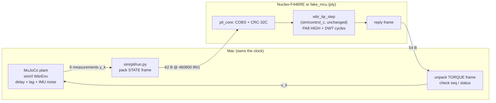

# Processor-in-the-loop (PIL) bench design: rungs 3 and 4

**Status (2026-10-30):** host side MEASURED with a fake MCU (microcontroller) on
the Mac. Nucleo firmware is BUILT, never flashed or run. Every Nucleo timing
below is CALCULATED or INFERRED until the bench measures it.

Ladder context: rung 3 = how long the controller takes on the chip; rung 4 =
the chip computes the torque inside the simulated closed loop. The
Nucleo-F446RE stands in for the robot's STM32H7, so its timings are a reference
point, not the robot's numbers.

## 1. Frame format

Reuses the existing link codec, unchanged: `COBS(header ‖ payload ‖ CRC-32C) ‖ 00`
from [tools/link_proto](../../tools/link_proto/SPEC.md). COBS (Consistent Overhead
Byte Stuffing) removes every `00` byte from the frame so that `00` can mark its end;
CRC-32C (Castagnoli cyclic redundancy check) detects corruption. The C side calls
`lp_crc32c` / `lp_cobs_encode` / `lp_cobs_decode`; Python imports
`tools/link_proto/py/link_proto.py`. The header is smaller than the link
protocol's 16-byte header: PIL needs no session or clock mapping. Type codes
0x10/0x11 cannot be confused with link_proto types 1–5.

All fields are little endian. Floats are IEEE-754 binary64 (`double`), because
the controller is a binary64 port and the PIL check compares it with Python
at 1e-9 level; a float32 wire would add quantization the reference does not have.

**STATE, host → MCU (60 B decoded, 62 B on the wire)**

| Offset | Type | Field |
|---:|---|---|
| 0 | u8 | version = 1 |
| 1 | u8 | type = 0x10 |
| 2 | u32 | seq, +1 per tick |
| 6 | u8 | flags: bit 0 RESET (init controller with `delay_ms`); other bits must be 0 |
| 7 | u8 | delay_ms, 2–5; must equal the profile set at the last reset |
| 8 | 6 × f64 | x, leg pitch, body pitch, ẋ, leg rate, body rate (m, rad, m/s, rad/s) |
| 56 | u32 | CRC-32C of bytes 0–55 |

**TORQUE, MCU → host (52 B decoded, 54 B on the wire)**

| Offset | Type | Field |
|---:|---|---|
| 0 | u8 | version = 1 |
| 1 | u8 | type = 0x11 |
| 2 | u32 | seq, echoed |
| 6 | u8 | status: 0 OK, 1 LQR_INVALID, 2 NOT_READY, 3 BAD_DELAY |
| 7 | u8 | reserved 0 |
| 8 | 2 × f64 | requested torque (wheel pair, hip pair), N·m |
| 24 | 2 × f64 | clipped torque, ±[2, 4] N·m |
| 40 | u32 | exec_ticks: counter ticks spent in `wbr_lqr_step` only |
| 44 | u32 | tick_hz: 84 000 000 (DWT cycle counter) on the Nucleo, 10⁹ (ns) on the fake |
| 48 | u32 | CRC-32C of bytes 0–47 |

Rules. A malformed frame (bad COBS, length, CRC, version, type or flag bits)
gets **no reply** and increments an error counter, so the host times out and
the episode fails explicitly. No retransmission exists: a resent STATE would
advance the controller's internal history twice. The MCU keeps its own torque
estimate and command history (`wbr_lqr` state); the host sends only the six
measurements, as the robot's sensors would.

## 2. Loop rate: what 460800 baud allows (CALCULATED)

UART 8N1 = 10 bits per byte, so one byte takes 10 / 460800 = 21.70 µs.
(The F446 divisor gives 461 538 baud, +0.16 %, negligible here.)

| Item | Bytes | Time |
|---|---:|---:|
| STATE frame | 62 | 1.346 ms |
| TORQUE frame | 54 | 1.172 ms |
| Both, back to back | 116 | **2.517 ms** |
| Control period at 500 Hz | — | 2.000 ms |

Consequences:

- **Real-time lockstep at 500 Hz is impossible with binary64 frames at 460800
  baud**: serialization alone (2.517 ms) exceeds the 2 ms period, before
  controller time and before USB latency. The ST-Link virtual COM port
  (VCP) moves bytes over USB full speed, which polls in 1 ms frames, so it
  adds up to about 1 ms per direction (INFERRED, to be MEASURED).
  Best case without USB: 1 / (2.517 ms + t_exec) ≈ 390 Hz.
- **Pipelined full duplex fits the bandwidth**: each direction uses 67 % / 59 %
  of its wire time. The torque for state k then arrives at least
  2.517 ms + t_exec after the state left, i.e. ≥ 2 extra ticks of delay.
- A compact float32 variant (STATE 38 B, TORQUE with clipped torque only 26 B)
  would need 0.825 + 0.564 = 1.389 ms, leaving 0.61 ms for USB and compute:
  marginal over the ST-Link VCP, comfortable on a direct Pi→H7 UART. Doubling to
  921600 baud halves every number above. Neither is implemented; lockstep
  does not need them.

## 3. Who owns the clock

**Lockstep (implemented, used for rung 4).** The simulation owns time. Each
tick: send STATE k, block until TORQUE k, step MuJoCo 2 ms, repeat. Wall-clock
time does not exist for the plant, so the link speed changes only how long a run
takes. Results are deterministic and comparable episode-by-episode with the
Python reference (same noise seeds, same initial state).

**Real time (not implemented, deferred).** The MCU timer owns a 500 Hz tick;
the host must deliver state before each tick or the MCU reuses the last state
and counts a miss. This needs a plant that runs at least as fast as real time.
MEASURED on this Mac: the Python MuJoCo environment plus trace recording costs
about 7 ms of wall time per 2 ms tick (1963 s for 320 × 5000 ticks with six
episodes in parallel on a shared machine), so the current host stack cannot
keep up. Real time belongs to a later
hardware-in-the-loop rung with a C plant or the real robot.

## 4. How link latency enters the result

The plant already contains the robot's assumed transport delay (2, 3, 4 or
5 ms) and a 5 ms motor lag. The delay-aware LQR knows that delay: its state
includes the last 1–3 commands and a reconstructed motor torque.

- **Lockstep:** PIL link latency does **not** enter the physics. A lockstep
  PIL result can only differ from Python through arithmetic or state handling.
- **Extra latency** appears when the real link is slower than the delay the
  controller assumes. The extra ticks then shift every command later than the
  controller's own model of its history. `--link-delay-ticks N` reproduces this
  deterministically in lockstep: each command is applied N ticks (N × 2 ms)
  late, applied identically to both controllers. Section 5 lists the measured
  effect.

$$
d_\text{true} = d_\text{assumed} + N\,\Delta t,\qquad \Delta t = 2\ \text{ms}
$$

The controller keeps using gains and a torque estimate designed for
$d_\text{assumed}$, so the mismatch $N\Delta t$ is unmodelled delay. It
reduces phase margin, and the reconstructed torque leads the real torque by
$N\Delta t$.

## 5. Comparison against the pure-Python LQR

Panel = the frozen 160-case LQR evaluation in [sim/rl/protocol.json](../../sim/rl/protocol.json):
4 delays × {balance, push 6 N for 0.15 s at 3 s} × 20 held-out noise seeds,
10 s each, same success rule (`sim/rl/metrics.compute_metrics`). The
`python` controller computes $u=-Kz$ with NumPy, as the original evaluator
does (gains parsed from `sim/control_c/gains.inc`; a unit test checks them
byte-for-byte against the recorded `K_used` hashes). The `pil` controller
sends $y_k$ over the link and applies the returned command. In each PIL tick the
runner also computes the Python command from the same observation.

**MEASURED, fake MCU on the Mac (2026-10-30, 320 episodes, 6 parallel jobs, 1963 s):**

| Delay | Python balance / push success | PIL balance / push success | Mean recovery, balance (s) | Mean recovery after push (s) |
|---|---:|---:|---:|---:|
| 2 ms | 20/20, 20/20 | 20/20, 20/20 | 1.7608 | 2.7432 |
| 3 ms | 20/20, 20/20 | 20/20, 20/20 | 1.7683 | 2.7488 |
| 4 ms | 20/20, 20/20 | 20/20, 20/20 | 1.7756 | 2.7547 |
| 5 ms | 20/20, 20/20 | 20/20, 20/20 | 1.7828 | 2.7583 |

- Python **160/160**, PIL **160/160**, 0 outcome mismatches in 160 pairs.
  The recovery means equal the archived table in
  [sim/rl/RESULTS_2026-10-20.md](../../sim/rl/RESULTS_2026-10-20.md) to all
  four printed decimals, so this runner reproduces the original evaluator.
- Largest PIL-vs-Python difference over all 800 000 ticks: torque
  2.0e-11 N·m, true state 2.4e-12, recovery time 0 s. That residue is
  NumPy's summation order vs the C loop, plus the C library keeping its own
  torque estimate; it does not grow over 10 s.
- Pty round trip (host Python + fake MCU): median of per-episode medians
  0.46 ms, worst per-episode p99 18 ms, worst single tick 117 ms on a loaded
  Mac. Lockstep makes these spikes harmless; in real time each would be a
  missed deadline.
- Fake MCU `wbr_lqr_step` on the Mac's i9: median 0.56 µs, worst 0.76 ms
  (OS preemption). This says nothing about the F446.

**MEASURED, unmodelled latency (`--link-delay-ticks N`, PIL on the fake MCU,
push scenario, noise seeds 1000–1009):**

| Extra delay | 2 ms profile: success, mean recovery, peak tilt | 5 ms profile: success, mean recovery, peak tilt |
|---|---|---|
| N = 0 (0 ms) | 10/10, 2.7448 s, 8.01° | 10/10, 2.7604 s, 8.04° |
| N = 1 (2 ms) | 10/10, 2.7472 s, 8.03° | 10/10, 2.7616 s, 8.07° |
| N = 2 (4 ms) | 10/10, 2.7490 s, 8.05° | 10/10, 2.7636 s, 8.11° |
| N = 3 (6 ms) | 10/10, 2.7516 s, 8.09° | 10/10, 2.7660 s, 8.16° |

Up to 6 ms of extra delay the push is still recovered in every case, about
7 ms slower and about 0.1° higher peak tilt. This does not show the delay
margin: N > 3 was not run, and the margin belongs to this ASSUMED plant only.
The trend has the expected sign: more unmodelled delay, more overshoot.

**Fault isolation: what evidence points where**

| Observation | Points to | Why |
|---|---|---|
| Timeout, CRC/COBS errors, seq mismatch (`LinkError`) | Link | CRC-32C makes silent bit corruption very unlikely; damage shows up as a missing reply instead of a wrong number |
| Torque differs from Python at the first tick after reset by > 1e-9 N·m | Chip arithmetic: float ABI, compiler flags, libm `expm1` | Input bits are verified by CRC, so different output bits come from computation |
| First ticks match, difference grows later | Controller state handling: missed reset, double step, history | Arithmetic is per-tick; growth needs stored state |
| Fake MCU matches but Nucleo does not | Target toolchain or library (newlib vs macOS libm) | Same C source and same frames |
| Torques match, outcomes differ | Runner bug or chaotic sensitivity, not the chip | Plant is identical given identical commands |
| PA8 pulse > budget, outcomes still match | Chip speed (rung 3), harmless in lockstep | Lockstep hides compute time |
| Outcomes degrade only with `--link-delay-ticks` | Latency budget, not the chip | Only the timing of commands changed |

## 6. Rung 3: execution time on the chip

PA8 (Arduino D7) is driven HIGH just before `wbr_lqr_step` and LOW just after;
the DWT (Data Watchpoint and Trace unit) cycle counter is read inside the same
window and returned as `exec_ticks`. The two measurements should agree within
a few cycles plus the GPIO write.

INFERRED expectation for the F446 (to be MEASURED): the Cortex-M4 FPU is
single precision, so every binary64 operation runs in a libgcc routine
(`__aeabi_dmul`, `__aeabi_dadd`, … are present in the ELF). The 5 ms profile
does 2 × 14 multiply-adds plus four `expm1` calls; with tens of cycles per
soft-double operation and a few thousand per `expm1`, expect roughly
10⁴ cycles, i.e. about 0.1–0.3 ms at 84 MHz, i.e. 5–15 % of the 2 ms period.
The H7 has a double-precision FPU and runs at a higher clock, so it should be
much faster; the F446 number is an upper reference, not the robot's.
Note: `expm1(-duration/0.005)` has a constant argument for each profile and
could be precomputed. That is an optimization for later; the validated
controller source is unchanged here.

What would contradict the expectation: a pulse width > 1 ms (check that
SYSCLK is really 84 MHz, flash wait states and caches), or DWT ticks and pulse
width disagreeing by more than ~1 µs (check the timer clock).

## 7. Files

| Path | Role |
|---|---|
| `sim/pil/c/pil_core.{h,c}` | Frame → LQR → reply, transport independent |
| `sim/pil/c/fake_mcu.c` | Same core behind a pseudo-terminal on the Mac |
| `sim/pil/firmware/` | F446RE build: USART2 (ST-Link VCP) 460800, PA8 marker, DWT |
| `sim/pil/frame.py`, `link.py` | Host framing, serial link, fake MCU launcher |
| `sim/pil/run.py` | Lockstep panel runner and Python comparison |
| `sim/pil/tests/` | 16 quick tests (frames, fake MCU fixture replay, runner); the QEMU firmware replay skips without `qemu-system-arm` |

Known limits: lockstep only; no retransmission or duplicate detection; one MCU
per run; the host sim is ASSUMED physics (see `sim/README.md`); PIL cannot
validate balance on the real robot (see [LESSON.md](LESSON.md)).
