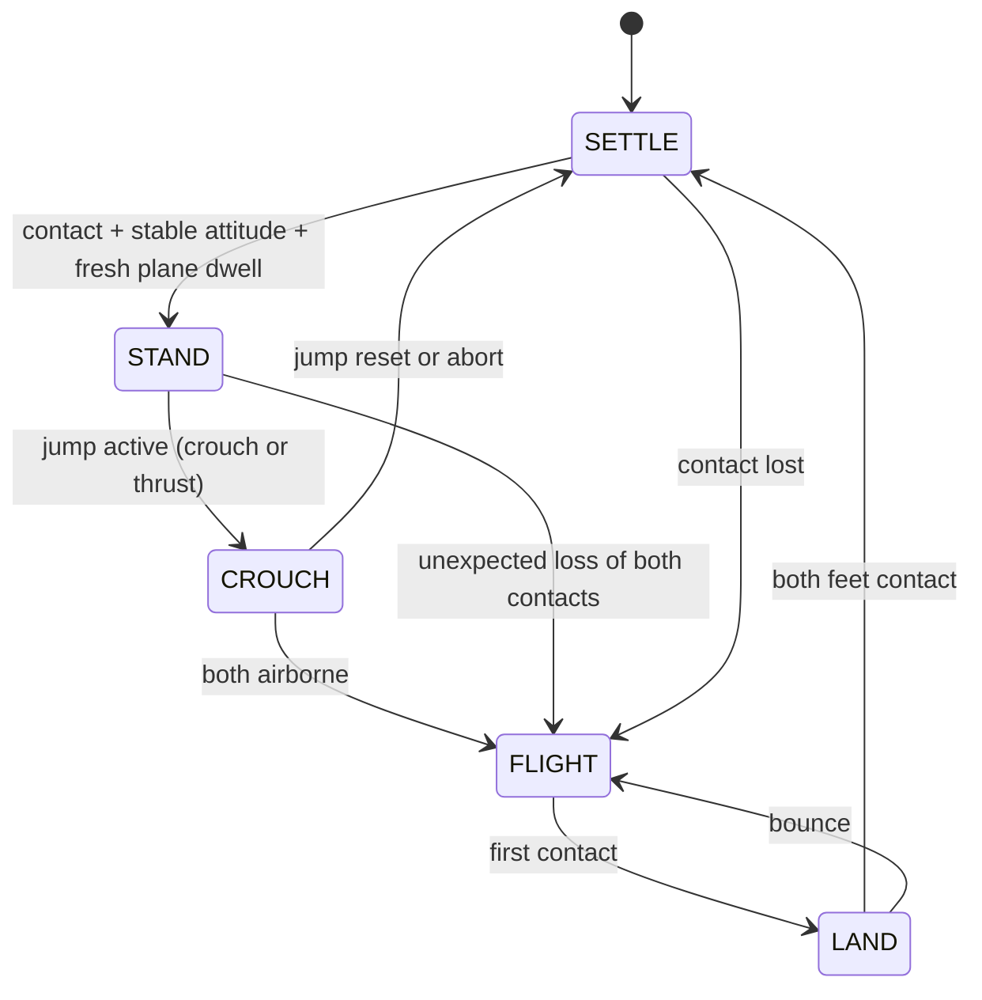

# Camera tilt and jump-phase advisory research

2026-10-30. Research only; no detector, firmware or robot changes.
Local validation: five stdlib unit tests passed; Markdown lint returned 0 issues;
vendored firmware SHA-256 values matched the pinned provenance. No twin run claimed.
Labels: **SOURCE-SUPPORTED** = inspected implementation or recorded observation;
**INFERRED** = derived mechanism/proposed policy; **ASSUMED** = unvalidated parameter/model.
All proposed behavior and acceptance limits below are INFERRED/ASSUMED, not measured robot capability.

## Answer and scope

**INFERRED recommendation:** retain depth-plane compensation; add timestamped robot
inertial measurement unit (IMU) attitude as a prediction/check, not a second rotation
of already corrected coordinates. Gate advisory usefulness during a jump independently
of plane validity. A MuJoCo twin can test geometry, visibility and gate timing before
November; it cannot establish D435 accuracy, actual contact timing or safe jump height.

**SOURCE-SUPPORTED:** floor tilt is already estimated, including roll. See
[`plane.py:38–43,46–113`](../../tools/ground_plane/plane.py) and
[`detect.py:78–91`](../../tools/obstacle_decision/detect.py): height is signed
distance to the plane; forward is optical Z projected onto that plane.
The `process_frame` docstring at lines 97–98 still says optical Z; the executed
`ground_coords` implementation takes precedence. No IMU or phase input exists in
[`core.py:81–95`](../../ros2/wbr_obstacle_node/wbr_obstacle_node/core.py).

## 1. Residual tilt error, not body tilt alone

**ASSUMED model:** flat floor, point on an obstacle at true forward distance $R$,
height $h$, camera height $H$. Depth and $H$ are exact; only the compensation
orientation has residual pitch error $\delta$. Rotate about the camera, positive
toward up in this derivation (not the source camera-down pitch convention).
Let $u=h-H$. Adding the correct $H$ after rotation gives:

$$
\hat h=H+R\sin\delta+u\cos\delta,\qquad
\hat R=R\cos\delta-u\sin\delta.
$$

$$
\Delta h=R\sin\delta+u(\cos\delta-1)\simeq R\delta,\qquad
\Delta R=R(\cos\delta-1)-u\sin\delta\simeq(H-h)\delta.
$$

**INFERRED:** this applies to an uncompensated level assumption, stale plane, IMU
extrinsic error or attitude latency. A fresh correct plane cancels body pitch/roll.
An independent offset error adds directly to height; IMU attitude alone cannot
recover changing camera height during crouch/flight. A fitted wrong tabletop plane
can report plausible angles yet remove the obstacle itself.

**ASSUMED table:** $H=0.30$ m, $h=0.12$ m. Each cell is the maximum absolute
error over positive/negative stated pitch; the two column maxima need not occur
for the same sign. Forward means horizontal coordinate from the camera's floor
projection, not slant range, robot-front clearance or optical depth.
Actual stdout of `python3 tools/scene_twin/tilt_error.py`:

| Pitch error (deg) | Forward (m) | Height error (mm) | Forward error (mm) |
|---|---|---|---|
| 1 | 0.5 | 8.75 | 3.22 |
| 1 | 1.0 | 17.48 | 3.29 |
| 1 | 1.3 | 22.72 | 3.34 |
| 3 | 0.5 | 26.41 | 10.11 |
| 3 | 1.0 | 52.58 | 10.79 |
| 3 | 1.3 | 68.28 | 11.20 |
| 5 | 0.5 | 44.26 | 17.59 |
| 5 | 1.0 | 87.84 | 19.49 |
| 5 | 1.3 | 113.99 | 20.63 |
| 10 | 0.5 | 89.56 | 38.85 |
| 10 | 1.0 | 176.38 | 46.45 |
| 10 | 1.3 | 228.48 | 51.01 |

**INFERRED worked example:** at 1 m, +1° gives +17.48 mm height error and
+2.99 mm forward error (worst sign gives 3.29 mm forward). Height error is 14.6%
of 120 mm, sufficient to cross the boundary for a near-limit object. This is
not 14.6% depth error. Euclidean camera-to-point range is invariant to rotation.
At $h=0$ the leading forward error is $H\delta$, about 5.24 mm at 1°.
For residual roll $\epsilon$ and lateral position $y$, leading height error
has magnitude $\lvert y\epsilon\rvert$: 1° at the 0.25 m corridor edge is 4.36 mm.
Combined small pitch/roll errors add; neither depth noise nor floor slope is in this table.

**SOURCE-SUPPORTED:** 0.12 m is an ASSUMED decision limit, not certified jump ability
([`decide.py:10–18,43–56`](../../tools/obstacle_decision/decide.py)). Its 10 mm
height hysteresis cannot cover 1° residual at 1 m. The older
[`REPORT.md`](../../tools/obstacle_decision/REPORT.md) reports 14/64 boundary
boxes became STOP and synthetic height MAE 1.50 mm; those results predate the
current top-surface estimator and do not measure moving-camera performance.

## 2. Tilt sources and fusion

| Source | Timing/latency | Failure modes and meaning | Status |
|---|---|---|---|
| Per-frame plane | Depth capture plus fit; ROS default processes at most 10 Hz; old report 63.90 ms/frame on host, not current Pi timing | Missing floor, wall/table dominates, occlusion near obstacle; local floor normal differs from gravity on slopes; flight itself does not invalidate a visible floor | SOURCE-SUPPORTED code; failures INFERRED |
| IMU complementary attitude | ASSUMED 100–400 Hz gives 10–2.5 ms sample intervals, plus transport/filter delay; current bench stream documents 100 Hz | Body-to-camera rotation and clock alignment needed; gyro bias, vibration, acceleration; free fall removes gravity direction; no floor offset | SOURCE-SUPPORTED bench/filter; 400 Hz is not verified |
| Fused plane + IMU | INFERRED gyro prediction to depth capture time, depth correction when supported; no guaranteed latency yet | Detect normal disagreement, missing data, wrong plane; IMU gravity must not force a sloped floor to horizontal | PROPOSED; absent today |

**SOURCE-SUPPORTED current behavior:** [`detect.py:18–19,102–115,151`](../../tools/obstacle_decision/detect.py)
fits every processed frame, gates relative to the previous plane by 30° and 0.12 m,
and reuses it for up to three failed fits. Reused output has `plane_valid=False`;
at the default 10 Hz this can span roughly 0.3 s, longer with drops.
[`decide.py:39–42,64`](../../tools/obstacle_decision/decide.py) then returns STOP
if remembered distance is within 1.5 m, otherwise UNCERTAIN; confidence is
candidate-count/5, not a calibrated probability or a plane/phase quality score.
[`node.py:25,38–47`](../../ros2/wbr_obstacle_node/wbr_obstacle_node/node.py)
publishes `/terrain_advisory`; [`core.py:130–145`](../../ros2/wbr_obstacle_node/wbr_obstacle_node/core.py)
packs code/distance/height/width/confidence/plane-valid/sequence/age.

**SOURCE-SUPPORTED:** [`filter.py:55–70`](../../tools/imu_view/filter.py) blends
gyro prediction with accelerometer tilt on every update; it has no dynamic
acceleration rejection. [`LESSON.md:33–49`](../imu_view/LESSON.md) records measured
bench x-axis gyro bias −3.25°/s (roll), and $\tau=0.5$ s at 100 Hz.
**INFERRED:** unremoved bias produces 1.625° roll error in 0.5 s gyro-only flight;
this is not a measured pitch bias. Acceleration of 1 m/s² can imitate 5.8° tilt.
Suppress accelerometer correction during thrust/flight/impact; norm-near-$g$
alone is insufficient to detect all acceleration. Calibrate bias while stationary.
For ASSUMED pitch rate 60°/s, a 50 ms timestamp error means 3° residual,
or 52.58 mm height error at 1 m. Align to image acquisition, not packet receipt.

**INFERRED fusion proposal:** rotate the previous plane normal with calibrated
relative gyro attitude to the new image epoch; use it as a fit prior/check.
Refit offset from depth; never keep $H=0.30$ m through a jump. Fuse normals on
the unit sphere, with support/residual and bounded age; do not average Euler
angles or rotate plane-corrected points again. With no supported plane/offset,
mark geometry unavailable and gate UNCERTAIN rather than invent a floor.

## 3. Jump gating mapped to actual firmware

**SOURCE-SUPPORTED source baseline:** local unmodified DM-jump snapshot
[`PROVENANCE.json`](../../sim/parity/vendor/dm_jump/PROVENANCE.json), upstream commit
`6855ef8c6da20246251cfd473467c04112bf800f`.
[`jump_loop_r`, User/APP/chassisR_task.c:272–342](https://github.com/nguyenbinh-shark/DM-jump/blob/6855ef8c6da20246251cfd473467c04112bf800f/User/APP/chassisR_task.c#L272)
exposes internal `jump_flag`, `jump_status_l/r`, counters and leg lengths:
0=crouch to 0.08 m, 1=thrust to 0.21 m, 2=retract to leg setpoint, 3=reset.
Each advance waits for both counters >=10, incremented by leg-length conditions;
these are not demonstrated consecutive-contact samples. Final reset checks
statuses, not contact; the comment "landed" is not evidence of impact detection.

[`ground_detectionR/L`, User/Algorithm/VMC/VMC_calc.c:184–215](https://github.com/nguyenbinh-shark/DM-jump/blob/6855ef8c6da20246251cfd473467c04112bf800f/User/Algorithm/VMC/VMC_calc.c#L184)
computes estimated force $F_N=F_0\cos\theta+T_p\sin\theta/L_0+6$;
returns **1 airborne** if $F_N<5$ N, otherwise 0. Its `ins` argument is unused.
[`chassisR_task.c:218–224`](../../sim/parity/vendor/dm_jump/User/APP/chassisR_task.c)
calls the jump loop before this contact estimate; both airborne flags affect
balance logic separately. These are internal estimates, not verified Pi telemetry
or direct contact sensors. Current upstream freshness was not verified: shell
clone failed DNS; the upstream README describes a four-phase cycle but source
conditions above are the pinned evidence used here.

**INFERRED proposed perception states** (all confidence factors/timers ASSUMED):

| State | Entry/evidence mapping | Advisory policy |
|---|---|---|
| STAND | Jump inactive AND stable contact/attitude/depth after SETTLE | Normal policy; $c=c_0q$, where $q$ captures geometry/timing quality |
| CROUCH | Active status 0; include status 1 THRUST in this inhibited state | Freeze last stable geometry for display only; emit UNCERTAIN, cap $c\le0.25c_0q$; thrust $c=0$ |
| FLIGHT | Both airborne flags 1; status 2 alone is retract intent, not contact proof | UNCERTAIN, $c=0$; no new jump candidate; keep old display sample with original time |
| LAND | First contact after FLIGHT, either foot; flags may chatter | UNCERTAIN, $c=0$; invalidate old geometry/temporal history; do not equate status reset with landing |
| SETTLE | Sustained two-foot contact after LAND or jump reset | UNCERTAIN, $c=0$ until fresh plane and stability dwell; then rebuild confirmation from fresh samples |
| Unknown/stale | Missing phase/contact, inconsistent legs, clock reset, telemetry timeout | UNCERTAIN, $c=0$; no promotion from unknown to STAND |

**ASSUMED initial replay settings:** telemetry age <=50 ms, stable contact for
100 ms, pitch/roll rates <5°/s, three fresh valid planes spanning >=200 ms before
STAND. Unknown overrides every diagram state. Confirm again after settling;
never resume a pre-jump EMA or cached JUMP_CANDIDATE. These values need sweeps,
not deployment. Retain a STOP indication as separate history if useful to the
operator; no gate may clear a controller-owned stop or safety latch.

**SOURCE-SUPPORTED interface:** [`link_proto/SPEC.md:118–156`](../../tools/link_proto/SPEC.md)
already carries advisory code, confidence, plane_valid and source/send timestamps;
no TerrainAdvisory layout change is needed to emit UNCERTAIN/zero confidence.
Keep `plane_valid` about plane evidence, not jump state. Hold last only in display/history;
do not retransmit old geometry with a fresh acquisition stamp. The 300 ms echo
staleness concerns accepted packets, not geometry age, and is not jump gating.
`McuStatus.fsm` is an opaque byte at offset 34 with MCU sample time at offset 0;
its mapping is undefined and lacks explicit per-leg contact/attitude validity.
**INFERRED minimum integration:** define an owner-reviewed phase mapping plus
freshness semantics; add timestamped per-leg contact/validity and attitude input
to the Pi (ROS status topic or versioned status payload). The existing byte can
encode a reviewed aggregated phase, but does not supply these observations today.
Optional output `gate_reason/phase/geometry_stamp` diagnostics need a new typed
ROS message or versioned packet only if downstream must distinguish why held.
STM32 retains all balance, safety and jump authority.

## 4. Small falsifiable steps

Commands in steps 2–4 are **PROPOSED future test contracts**, not existing twin
capabilities or runs. Proposed files are outside this task's edits; coordinate
them with the scene-twin worker. Use existing host environment; no training/Pi.

| Step / environment | Files and command proving done | Evidence that would contradict the proposal |
|---|---|---|
| 1. NOW, analytic | `tools/scene_twin/tilt_error.py`, `tests/test_tilt_error.py`, this note; `python3 -m unittest tools.scene_twin.tests.test_tilt_error -v`; `python3 tools/lint_markdown.py docs/scene_twin/TILT_JUMP_RESEARCH.md` | Rotation fails norm preservation, small-angle slope differs from range, or generated table differs from note |
| 2. Twin geometry, after twin integration | Proposed `tools/scene_twin/tests/test_tilt_sweep.py`; `python3 -m unittest tools.scene_twin.tests.test_tilt_sweep -v` | Known 0.11/0.12/0.13 m boxes at 0.5/1/1.3 m, pitch/roll 0/±1/±5/±10°: oracle-plane height error >5 mm, or compensated output still has uncorrected tilt slope; isolate pixel sampling first |
| 3. Twin + saved replay | Proposed `tests/test_jump_gate.py`, research-only gate/replay harness; `python3 -m unittest tools.scene_twin.tests.test_jump_gate -v` | Any JUMP_CANDIDATE in flight/impact/stale-phase cases, false STAND on status reset, re-stamped held geometry, or no recovery within 1 s of clean stable input |
| 4. Robot in November, offline analysis of owner capture | Proposed `tests/test_robot_tilt_replay.py` + timestamped owner capture fixture; `python3 -m unittest tools.scene_twin.tests.test_robot_tilt_replay -v` | Measured tilt/height exceeds declared bounds, timestamp offset >50 ms, false landing from force estimate, gate misses impact or suppresses useful output beyond 1 s |

**INFERRED experiment details:** step 2 compares fixed-level, present depth-plane,
IMU-only and fused-prior modes against identical known geometry; a harness can
inject a plane without editing the detector. Convert rendered depth to the
detector's optical-axis metric depth, match intrinsics/extrinsics and save truth.
Step 3 varies camera height through crouch/flight, floor occlusion, slopes,
50–100 ms timing offsets, bias, dropped frames, contact chatter and abort/bounce;
score height/distance error, false promotions, suppression duration and recovery.
Use scripted motion first, independent of whether simulated balance succeeds.

**SOURCE-SUPPORTED replay baseline:** external
`~/wbr-evidence-archive/lab-day-20261025/foxglove/FLICKER_REPORT.md:1–13`
reports approach-r2 transitions 561→30 and r3 651→37 with hysteresis, but
approach old/live matched-stamp agreement only 50.7%. These are not jump trials
or proof of tilt causality. Preserve matched timestamps and original timings;
label injected phases synthetic, never measured robot phases.
**ASSUMED limitations:** ideal rendered depth does not reproduce D435 stereo
holes, flying pixels, exposure, vibration, USB scheduling or real body-camera
flex. Twin ground-truth contact is an oracle, not validation of firmware force
contact. Step 4 needs actual mount calibration, stationary bias, measured box
dimensions and synchronized IMU/contact/depth records; safe jump execution is
owner-controlled and outside this research task.
