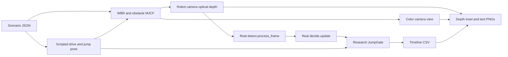

# Robot camera simulation

This harness builds an obstacle scene around the animated WBR, renders depth
from a camera attached to its body, and feeds that image through the **unchanged**
`detect.process_frame`, `decide.update`, and research `JumpGate`. It saves a
timeline and optional annotated camera PNGs. Motion follows the scenario even
when perception says STOP: this closes the scene-to-perception pipeline, while
control, collision response and automatic jump initiation remain absent.



## Run on the conductor Mac

From `~/Desktop/Research/wbr-wt-simcam`, using the existing environment with
NumPy, MuJoCo and Pillow:

```bash
~/Desktop/Research/wbr-lab-ops/.venv/bin/python -m tools.simcam.run docs/simcam/example_box132.json --record /tmp/wbr-simcam-box132 --out /tmp/wbr-simcam-box132/timeline.csv
```

The record directory must be absent or empty. A successful example run produces
61 acquisition ticks from 0 through 6 seconds, `timeline.csv`, and 61 PNGs named
`frame_00000.png` onward. Without `--record`, the program renders depth and writes
only CSV; the default output is `timeline.csv`. Acquisition is **ASSUMED 10 Hz**,
processed as fast as possible, with no wall-clock pacing. A duration between
ticks has no additional off-grid sample.

For optional **ASSUMED** disparity noise, append `--noise 0.1 --seed 0`. The value
is disparity standard deviation in pixels, with a 0.050 m baseline and
`sigma_Z = Z^2 * sigma_d / (FX * baseline)`, matching
[`ground_plane/synth.py`](../../tools/ground_plane/synth.py). Invalid/background
pixels stay zero. This adds independent Gaussian errors; it does not reproduce
stereo holes, edge mixing, temporal correlation or measured D435 noise.

## Shared scenario schema

[`example_box132.json`](example_box132.json) uses the shared JSON format exactly:
name, description, status, robot, obstacles, and optional expected intervals.
Distances are metres, times are seconds, and yaw is degrees. World +x is forward,
+y is robot left, and +z is up; `start_x` is the wheel axle's initial x position.
The axle translates by `speed_m_s * t`, independently of perception.

| Object | Required fields | Placement |
|---|---|---|
| Robot | `start_x`, `speed_m_s`, `duration_s`, `l0`, `jump_at_s` | Nonnegative speed; positive duration and reachable neutral leg length; `null` disables jumping |
| Box | `type`, `x_face`, `depth`, `width`, `height` | Rests on floor; optional `y=0`, `yaw_deg=0`; `x_face` is minimum world x of the yawed footprint |
| Step | `type`, `x_face`, `height` | ASSUMED 4 m wide long box; depth is at least 4 m and extends at least 4 m past final axle x |
| Ramp | `type`, `x_start`, `length`, `rise`, `width` | Closed triangular wedge, centred at y=0, top rising from z=0 to `rise` over `length` |
| Expected | `t_from`, `t_to`, `advisory`; optional `note` | Nonoverlapping intervals inside duration; enum names `NONE`, `JUMP_CANDIDATE`, `STOP_CANDIDATE`, `UNCERTAIN` |

Sizes must be positive and finite. Missing fields, unknown fields, invalid types,
unreachable neutral leg lengths, nonfinite numbers and overlapping expectations
produce errors naming the relevant field and input file. Unknown obstacle types
are rejected. An empty obstacle list and omitted expected intervals are valid.
`jump_at_s` must precede the scenario end and denotes **CROUCH onset**, matching
[`jump_gate/timeline.py`](../../tools/jump_gate/timeline.py).

The example approaches a 0.132 m box at x=1.2 m for 6 s at 0.25 m/s. The existing
policy's **ASSUMED 0.12 m** maximum jump height is unchanged. Its expected STOP
window from 0.5 through just before 2.0 s is a hypothesis, not measured truth;
startup and later close views are unlabelled. Change `jump_at_s` to `1.0` to
exercise the prescribed jump while approaching that same scene.

## Camera geometry and depth

The **ASSUMED** mount reuses
[`scene_twin/replay.py`](../../tools/scene_twin/replay.py)'s +0.15 m forward offset
and [`scene_twin/scene.py`](../../tools/scene_twin/scene.py)'s front-top convention.
It is attached to the `wbr_pose` body at local `(0.15, 0, BODY_HALF[2])`, so its
height follows articulated legs and flight. At neutral `l0=0.12`, the source
model gives `R_WHEEL + l0 + HIP_BELOW_TOP = 0.2103 m`. The synthetic evaluator's
0.30 m camera height is **not** substituted for the robot's model geometry;
`synth.render` separately defaults to 0.40 m.

Mount pitch is **ASSUMED 3 degrees downward**, selected from the 0/3 degree cases
in [`obstacle_decision/evaluate.py`](../../tools/obstacle_decision/evaluate.py).
It is not measured mount calibration. Camera +X points robot right, +Y points up
in the MuJoCo camera, and its viewing direction is local -Z. The detector optical
frame uses +X right, +Y down, +Z forward. CSV camera pitch is positive downward,
computed from the actual camera rotation; height is actual world z.

Resolution is 640×480 with the source synthetic D435 intrinsics
`FX=FY=386.953`, `CX=321.034`, `CY=241.040`. Camera fovy is
`degrees(2 * atan(240 / FY))`. Every scene update also adjusts the low-level
OpenGL camera frustum for the off-centre principal point and pixel-centre offset,
so `detect` uses that same exact K without resampling depth across obstacle edges.
The implementation assumes square pixels, as in the source intrinsics.
MuJoCo documents those projection fields in
[`mjvGLCamera`](https://mujoco.readthedocs.io/en/stable/APIreference/APItypes.html#mjvglcamera).

`Renderer.enable_depth_rendering()` already returns metric camera-plane depth:
the same planar optical Z that `detect.process_frame` expects. It needs neither
ray-length correction nor another OpenGL buffer inversion or vertical flip.
The [MuJoCo camera reference](https://mujoco.readthedocs.io/en/stable/XMLreference.html#body-camera)
distinguishes plane depth from distance to the camera origin; the
[3.3.7 Python Renderer source](https://github.com/google-deepmind/mujoco/blob/3.3.7/python/mujoco/renderer.py)
shows projection inversion and image orientation handling. The code fixes model
extent at 1 m and clipping at 0.01–6 m; in general the map values multiply model
extent, as specified in the
[clipping reference](https://mujoco.readthedocs.io/en/stable/XMLreference.html#visual-map).
Nonfinite, below-near and far/background values, including the far plane's
float32 rounding band, become zero, which the detector treats as invalid.

## Jump and temporal state

The jump reuses [`wbr_pose/jump_demo.py`](../../tools/wbr_pose/jump_demo.py)'s
piecewise crouch, push, ballistic rise, landing and settle trajectory. It runs
once, without wrapping. A different scenario `l0` changes the neutral endpoints;
the 0.07/0.20/0.10 m crouch/push/landing landmarks stay the same. The current
source timeline supplies **no body pitch trajectory**, so body pitch and roll
are zero throughout, as allowed by this interface. The camera rises and falls
with the body, while its downward pitch stays 3 degrees. Pitching-jump coverage
remains unverified; there is no invented attitude or IMU signal.

| Synthetic pose | Jump status | Airborne left/right |
|---|---|---|
| STAND | 3 | false / false |
| CROUCH | 0 | false / false |
| PUSH | 1 | false / false |
| FLIGHT | 2 | true / true |
| LAND | 2 | false / true |
| SETTLE | 3 | false / false |

This is the exact mapping used by `jump_gate.demo` through its timeline helper.
Telemetry age and attitude rates are assumed zero. Plane validity comes from
the **real detector**, and every 10 Hz acquisition keeps its own simulation
timestamp. Contact is an oracle from the script, not a dynamics measurement.
The 40 ms scripted LAND interval can fall between detector ticks; the gate still
emits LAND on its first observed contact after FLIGHT, even if the pose is SETTLE.

Detection still runs in flight. Crouch entry and first contact after flight clear
the detector plane cache and decision history. Every inhibited gate tick clears
decision votes and EMA, preventing pre-jump/flight estimates from resuming after
settle. The existing gate independently requires fresh planes and stable contact
before STAND. Confidence and output are advisory only, with no motor, transport,
controller safety-latch or STM32 authority.

## Outputs, status and limits

The CSV includes time, axle x, actual camera height/pitch, raw decision and its
EMA height/distance, real plane validity, gated advisory/phase, expected label,
and match. Extra columns retain synthetic phase, reason, confidence, reused-plane
age, reset events, leg/flight pose and evidence labels. Nonfinite dimensions are
written as `nan`; dimensions may be remembered EMA values even without a current
cluster. `plane_valid=False` is preserved when the detector reuses a plane.

`match` compares the **gated** result with expected; `raw_match` separately
compares the raw decision. Intervals are `[t_from,t_to)`, except that an interval
ending exactly at scenario duration includes that final endpoint. Unlabelled
ticks have blank expectation/match cells, not a fabricated pass. PNGs show the
robot camera's color view, a depth inset with fixed 0–6 m scale, and status text.
Brightness means nearer depth; black is invalid. Noise changes detector depth
and the inset, while color rendering remains ideal.

| Evidence | Status |
|---|---|
| Scene, mount, motion, contact, rates and noise parameters | ASSUMED/SYNTHETIC, never measured hardware |
| Detection and decision | Actual existing algorithms on synthetic images |
| Geometry/depth/scheduling and analytic detector-to-gate integration | Non-rendering tests, recorded in [WORKLOG.md](WORKLOG.md) |
| MuJoCo color/depth rendering and PNG/timeline example | Conductor execution pending; sandbox CGL rendering explicitly excluded |
| Ground truth dimensions | Scenario inputs, not sensor estimates or certified jump ability |

Ideal rendering omits stereo matching failures, lighting effects on depth,
exposure, vibration, USB scheduling, mount flex, latency and dropped frames.
Prescribed mocap motion can penetrate obstacles; there is no balance, contact
solver or advisory-driven motion change. Plane fitting may fail with missing
floor or abrupt height changes, and coarse pixel sampling can miss box tops.
The harness exposes these outcomes instead of providing an oracle plane.
It does not yet implement the tilt/roll sweep and oracle-plane error comparison
proposed in [TILT_JUMP_RESEARCH.md, section 4](../scene_twin/TILT_JUMP_RESEARCH.md).

## Non-rendering checks

```bash
~/Desktop/Research/wbr-lab-ops/.venv/bin/python .github/run_unittest.py tools/simcam
python3 tools/lint_markdown.py docs/simcam/README.md docs/simcam/WORKLOG.md
```

Tests cover validation, box/step/wedge geometry, camera axes and fovy, planar Z
and clip sanitation, exact pinhole rays, seeded noise, tick scheduling, expected
matching, and the actual detector/decision/gate on analytically generated arrays.
No test constructs a MuJoCo renderer. The full-resolution 132 mm fixture checks
geometry and STOP output; a smaller jump fixture checks inhibition and recovery
without claiming full-resolution geometry accuracy.

## Conductor run (2026-10-30)

- The renderer works outside the sandbox. MuJoCo warns "ARB_clip_control unavailable", so depth precision is limited at range.
- `example_box132`: the detector measures 0.130–0.132 m from 0.93 m down to 0.34 m and gives STOP_CANDIDATE (MEASURED in simulation).
- The scenario has no collision, so after about 3.6 s the robot drives into the box. With the box filling the view the detector reports NONE, consistent with fitting the box top as the floor. Treat ticks after contact as invalid. A real robot must not rely on a close-range advisory in this situation (INFERRED).
- Fix: the floor is now sized to the scenario. The ±2 m wbr_pose floor edge produced false STOPs.
- All 13 library scenarios (`tools/sim_scenarios`): 12/12 scored PASS.
