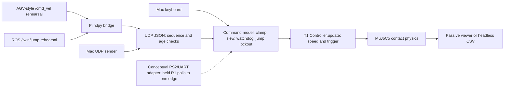

# T2: command interface for the live bench physics twin

This is a simulation interface to the [T1 contact plant and controller](../twin3d/README.md).
It accepts velocity and one-shot jump requests, runs MuJoCo physics, and exposes
command provenance and freshness in a passive viewer or CSV. It never accesses
serial devices or hardware control. All T1 plant/controller parameters retain
their existing evidence labels; T2 does not change them.

**Firmware labelling rule (SOURCE-SUPPORTED by owner sessions):** real WBR
DM-jump firmware is driven by **PS2 + UART**. It has **no micro-ROS and no
`/cmd_vel`**. Those ROS interfaces belong to the AGV firmware. Every ROS path
here is an **AGV-style /cmd_vel rehearsal** feeding the simulator.



## Command semantics and evidence labels

| Parameter / behavior | Value | Evidence |
| --- | --- | --- |
| `v_ref`, positive forward | m/s, clamp ±0.6 | ASSUMED command envelope, not a hardware limit |
| Slew rate | 0.6 m/s² in either direction | ASSUMED; also applies to watchdog braking |
| `yaw_rate` | rad/s; retained in overlay/CSV, ignored by planar T1 | SOURCE-SUPPORTED T1 has no yaw degree of freedom |
| `jump` | Boolean one-shot request edge per accepted command | ASSUMED simulation protocol; not a held level |
| Watchdog | No accepted command for ≥0.5 s: target becomes zero | ASSUMED; uses receiver monotonic time live, simulation time scripted |
| R1 debounce | Strictly >10 held processing polls | SOURCE-SUPPORTED [lesson 05](../lessons/05_wbr_jump_sequence.md) |
| PS2 nominal polling | 0.01 s; eleven held polls qualify | SOURCE-SUPPORTED nominal interval; not a guaranteed physical hold time |
| Hold adapter rearm | Require release after qualifying, even if locked out | ASSUMED stricter request policy; not exact firmware parity |
| Jump lockout | Reject requests when T1 phase is not `STAND`; no pending replay | ASSUMED adapter policy using SOURCE-SUPPORTED T1 phase |
| T1 `SETTLE` | Latched through end of run; use R/reset to rearm | SOURCE-SUPPORTED T1 implementation; no automatic landing-to-stand transition added |
| Keyboard increment | 0.05 m/s per press or OS repeat | ASSUMED |
| Keyboard heartbeat | 0.1 s while keyboard owns the latest command | ASSUMED; UDP ownership disables it until another key press |
| Viewer updates / view | Up to 60 Hz; azimuth 90°, elevation −15°, distance 2 m | ASSUMED presentation settings |
| Integration | 0.001 s | ASSUMED T1 timestep, reused unchanged |
| Default headless duration | 7 s | ASSUMED rehearsal protocol |

Velocity/yaw use **last accepted writer wins**. Each tick drains UDP first, then
queued keyboard callbacks, so a key processed in that tick takes ownership.
This is receiver processing order, not a claim of global sender-time ordering.
A pending jump edge survives a subsequent velocity heartbeat until the next
physics tick; multiple edges before that tick coalesce to one. Edges received
while jumping are consumed and counted as ignored. Expired edges are discarded.
CSV/overlay `src` identifies the latest velocity/yaw writer, even if an earlier
writer supplied a coalesced jump edge.

The watchdog brakes by changing the controller reference; it does not impose
zero physical velocity. T1 has a transient and can reverse slightly while
settling. Local keyboard velocity is intentionally latched with a heartbeat;
watchdog command-loss behavior applies to UDP and non-heartbeating scripts.
R resets physics, controller, command state and jump counts; the listener keeps
its sequence history, preventing reset from accepting old UDP datagrams.

## UDP protocol

One UTF-8 JSON object per datagram, exact fields, no ROS dependency:

```json
{"seq":1,"t":1793300000.0,"v":0.3,"yaw_rate":0.0,"jump":false,"src":"mac-cli"}
```

The example timestamp is ASSUMED illustrative data; a sender must use its
current wall clock. `encode()` emits JSON with finite values only.

| Field | Type / units | Evidence and interpretation |
| --- | --- | --- |
| `seq` | Nonnegative integer, strictly increasing per `src` | ASSUMED ordering protocol; duplicates and lower sequences rejected |
| `t` | Finite Unix wall time, seconds | MEASURED sender time; accepted timestamps must not decrease per source |
| `v` | Finite number, m/s | ASSUMED request, clamped to ±0.6 in the shared command model |
| `yaw_rate` | Finite number, rad/s | ASSUMED request; logged, ignored in planar physics |
| `jump` | JSON boolean | ASSUMED one-shot request; `true` is not a key-held state |
| `src` | Nonempty string, at most 64 characters | ASSUMED source identity and sequence namespace |

| Receiver parameter | Value | Evidence |
| --- | --- | --- |
| Default bind / port | `127.0.0.1:9876` | ASSUMED local-only default; use `--host 0.0.0.0` for Pi input |
| Packet age | At most 0.5 s old, at most 0.1 s in the future | ASSUMED; Mac/Pi clocks must agree within this policy |
| Datagram limit | 4096 bytes | ASSUMED; oversized/invalid/extra-field packets rejected |
| Drain work limit | 256 datagrams per physics tick | ASSUMED work bound |
| Sender heartbeat | 20 Hz when `--seconds` is positive | ASSUMED CLI default |
| ROS subscription queue depth | 1 | ASSUMED backlog reduction |

Freshness validation uses wall time; the local watchdog uses monotonic time.
Rejected packets never update the command watchdog. There are no acknowledgments,
retries, delivery guarantee or authentication. `src` is caller-supplied metadata.
The sender CLI starts its sequence from a MEASURED `time.time_ns()` sample;
the bridge starts from zero with a unique source per process. After a restart
with a fixed `src`, continue its sequence or choose a new `src`. The receiver
does not clear sequence history on silence. Clock jumps can cause rejection.

## Mac viewer and local sender

From this worktree, outside the worker graphics sandbox:

```sh
export PYTHON=~/Desktop/Research/wbr-lab-ops/.venv/bin/python
export MJPYTHON=~/Desktop/Research/wbr-lab-ops/.venv/bin/mjpython
export OPENBLAS_NUM_THREADS=1
"$MJPYTHON" -m sim.twin3d_cmd.teleop_viewer --host 0.0.0.0
```

Use Up/W or Down/S to change velocity, Space to jump, R to reset, Esc or close
the window to quit. The viewer follows the simulated body and shows reference
velocity, actual axle velocity, pitch, leg length, phase, source, watchdog and
ignored yaw rate. It follows the repository's
[passive viewer pattern](../../tools/imu_view/view.py), using `set_texts`.
Physics state is owned by the simulation thread; key callbacks only enqueue
events. If processing overruns, simulation slows rather than running an
unbounded catch-up loop. Live watchdog time still advances during stalls.

In a second Mac terminal:

```sh
export PYTHON=~/Desktop/Research/wbr-lab-ops/.venv/bin/python
"$PYTHON" -m sim.twin3d_cmd.udp send --v 0.3
"$PYTHON" -m sim.twin3d_cmd.udp send --v 0.3 --seconds 4
"$PYTHON" -m sim.twin3d_cmd.udp send --jump
```

The first command sends one packet, which expires after 0.5 s (ASSUMED). The
second maintains the setpoint. `--jump --seconds 4 --v 0.3` sends one jump edge
on the first packet and velocity-only heartbeats afterward. Separate `--jump`
without `--v` also writes velocity zero. The source changes when another writer
is accepted; there is no automatic fallback to an earlier keyboard setpoint.

## Headless scripts and checks

No viewer or Renderer is imported by the headless entry point:

```sh
export PYTHON=~/Desktop/Research/wbr-lab-ops/.venv/bin/python
export OPENBLAS_NUM_THREADS=1
"$PYTHON" -m sim.twin3d_cmd.run_scripted --scenario drive --seconds 3 --check --out docs/twin3d_cmd/runs/drive.csv
"$PYTHON" -m sim.twin3d_cmd.run_scripted --scenario watchdog --seconds 7 --check --out docs/twin3d_cmd/runs/watchdog-final.csv
"$PYTHON" -m sim.twin3d_cmd.run_scripted --scenario jump --seconds 3 --check --out docs/twin3d_cmd/runs/jump-reproduction.csv
"$PYTHON" -m sim.twin3d_cmd.run_scripted --udp --seconds 8 --out docs/twin3d_cmd/runs/udp.csv
```

The UDP runner is paced in real time; send commands from a second terminal.
Scripted runs execute at CPU speed. Built-in schedule parameters are ASSUMED:
drive sends 0.3 m/s every 0.1 s from 0.5 through 3.9 s; watchdog stops sending
after 2.8 s; jump presses occur at 0.5, 0.55, 0.6, 0.65 and 1.0 s. A 3 s drive
run intentionally ends before later scheduled commands. Script JSON accepts
an array of rows like the following, passed with `--script path.json`:

```json
[
  {"at":0.0,"v":0.3,"yaw_rate":0.0,"src":"script"},
  {"at":0.1,"v":0.3,"jump":true,"src":"script"},
  {"at":0.2,"v":0.3,"src":"script"}
]
```

`at` is ASSUMED simulation seconds, sorted stably; omitted velocity/yaw/jump
default to zero/zero/false. Scripts must heartbeat if they intend sustained
motion. Built-in `--check` does not apply to arbitrary scripts or UDP runs.

| Check parameter | Value | Evidence |
| --- | --- | --- |
| Tracking window | 2.5–2.8 s, two seconds after the first 0.3 m/s request | ASSUMED protocol |
| Tracking tolerance | ±0.08 m/s throughout that window | ASSUMED coarse rehearsal criterion, 26.7% of request (CALCULATED) |
| Stop window / tolerance | 6.5–7.0 s; `v_ref=0`, watchdog stale, actual speed within ±0.03 m/s | ASSUMED protocol/criterion |
| Physics screen | No numerical warnings, no body-floor contact, pitch strictly below 30° | ASSUMED T1-style validity screen |
| Jump | One edge/cycle, four ignored repeats, all phases, flight then two-wheel contact | ASSUMED built-in scenario criterion |

These criteria were revised after the initial ±0.05 m/s check failed. The saved
failure and measured transients are in [RUN_LOG.md](RUN_LOG.md). Passing the
coarse check does **not** establish ±0.05 m/s tracking or an immediate stop.
No T1 gains or physics parameters were changed to meet it.

CSV uses post-step simulation `t` (seconds); `v_ref`, `target_v`, `v` (m/s);
`yaw_rate` (rad/s); `pitch` (rad); `leg_length` (m); `phase`, `src`; and boolean
`watchdog`, `jump_edge`, contacts and `base_ground`. It includes cumulative
`jump_count`, `ignored_jumps`, and MuJoCo `physics_warning` count. References,
phases and edges describe the just-applied control interval; measured plant
values describe its endpoint, one T1 timestep later. Physical outputs and
contacts are MEASURED in simulation; references/counters are CALCULATED by
the command/controller logic. No measured hardware data is present.

## PS2/UART mapping and ROS rehearsal

The source trigger is a held R1 input, not a ROS message. A conceptual PS2/UART
adapter maps its decoded forward setpoint to `Command.v_ref`, decoded turn
request to `yaw_rate` (logged only here), and a qualifying R1 hold to one
`jump=True` edge. Apply `HoldDebounce.poll()` once per valid decoded PS2 poll:

```python
from sim.twin3d_cmd.commands import Command, HoldDebounce
hold = HoldDebounce()
# Inside a hypothetical decoded-input loop, not an implemented UART reader:
# edge = hold.poll(r1_held, active=twin.active)
# twin.receive(Command(forward_m_s, turn_rad_s, edge, 'ps2-uart'), receiver_time)
```

This adapter is conceptual: UART framing, PS2 stick scaling, calibrations and
actual polling timing are UNKNOWN here, and no UART reader is implemented.
The assumed ±0.6 m/s clamp is not inferred from a stick value. The hold adapter
requires release after a qualifying request; the original firmware's complete
retrigger behavior is not reproduced. Keyboard/UDP already represent deliberate
request edges and therefore do not wait eleven polls before jumping.

The standalone Pi package and exact owner-run commands are in the
[bridge README](../../ros2/twin_cmd_bridge/README.md). Only `Twist.linear.x`
and `Twist.angular.z` are forwarded. `/twin/jump` is a simulation-only `Empty`
request. The bridge sends on callbacks only; it does not keep stale Twist alive
with a timer. A jump callback carries the last Twist only while locally fresh
(ASSUMED <0.5 s), otherwise it writes zero velocity/yaw with the edge.

## Validation and limits

```sh
export PYTHON=~/Desktop/Research/wbr-lab-ops/.venv/bin/python
export OPENBLAS_NUM_THREADS=1
"$PYTHON" .github/run_unittest.py sim/twin3d_cmd
"$PYTHON" .github/run_unittest.py ros2/twin_cmd_bridge
python3 tools/lint_markdown.py docs/twin3d_cmd/README.md docs/twin3d_cmd/RUN_LOG.md docs/twin3d_cmd/REVIEW.md ros2/twin_cmd_bridge/README.md
```

Pure Python tests include actual T1 physics, command policy, keyboard logic
without rendering, bridge serialization without ROS, and real localhost UDP
tests. Local socket tests skip explicitly only when `bind()` raises
`PermissionError`; these skips are **not UDP validation**. Sandbox sockets and
graphics are unavailable. Viewer launch, OS key delivery/overlay, socket
delivery and ROS runtime remain for the conductor. See [REVIEW.md](REVIEW.md).

T1 remains planar with idealized actuators/contacts and no hardware calibration.
Yaw requests cannot turn this model. There is no automatic jump rearm, terrain
gate, obstacle scenario, delay compensation, motor safety or firmware bridge
in T2. Headless jumps here are on flat ground, not an obstacle-clearance test.
No Pi, serial device, motor or STM32 was accessed; no dependency installation,
rendering attempt, commit or push was made.
