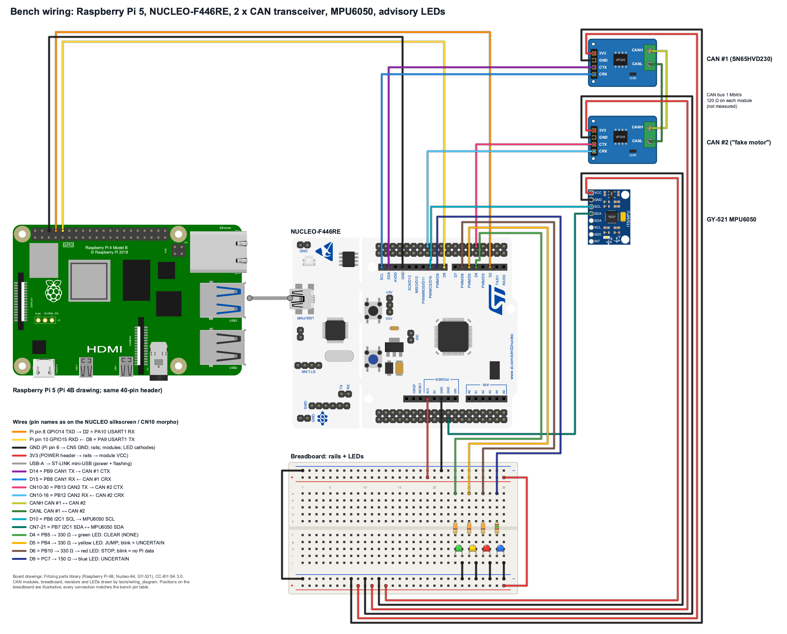
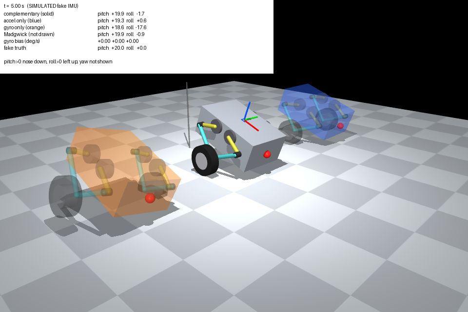
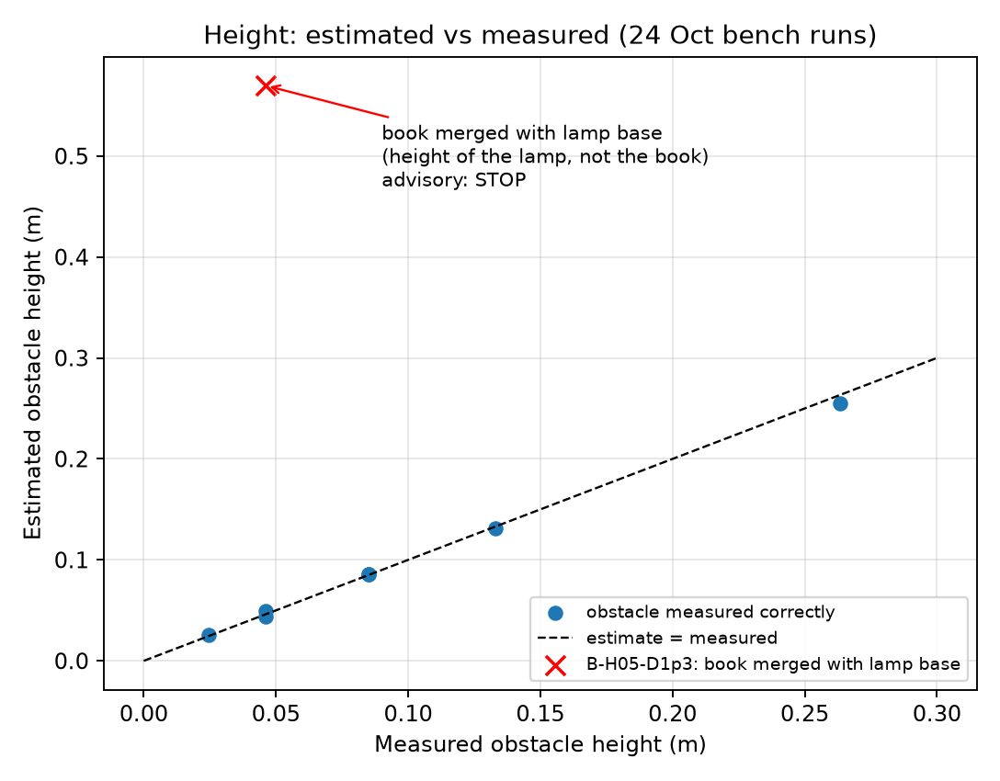

# Afternoon report: 30 Oct 2026

Nothing is merged. Statuses are as recorded in each source review. Read in this order:
this page → [STUDY_PACK](https://github.com/KaiserRichard/wbr-perception-phase1-runtime/blob/claude2/20261030-research-scout/research/scout/STUDY_PACK.md) → [SYNTHESIS](https://github.com/KaiserRichard/wbr-perception-phase1-runtime/blob/claude2/20261030-research-scout/research/scout/SYNTHESIS.md) (PR #179).

## (a) What works now

| Theme | Result | PRs |
|---|---|---|
| WBR perception (24 Oct data) | Box height within ±1 cm and distance within 5 cm at 1 m (tabletop pilot) · 24 Oct data copy 180/180 identical | #157–#159, #161–#164 |
| End-to-end replay | Recorded data → advisory → real UART → Nucleo: **630/630 echoes, 0 loss, RTT P50 2.83 ms / P99 4.3 ms**; classes STOP/JUMP/STOP as offline | #165 |
| IMU + CAN bench | IMU and CAN1↔CAN2 work; canfix05 wheel test 8/8 | #155, #156 |
| Processor-in-the-loop | C LQR over fake MCU 160/160 = Python, max torque difference 2e-11 N·m; 460800 baud cannot carry 500 Hz real time (2.5 ms per step) → lockstep | #160 |
| 3D twin | MuJoCo WBR (five-bar legs, ASSUMED sizes) tilts with the **live MPU6050** · real sway keeps STOP alive 38/48 ticks after the gate fix | #166, #168–#178 |
| Course OS | OS-T1 camera 9000 frames, 0 drops · OS-T2 inference P50 43.9/30.7/24.0 ms at 1/2/4 threads · OS-T4 input side: latest-value AoI 93 vs 192 ms | OS #10–#15 |
| Course CN | CN-T2 capture→AI 66–67 ms · CN-T3 frame loss 4.9/24.0/41.5 % vs calculated 5.0/23.0/41.6 % · CN-T4 late frames 93.5→0 % · CN-T5/T7/T9 PASS · CN-T7 AI-result age 0.20 s (latest) vs 0.62 s (FIFO) | local `work/RTP0` |

## (b) Failures and blocks
- **OS-T3 FAIL (as defined):** under stress, P99 is 355–422 ms and P50 > 320 ms, above the 100 ms period, for both P0 and P1.
  INFERRED: the cause is memory-bandwidth/cache contention, which scheduling priority cannot fix.
- **OS-T4 bridge side FAIL:** no difference (191.5 vs 192.1 ms). The bridge is not the bottleneck.
- **CN-T1:** 1/6 checks FAIL (timestamp step, because the timestamp is the pipe-read time) · **CN-T8** adaptive bitrate misses its 5 s recovery target.
- **Lab pilot limits:** the empty table reads STOP because of the lamp pole and wall within 3 m; one 1.3 m case merged with the pole.
- **Not tested:** live D435i driver + real ORB-SLAM3 pose in the loop. The QEMU test is BLOCKED (Intel Mac).
- **Open:** camera CLOCK_BOOTTIME vs bridge clock (being fixed for OS); the `agy` digest step is slow and sandbox-sensitive.

## (c) Demos you can run yourself
Use [STUDY_PACK.md](https://github.com/KaiserRichard/wbr-perception-phase1-runtime/blob/claude2/20261030-research-scout/research/scout/STUDY_PACK.md). It has the reading order (~2 h 15 min) and 5 demos with exact commands:
3D viewer fake/live · MuJoCo LQR push · PIL fake MCU · end-to-end replay on the Pi.
The Nucleo now holds **imu_can_bench**. The replay demo needs the LED image first (`e2e_led_replay.sh led`).

## (d) Research direction (SYNTHESIS.md, Codex web scouting, 3 citations spot-checked)
- **Recommended first paper:** *observation-age contracts for Pi→MCU terrain advice*. Accepted advice must still be valid at MCU consumption under stalls, replay, resets and clock drift, compared against plain timeouts and latest-value baselines.
- It reuses the most mature evidence (the protocol, the replay, your OS freshness supervisor) and can be finished **before the robot arrives**: 6–8 weeks. Novelty risk is MEDIUM–HIGH; the closest prior work is the AoI-in-robots and ROS 2 timing papers.
- Next in line: selective geometry with a measured validity envelope (needs a bigger dataset), then local mapping vs freshness (needs the robot).
  Venues: ATC/RIVF 2027 (deadlines UNVERIFIED) or the JRM journal (rolling).

## (e) Next steps (pick, don't do all)
1. Read SYNTHESIS.md, then choose a paper direction (it's your decision); I then turn it into a frozen hypothesis and an experiment plan.
2. Review and merge in batches by theme: lab #158/#161/#165 first, then 3D #166–#178.
3. Run demos (a) and (b) of the study pack to learn the IMU/filter; (c) and (d) for LQR/PIL.
4. For direction 1: a fault-injection bench on the existing replay (stall, replay, reset), Codex-built.
5. Before November: measure the robot's real masses and motor latency to replace the ASSUMED sim parameters.
