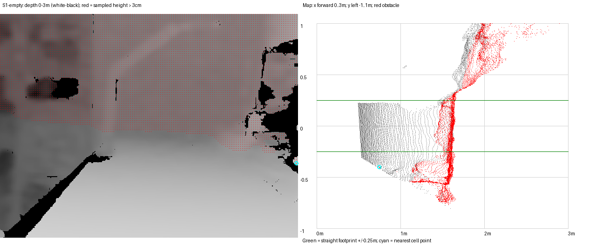
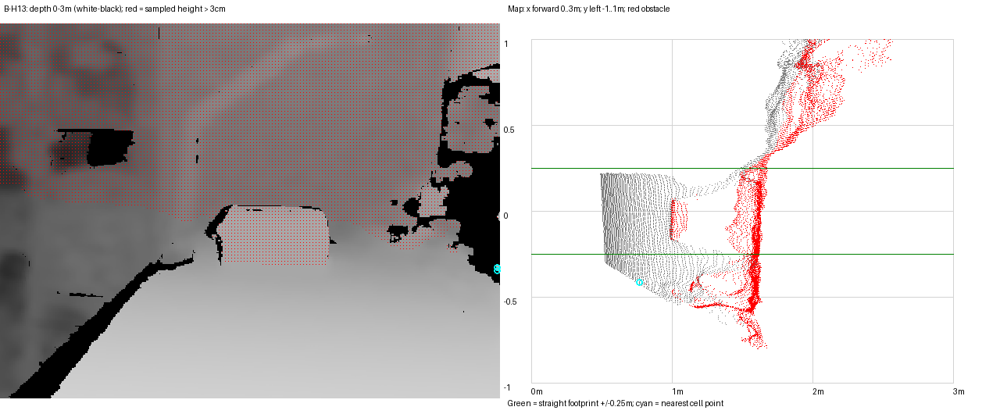

# Recorded EMPTY scene: planner diagnosis (Mac, 2026-10-30)

**INFERRED conclusion:** BLOCKED is supported by real scene geometry, not a demonstrated planner bug. “Empty” means the box was removed from a tabletop strip; it does not mean an obstacle-free 3 m route. The camera sees the lamp, wall, and equipment beside the table. The default planner checks the entire route to x=3 m. Its list of nearest obstacle cells is global, not a list of the cells responsible for blocking every candidate. No production code was changed; no bug-specific regression was warranted.

## Reproduction and scope

**MEASURED:** `diag/replay_empty.py` opens archive SQLite files with `mode=ro&immutable=1`. No archive files were modified, no SSH/hardware access occurred, and no git commit was made. All outputs are inside this planner directory. Input paths:

- `~/wbr-evidence-archive/mobile-demo-20261024-01/S1-empty/rgbd-bag/rgbd-bag_0.db3`
- same prefix, `B-H13/rgbd-bag/rgbd-bag_0.db3`
- same prefix, `LIVE/rgbd-bag/rgbd-bag_0.db3` for recorded advisories.

Commands, from repository root:

```sh
~/Desktop/Research/wbr-venvs/perception/bin/python ros2/wbr_planner_node/diag/replay_empty.py
~/Desktop/Research/wbr-venvs/perception/bin/python ros2/wbr_planner_node/diag/inspect_surfaces.py
~/Desktop/Research/wbr-venvs/perception/bin/python ros2/wbr_planner_node/diag/plot_empty.py
~/Desktop/Research/wbr-venvs/perception/bin/python -m unittest discover -s ros2/wbr_planner_node/test
```

The replay uses the exact node depth decoding: row step, endianness, 16UC1 -> float32 multiplied by 0.001; K from `/camera/camera/color/camera_info`; identity camera-to-world pose stamped at each selected depth frame. Default PlannerCore parameters: stride 4, 5 cm cells, 6 m grid, 3 cm obstacle threshold, robot half-width 25 cm, goal 3 m. For repeatability, frame admission uses source-stamp separation >=333333333 ns, rather than emulating the node's nondeterministic wall-clock callback scheduling. All selected frames fuse cumulatively in the same core.

**MEASURED:** 110 depth frames per bag; 22 selected per bag; both give **22 BLOCKED / 0 NO_PLANE / 0 NO_POSE**. S1 depth bag receipt span is 7.271789075 s. The reported Pi 17 BLOCKED + 2 NO_POSE in 10 wall-clock seconds is not reproduced count-for-count by this deterministic offline schedule. Identity poses are always available here, so it cannot reproduce transport/startup pose timeouts.

Raw per-frame output, full transforms and first-frame fits: [diag/results.json](diag/results.json). Geometry ablations and recorded LIVE output: [diag/surfaces.json](diag/surfaces.json).

## Floor fitting succeeds

**MEASURED, first selected frame:** the planner uses `gravity_frame_from_first_frame`, which calls `tools/ground_plane/plane.py::estimate_plane` without a mount prior, seed 17, stride 4, min_inliers 60, residual threshold 0.012 m.

| Bag | Depth source stamp ns | Floor normal (optical XYZ) | Height m | Pitch / roll deg | Inliers |
|---|---:|---|---:|---|---:|
| S1-empty | 1792817060492907471 | (0.0426553, -0.9851260, -0.1664549) | 0.292599 | 9.59057 / 2.44471 | 6145 |
| B-H13 | 1792819323634641602 | (0.0329115, -0.9842955, -0.1734337) | 0.295260 | 9.99299 / 1.88603 | 5691 |

**INFERRED:** these fits select the tabletop support plane, consistent with the run sheet's 0.290 m camera height / 10 degree downward pitch. The obstacle detector's independent first-frame gated fit gives S1 height 0.293185 m, pitch 9.61986 degrees, 24949 inliers (stride 2), corroborating the surface choice. Planner fitting occurs only at initialization; these numbers do not establish dynamic floor tracking.

## Frame mapping and identity pose

**MEASURED from code:** `ros2/wbr_orb_node/src/d435_node.cpp:194–209` takes TrackStereo/TrackRGBD's Tcw, inverts it, and publishes **Twc**, the camera optical pose in `slam_world` (default `world_frame`, line 40), stamped with the source image stamp. It publishes only in OK/OK_KLT tracking states. It does not convert optical axes to a robot body frame.

**MEASURED from local upstream source:** `~/Desktop/Research/third_party/ORB_SLAM3/src/Tracking.cc:2335–2370`, `StereoInitialization`, requires >500 features and initializes visual-only STEREO/RGBD with `mCurrentFrame.SetPose(Sophus::SE3f())`, identity. Before successful initialization a usable pose need not be published. The wrapper constructs visual-only STEREO/RGBD, even for a D435i; this is not the inertial initialization branch.

**INFERRED:** identity is a valid initialized first-camera optical-to-world pose. Holding it constant is valid for this static-camera diagnostic; it does not establish real ORB tracking quality. For a moving camera it would be wrong. The exact ORB build running on the Pi and its actual first published pose were not measured here (**UNKNOWN**).

`tools/local_map/fuse.py` makes a gravity frame with [right, forward, up]. PlannerCore then rotates it to [forward, left, up]. For S1 identity input the resulting map equations are:

```text
x =              -0.16660654 * optical_y +0.98602346 * optical_z
y = -0.99908985 * optical_x -0.04205913 * optical_y -0.00710665 * optical_z
z = +0.04265531 * optical_x -0.98512603 * optical_y -0.16645490 * optical_z +0.29259890
```

**MEASURED:** optical Z points mainly forward, optical X points mainly right (= negative map y), optical Y points down (= negative map z). The camera maps to approximately (0,0,0.292599), and fitted support points map to z≈0. An identity pose does not accidentally send optical Z into planner height.

## Which pixels produce the nearest cells?

**MEASURED:** the first frame's exact above-threshold contributors are saved in `diag/*-nearest-points.csv`. Pixel indices below are zero-based (row, column); cell centres are quantized, not point coordinates.

| Bag | Cell centre (x,y) m | Pixel | Optical XYZ m | Map XYZ m |
|---|---|---|---|---|
| S1 | (0.725,-0.425) | (320,636) | (0.393948,0.082230,0.769000) | (0.744552,-0.402513,0.100392) |
| B-H13 | (0.775,-0.425) | (312,636) | (0.408292,0.074739,0.797000) | (0.771939,-0.415045,0.096906) |
| B-H13 | same | (316,636) | (0.406755,0.079681,0.794000) | (0.768127,-0.413652,0.092511) |

Across sampled S1 frames the nearest centre has x=0.725 m and y=-0.425..-0.375 m, consistent with the Pi's approximate location. These points are outside the straight footprint |y|<=0.25 m. **INFERRED:** their far-right image position corresponds to the monitor/support/cabling area, rather than the central empty tabletop. **UNKNOWN:** the exact physical component and whether these individual edge returns include stereo artifacts. A single sampled return can mark a cell: the elevation grid uses maximum height, with no cluster filter. This does not by itself explain BLOCKED on all lanes.

First-frame sampled points >3 cm: S1 9610 points / 315 occupied cells; B-H13 9752 / 316. The saved depth overlays mark all such points red and nearest-cell contributors cyan; top-down panels show the straight footprint in green:




The first recorded color frames provide scene context (not asserted to be exactly synchronized to the selected depth): [S1](diag/S1-empty-color.jpg), [B-H13](diag/B-H13-color.jpg). They visibly show the tabletop, lamp, rear wall, right-side monitor/support, and, only in B-H13, the central box stack.

## Why BLOCKED rather than a shift?

**MEASURED:** `_choose` checks 25 lateral targets from -0.60 to +0.60 m, including the initial swept lateral transition and the remaining 3 m lane. All 25 fail with the first-frame obstacle grid in both bags. The blocker is not just the nearest right-side return.

S1 has **zero** sampled above-threshold points with |y|<=0.25 and 0<=x<1.3 m. There are 307 such points at x=1.3–1.5 m (pixel bounds row 20–252, column 228–416), and 2776 at x=1.5–1.7 m (rows 0–256, columns 224–432). These occupy the lamp/wall region in the color view. B-H13 additionally has 626 such central points before 1.3 m (rows 232–308, columns 272–420), where the box appears.

**MEASURED diagnostic ablation, S1 first frame:** keep the same known/free grid and goal, but clear only obstacle flags in columns starting at a forward cutoff. This is an explanation experiment, not a production fix or a safety claim:

| Keep obstacles before x | Result | Target y |
|---:|---|---:|
| 1.0 m | GO_STRAIGHT | 0.00 m |
| 1.3 m | GO_STRAIGHT | 0.00 m |
| 1.5 m | SHIFT_LEFT | +0.50 m |
| 1.7 m | BLOCKED | 0.00 m |
| 2.0 m / all | BLOCKED | 0.00 m |

**INFERRED:** the nearer right-side equipment alone does not block the straight lane. Returns around the rear lamp/wall and adjacent scene geometry close the available lanes before the default 3 m goal. B-H13 similarly shifts left with obstacles beyond 1.3 m removed, but is BLOCKED with the full scene. Changing the coordinate convention or discarding real obstacles would not be a justified fix.

## Obstacle-node comparison

**MEASURED on the same sampled S1/B-H13 depth frames:** rerunning `tools.obstacle_decision.detect.process_frame` with default stride 2 and `decide.update` gives 2 UNCERTAIN then 20 STOP_CANDIDATE in each bag. This is the detection/policy code used by `wbr_obstacle_node` under default parameters, not a claim that S1 contains recorded obstacle-node messages.

| Bag | Median nearest distance | Median estimated height | Median width |
|---|---:|---:|---:|
| S1-empty | 1.440153 m | 0.632464 m | 0.494314 m |
| B-H13 | 0.989255 m | 0.130883 m | 0.238573 m |

**MEASURED existing evidence:** `tools/obstacle_decision/results/lab-20261024/run_sheet_used.csv` maps evaluation run **S1** to **S1-empty/rgbd-bag**, describes “empty strip to the lamp pole (~1.42 m) and wall (~1.60 m by tape).” The evaluation README explicitly identifies the S1 pole as a real obstacle. `evaluation.md` reports S1 false-detection rate 1.000 and STOP_CANDIDATE, while floor stability passes. Thus its label “false detection” comes from expected NONE, not proof of a phantom surface. Its full-resolution B-H13 medians are 0.989 m distance and 0.131 m height, consistent with this replay.

**MEASURED recorded LIVE:** `/wbr_obstacle_node/advisory` contains 246 messages: 221 JUMP_CANDIDATE, 25 STOP_CANDIDATE. First message: distance 1.021024 m, height 0.035162 m, width 0.235190 m, valid plane height 0.292556 m. LIVE is a separate recording with a different obstacle configuration; these counts cannot be attributed to S1 or B-H13. Neither S1 nor B-H13 db3 contains an advisory topic (topic inventories saved in surfaces.json).

## Limits and validation

**UNKNOWN:** precise physical identity of each right-edge depth sample, ground-truth depth accuracy, Pi callback ordering behind the two NO_POSE outputs, and actual Pi ORB pose initialization. This analysis does not establish traversability of unseen table edges: unknown cells are only a cost penalty in the present planner, not a hard barrier. The ungated initial plane selector and maximum-height persistence can be limitations in other scenes, but neither is demonstrated as the cause here.

Required command output (also [diag/unittest.txt](diag/unittest.txt)):

```text
...........
----------------------------------------------------------------------
Ran 11 tests in 6.071s

OK
box sequence core runtime ms/frame: mean=221.50, max=259.15
clear sequence core runtime ms/frame: mean=214.10, max=259.37
```

## Implication for the P1 lab test (Claude review, 30 Oct)

`path_live.sh` launches `planner.launch.py` with the default `goal_forward_m = 3.0` and no override. P1 therefore needs about 3 m of clear floor ahead of the start mark (no wall, pole or table edge inside the swept lane), or every suggestion is `BLOCKED` whatever the box does. The 12 large `.npz` intermediates are not committed. `replay_empty.py` regenerates them; copies are in `~/wbr-evidence-archive/overnight-20261030-01/planner-diag/`.
