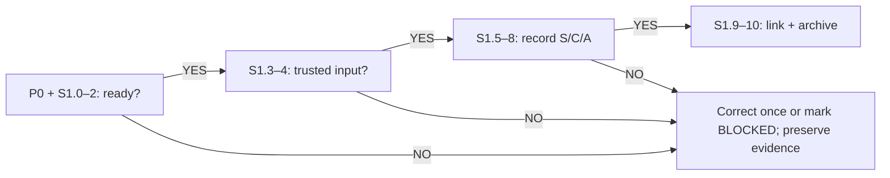
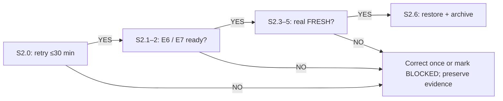

# WBR two-session lab plan

Status: OPEN. English study/runbook; document QA is not hardware qualification. All commands below are instructions for future operator execution; the deck builder ran none of them.

Both supervised lab visits are capped at 150 minutes. Record in the lab, analyze at home. The stationary ≥4 h provisional / preferred 15–24 h Allan run and 30 min warm-up are separate at-home elapsed time between visits. If home hardware access is unavailable, Allan stays OPEN. Dates in run IDs are examples; use one new ID per actual attempt.

Every primary S/C/A sensor take is a ROS 2 sqlite3 bag with explicit topics. Optional native S/C replicas have distinct IDs and require a validated derived ROS companion before scheduling. Native N2/vendor CSV and native Allan CSV currently lack a verified ROS companion interface. The missing conversion paths are marked UNVERIFIED, not silently waived. Do not run native SDK and ROS wrapper camera owners concurrently.

**Preparation blockers:** complete pre-lab authorized deployments, correct firmware and builds, qualified data storage, installed ROS wrapper/CLI, source-clock metadata, full-window conversions and CN/OS result IPC producer. An absent prerequisite stops that branch; there is no instruction to fabricate a receipt or invent a program. Source runbook requires owner `transfer` before deployment/card/write-test work; none is executed by this document build. No card clone belongs in these sessions.

**Terminals and variables:** Mac commands start from `~/Desktop/Research/wbr-perception-phase1-runtime` unless stated. Pi P0 creates explicit `GATE`, `RUN`, `DATA`; repeat bindings in each terminal. `STUDY=~/wbr-runtime/study-docs` is a pre-lab copy of this document package. On both CN Pis `~/CN` is the prepared CN checkout. `NATIVE` is an actual finalized copied `take/`; `DERIVED` is a fresh output parent; `TARGET` is the actual measured target. Paths are named deployment choices, not assertions they exist.

**Same-clock rule:** keep original SDK timestamps/domain, ROS header, recorder time, host arrival, processing boundaries and MCU events distinct. No unsynchronized cross-host subtraction. Stable power, fresh unit identity, N1→N2→N3 precede qualified calibration. Diagnostic capture under unresolved prerequisites stays OPEN.

## Lab operating contract

**Evidence:** ASSUMED time budget / SOURCE-SUPPORTED stop rules

- Each supervised session is capped at 150 min; first failure consumes the retry buffer.
- No build, install, card clone or persistent network change belongs in these sessions.
- The 30 min warm-up and Allan take (≥4 h provisional; 15–24 h preferred) happen at home.

Stop at the time cap; leave skipped work OPEN.

## Packing checklist

**Evidence:** SOURCE-SUPPORTED packing / availability to verify

- 8 GB Pi + qualified 128 GB card + 27 W supply; 4 GB Pi + own supply for CN.
- D435i/cable, Ethernet, Mac/power, rigid measured AprilGrid, ruler/calipers, tape.
- F446RE, Mac USB cable, 3 jumpers; optional analyzer; prepared firmware and tools.

Pack distinct link-bench and OS-supervisor firmware with hashes.

## Stop rules: the earliest failed layer wins

**Evidence:** SOURCE-SUPPORTED prerequisites / ASSUMED one-retry policy

- New live power fault, reboot, USB <5000M or data reversal: stop acquisition.
- At a missing tool, unknown device identity or unverified command: stop that branch.
- One corrected retry with a new ID; then defer to Session 2 or home preparation.

Do not tune SLAM, erase failed takes or relax thresholds to hide sensor faults.

## Shell variables used in the lab

**Evidence:** SOURCE-SUPPORTED shell bindings / chosen deployment paths

| Variable / binding | Plain meaning |
|---|---|
| $HOME | The shell’s existing home folder; never change it. |
| $GATE | Prepared complete gate bundle: ~/wbr-runtime/study-gates. |
| $RUN | This session’s small logs/receipts: ~/wbr-evidence/study-S1-20261018. |
| $DATA | This session’s take root: ~/wbr-takes/study-S1-20261018. |
| $STUDY | Prepared copy of this package: ~/wbr-runtime/study-docs. |

Repeat bindings in each named terminal; use fresh actual session and take IDs.

## Shell variables: take and terminal identity

**Evidence:** SOURCE-SUPPORTED shell bindings / chosen deployment paths

| Variable / binding | Plain meaning |
|---|---|
| $ID | Fresh take name, such as S-ROS-01 or C1-ROS-01; repeat in every terminal. |
| $TOPICS | Bash array of explicit topics; define in the recorder shell before use. |
| $TAKE | Completed native take name used by the handoff copy loop. |
| $PORT | Actual checked UART device, such as /dev/ttyAMA0; not a guessed port. |
| $WBR_HOST | Prepared demo SSH target richard@192.168.50.2; verify against inventory. |

Repeat bindings in each named terminal; use fresh actual session and take IDs.

## Shell variables: home analysis paths

**Evidence:** SOURCE-SUPPORTED shell bindings / chosen deployment paths

| Variable / binding | Plain meaning |
|---|---|
| $ARCH | Copied Mac session root under ~/Desktop/Research/wbr-data/. |
| $BAG | An actual finalized ROS bag directory, not a native SDK file. |
| $NATIVE | An actual finalized native take/ folder containing stereo_imu.db3. |
| $DERIVED | Fresh output parent for analysis; keep it separate from raw takes. |
| $TARGET | Measured target YAML at the explicit H4 path; nominal dimensions are insufficient. |

Repeat bindings in each named terminal; use fresh actual session and take IDs.

## Shell variables: ORB and CN bindings

**Evidence:** SOURCE-SUPPORTED shell bindings / chosen deployment paths

| Variable / binding | Plain meaning |
|---|---|
| $ORB_DIR / $TAKE_DIR | Prepared ORB root / audited exported sequence used in H6. |
| $SETTINGS_FILE / $LD_LIBRARY_PATH | Reviewed ORB YAML / runtime library search list from H6. |
| $WIFI_B | Pi B’s measured Wi-Fi IPv4 address; Pi A must route to it over wlan0. |
| $CN_CLIENT_SSH / $CN_EDGE_SSH | Actual client/edge user@host bindings entered during S2 archive. |

Repeat bindings in each named terminal; use fresh actual session and take IDs.

## Shell variables: repeat bindings in each terminal

**Evidence:** SOURCE-SUPPORTED shell bindings / chosen deployment paths

| Variable / binding | Plain meaning |
|---|---|
| Session 2 RUN / DATA | Use study-S2-20261019 as shown in S2.0; dates are examples, not observations. |
| ROS_DOMAIN_ID=42 / 43 | Environment: localhost live acquisition / isolated home replay. |
| ROS_LOCALHOST_ONLY=1 | Environment: keep the ROS graph on the current machine. |
| STUDY versus ~/CN | STUDY holds study configs; ~/CN is the separately prepared CN checkout. |

Repeat bindings in each named terminal; use fresh actual session and take IDs.

## Session 1 map: stop at the earliest failed prerequisite



FAIL: correct once with a new ID; then hand off to Session 2. Healthy independent link work may continue.

## Session 1 timeline: 150 min maximum

**Evidence:** ASSUMED wall-time budget

| Elapsed | Task / exit artifact |
|---|---|
| 0–15 / 15–30 min | S1.0–2: setup, power, storage/USB identity. |
| 30–55 / 55–75 min | S1.3–4: N2 stages/review; N3 audit/record-replay. |
| 75–110 / 110–125 min | S1.5–7: ROS S/C takes; native replicas only if ready. |
| 125–140 / 140–150 min | S1.8–10: A pilot plan, link bench, verified handoff. |

N3 unresolved at minute 75 means calibration qualification is deferred.

## Before lab: prepare, do not improvise

**Evidence:** SOURCE-SUPPORTED runbook / readiness OPEN

- Owner-authorized transfer/deployment, card setup and any builds happen beforehand.
- Gate bundle, wrapper, ROS CLI, native recorder, Kalibr image and CN files must exist.
- The strict card exception needs a reviewed sustained-write receipt; capacity is insufficient.

An unready prerequisite becomes a documented skipped step.

## P0 — Bind prepared paths and verify tools

**Evidence:** SOURCE-SUPPORTED procedure / execution OPEN

**Goal / why:** Check the prepared tools and name the output folders before connecting hardware, so every later command has a known location.

**Hardware / preconditions:** On the Mac, open the canonical WBR checkout. On each Pi terminal, source Jazzy and repeat the path bindings. Keep all camera programs stopped.

**Expected output:** The help command lists the demo interface. Each file test returns without an error; the new RUN and DATA folders exist.

**PASS / FAIL:** Continue only if every required file is present and the chosen output folders are fresh. A missing file leaves this branch OPEN.

**If FAIL:** Stop this branch and prepare the missing dependency at home. Do not install tools or guess another script during the session.

**Files / destinations:** Keep Pi logs in RUN and takes in DATA. Keep the source revision and dirty-file record with the Mac session archive.

**Mac / before lab**

```bash
cd ~/Desktop/Research/wbr-perception-phase1-runtime
export WBR_HOST=richard@192.168.50.2
bash experiments/2026-10-15-demo-day/demo.sh --help
git rev-parse HEAD
git status --short
```

**Pi / each shell**

```bash
source /opt/ros/jazzy/setup.bash
export GATE="$HOME/wbr-runtime/study-gates"
export RUN="$HOME/wbr-evidence/study-S1-20261018"
export DATA="$HOME/wbr-takes/study-S1-20261018"
# Prepared, reviewed 128 GB data-directory exception.
mkdir -p "$RUN" "$DATA"
test -f "$GATE/phase_gate.py"
test -f "$GATE/n3_record.py"
test -f "$GATE/n3_bag.py"
export ROS_DOMAIN_ID=42 ROS_LOCALHOST_ONLY=1
```

**Source:** Canonical AGENTS.md; archived PHASE_A_RUNBOOK.md; demo.sh --help; docs/D435I_CALIBRATION_PLAN.md storage exception.

**Operator detail / limitations:** study-gates is an explicitly chosen pre-lab deployment location, not a claimed existing runtime path. It must contain the full checksummed archived bundle; do not copy individual gate files. Session date/IDs are operator run IDs, not claims of capture on 18 Oct. Repeat environment bindings in each Pi terminal. DATA is a dedicated directory on the qualified 128 GB slot card; record actual findmnt/lsblk identity.

## S1.0 — Set up and make the evidence manifest

**Evidence:** SOURCE-SUPPORTED procedure / execution OPEN

**Goal / why:** Document the physical assembly before testing it, so a result can be traced to the board, supply, cable and storage actually used.

**Hardware / preconditions:** Secure the Pi and camera cable against pulling. Use the direct USB3 cable and connect power last. Camera access requires the owner’s CAMERA AVAILABLE instruction.

**Expected output:** The identity file shows the running kernel and resolved data mount. Your notebook identifies the supply, cooler, board, card, target and room.

**PASS / FAIL:** Continue when every identity field is recorded or explicitly marked UNKNOWN, and the process list shows no competing camera owner.

**If FAIL:** Correct cabling or process ownership first. Record any missing identity; use a fresh run folder rather than overwriting earlier evidence.

**Files / destinations:** Save RUN/identity.txt and processes-before.txt. Retain the Mac source/config hash files and measured-target notes in the same session archive.

**Pi / control**

```bash
uptime > "$RUN/identity.txt"
uname -a >> "$RUN/identity.txt"
findmnt -T "$DATA" >> "$RUN/identity.txt"
lsblk -o NAME,SIZE,MODEL,FSTYPE,UUID,MOUNTPOINTS \
  >> "$RUN/identity.txt"
ps -eo pid,args > "$RUN/processes-before.txt"
```

**Mac / canonical checkout**

```bash
git rev-parse HEAD > /tmp/study-source-git.txt
git status --short > /tmp/study-source-dirty.txt
shasum -a 256 calibration/lab/config/*.yaml \
  calibration/aprilgrid/*.yaml > /tmp/study-config.sha256
```

**Source:** Latest lab runbook steps 0–3; calibration plan per-take manifest. Standard read-only Linux/macOS commands.

**Operator detail / limitations:** Copy /tmp/study-source-* and study-config.sha256 into the final session archive before /tmp cleanup. Record actual tool/binary/config hashes, wrapper version, SDK version, serials separately and notes on any dirty sources; a Git hash alone is insufficient.

## S1.1 — Power and storage preflight

**Evidence:** SOURCE-SUPPORTED procedure / execution OPEN

**Goal / why:** Rule out the two observed bottlenecks, weak power and slow storage, before collecting new sensor data.

**Hardware / preconditions:** Use the 8 GB Pi with its 27 W supply and cooling. Point DATA at the prepared, qualified 128 GB data directory and have its write receipt available.

**Expected output:** The commands print raw power flags, rail voltage, temperature, available memory and disk space. A healthy power example is throttled=0x0.

**PASS / FAIL:** N0 requires flags 0x0, temperature below 75°C and available memory ≥512 MiB. The card exception proposes sustained writes ≥27.6 MB/s; this margin is ASSUMED.

**If FAIL:** Stop acquisition after a power fault or reboot. Check supply, cable and cooling, then storage identity and write evidence. An unqualified volume cannot receive a qualified take.

**Files / destinations:** Keep RUN/power-before.txt and capacity.txt, the original write receipt and its hash. Record the actual free-space reserve before each take.

**Pi / control**

```bash
vcgencmd get_throttled | tee "$RUN/power-before.txt"
vcgencmd pmic_read_adc EXT5V_V \
  | tee -a "$RUN/power-before.txt"
vcgencmd measure_temp | tee -a "$RUN/power-before.txt"
free -h | tee "$RUN/capacity.txt"
df -B1 "$DATA" /dev/shm | tee -a "$RUN/capacity.txt"
timedatectl status > "$RUN/time-before.txt"
```

**Source:** base/main.tex N0 table; calibration plan storage/power requirements; lab runbook telemetry.

**Operator detail / limitations:** ASSUMED card qualification: test file larger than the largest take and for at least its duration, sustained ≥27.6 MB/s; free ≥2× planned take plus OS reserve. Native script uses extra RAM/disk reserves. The archived external-storage gate runner does not accept the card policy by default; that is a real N3 tooling blocker. A clone/post-boot 4 GiB speed test is not equivalent qualification. Historical latched bits are retained; strict gates still require zero.

## S1.2 — USB, serial and fresh N1

**Evidence:** SOURCE-SUPPORTED procedure / execution OPEN

**Goal / why:** Prove access to the current camera on its own USB branch before asking it to stream.

**Hardware / preconditions:** Connect the D435i directly to the Pi’s blue USB3 port. Use stable N0 power, the complete prepared GATE bundle and the owner’s camera authorization.

**Expected output:** The camera’s own lsusb branch shows at least 5000M. SDK enumeration identifies serial 317422076650 and reports firmware and the other identity fields separately.

**PASS / FAIL:** Continue only if the camera branch is ≥5000M and n1_precheck exits 0 with an eligible sealed receipt. Access or kernel errors fail this check.

**If FAIL:** At 480M, stop before SDK enumeration. Inspect cable, port and intervening topology in that order; retry once into a new output folder.

**Files / destinations:** Keep RUN/usb.txt, sdk-enumeration.txt and the entire RUN/n1 directory, including result.json and its sealed raw logs.

**Pi / control**

```bash
lsusb -t | tee "$RUN/usb.txt"
# Only after camera branch is confirmed >=5000M:
rs-enumerate-devices > "$RUN/sdk-enumeration.txt" 2>&1
cd "$GATE"
python3 n1_precheck.py --camera-available \
  --direct-cable-confirmed --output "$RUN/n1"
```

**Source:** Archived PHASE_A_RUNBOOK.md and n1_precheck.py; source lab enumeration procedure.

**Operator detail / limitations:** Read normal-user permissions; no broad chmod. N1 expires after two hours or reboot; renew after topology/storage changes. SDK enumeration warning absence does not prove physical IMU calibration.

## S1.3 — Exact N2 acquisition: inspect each stage

**Evidence:** SOURCE-SUPPORTED procedure / execution OPEN

**Goal / why:** Prove sustained raw delivery before adding ROS or SLAM; this isolates the sensor path from later software layers.

**Hardware / preconditions:** Keep only the native gate recorder running. Use a fresh eligible N1 receipt and the exact IR1 640×480 Y8/15, gyro/200 and accel/100 profile.

**Expected output:** Run 20 s, inspect the result, then 105 s, inspect again, then the mandatory 300 s soak. Each stage writes raw CSV, image samples and one-Hz health.

**PASS / FAIL:** Require IR 14.25–15.75, gyro 190–210 and accel 95–105 Hz. Image gaps must be ≤0.20 s and motion gaps ≤0.05 s, with positive steps and no missing IR frames.

**If FAIL:** Stop at the first failure. Inspect power, USB, permissions, selected profile and timestamps in that order. Allow one corrected new-ID retry, then defer to Session 2.

**Files / destinations:** Preserve RUN/smoke, reproduction and soak in full, including capture-result.json, CSV files, SDK/kernel logs and sampled PGMs.

**Pi / gate bundle, stage 1**

```bash
cd "$GATE"
python3 phase_gate.py n2 --camera-available --seconds 20 \
  --n1-result "$RUN/n1/result.json" \
  --output "$RUN/smoke"
```

**Pi / only after prior stage review**

```bash
python3 phase_gate.py n2 --camera-available --seconds 105 \
  --n1-result "$RUN/n1/result.json" \
  --previous "$RUN/smoke/capture-result.json" \
  --output "$RUN/reproduction"
# Review that result before issuing the next command.
python3 phase_gate.py n2 --camera-available --seconds 300 \
  --n1-result "$RUN/n1/result.json" \
  --previous "$RUN/reproduction/capture-result.json" \
  --output "$RUN/soak"
```

**Source:** Archived phase_gate.py CLI and PHASE_A_RUNBOOK.md exact N2 stages.

**Operator detail / limitations:** These native gate samples are required historical-tooling outputs; the vendor CSV lacks domain tags and rounds motion. They cannot replace full-precision calibration takes. Native gate capture has no ROS publisher; a simultaneous ROS bag is unavailable. Preserve this explicit exception/gap instead of launching a second device owner.

## S1.3R — Human N2 review and acceptance

**Evidence:** SOURCE-SUPPORTED procedure / execution OPEN

**Goal / why:** Turn completed captures into an actual reviewed decision; an automatic zero exit is not human acceptance.

**Hardware / preconditions:** Open the sampled images and unfiltered logs from all three strict N2 stages. Have the real reviewer identity, UTC time and observations ready.

**Expected output:** The review file records your actual observations and retained warnings. The acceptance command checks the sealed evidence instead of trusting a claim of success.

**PASS / FAIL:** Accept only coherent images, finite plausible motion, explained startup offsets and preserved warnings, followed by eligible acceptance output. Incomplete review leaves N2 OPEN.

**If FAIL:** Keep the gate OPEN when any required review is missing. Do not prefill true booleans or replace a strict receipt with a diagnostic capture.

**Files / destinations:** Save RUN/review.json and RUN/n2-accepted/result.json beside all original stage directories.

**Pi / after actual review**

```bash
python3 phase_gate.py accept-n2 --camera-available \
  --n1-result "$RUN/n1/result.json" \
  --smoke "$RUN/smoke/capture-result.json" \
  --reproduction "$RUN/reproduction/capture-result.json" \
  --soak "$RUN/soak/capture-result.json" \
  --review "$RUN/review.json" --output "$RUN/n2-accepted"
```

**Source:** phase_gate.py accept-n2; PHASE_A_RUNBOOK.md manual review schema.

**Operator detail / limitations:** Review schema strings: utc, reviewer, notes, power_supply, cooling, scene, calibration_provenance (verified parser field: utc, timezone-aware and ≤2 h old). Required true booleans: raw_logs_clean, images_coherent, startup_offsets_explained, imu_values_plausible, power_cooling_documented, calibration_warning_preserved. The exact UTC field is verified in the command audit; never invent a review receipt.

## S1.4 — Active N3: baseline record and replay

**Evidence:** SOURCE-SUPPORTED procedure / execution OPEN

**Goal / why:** Check that ROS publishes the expected data and preserves it through recording and replay before making ROS-based calibration claims.

**Hardware / preconditions:** Use reviewed N2, the installed reviewed wrapper and a storage receipt the strict runner accepts. Stop the live camera before the replay phase.

**Expected output:** The runner observes 60 s live, then records a 20 s sqlite3 bag. Replay uses localhost domain 43 while the live domain remains isolated.

**PASS / FAIL:** Require the exact baseline topics/types, N2 rate bands and complete replay agreement in counts, headers and payloads. Live contamination fails the check.

**If FAIL:** If the runner cannot accept the approved card policy or receipt, stop and leave N3 OPEN. Otherwise inspect raw delivery, graph/QoS and storage before retrying once.

**Files / destinations:** Retain DATA/N3 plus RUN/n3-record and n3-replay, including parameter readback, observer/player logs, metadata and result files.

**Pi / prepared bundle**

```bash
python3 wrapper_inspect.py --output "$RUN/wrapper.json"
# UNVERIFIED: card-exception receipt/runner compatibility.
# Run only with a reviewed eligible storage receipt.
python3 n3_record.py --camera-available \
  --n1-result "$RUN/n1/result.json" \
  --n2-result "$RUN/n2-accepted/result.json" \
  --storage-result "$RUN/storage/result.json" \
  --bag "$DATA/N3" --seconds 20 --output "$RUN/n3-record"
```

**Pi / after live camera has stopped**

```bash
python3 n3_bag.py replay "$DATA/N3" \
  --record-result "$RUN/n3-record/result.json" \
  --live-domain 42 --replay-domain 43 \
  --output-dir "$RUN/n3-replay"
```

**Source:** n3_record.py/n3_bag.py; n3_topics.json/n3_qos.yaml; archived gate runbook.

**Operator detail / limitations:** The command interface is verified; compatibility with a strict 128 GB card exception is UNVERIFIED. The bounded-microSD diagnostic path is not equivalent to accepting storage. If N3 remains OPEN, subsequent takes can only be explicitly diagnostic; default qualification sequence stops here.

## Record contract: one device owner, explicit representations

**Evidence:** SOURCE-SUPPORTED ownership / conversion gaps OPEN

- Main S/C/A takes use one ROS wrapper plus ros2 bag record, explicit topics and sqlite3.
- Native S/C replicas use the checked recorder after ROS stops; their own IDs stay distinct.
- Native playback→ROS recording is source-supported but target compatibility is UNVERIFIED.

Native Allan CSV has no supplied ROS companion adapter; that branch is blocked.

## S1.5 — ROS recipe shared by S, C1–C3 and A

**Evidence:** SOURCE-SUPPORTED procedure / execution OPEN

**Goal / why:** Use one explicit ROS recording recipe for S and C takes, so the sensor data and the context needed at home are preserved together.

**Hardware / preconditions:** Copy this study package to STUDY before lab. Use one wrapper, three named terminals and the same RUN, DATA and ID in each. Review actual graph and option readback first.

**Expected output:** The graph contains /camera/camera streams and metadata. The recorder creates DATA/ID/ros while the other terminals save parameters, wrapper output and periodic power samples.

**PASS / FAIL:** For the ASSUMED 30 Hz review, images must be 28.5–31.5 Hz; gyro 190–210 and accel 95–105 Hz. Reject reversals, skipped samples or gaps >1.5 nominal periods.

**If FAIL:** Stop if metadata or clock domains are missing. Inspect power, USB, profile, QoS and storage in order; make at most one corrected attempt with a new ID.

**Files / destinations:** Preserve DATA/ID/ros and RUN/ID together: parameters, topics, QoS, wrapper.log, bag-info and all power samples. A takes use the separate S1.8R topic recipe.

**Pi / camera terminal A**

```bash
export STUDY="$HOME/wbr-runtime/study-docs"
: "${ID:?Bind this step ID in each Pi terminal first}"
mkdir -p "$RUN/$ID"
set -o pipefail
# Source-checked recipe; installed wrapper remains UNVERIFIED.
ros2 launch realsense2_camera rs_launch.py \
  config_file:="$STUDY/lab-config/ros-stereo.yaml" \
  2>&1 | tee "$RUN/$ID/wrapper.log"
# Keep this terminal open. Ctrl-C after the bag finalizes.
```

**Pi / control terminal B**

```bash
: "${ID:?Set current step ID, for example S-ROS-01}"
mkdir -p "$RUN/$ID" "$DATA/$ID"
ros2 param dump /camera/camera > "$RUN/$ID/params.yaml"
ros2 topic list -t > "$RUN/$ID/topics.txt"
ros2 topic info --verbose /camera/camera/gyro/sample \
  > "$RUN/$ID/gyro-qos.txt"
vcgencmd get_throttled > "$RUN/$ID/power-before.txt"
```

**Pi / topic selection terminal B**

```bash
TOPICS=(
/camera/camera/infra1/image_rect_raw
/camera/camera/infra2/image_rect_raw
/camera/camera/infra1/camera_info /camera/camera/infra2/camera_info
/camera/camera/gyro/sample /camera/camera/accel/sample
/camera/camera/gyro/imu_info /camera/camera/accel/imu_info
/camera/camera/extrinsics/depth_to_infra1
/camera/camera/extrinsics/depth_to_infra2
/camera/camera/extrinsics/depth_to_gyro
/camera/camera/extrinsics/depth_to_accel /tf_static
/camera/camera/infra1/metadata /camera/camera/infra2/metadata
/camera/camera/gyro/metadata /camera/camera/accel/metadata
)
```

**Pi / recorder terminal B, same shell**

```bash
# UNVERIFIED: installed metadata presence/field semantics.
ros2 bag record --storage sqlite3 --output "$DATA/$ID/ros" \
  --qos-profile-overrides-path "$STUDY/lab-config/qos.yaml" \
  --topics "${TOPICS[@]}"
# Ctrl-C after this take's duration; wait for finalization.
ros2 bag info "$DATA/$ID/ros" > "$RUN/$ID/bag-info.txt"
vcgencmd get_throttled > "$RUN/$ID/power-after.txt"
```

**Pi / telemetry terminal C, during each take**

```bash
# Bind RUN and ID as in terminal B; Ctrl-C after capture stops.
while true; do
  date -u +%FT%TZ
  vcgencmd get_throttled
  vcgencmd pmic_read_adc EXT5V_V
  vcgencmd measure_temp
  sleep 1
done > "$RUN/$ID/power-periodic.txt" 2>&1
```

**Source:** Local realsense-ros rs_launch.py config_file handling, node parameters and metadata publishers; n3_record.py recorder_argv storage/topics/QoS interface.

**Operator detail / limitations:** The literal TOPICS array is shared by the slides and LAB_PLAN; define it and run the recorder in the same terminal. Installed ROS/wrapper readiness is UNVERIFIED; check actual topic info and param readback before capture. Scripted diagnostic checks use rates ±5% and 1.5 periods, tighter than N2 gaps; do not substitute thresholds. Metadata must retain SDK timestamp/domain; ROS headers alone cannot establish original domain. For 30 Hz gaps ≤50 ms; gyro ≤7.5 ms; accel ≤15 ms.

## S1.5F — Finalize, hash and preserve each ROS take

**Evidence:** SOURCE-SUPPORTED procedure / execution OPEN

**Goal / why:** Finalize and verify each take before copying it, so home analysis reads a complete bag rather than files still being written.

**Hardware / preconditions:** Press Ctrl-C in the recorder and wait for metadata finalization. Then stop the wrapper and telemetry. No process may still write either take tree.

**Expected output:** ros2 bag info opens the bag and lists the selected topics. The local and copied SHA-256 checks report that the finalized files match.

**PASS / FAIL:** Require every selected topic with nonzero expected counts and matching Mac hashes. This proves preservation, not the sensor rates or calibration quality.

**If FAIL:** Keep the Pi originals. Retry a failed copy once; a mismatch or missing context leaves the take unusable for qualification until resolved.

**Files / destinations:** Copy DATA/ID and RUN/ID to the Mac session archive. Keep metadata.yaml, every db3 file, SHA256SUMS, configs and the failed attempts.

**Pi / after finalization**

```bash
cp "$STUDY/lab-config/ros-stereo.yaml" "$RUN/$ID/"
cp "$STUDY/lab-config/qos.yaml" "$RUN/$ID/"
cd "$DATA/$ID"
find ros -type f -print0 | sort -z | xargs -0 sha256sum \
  > SHA256SUMS
sha256sum -c SHA256SUMS
# Save periodic telemetry from a separate terminal during takes.
# For all S/C/A takes: before, during, after; errors stay visible.
```

**Mac / after all writers stop**

```bash
mkdir -p ~/Desktop/Research/wbr-data/study-S1-20261018
rsync -a richard@192.168.50.2:wbr-takes/study-S1-20261018/ \
  ~/Desktop/Research/wbr-data/study-S1-20261018/
cd ~/Desktop/Research/wbr-data/study-S1-20261018/S-ROS-01
shasum -a 256 -c SHA256SUMS
```

**Source:** Calibration plan manifest/hash requirements; lab runbook steps 10–11; n3_bag.py finalized metadata rules.

**Operator detail / limitations:** No deletion is part of this plan. Save Git hash and dirty diff, exact config/tool/binary hashes, SDK/wrapper versions, camera identities, raw readbacks/exposure/gain/global-time and motion correction, time domains, notes, requested/observed profile, target, storage identity, power/kernel faults. A new path is required for every retry. Use correct session ID for S2 archives.

## S1.6 — S stereo take: static intervals then coverage

**Evidence:** SOURCE-SUPPORTED procedure / execution OPEN

**Goal / why:** Record S to validate factory stereo geometry before interpreting disparity as metric depth.

**Hardware / preconditions:** Fix the measured 6×4 grid to a flat board. Turn the emitter off, use suitable near-infrared light, and move the camera smoothly without cable pull.

**Expected output:** Record 120 s: hold still at 0.5, 1 and 1.5 m for 10 s each, then sweep and tilt slowly. If far tags do not decode in both views, use the stated visibility fallback.

**PASS / FAIL:** Home review proposes ≥100 paired detections in four quadrants, RMS ≤0.5 px, row median ≤0.3 px/P95 ≤1 px and depth error ≤2%. These are ASSUMED thresholds.

**If FAIL:** Inspect print size/flatness, light/exposure, pairing and timestamps before changing calibration. Mark invisible far ranges OPEN and retry a failed take in Session 2.

**Files / destinations:** Keep DATA/S-ROS-01/ros, RUN/S-ROS-01 and target/range measurements. An optional native replica has a different ID and remains blocked until its companion route is validated.

**Pi / ROS control before S1.5**

```bash
export ID=S-ROS-01
# Run S1.5 with this ID; record 120 seconds.
# 0-10s: still at 0.5m; 10-20s: 1m; 20-30s: 1.5m.
# Use those ranges only if the small grid decodes in both IRs.
# If not: 0.4 / 0.6 / 0.8m visibility run, mark far-depth OPEN.
# 30-120s: slow sweeps / tilts; four-quadrant coverage.
# Finalize and hash with S1.5F before continuing.
```

**Pi / OPTIONAL native replica, ROS stopped**

```bash
export WBR_CAMERA_AVAILABLE='CAMERA AVAILABLE'
# Native replica is a new take; repeat the S motion recipe.
bash ~/wbr-runtime/calib-lab-20261015/pi/record_calib_take.sh \
  S-NATIVE-01 120
# Requires 3,974,400,000 free tmpfs bytes plus disk reserves.
# UNVERIFIED: native playback -> derived ROS companion (H2).
# Without a validated companion route, defer native replica.
```

**Source:** Calibration plan S protocol and thresholds; calibration/lab/pi/record_calib_take.sh exact NAME SECONDS interface.

**Operator detail / limitations:** Current plan retains 0.5/1/1.5 m depth checks while printable target README gives 0.4–0.8 m A3 visibility range. The small target may not decode at 1.5 m: report the far-depth check OPEN rather than moving an invisible target as if calibrated. Native recorder copies into ~/wbr-evidence/2026-10-15-calib-S-NATIVE-01/take; hard-coded date is the script path, actual UTC belongs in manifest. Full 120 s RAM reserve may fail even on 8 GB; do not shrink to 60 s and claim full S coverage silently.

## S1.7 — C1–C3 camera–IMU takes

**Evidence:** SOURCE-SUPPORTED procedure / execution OPEN

**Goal / why:** Record three independent motions so home fitting can test whether the camera–IMU transform and time shift repeat.

**Hardware / preconditions:** Keep the measured target fixed and visible in both IR views. Preserve settings and domains. Move the camera through roll, pitch, yaw and XYZ translation without impacts.

**Expected output:** Each 60 s C take starts and ends still. Between these intervals, use smooth rotations and ±15–20 cm translations; retain the whole target and avoid blur.

**PASS / FAIL:** Capture must have allowed known domains and no gaps, skips, blur or saturation. Home review proposes ≤3 mm/1° extrinsic spread and ≤1 ms shift spread across three takes.

**If FAIL:** Correct one visibility or motion problem, then retry once with a new ID. Defer missing takes to Session 2; never reuse a failed take’s folder.

**Files / destinations:** Keep DATA/C1-ROS-01/ros through C3 and their RUN logs. Optional C-native replicas are separately named physical takes, not equivalent copies of the ROS takes.

**Pi / ROS control, each take separately**

```bash
export ID=C1-ROS-01
# Run S1.5 for 60 seconds, then S1.5F.
# Repeat with ID=C2-ROS-01, then ID=C3-ROS-01.
# 0-10s still; 10-25s rotations about each axis.
# 25-45s XYZ translations, +/-15-20cm, mixed motion.
# 45-50s varied target position/range; 50-60s still.
# A3: 0.4-0.8m; A4: 0.3-0.5m. No taps/cable pull.
```

**Pi / OPTIONAL native replicas, ROS stopped**

```bash
export WBR_CAMERA_AVAILABLE='CAMERA AVAILABLE'
bash ~/wbr-runtime/calib-lab-20261015/pi/record_calib_take.sh \
  C1-NATIVE-01 60
# Repeat recipe and command as C2-NATIVE-01 / C3-NATIVE-01.
# Each 60s native take needs >=1,987,200,000 tmpfs bytes.
# UNVERIFIED: H2 native-to-ROS companion round trip.
# Defer replicas when that route is not validated.
```

**Source:** Calibration plan §3–4; latest lab step 9; record_calib_take.sh and take_diagnostics.py.

**Operator detail / limitations:** Native replica output ~/wbr-evidence/2026-10-15-calib-C1-NATIVE-01/take etc. Native scripts do not set/log every exposure/gain control; missing readback stays UNKNOWN and prevents calibration qualification. ROS→Kalibr conversion is not implemented by the native SDK take exporter (H3). No cross-representation count equality is expected between separate physical replicas.

## S1.8 — Allan pilot and between-session long recording

**Evidence:** SOURCE-SUPPORTED procedure / execution OPEN

**Goal / why:** Use a short pilot to inspect raw timing, then reserve hours at home for noise processes that cannot be identified in a short lab visit.

**Hardware / preconditions:** Rest the camera on a rigid vibration-free surface with cable strain relief. Use stable power/storage and IMU-only recording; warm up 30 min before the home long run.

**Expected output:** The lab pilot lasts 36 s. After review, the home plan records 15 h; 4 h is provisional and 15–24 h is preferred. No image traffic is requested.

**PASS / FAIL:** The ASSUMED capture review requires raw rates within ±5%, monotonic allowed domains and no missing samples. Document stationarity and temperature/power evidence.

**If FAIL:** Stop on power faults. Never run ROS and native owners together. The optional native CSV branch stays BLOCKED while the required CSV-to-ROS companion is absent.

**Files / destinations:** Keep A-ROS-pilot-01/ros and the separate home A-ROS-15h-01/ros with all logs. Preserve native allan-* directories only if that blocked branch becomes ready.

**Pi / ROS camera terminal, replace stereo launch**

```bash
export ID=A-ROS-pilot-01
mkdir -p "$RUN/$ID"
set -o pipefail
ros2 launch realsense2_camera rs_launch.py \
  config_file:="$STUDY/lab-config/ros-imu.yaml" \
  2>&1 | tee "$RUN/$ID/wrapper.log"
# A separate recorder terminal runs S1.8R, not S1.5 stereo.
# 36s pilot; clean stop, review, warm 30min before long take.
# Plan 15h at home (4h provisional; target 15-24h).
# Run at home only with maintained safe power/storage setup.
```

**Pi / native alternative, BLOCKED pending companion**

```bash
# UNVERIFIED: no supplied raw-CSV -> ROS2 companion adapter.
# Do not execute this branch until that requirement is resolved.
cd ~/wbr-runtime/allan-20261014
bash ./record_allan.sh 0.01 A-native-pilot-01
# After reviewed pilot and 30min warm-up, at home only:
nohup bash ./record_allan.sh 15 A-native-15h-01 \
  > "$HOME/allan-A-native-15h-01.launch.log" 2>&1 < /dev/null &
```

**Source:** calibration/allan/record_allan.sh and README.md; current calibration plan wins over lab suggestion to use weak PSU.

**Operator detail / limitations:** The script accepts HOURS NAME (0.01–30 h), preserves separate 17-digit native gyro/accel CSV, and budgets 207.36 MB/h plus logs with 3× reserve. Long native 15 h CSV budget is 3.1104 GB, not the older 160 B/row plan estimate. ROS raw Imu serialization is larger: measure pilot bytes/hour and reserve ≥2× projected bag plus OS reserve. No supervised lab session includes those 15 hours. If overnight home access is unavailable, leave physical Allan OPEN rather than replacing it with a short lab sample.

## S1.8R — Allan ROS recording: explicit IMU-only bag

**Evidence:** SOURCE-SUPPORTED procedure / execution OPEN

**Goal / why:** Preserve every primary A take as an explicit ROS 2 bag while recording only the raw IMU and required context.

**Hardware / preconditions:** Keep the IMU-only wrapper from S1.8 running. In the recorder terminal, repeat the same RUN, DATA, STUDY and ID; monitor power in another terminal.

**Expected output:** The sqlite3 bag contains raw gyro and accel, their metadata and context, and /tf_static. No image topic appears in the selected recording list.

**PASS / FAIL:** Require the expected raw-rate counts, finite values, source-domain metadata and clean finalization. The 36 s pilot is not accepted as long-term noise evidence.

**If FAIL:** If metadata is missing or data are lost, retain the bag and reject qualification. Review the raw cause at home before starting a long replacement run.

**Files / destinations:** Keep DATA/A-ROS-pilot-01/ros and RUN/A-ROS-pilot-01. Use the same structure for the separately named 15 h home take and copy the IMU-only config.

**Pi / recorder terminal B**

```bash
export ID=A-ROS-pilot-01
mkdir -p "$RUN/$ID" "$DATA/$ID"
ros2 param dump /camera/camera > "$RUN/$ID/params.yaml"
ros2 bag record --storage sqlite3 --output "$DATA/$ID/ros" \
  --qos-profile-overrides-path "$STUDY/lab-config/qos.yaml" \
  --topics /camera/camera/gyro/sample \
  /camera/camera/accel/sample /camera/camera/gyro/metadata \
  /camera/camera/accel/metadata \
  /camera/camera/gyro/imu_info /camera/camera/accel/imu_info \
  /camera/camera/extrinsics/depth_to_gyro \
  /camera/camera/extrinsics/depth_to_accel /tf_static
# Ctrl-C after 36s pilot; at home use ID=A-ROS-15h-01.
# Finalize and hash with S1.5F, copy ros-imu.yaml as config.
```

**Source:** n3_record.py storage/QoS/topics interface; local wrapper metadata publishers. ROS A→native Allan CSV exporter remains UNVERIFIED.

**Operator detail / limitations:** Primary ROS A records satisfy bag preservation. The supplied allan_analyze.py expects native raw CSV files and meta.json, not ordinary ROS sensor topic bags; no direct call on A-ROS is valid. The missing extraction/round-trip interface is an explicit H3 preparation gap. Use original raw stamps/units with full precision after reviewed extraction; never substitute bag-write time.

## S1.9 — Step 9b link bench: wire and check

**Evidence:** SOURCE-SUPPORTED procedure / execution OPEN

**Goal / why:** Test UART packet integrity with camera load removed before interpreting any higher-level supervisor behavior.

**Hardware / preconditions:** Unplug the camera. The Mac powers the F446RE with the prepared bench image. Cross Pi TX pin 8 to D2/PA10 and RX pin 10 to D8/PA9; join GND pin 6.

**Expected output:** Preflight receives about 20 status records/s in NO_LINK. The LED follows packet traffic; this firmware contains no motor or balancing control.

**PASS / FAIL:** Source expectations are 3000 sent/0 lost, CRC/duplicate/session rejection 10/10 each, and zero wire errors or MCU reboots. Keep the diagnostic label.

**If FAIL:** Check power, ground, crossed pins, port/console and firmware in order. If ttyAMA0 is absent, defer owner setup or use the documented USB fallback; never alter timeouts.

**Files / destinations:** Keep the entire /tmp/wbr_link_bench/out-ID directory and firmware hash in the Mac session/link-bench archive before temporary Pi files disappear.

**Mac / before wiring, prepared binary**

```bash
cd ~/Desktop/Research/wbr-perception-phase1-runtime
test -f tools/link_bench/firmware/prebuilt/link_bench_f446.bin
shasum -a 256 \
  tools/link_bench/firmware/prebuilt/link_bench_f446.bin
# Owner flashes this bench image from Mac before the session.
# Never flash the CN/OS image for this test or power MCU from Pi.
```

**Pi / control, camera unplugged**

```bash
ls -l /dev/ttyAMA* /dev/ttyACM* /dev/serial*
groups
grep -n uart /boot/firmware/config.txt
cat /proc/cmdline
# Verify no console/getty owns the chosen device.
export PORT=/dev/ttyAMA0
python3 /tmp/wbr_link_bench/link_bench.py \
  --port "$PORT" --out /tmp/wbr_link_bench/out-S1-01
```

**Source:** sources/STM32_LINK_STEP_2026-10-15.md; tools/link_bench/pi/link_bench.py and firmware prebuilt image.

**Operator detail / limitations:** Pre-lab Mac firmware flash can use cp of the checked binary to the verified /Volumes/NOD_F446RE/ drive per source; do not invent another board drive. /tmp/wbr_link_bench/ must include link_bench.py and adjacent link_proto.py copied from tools/link_proto/py/. If owner chooses fallback, PORT=/dev/ttyACM0 after USB moves to Pi; label USB path and recheck power. No config.txt edits/reboot in these short sessions. GPIO path expected RTT floor is calculated; no RTT upper budget invented.

## S1.9T — Step 9b timeouts and optional 9c

**Evidence:** SOURCE-SUPPORTED procedure / execution OPEN

**Goal / why:** Verify the bench silence rule, and optionally separate wire timing from software delay with a logic analyzer.

**Hardware / preconditions:** Finish 9b first and leave the camera unplugged. For optional 9c, use the documented 3.3 V probes, 12 MHz sampling and a 15 s capture.

**Expected output:** The 100 ms silences should produce 0/5 NO_LINK events. The 300 ms silences should produce 5/5, around 150–151 ms MCU silence, then 5/5 recoveries.

**PASS / FAIL:** Require those source-defined observable counts. NO_LINK belongs to the bench protocol and does not establish OS HOLD/FAILSAFE or robot fallback.

**If FAIL:** Check baud, channels and ground before interpreting timing. If the Pi marker never toggles, report 9b-only timing; retry once, then defer.

**Files / destinations:** Preserve the 9b output and, if captured, la-S1-01/summary.json, the original VCD/digital CSV and analyzed la.json.

**Pi / only after analyzer capture starts**

```bash
python3 /tmp/wbr_link_bench/link_bench.py \
  --port "$PORT" --out /tmp/wbr_link_bench/la-S1-01 \
  --phases rtt --duration 10 --marker-gpio 17
```

**Mac / after copying capture and summary**

```bash
cd ~/Desktop/Research/wbr-perception-phase1-runtime
python3 tools/link_bench/pi/la_analyze.py cap.vcd \
  --summary la-S1-01/summary.json --out la-S1-01/la.json
```

**Source:** Link source steps 9b/9c; la_analyze.py CLI.

**Operator detail / limitations:** Probe D0 CN10-33 PA10, D1 CN10-21 PA9, D3 CN10-23 PA8, GND CN10-20. D2 Pi pin11 GPIO17. Expected CALCULATED pi_tx_wire≈2210 us, reply_wire≈1430 us, ~500 matched markers. Decode/reply timing is to be MEASURED, not assigned a fake threshold.

## S1.10 — Session handoff: stop at 150 minutes

**Evidence:** SOURCE-SUPPORTED procedure / execution OPEN

**Goal / why:** End Session 1 within 150 min with preserved evidence and a short list of the earliest failed conditions to revisit.

**Hardware / preconditions:** Stop all writers normally, then copy and verify every completed directory on the Mac. Do not clone a card during this handoff.

**Expected output:** handoff.md lists completed, failed, marginal and skipped steps, each with its evidence path, cause and required next action.

**PASS / FAIL:** Require matching hashes and a next action for every failure. A diagnostic result or unfinished review must not silently become a gate PASS.

**If FAIL:** Keep Pi originals when copying fails. Retry the transfer once; do not delete data or draw a supported-data conclusion from an incomplete archive.

**Files / destinations:** Take home the full session archive, RUN logs, target notes and handoff.md, including Allan availability and the exact new IDs planned for Session 2.

**Mac / copy small logs too**

```bash
mkdir -p ~/Desktop/Research/wbr-data/study-S1-20261018/logs
rsync -a \
  richard@192.168.50.2:wbr-evidence/study-S1-20261018/ \
  ~/Desktop/Research/wbr-data/study-S1-20261018/logs/
# Review SHA256SUMS for every copied take as in S1.5F.
# Record A-ROS long-run availability and native/ROS gaps.
# Owner handles clean shutdown after evidence verification.
```

**Mac / completed native or bench branches only**

```bash
export ARCH="$HOME/Desktop/Research/wbr-data/study-S1-20261018"
export WBR_HOST=richard@192.168.50.2
# For EACH completed native ID only; example C1:
export TAKE=C1-NATIVE-01
mkdir -p "$ARCH/native/$TAKE"
rsync -a "$WBR_HOST:wbr-evidence/2026-10-15-calib-$TAKE/" \
  "$ARCH/native/$TAKE/"
(cd "$ARCH/native/$TAKE/take" && \
  shasum -a 256 -c ../ram-sha256.txt)
# Repeat TAKE=S-NATIVE-01 / C2-NATIVE-01 / C3-NATIVE-01 if done.
# If 9b/9c ran, preserve its entire output before /tmp is cleared:
rsync -a "$WBR_HOST:/tmp/wbr_link_bench/" "$ARCH/link-bench/"
```

**Source:** Latest lab source steps 10–11; current calibration plan preservation policy.

**Operator detail / limitations:** Handoff fields: step/take, requested/resolved profile, success/failed/marginal/skipped, raw paths/hash, power/USB/timing issue, one correction, new retry ID, remaining time, owner-required setup, overnight A state. Card clone from original long-day source is deliberately outside the two-session plan.

## Session 1: what you take home — sensor data

**Evidence:** SOURCE-SUPPORTED inventory / optional branches conditional

| Bag or file family | Home consumer |
|---|---|
| N1/N2/N3 receipts, CSV/PGMs and logs | H0: input and replay context; retain all failures. |
| S and C1–C3 ROS bags + metadata/configs | H0 audit; H3 missing exporter; H4 fits after conversion. |
| A pilot / separate long A + power logs | H0 audit; H3 raw extraction; H5 supported Allan. |
| Optional native S/C + raw timestamps | H1 export, H2 companion, H3 conversion, H4 fits. |

Each ROS bag means metadata.yaml plus every db3 file, finalized and hashed.

## Session 1: what you take home — supporting files

**Evidence:** SOURCE-SUPPORTED inventory / missing routes remain OPEN

| Bag or file family | Home consumer |
|---|---|
| RUN/ID wrapper, params, topics, QoS, power | H0/H3 conversion checks; H4–H6 provenance. |
| Target YAML/dimensions, ranges and motion notes | H4 geometry; H7 proxy/reference interpretation. |
| Native A CSV/meta, only if unblocked | H3 preservation receipt, then H5 Allan fitting. |
| Link summary/raw/optional VCD; handoff; hashes | H0 archive check; retain link review separately. |

H6 needs an actual motion export; H7 needs an independent reference for ATE/RPE.

## Session 2 map: keep independent branches separate



NO: mark that branch BLOCKED. No real FRESH means no supervisor fault injection; always preserve the handoff.

## Session 2 timeline: 150 min maximum

**Evidence:** ASSUMED wall-time budget

| Elapsed | Task / exit artifact |
|---|---|
| 0–30 min | S2.0: one corrected rerun per failed/marginal S1 branch. |
| 30–65 min | S2.1: E6 two-Pi edge run; selected sweep, not full campaign. |
| 65–95 min | S2.2: E7-C real-UART readiness / bounded trial. |
| 95–130 / 130–150 min | S2.3–6: CN/OS fault demo; verified archive and stop. |

If E7/supervisor preparation is missing, document BLOCKED; do not improvise firmware.

## S2.0 — Rerun only the earliest failed S1 condition

**Evidence:** SOURCE-SUPPORTED procedure / execution OPEN

**Goal / why:** Use the first 30 min to revisit the earliest failed Session-1 condition with one specific correction.

**Hardware / preconditions:** Read handoff.md, rebind P0 to the new Session-2 RUN and DATA roots, and recheck power and identity. Renew N1 after a reboot or topology change.

**Expected output:** Each rerun has a fresh ID, the same original acceptance rule and a note naming the one cause changed. Old evidence remains untouched.

**PASS / FAIL:** A rerun passes only if it meets the original numeric and observable criteria. Stop retries at minute 30; unresolved work stays OPEN.

**If FAIL:** Preserve the new failure and defer further WBR work. Continue independent CN tests only if their own power and physical prerequisites are healthy.

**Files / destinations:** Keep DATA/new-retry-ID, the matching RUN logs, fresh receipts and RUN/S2-rerun-ledger.md beside the Session-1 handoff.

**Pi / control, fresh bindings**

```bash
export RUN="$HOME/wbr-evidence/study-S2-20261019"
export DATA="$HOME/wbr-takes/study-S2-20261019"
mkdir -p "$RUN" "$DATA"
vcgencmd get_throttled > "$RUN/power-before.txt"
lsusb -t > "$RUN/usb-before.txt"
# Repeat only the failed S1 step, with new output paths/IDs.
# Example ID=C2-ROS-retry01; same S1.5/S1.7 recipe.
# Reboot/topology change: renew N1; never reuse the old receipt.
```

**Source:** Calibration plan, gate receipt rules and S1 handoff. S2 date is an explicit run-ID example.

## S2.1 — CN/OS integration: E6 two-Pi edge offloading

**Evidence:** SOURCE-SUPPORTED procedure / execution OPEN

**Goal / why:** Run E6 on the two real Pis to distinguish client-clock network RTT from server-local queue and service time.

**Hardware / preconditions:** Disconnect the camera. Use the 8 GB Pi B as edge server and the 4 GB Pi A as client, each with its own supply. Connect Ethernet and keep local consoles available.

**Expected output:** Wait for the server’s READY line before starting the client. The client writes frames.csv and meta.json; the server writes service-times.csv.

**PASS / FAIL:** The ASSUMED smoke check expects 200 terminal outcomes for 20 s at 10 fps, with no unidentified frame. Report actual loss/late replies and require clean power.

**If FAIL:** Check power, route/interface, server/port, transport and queue/service in order. Retry once with a fresh output; never subtract unsynchronized absolute host times.

**Files / destinations:** Take home client results_hw/E6/study-S2-* and server hw/results/study-S2-* with preflight, model/OS identities, commands and power readings.

**8 GB server B / ~/CN prepared checkout**

```bash
cd ~/CN
sudo ip link set eth0 up
sudo ip address replace 192.168.77.2/24 dev eth0
sh hw/preflight.sh eth0 /tmp/e6-server-before.json
python3 hw/edge_server.py --host 192.168.77.2 --port 9000 \
  --transport udp --mode synthetic --sleep-ms 4 \
  --queue latest \
  --service-log hw/results/study-S2-udp/service-times.csv
```

**4 GB client A / local console, after READY**

```bash
cd ~/CN
sudo ip link set eth0 up
sudo ip address replace 192.168.77.1/24 dev eth0
ping -c 3 192.168.77.2
python3 hw/sender.py --host 192.168.77.2 --transport udp \
  --frame-bytes 30000 --fps 10 --duration 20 \
  --out-dir results_hw/E6/study-S2-smoke-udp-01
python3 hw/run_e6.py --link ethernet --transport udp \
  --dry-run
```

**4 GB client A / selected E6 pass**

```bash
# After reviewed smoke; 30 runs x20s, plus overhead.
python3 hw/run_e6.py --link ethernet --transport udp \
  --output-root results_hw/E6/study-S2-wired-udp-01
# Repeat TCP only after stopping/restarting server as TCP.
# Wi-Fi: existing AP; verify route dev wlan0 before any run.
# Full four-pass /120-run campaign is outside this session.
# Retain both Pi models, supplies, clocks and before/after flags.
```

**Source:** CN hw/README.md, hw/{edge_server,sender,run_e6,os_inference}.py; configs/E6hw.yaml; docs/HARDWARE.md (owner 16 Oct).

**Operator detail / limitations:** ~/CN is the explicit pre-lab deployment location on both Pis; do not assume it exists without P0. Address commands are source examples for unused 192.168.77.0/24 and require local console if Ethernet carries SSH. Do not mutate a management route blindly. E6 sweep declares synthetic 4 ms service; --queue latest is explicitly logged. No ONNX claim: optional ONNX needs actual model/runtime/hash, separate root and compatible config. Default runner includes separate preflight per run and validates route; 1-client E6 hardware is not equal to 2-client simulator.

## S2.1W — CN/OS integration: Wi-Fi / ONNX branches

**Evidence:** SOURCE-SUPPORTED procedure / execution OPEN

**Goal / why:** Keep optional Wi-Fi and ONNX comparisons tied to the transport and compute workload actually used.

**Hardware / preconditions:** Use the existing access point and local consoles. Both endpoints must select the same transport. ONNX requires a prepared compatible model and runtime.

**Expected output:** The route to Pi B says dev wlan0. RTT uses the sender clock; queue and service durations use the server clock. ONNX failures remain visible.

**PASS / FAIL:** Require the intended route and retained outcomes for every generated frame. An absent model/runtime means ONNX is UNKNOWN; a synthetic run cannot qualify it.

**If FAIL:** Stop the Wi-Fi branch if the route is wrong; do not reconfigure the AP in lab. If ONNX is unavailable, retain a clearly labeled synthetic result instead.

**Files / destinations:** Use fresh results_hw/E6/study-S2-wifi-* or ONNX run roots. Keep the actual model hash, server service log and both Pi configurations.

**8 GB server B / existing Wi-Fi**

```bash
WIFI_B=$(ip -4 -o address show dev wlan0 scope global \
  | awk '{split($4,a,"/"); print a[1]; exit}')
python3 hw/edge_server.py --host "$WIFI_B" \
  --transport udp --mode synthetic --sleep-ms 4 \
  --service-log hw/results/study-S2-wifi/service-times.csv
```

**4 GB client A / use server printed IPv4**

```bash
read -r -p 'Pi B Wi-Fi IPv4 address: ' WIFI_B
ip route get "$WIFI_B"
# Continue only if route is dev wlan0.
python3 hw/sender.py --host "$WIFI_B" --transport udp \
  --frame-bytes 30000 --fps 10 --duration 20 \
  --out-dir results_hw/E6/study-S2-wifi-udp-01
# Repeat as -02/-03 if time; TCP requires matching server.
# Optional ONNX service syntax (separate run/config):
# --mode onnx --model EXISTING_MODEL.onnx --threads 1
```

**8 GB server B / OPTIONAL prepared ONNX branch**

```bash
# UNVERIFIED installed model/runtime; use a separate run root.
cd ~/CN
test -s offline-bundle/mobilenetv2-12.onnx
sha256sum offline-bundle/mobilenetv2-12.onnx
python3 hw/edge_server.py --host 192.168.77.2 --port 9000 \
  --transport udp --mode onnx \
  --model offline-bundle/mobilenetv2-12.onnx --threads 1 \
  --queue latest \
  --service-log hw/results/study-S2-onnx/service-times.csv
# Client: S2.1 sender, new output name study-S2-onnx-01.
# Do not use unchanged synthetic-4ms E6 sweep config here.
```

**Source:** CN hw/README.md Wi-Fi and ONNX sections; hw/os_inference.py fixed-image preprocessing.

**Operator detail / limitations:** Network bytes are load, not decoded JPEG inference. Freeze transport, payload, fps, model/hash, threads and queue to compare. Remote absolute t_rx/t_start/t_done stay empty; do not derive them from RTT. No hardware E6 result is established by writing this deck.

## S2.2 — CN/OS integration: E7-C UART gateway trial

**Evidence:** SOURCE-SUPPORTED procedure / execution OPEN

**Goal / why:** Run E7 option C to add real STM32 UART ingress while measuring UART and network intervals separately.

**Hardware / preconditions:** Use the owner-prepared E7 CubeMX image, gateway Pi A and edge Pi B. Cross the selected 3.3 V UART pins, join ground and confirm the port is not a console.

**Expected output:** CRC-checked image chunks assemble at the gateway and reach the edge. Each unique frame receives a terminal outcome with UART and network fields.

**PASS / FAIL:** The design requires unique IDs, one terminal outcome per frame and no corrupt forwarding. Real baud reliability and MCU inference remain UNTESTED until measured.

**If FAIL:** Check power, ground/pins, baud/console, CRC/chunks and server in order. A missing built image blocks this branch; no flash command may be guessed.

**Files / destinations:** Preserve results_hw/E7/study-S2-edge-udp-01 with args.json, frames.csv and outcomes.jsonl, plus the actual firmware/config hashes.

**4 GB gateway A / ~/CN**

```bash
# UNVERIFIED hardware: owner's E7 firmware and real UART.
python3 e7/gateway/gateway.py --serial /dev/serial0 \
  --baud 115200 --host 192.168.77.2 --port 9000 \
  --transport udp --reply-format timed \
  --outDir results_hw/E7/study-S2-edge-udp-01
# Stop normally with Ctrl-C after the bounded fixture trial.
# Repeat TCP only with matching timed-reply server.
# No --net-status-ms here until a compatible supervisor exists.
```

**Source:** CN docs/E7_DESIGN.md option C, docs/CODEX_TICKETS.md E7/E7d2/T18; e7/README.md and gateway.py.

**Operator detail / limitations:** E7 image format is not WBR link bench or OS UART framing. Default firmware has fixed 1×1 JPEG, no trained tiny-CNN. USART2 PA2/PA3 uses ST-LINK VCP; USART1 direct route PA9 TX→Pi15 RX, PA10 RX←Pi14 TX; qualify solder bridges and port. Start 115200 8N1; 921600/2M sustained hardware reliability UNTESTED. At least 100 transfers per size/baud and 3 network repetitions are full design qualification outside this short smoke trial. UART response-to-MCU egress is unimplemented. No cloud endpoint is selected; cloud branch deferred.

## S2.3 — CN/OS integration: supervisor readiness

**Evidence:** SOURCE-SUPPORTED procedure / execution OPEN

**Goal / why:** Establish real-UART FRESH before fault injection, so a later state change has a verified healthy starting point.

**Hardware / preconditions:** Use the compatible OS v3 board image, one hea_bridge UART writer and a prepared CN-result IPC producer. Replace the E7 image/path; do not run both UART writers.

**Expected output:** Accepted local HEARTBEAT, INFERENCE and NET_STATUS make MCU_STATUS report FRESH=1. Save the real MCU state and clock telemetry.

**PASS / FAIL:** Continue only after state 1 is actually observed and recorded. Sources report host/PTY tests only; the real UART path is still UNTESTED.

**If FAIL:** Stop if the image, producer or FRESH state is missing. E7 telemetry alone sends no INFERENCE and cannot satisfy the supervisor’s local readiness checks.

**Files / destinations:** Retain bridge.csv, inf_rx.csv, state_events.csv and readiness notes, together with the exact OS firmware and configuration hashes.

**Gateway Pi / prepared OS checkout**

```bash
# UNVERIFIED: deployed image, UART and CN-result IPC producer.
# Source interface exists; this hardware recipe is not validated.
linux/build/hea_bridge --socket /tmp/cn-results.sock \
  --serial /dev/ttyAMA0 --baud 921600 \
  --heartbeat-ms 20 --net-status-ms 20 --policy latest \
  --csv bridge.csv
# Do NOT run E7 gateway as another writer to the same UART.
# CN producer must provide accepted <IQQBBI IPC records.
# No verified producer/flash command is supplied: STOP if absent.
```

**Source:** OS-wt-cn docs/CN_INTEGRATION.md and protocol/PROTOCOL.md; CN e7/gateway/NET_STATUS.md.

**Operator detail / limitations:** This is a pre-lab integration dependency, not a fabricated executable. Original requested OS protocol v1 names INIT/FRESH/HOLD/FAILSAFE but NET_STATUS is a later v3 extension in OS-wt-cn. Updated full board image status is UNKNOWN there; only portable sources cross-compiled and host tests passed. Existing E7 gateway --net-status-ms 20 can emit v3 HB/status with one sequence, but sends no INFERENCE or MCU clock map and alone cannot satisfy supervisor local readiness. IPC clock stamps must be explicitly mapped to gateway RAW; remote host times are invalid.

## S2.4 — CN/OS integration: Wi-Fi loss while heartbeat lives

**Evidence:** SOURCE-SUPPORTED procedure / execution OPEN

**Goal / why:** Interrupt network results while keeping local heartbeat alive, so the MCU can demonstrate stale-result HOLD followed by latched FAILSAFE.

**Hardware / preconditions:** Start from recorded FRESH on a motor-free bench. Keep local heartbeat at 20 ms and use the transmitting result peer’s wlan0, with local console recovery available.

**Expected output:** The source defaults predict HOLD at result/network age ≥200 ms and FAILSAFE ≥500 ms. These are provisional configuration values, not measured WBR safety bounds.

**PASS / FAIL:** Require recorded state order 1→2→3 with age/silence reasons and no unexplained missing events. A stopped local heartbeat tests a different failure path.

**If FAIL:** Restore the result path and keep the failed trace. If heartbeat also stopped, label that attempt accordingly; do not change timeouts to obtain the desired sequence.

**Files / destinations:** Keep bridge.csv, state_events.csv, fault-on/off observations and the gateway/server interface and config records. Measure transitions on a supported clock.

**Wi-Fi transmitting peer / prepared OS scripts**

```bash
# UNVERIFIED real Wi-Fi/UART integration; source CLI verified.
# Affect outgoing results on edge server B, not management SSH.
scripts/netem_inject.sh --dry-run apply wlan0 --loss 100
# After owner checks the printed direction and local console:
scripts/netem_inject.sh apply wlan0 --loss 100
# Leave >500ms while gateway HEARTBEAT stays alive.
# Observe and save MCU states, then restore the path:
scripts/netem_inject.sh clear wlan0
```

**Source:** OS-wt-cn scripts/netem_inject.sh; docs/CN_INTEGRATION.md network age/silence transitions; CN synergy part 6.

**Operator detail / limitations:** Loss injection is outbound root qdisc; clear deletes instead of restoring previous custom qdisc. Do not apply on an interface with a valued existing root policy; prepare isolated link beforehand. On server B, lost replies stop accepted results at gateway; HB continues locally. This is controlled Wi-Fi result-delivery loss, not a proof of radio disassociation. An actual AP outage can be added manually only after recording network path; expected state semantics stay the same. Loss telemetry counts result identities, not raw Wi-Fi packet loss.

## S2.5 — CN/OS integration: recover and test heartbeat loss

**Evidence:** SOURCE-SUPPORTED procedure / execution OPEN

**Goal / why:** Demonstrate recovery from latched FAILSAFE, then test heartbeat loss separately so the two mechanisms remain understandable.

**Hardware / preconditions:** Restore the network while FAILSAFE is latched. On the motor-free bench, the owner resets the board; re-establish accepted heartbeat, inference and network status.

**Expected output:** After reset, expect INIT→FRESH. A short HOLD-only interruption may recover automatically; stopping heartbeat instead predicts FAILSAFE near 100 ms.

**PASS / FAIL:** Require FAILSAFE to remain latched on resumed packets alone. Reset and new readiness must precede FRESH. The 100 ms default is provisional, not a guaranteed physical response.

**If FAIL:** Stop on an unexpected state and save raw protocol/state traces. A missing hardware result leaves robot control independence unproven; do not infer balancing from this bench.

**Files / destinations:** Preserve separate reset/recovery and heartbeat-loss traces, with fault/reset notes and exact thresholds. A bounded short-fault fixture is still UNVERIFIED.

**Gateway / manual controlled fault sequence**

```bash
# Restore Wi-Fi result path and preserve prior trace first.
# Owner presses board RESET after latched FAILSAFE.
# Verify fresh HB + INFERENCE + NET_STATUS -> INIT then FRESH.
# For HB-loss case: Ctrl-C the sole hea_bridge process.
# Expected provisional HB timeout: 100ms -> latched FAILSAFE.
# Resume bridge; packets alone do not clear the latch.
# Owner resets board, re-establishes FRESH; save a new trace.
# HOLD-only recovery needs measured <500ms result interruption.
# UNVERIFIED: bounded real-network short fault timing fixture.
```

**Source:** OS protocol v3 and docs/CN_INTEGRATION.md explicit latched/rearm/board-reset policy.

**Operator detail / limitations:** Network age includes reported age + local MCU silence + provisional transit allowance. Thresholds are configuration, not measured physical response guarantees. Measure MCU state-change time on MCU clock or validated mapping; shell/netem command duration is not wire fault onset. There is no remote rearm wire command. Board reset demonstrates this port’s recovery, not uninterrupted WBR balancing. Real robot must retain independent control by architecture; physical N7 remains OPEN.

## S2.6 — CN/OS integration: archive and interpret honestly

**Evidence:** SOURCE-SUPPORTED procedure / execution OPEN

**Goal / why:** Finish within 150 min with complete node/MCU evidence and an honest account of what was not tested.

**Hardware / preconditions:** Stop jobs normally, clear the injected qdisc, and sample power on each Pi. Keep the Mac reachable while both node archives are copied.

**Expected output:** The cleared qdisc is checked explicitly. The archive contains client outcomes, server service logs, UART states, configs, identities and verified file hashes.

**PASS / FAIL:** Require one recorded outcome per generated frame, valid clock boundaries and matching copies. Missing telemetry stays UNKNOWN and no hardware gate is promoted by this archive.

**If FAIL:** Keep each node’s originals after a failed copy. Retry transfer once; do not delete files until the finalized manifests verify on the Mac.

**Files / destinations:** Take home study-S2-20261019/{wbr,cn-client,cn-server,os} and summary.md, including rerun evidence, fault/recovery traces and unresolved prerequisites.

**Each Pi / control**

```bash
vcgencmd get_throttled
vcgencmd pmic_read_adc EXT5V_V
# Save the raw values in that node's run directory.
# On edge peer if injection was used:
scripts/netem_inject.sh status wlan0
# Verify cleared qdisc; do not infer it from restored replies.
# Copy both CN results roots and OS CSVs to Mac; hash finalized files.
# Owner shuts down only after the archive verification.
```

**Mac / both-node CN archive, then hash review**

```bash
export ARCH="$HOME/Desktop/Research/wbr-data/study-S2-20261019"
mkdir -p "$ARCH/cn-client" "$ARCH/cn-server" "$ARCH/os"
# UNVERIFIED deployment SSH targets/routes: bind from lab inventory.
read -r -p 'Client SSH user@host: ' CN_CLIENT_SSH
read -r -p 'Edge SSH user@host: ' CN_EDGE_SSH
rsync -a --checksum "$CN_CLIENT_SSH:CN/results_hw/" \
  "$ARCH/cn-client/"
rsync -a --checksum "$CN_EDGE_SSH:CN/hw/results/" \
  "$ARCH/cn-server/"
# OS trace dir is a pre-lab binding, not a guessed path.
# Copy bridge/inf_rx/state_events CSVs plus firmware/config hashes.
# Verify per-node finalized SHA256 manifests as in S1.5F.
```

**Source:** CN hw/README.md, E7 retained timing contract; OS CN integration telemetry; WBR source handoff policy.

## Session 2: what you take home — runs and traces

**Evidence:** SOURCE-SUPPORTED inventory / hardware tests conditional

| Bag or file family | Home consumer |
|---|---|
| WBR retry bags, native takes and fresh receipts | Same H0–H6 path as the corresponding S1 take. |
| Both Pi E6 outcomes/meta/service/preflight logs | H0 archive check; H7 clock/coverage discipline only. |
| E7 args/frames/outcomes + firmware identity | H0 archive check; separate CN timing analysis. |
| OS bridge/inf_rx/state events + faults/resets | H0 archive check; separate supervisor transition review. |

CN/OS CSVs are not trajectories and must not be fed to H7 ATE/RPE.

## Session 2: what you take home — context and decisions

**Evidence:** SOURCE-SUPPORTED inventory / no new gate evidence

| Bag or file family | Home consumer |
|---|---|
| Power before/after, qdisc status, node configs | H0 preservation; join with separate CN timing review. |
| Model/binary/firmware hashes and exact commands | H0 integrity; H6 only for an actual WBR replay. |
| RUN/S2-rerun-ledger, summary and SHA256SUMS | H0 decides usable inputs; H1–H7 skip absent branches. |
| Independent route/reference, only if acquired | H7 metrics if compatible; otherwise report proxies. |

H1–H5 consume sensor data, not E6/E7 logs. Keep full hardware campaigns OPEN.

## At home: analyze immutable inputs

**Evidence:** SOURCE-SUPPORTED offline workflow

- Begin with copied hashes, bag metadata, raw counts/timestamps and config identities.
- Then validate conversion, fit calibration/noise and replay the same data repeatedly.
- Only independent ground truth permits ATE/RPE; room routes provide proxies.

Keep acquisition failures visible through every derivative.

## H0 — Home: bag metadata, replay and timestamps

**Evidence:** SOURCE-SUPPORTED procedure / execution OPEN

**Goal / why:** Check recording completeness before analysis; a bag that opens can still be missing data or context.

**Hardware / preconditions:** Use finalized copied bags and sourced Jazzy at home. Stop live camera publishers and replay in the separate localhost domain.

**Expected output:** Bag information lists topics, types and counts. The audit must also examine source headers, clock domains, complete-window gaps and replay contents.

**PASS / FAIL:** The ASSUMED review permits no unexplained loss/reversal and requires complete context plus replay count/header/pixel agreement. Bag-info alone cannot pass it.

**If FAIL:** Resolve hashes/copy first, then context/QoS and original timestamp metadata. Do not sort, interpolate or fill damaged data to make the report pass.

**Files / destinations:** Keep derived bag-info, timing/count reports and replay logs beside the input hash manifest. Preserve all original bags unchanged.

**Home Linux / sourced Jazzy**

```bash
export BAG="$HOME/wbr-takes/study-S1-20261018/S-ROS-01/ros"
ros2 bag info "$BAG"
# Stop live wrapper first; use isolated localhost replay domain.
export ROS_DOMAIN_ID=43 ROS_LOCALHOST_ONLY=1
ros2 bag play "$BAG" --rate 1.0 --delay 3 \
  --qos-profile-overrides-path "$STUDY/lab-config/qos.yaml"
# In another domain-43 terminal: observe source headers/counts.
# UNVERIFIED: extended stereo/metadata bag audit interface.
# n3_bag.py accepts only its reviewed N3 receipt/topic contract.
```

**Source:** n3_bag.py play flags and strict replay contract; current calibration plan raw timing checks.

**Operator detail / limitations:** Use both N/requested-window and (N−1)/(last−first) surviving-span rates; inspect boundaries, dt histograms, domains, sequence gaps and original metadata. ros2 topic hz is supplemental and does not prove zero loss. ROS→SDK-audit conversion is absent; no invented check script. Record source header separately from rosbag storage time.

## H1 — Home: native SDK bag audit and EuRoC export

**Evidence:** SOURCE-SUPPORTED procedure / execution OPEN

**Goal / why:** Identify and audit the native SDK schema before exporting EuRoC input, because a .db3 extension does not define its contents.

**Hardware / preconditions:** On the Mac’s canonical WBR checkout, select an actual finalized native take and a fresh derived output root. No camera is needed.

**Expected output:** Inspection and audit produce schema/timing reports. Export creates lossless grayscale PNGs, raw gyro/accel, the combined grid, manifest and times_ns.txt.

**PASS / FAIL:** Require an allowed common source domain, valid order, no rejected gaps and nonempty image times strictly inside combined IMU coverage.

**If FAIL:** Stop on unsupported schema, ROS1 magic or invalid timing. Do not rename the input or use a diagnostic override to claim qualification.

**Files / destinations:** Keep DERIVED/C1-native-euroc in full, plus the audit JSON/Markdown. Its manifest links pixels, timestamps and converter identity to the raw hash.

**Mac / canonical WBR checkout**

```bash
export ARCH="$HOME/Desktop/Research/wbr-data/study-S1-20261018"
export NATIVE="$ARCH/native/C1-NATIVE-01/take"
export DERIVED="$HOME/Desktop/Research/wbr-data/derived-study"
python3 tools/take_tools/take_tools.py inspect \
  "$NATIVE/stereo_imu.db3"
python3 tools/take_tools/take_tools.py audit \
  "$NATIVE/stereo_imu.db3" --json /tmp/C1-audit.json \
  --markdown /tmp/C1-audit.md
python3 tools/take_tools/take_tools.py export-euroc \
  "$NATIVE/stereo_imu.db3" "$DERIVED/C1-native-euroc"
```

**Source:** tools/take_tools/README.md and take_tools.py; older experiments/2026-10-14-db3-to-euroc/db3_to_euroc.py inspected but not selected.

**Operator detail / limitations:** Use take_tools.py, not the older converter: it preserves Decimal SDK milliseconds→integer ns, independent raw streams, pixel hashes, interpolation exclusions and strict times-file interior. The older db3_to_euroc.py uses different fixed assumptions; do not mix its CLI/schema. export-euroc expects native /device_0/... metadata, not /camera/camera/... ordinary ROS bags. Take format is detected from magic, not extension. Native domain SYSTEM_TIME is excluded by calibration policy even if a structural tool would accept it.

## H2 — Home: native replica → derived ROS companion

**Evidence:** SOURCE-SUPPORTED procedure / execution OPEN

**Goal / why:** Test whether a native take can produce a faithful ROS companion through file playback, without two programs opening the camera.

**Hardware / preconditions:** Physically unplug the camera. Prepare the explicit ROS recorder before starting wrapper file playback from the finalized native SDK file.

**Expected output:** The source exposes rosbag_filename, but this target db3’s startup and stamp preservation have not been validated. A derived ROS bag is the expected candidate output.

**PASS / FAIL:** This route remains UNVERIFIED until complete counts, first/last IDs, original stamps/domains and pixels match exactly. A readable derived bag is insufficient.

**If FAIL:** Keep the native file and mark conversion BLOCKED after any missing boundary, rewritten stamp or unsupported schema. Do not schedule native replicas until this gap is resolved.

**Files / destinations:** Retain derived/C1-native-ros and a conversion receipt linking its input hash and full-window comparisons. Failed candidate conversions remain evidence.

**Home ROS / file publisher, no live camera**

```bash
# UNVERIFIED: db3 load and lossless full-window behavior.
# Start ros2 bag record with the S1.5 explicit topic list first.
ros2 launch realsense2_camera rs_launch.py \
  config_file:="$STUDY/lab-config/ros-stereo.yaml" \
  rosbag_filename:="$NATIVE/stereo_imu.db3" rosbag_loop:=false
# No tested pause/start handshake exists in this recipe.
# Never claim this derived replay is a second live measurement.
# Native A CSV has no rosbag_filename route: see H3.
```

**Source:** Local realsense-ros realsense_node_factory.cpp load_device and rs_launch.py rosbag_filename/rosbag_loop; live_record_db3_play test source.

**Operator detail / limitations:** A native SDK .db3 is a recording format, not an ordinary wrapper topic bag. Wrapper playback may remap stamps or begin before discovery; source support does not prove exact conversion. A native replica is not scheduled until this requirement is validated. The mandated ROS companions for native N2/vendor CSV and native Allan CSV remain absent. This is a material input-tool gap recorded in REVIEW_LOG.md.

## H3 — Home: conversion boundary and preparation gaps

**Evidence:** SOURCE-SUPPORTED procedure / execution OPEN

**Goal / why:** Keep schema boundaries explicit before fitting: native SDK bags, wrapper ROS bags and native IMU CSV are different inputs.

**Hardware / preconditions:** Use the source-supported native S/C converter only on its expected take directory. Have the fixed Foundation path and prepared Kalibr image verified.

**Expected output:** The native helper creates ROS1 take.bag. Ordinary ROS S/C-to-Kalibr and raw A extraction still lack reviewed adapters; the commands mark those gaps UNVERIFIED.

**PASS / FAIL:** Require matching counts/pixels/SI units and source-stamp error ≤1 µs after conversion. An absent extractor blocks that analysis branch.

**If FAIL:** Stop fitting and prepare the missing conversion at home. Never invent a program or substitute recorder write time for sensor source time.

**Files / destinations:** Keep the native Kalibr output, input/output hashes and count/stamp/pixel receipt. Preserve every rejected derivative separately.

**Mac / native S/C only**

```bash
cd ~/Desktop/Research/wbr-perception-phase1-runtime
bash calibration/lab/mac/take_to_kalibr_bag.sh \
  "$NATIVE" "$DERIVED/C1-native-kalibr"
# Repeat independently for C2, C3 and S native takes.
# UNVERIFIED: wrapper ROS bag -> Kalibr source-stamp exporter.
# UNVERIFIED: ROS raw IMU -> Allan CSV extraction.
# UNVERIFIED: native Allan / native N2 -> ROS companion.
# No executable for those absent interfaces is claimed.
```

**Source:** calibration/lab/mac/take_to_kalibr_bag.sh and README.md; tools/take_tools native schema.

**Operator detail / limitations:** The Kalibr helper calls an exact fixed Foundation tool path /Users/quockaiser/Desktop/Research/wbr-sw-foundation/tools/take_tools/take_tools.py, not automatically this worktree copy. Verify its source hash and prepared Docker image before use. common.sh hard-codes FOUNDATION and IMAGE; there is no environment override. Verify the fixed paths/image; never invent LAB_FOUNDATION. ROS1 output topics are /cam0/image_raw /cam1/image_raw /imu0. Do not pass --diagnostic for accepted calibration.

## H4 — Home: Kalibr C fits and stereo validation

**Evidence:** SOURCE-SUPPORTED procedure / execution OPEN

**Goal / why:** Compare residuals and independent repeats before selecting a spatial/time candidate for later review.

**Hardware / preconditions:** Use audited native-to-ROS1 bags, the physically measured target YAML and the prepared Intel-Mac Kalibr image. Keep factory operating settings unchanged.

**Expected output:** Each C fit produces a report, results and camera chain. The S stereo check produces its own report; ORB YAML files remain candidates.

**PASS / FAIL:** ASSUMED review: radial RMS ≤0.5 px, C1–C3 spread ≤3 mm/1° and time-shift spread ≤1 ms. S validation baseline should differ by ≤1 mm.

**If FAIL:** Inspect timing, target/light, motion, transform direction and noise in order. Do not replace factory settings based on an attractive single fit.

**Files / destinations:** Keep DERIVED/C1-imucam through C3 and S-stereo with PDFs, logs and candidate files. Record noise source and every failed detection/residual pattern.

**Mac / canonical WBR checkout**

```bash
export TARGET="$HOME/Desktop/Research/wbr-data/measured-target.yaml"
bash calibration/lab/mac/run_kalibr_camimu.sh \
  "$DERIVED/C1-native-kalibr/take.bag" "$TARGET" \
  "$DERIVED/C1-imucam"
# Repeat with C2/C3 input/output names, no overwrites.
# Optional fourth arg is a supported measured IMU noise YAML.
bash calibration/lab/mac/run_kalibr_stereo_check.sh \
  "$DERIVED/S-native-kalibr/take.bag" "$TARGET" \
  "$DERIVED/S-stereo"
```

**Source:** calibration/lab/mac/{run_kalibr_camimu,run_kalibr_stereo_check}.sh and summarize_kalibr.py.

**Operator detail / limitations:** Cam-IMU uses --cams plural, fixed factory chain, calibrated IMU model and default temporal estimation. Do not pass --no-time-calibration. Report radial RMS from pixel mean/std, not normalized residual or mean alone. Check all axes/residual structure/failed detections, proper orthonormal R, det≈+1, CAD ≤5mm/2° as comparison, not forced truth. Candidate converter emits PinHole; current operating model Rectified. Review rectification before deployment and apply time shift once via a separately reviewed hook; no ORB YAML time-offset field exists.

## H5 — Home: Allan fitting on native raw channels

**Evidence:** SOURCE-SUPPORTED procedure / execution OPEN

**Goal / why:** Fit only the noise processes supported by long stationary raw data; unsupported walks must remain UNKNOWN.

**Hardware / preconditions:** Use complete native raw A CSV and its power metadata. Primary ROS A first needs the missing reviewed H3 extraction; do not pass a ROS bag directory to the native analyzer.

**Expected output:** The analyzer emits per-axis Allan plots, fit ranges/counts and raw/x10 YAML. Null unsupported coefficients are unknown values, not zeros.

**PASS / FAIL:** ASSUMED fits need slopes −0.5/+0.5 within ±0.1 for ≥1 decade, R²≥0.95 and ≥30 clusters per point. Compare halves; estimates should agree within 30%.

**If FAIL:** Keep unsupported walk UNKNOWN. Split invalid timing segments without resampling across gaps, and replace power-damaged data with a fresh take.

**Files / destinations:** Keep allan.json, summary.md, imu_allan_raw.yaml, imu_allan_x10.yaml and plots under the derived analysis root, linked to raw-data hashes.

**Mac / native A only after preservation requirement resolved**

```bash
python3 calibration/allan/allan_analyze.py \
  "$HOME/Desktop/Research/wbr-data/allan-A-native-15h-01" \
  "$DERIVED/A-native-15h-analysis"
# Do not pass an ordinary ROS bag directory to this command.
# Null YAML scalars are UNKNOWN and cannot feed Kalibr/ORB.
# Review raw native accel100 / gyro200, not interpolated accel.
# First/second-half stability comparison is not automated here.
```

**Source:** calibration/allan/allan_analyze.py and README.md; calibration plan §5.

**Operator detail / limitations:** N units gyro rad/s/sqrt(Hz), accel m/s²/sqrt(Hz); walk units gyro rad/s²/sqrt(Hz), accel m/s³/sqrt(Hz). ORB continuous values: NoiseGyro/NoiseAcc/GyroWalk/AccWalk; no pre-discretization. x10 is an ASSUMED ablation hypothesis, not measured noise. Power metadata may label DIAGNOSTIC; keep historical sticky flags, monitoring errors and temperature source (Pi SoC, not IMU).

## H6 — Home: offline ORB before any live experiment

**Evidence:** SOURCE-SUPPORTED procedure / execution OPEN

**Goal / why:** Replay one immutable motion take before live trials, so build, input and estimator failures can be separated.

**Hardware / preconditions:** Use a prepared home Pi, audited EuRoC export and reviewed settings. Source rules still require explicit ORB authorization. The optional demo branch needs a real existing hand100 take.

**Expected output:** A successful trial writes pose/state evidence and logs; a failed trial retains its crash or empty output. A still calibration take is not a qualified route test.

**PASS / FAIL:** ASSUMED route review proposes initialization ≤30 s, one map, zero resets, loss ≤1% and no lost interval >1 s. Missing route data or events leaves this review OPEN.

**If FAIL:** Inspect hashes/export, build identity, coverage, calibration and motion in order. Keep failures; do not tune around an input defect or rename a take to fit the demo wrapper.

**Files / destinations:** Keep exact commands, input/settings/binary hashes, trajectories, state/power logs and demo plots/stats when applicable. Fetch raw native bags separately.

**Mac / optional existing demo take, not a C/S path**

```bash
cd ~/Desktop/Research/wbr-perception-phase1-runtime
export WBR_HOST=richard@192.168.50.2
# Requires an actual completed native demo record hand100.
# Do not rename a calibration take to satisfy this wrapper.
bash experiments/2026-10-15-demo-day/demo.sh offline hand100
bash experiments/2026-10-15-demo-day/demo.sh fetch hand100
bash experiments/2026-10-15-demo-day/demo.sh report hand100
```

**Home Pi / generic exported immutable take**

```bash
# Prepared built engine/settings; owner ORB authorization required.
export ORB_DIR="$HOME/orbslam3/ORB_SLAM3"
export TAKE_DIR="$HOME/wbr-data/derived/V1-native-euroc"
export SETTINGS_FILE="$HOME/wbr-data/reviewed-settings.yaml"
export LD_LIBRARY_PATH="$ORB_DIR/lib:$ORB_DIR/Thirdparty/DBoW2/lib"
export LD_LIBRARY_PATH="$LD_LIBRARY_PATH:$ORB_DIR/Thirdparty/g2o/lib"
"$ORB_DIR/Examples/Stereo-Inertial/stereo_inertial_euroc" \
  "$ORB_DIR/Vocabulary/ORBvoc.txt" "$SETTINGS_FILE" \
  "$TAKE_DIR" "$TAKE_DIR/times_ns.txt"
# Run in a fresh directory; archive exact binary/library hashes.
# Required V route take may still be absent: keep replay OPEN.
```

**Source:** demo.sh, remote.sh, summary.py exact subcommands; latest lab runbook steps 6–7.

**Operator detail / limitations:** No hand100 is newly recorded by this two-session plan unless added as an explicitly separately named optional V motion slot; otherwise the wrapper branch stays skipped. For native calibration/route data, an already-built stereo_inertial_euroc can consume H1 export with verified settings and times_ns; do not use librealsense --bag route. fetch excludes .db3 and euroc-export, so it is not a complete raw-data backup. Take name and file locations are fixed by remote.sh. Later lab reports still-15s exit0, no map, not a hand-motion result.

## H7 — Home: trajectory evaluation only with a reference

**Evidence:** SOURCE-SUPPORTED procedure / execution OPEN

**Goal / why:** Evaluate trajectories only after confirming that estimate and independent reference describe the same physical motion and compatible epochs.

**Hardware / preconditions:** Provide actual paths and verified frame/origin/clock declarations. For MH01 use its dataset body labels; the displayed imu_camera template is for a compatible camera reference.

**Expected output:** The evaluator writes association and declared rigid-alignment ATE/RPE results. It must report coverage, exclusions and failures alongside plots.

**PASS / FAIL:** Require finite associated data and supported frame/clock meaning. Without independent ground truth, skip ATE/RPE and report closure or measured-segment proxies instead.

**If FAIL:** Inspect units/order, pose direction/extrinsics, epochs, association and alignment in order. Do not fit scale to hide a metric-stereo error.

**Files / destinations:** Preserve DERIVED/traj-eval with raw inputs/hashes, exact arguments, assumptions and all excluded-pair counts.

**Mac / replace only verified input paths**

```bash
python3 tools/trajectory_eval/traj_eval.py single \
  --est "$DERIVED/CameraTrajectory.txt" \
  --ref "$HOME/Desktop/Research/wbr-data/reference.csv" \
  --est-format orbslam3 --ref-format euroc_gt \
  --clock-assumption 'Verified common sensor epoch; zero offset' \
  --est-frame 'imu_camera' --ref-frame 'imu_camera' \
  --t-max-diff 0.02 --align se3 \
  --rpe-delta 1 --rpe-unit s --out "$DERIVED/traj-eval"
# Input declarations above must be established, not assumed true.
# No independent room reference: skip, report closure/scale proxies.
```

**Source:** tools/trajectory_eval/traj_eval.py CLI and README.md. Only use frame/clock declarations supported by the actual dataset.

**Operator detail / limitations:** This command is a source-verified template, not a claim that those input files exist. MH01 reference is dataset IMU/body, not D435i imu_camera: use the actual EuRoC body labels and conventions when reproducing MH01, and verify output pose origin. Current new-room ATE is UNKNOWN. --est-format orbslam3 defaults to ns; euroc_gt is ns and quaternion qw-first, converted internally. RPE uses first eligible endpoint without interpolation; association can reuse samples.

## Home ablation: preserve every controlled variable

**Evidence:** ASSUMED calibration-plan protocol

- V1–V3 are separate textured-room 90 s route takes, not target-only C takes.
- Pair factory vs selected spatial/time settings with raw vs x10 noise on identical inputs.
- Three replays per cell; record initialization, maps/resets, tracking loss and route proxies.

Select on development takes, verify on held-out V; keep ties and failures.

## Backup: printable Session 1 checklist

**Evidence:** ASSUMED printable one-page field checklist

- □ P0/S1.0–2: ready paths; manifest; flags 0x0; camera branch ≥5000M; serial.
- □ S1.3–4: 20/105/300 s + actual review; N3 record/replay or explicit blocker.
- □ S1.5–8: ROS S/C1/C2/C3 + metadata; A pilot; native branches only if companion ready.
- □ S1.9–10: camera off, correct bench firmware, link results; hashes/handoff; 150 min.

Stop on power/USB/order faults. One new-ID retry; no gate PASS without evidence.

## Backup: printable Session 2 checklist

**Evidence:** ASSUMED printable one-page field checklist

- □ S2.0: handoff read, fresh power/identity/N1 as needed; retries stop at minute 30.
- □ S2.1: 8 GB server / 4 GB client; E6 exact service/transport, outcomes and both logs.
- □ S2.2–5: E7 image ready; real UART FRESH; result loss vs HB loss; latch/reset contract.
- □ S2.6: qdisc cleared, both-node/MCU traces hashed, unresolved work OPEN; 150 min.

No FRESH or no verified firmware/producer means skip the fault demo and retain BLOCKED.

## Backup: what the two-session plan cannot promise

**Evidence:** OPEN / UNVERIFIED

| Gap | Required before acceptance |
|---|---|
| N3 card receipt policy | Reviewed runner/receipt compatible with approved 128 GB exception. |
| Native / ROS companions | Validated source-preserving playback; CSV adapters absent. |
| Primary ROS → analysis | Reviewed wrapper-bag→Kalibr / raw Allan extraction. |
| Real CN/OS demo | Built v3 board image, result IPC producer and UART qualification. |

These are source/tooling gaps, not commands to improvise at the bench.

## Sources and reading order

**Evidence:** SOURCE-SUPPORTED provenance

| Local source | Use |
|---|---|
| base/main-v4-91p.tex → base/main.tex | Lecture flow → Phase-8 factual precedence. |
| sources/LAB_DAY…4b63.md + STM32_LINK… | Latest lab scripts, native diagnostics, link bench. |
| docs/D435I_CALIBRATION_PLAN.md | Current storage/target/timing/noise review protocol. |
| CN hw/e7 + OS-wt-cn CN_INTEGRATION | E6/E7 interfaces; v3 supervisor behavior. |

Full paths, hashes and material conflicts are in qa/SOURCES.md and README.

