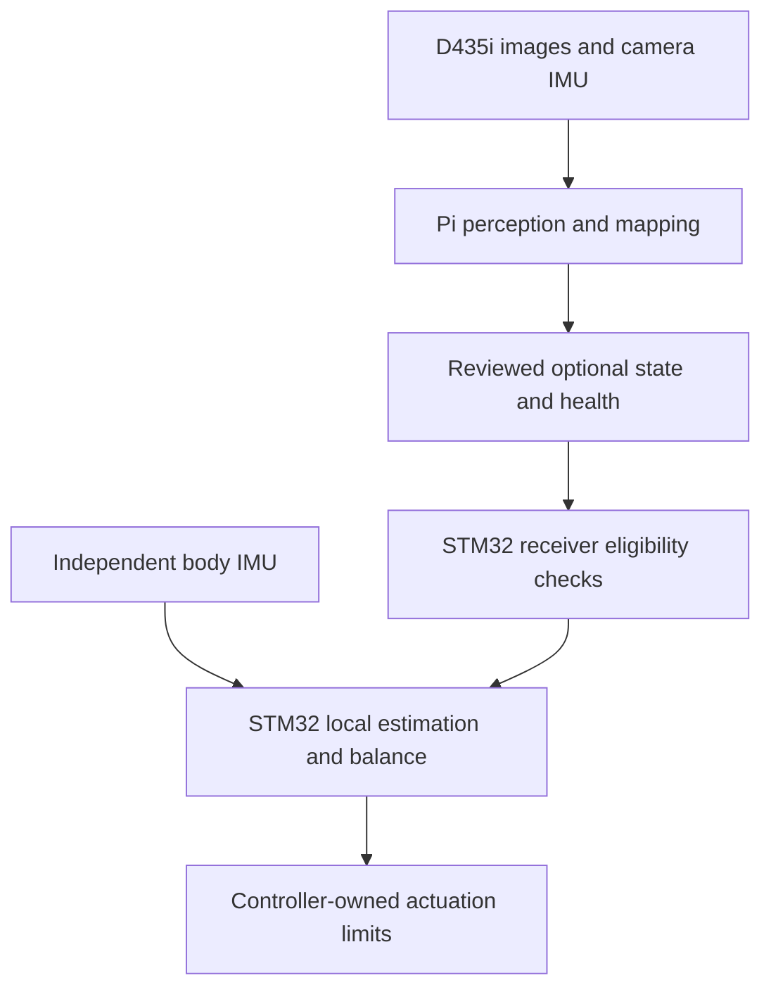
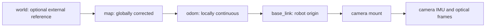
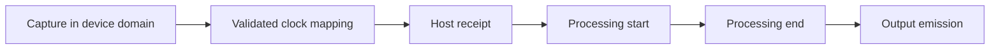
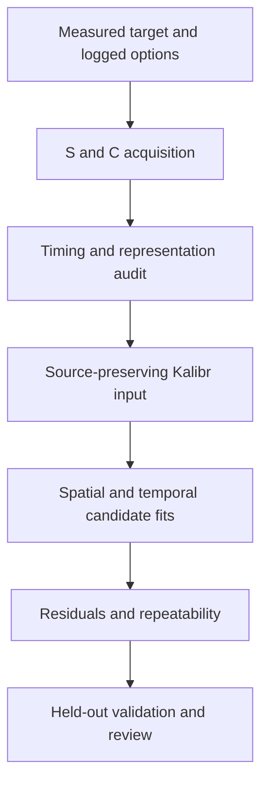
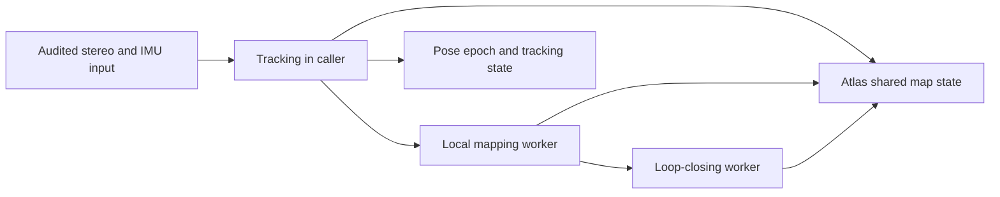
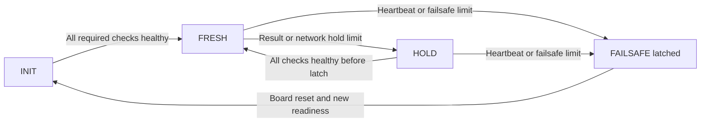
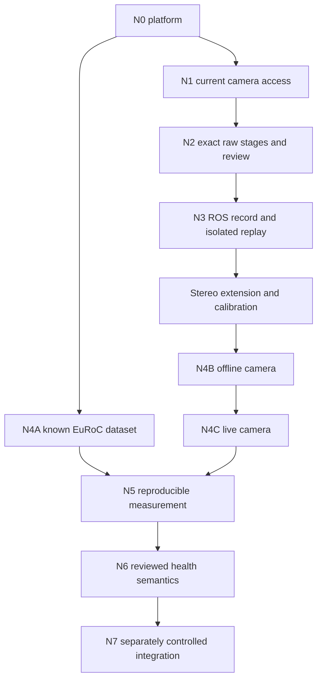
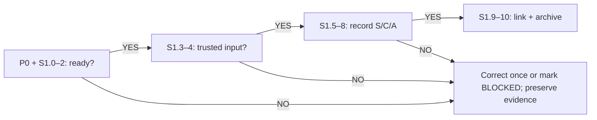
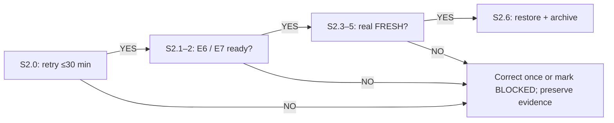

# WBR perception: an end-to-end study guide

From sensor physics to recorded evidence, stereo-inertial estimation and an independently supervised controller boundary.

## 0. How to use this guide

This wheel-biped robot (WBR) guide is for a fourth-year Electronics and Telecommunications student who can already write embedded C, work with an STM32 and use Linux. The unfamiliar part is usually connecting estimation mathematics to the behavior of a real acquisition and control system. Read Part I in order. Predict the result of each worked example before reading its explanation, and answer the questions before opening the answer. Part II is a field runbook for two sessions of at most 150 minutes each, followed by home analysis H0–H7. Part III is the lookup reference.

The objective is to explain how a physical event becomes a usable state estimate, and to recognize where that explanation stops being supported. A trajectory is useful only if its samples describe the right physical origin, in the right frame, at the right time, with adequate continuity and a receiver that handles failure. A clean exit, an attractive map and a current heartbeat each answer a narrower question.

**Scope of this edition:** documentation and offline document checks only. The acquisition, network, firmware and estimator commands printed here have not been executed while writing this guide. Every hardware procedure is conditional on its stated prerequisites. This guide supplies no motor-test command. The original brief and project procedures retain their physical authorization requirements; preparing the guide does not grant camera, flashing, card-transfer or robot-test authorization.

The platform uses Robot Operating System 2 (ROS 2) on a Linux operating system (OS). The camera software development kit (SDK) exposes its inertial measurement unit (IMU) and images through Universal Serial Bus (USB). Keep application-specific integrated circuit (ASIC) identifiers separate from SDK serials. Random-access memory (RAM), micro Secure Digital (microSD) cards and proposed Non-Volatile Memory Express (NVMe) storage have different roles. The related Computer Networks (CN) experiments use a Universal Asynchronous Receiver/Transmitter (UART) for the microcontroller link. These names identify components and mechanisms; qualification still depends on evidence.

### 0.1 Evidence vocabulary

| Label | Meaning and appropriate use |
|---|---|
| **KNOWN** | An established definition, mathematical identity or accepted project ownership decision. It is not proof that this implementation satisfies it. |
| **MEASURED** | A retained observation, such as factory readback or a dated experiment. State the unit, configuration and source. Readback is not independent physical metrology. |
| **CALCULATED** | Arithmetic or a derivation from explicitly stated inputs. An illustrative input is never a measurement. |
| **SOURCE-SUPPORTED** | Supported by inspected code, an audited procedure or a cited source. A supported command interface does not establish installation or hardware behavior. |
| **INFERRED** | A causal interpretation consistent with evidence but requiring a discriminating test. |
| **ASSUMED** | A proposed operating choice, example input or review threshold. It must stay distinct from an accepted gate requirement or measurement. |
| **UNKNOWN** | No adequate evidence is available. Missing counters and unsupported noise fits are UNKNOWN, not zero. |
| **OPEN** | Qualification or a decision is unfinished. A branch can be locally BLOCKED by a named missing dependency while the project gate remains OPEN. |

The lab additionally uses **UNVERIFIED** to flag an interface or installed behavior that must be established before executing that branch. **PLANNED**, **DESIGN**, **NOMINAL**, **SIM** and **diagnostic** reproduce source qualifications: planned work, proposed configuration, factory/computer-aided design (CAD) comparison geometry, simulation evidence and a bounded observation respectively. They do not promote a WBR gate.

A useful sentence has a subject and a limit: “MEASURED on the historical 4 GB Pi, three MH01 trials produced these rigid-aligned errors; under-voltage prevents a speed verdict.” A misleading sentence drops the subject and limit: “The robot has four-centimetre accuracy.” Keep those distinctions in your notebook.

### 0.2 Current project state: one authoritative snapshot table

The accuracy summary uses Absolute Trajectory Error (ATE) and root mean square error (RMSE). Relative Pose Error (RPE) is a separate local-motion metric developed in Chapter 12.

The controlling WBR snapshot is `docs/PROJECT_STATE.md` and Phase 8 in `slides_study/base/main.tex`, dated 14 October 2026. `docs/NEXT_GATE.md` names **N3** as the active gate. Later source reports are explicitly dated in the final rows below; they do not silently rewrite that snapshot or constitute new acceptance.

| Item or gate | Source state | Evidence and practical consequence |
|---|---|---|
| Hardware | MEASURED 8 GB Pi boot; historical 4 GB stand-in | `PROJECT_STATE.md`; 14 October addendum. Record the actual board at every run. |
| Power | Unresolved in controlling WBR snapshot | Under-voltage with 5 V/3 A on both boards. A larger memory board does not repair power. |
| Storage | 32 GB boot card; NVMe absent | Card file growth measured 16.6 MB/s against about 18.4 MB/s input. USB2 stick measured 1.09 MB/s with fsync and is unsuitable. |
| Camera | SDK serial 317422076650; BMI085; firmware readback 5.17.3.10 | ASIC/descriptor observation 327743061057 is a separate identity field. Old SDK serial 243322073847 receipts do not transfer. |
| N0 platform | **OPEN** | OS/Jazzy runs exist, but stable power qualification is missing. |
| N1 current-unit access | **OPEN** | New-unit attempt stopped at a clock prerequisite, later repaired; no accepted fresh sequence is established. |
| N2 current-unit raw streams | **OPEN** | Not completed on the new unit; old September observations are historical. Mandatory staged soak remains required. |
| N3 ROS 2 record/replay | **OPEN; active gate** | Requires trusted streams, compatible graph/QoS, qualified storage and faithful isolated replay. Card-policy compatibility remains unresolved. |
| N4A known dataset on Pi | **OPEN, strong evidence** | Three EuRoC MH01 runs; ATE RMSE 0.0415 / 0.0368 / 0.0416 m; IMU initialized, one map, no resets. Power and acceptance contract remain incomplete. |
| N4B offline D435i | **OPEN** | Controlling snapshot: first offline run crashed; patch-4 rebuild interrupted. No qualified camera motion trajectory. |
| N4C live D435i | **OPEN** | Not attempted in the controlling snapshot; no live timing qualification. |
| N5 measurement campaign | **Not started / OPEN** | Partial historical N4A summaries exist; reproducible campaign and budgets remain incomplete. |
| N6 WBR health semantics | **Not started / OPEN** | Message, rate, source-age bound and receiver fixtures need review. |
| N7 controller boundary | **Not started / OPEN** | STM32H7 retains control ownership; measured physical independence and fallback bound remain absent. |
| Later lab-source report, 14 October night | SOURCE-SUPPORTED dated report | `LAB_DAY_2026-10-15-4b63.md` reports further fixes and exit 0 for a 15 s still take exported to the EuRoC example; no map. Hand-motion and live unverified. Keep separate from Phase 8. |
| Later CN inventory, 16 October | Owner-reported availability | CN `HARDWARE.md` assigns 8 GB Pi B the official 27 W supply, fast 128 GB card and better cooler; 4 GB Pi A has 5 V/3 A. Availability is not WBR loaded qualification; card speed is an estimate. |
| Later OS integration, 17 October | Host/pseudo-terminal (PTY) verification reported; full image UNKNOWN | `OS-wt-cn/docs/CN_INTEGRATION.md` reports host tests and portable Cortex-M4 compilation. Full firmware lacked a reference dependency; real Wi-Fi/UART behavior unverified. |

No WBR gate is shown PASS in this table. Gate numbers in another architecture document differ: its N4 known-dataset plus N5 Pi-build correspond to this guide's N4A, its N6 saved-camera replay to N4B, and its N7 live to N4C. Here **N6 and N7 always mean WBR health and controller integration**, unless explicitly described as the other numbering scheme.

### 0.3 Reading map and source precedence

| Part | Contents |
|---|---|
| I, Chapters 1–4 | Ownership; physical platform; storage; stereo and feature geometry. |
| I, Chapters 5–8 | Inertial models; Allan analysis; frames; clocks and timestamps. |
| I, Chapters 9–12 | ROS 2/queues/bags; calibration; ORB-SLAM3; evaluation. |
| I, Chapters 13–16 | WBR health; UART and OS supervision; gates and diagnosis; CN E6/E7 and research practice. |
| II | Preparation P0; Session 1 S1.0–S1.10; handoff; Session 2 S2.0–S2.6; home H0–H7; printable checklists. |
| III | Glossary; command lookup; file map; open gaps; source register. |

Use the 91-page lecture for teaching flow and Phase-8 base facts when they conflict. Use the audited `LAB_PLAN.md` for command bytes. The current calibration plan and actual target files resolve stale target prose: the target is **6 columns by 4 rows**, not the older 6×6/80 mm proposal. The native Allan implementation budgets **192 bytes/sample** for comma-separated values (CSV), superseding the plan's 160-byte estimate. The original OS protocol is v1; NET_STATUS and the detailed network supervisor contract come from the newer OS-wt-cn v3 sources. `slides_study/REVIEW_CODEX_K.md` was absent when this guide was prepared. The source audit already records material command and criteria corrections; those are preserved here.

# Part I — Theory

## 1. Robot context, responsibility and scientific questions

### 1.1 Why navigation and balance have different owners

A wheel-biped robot (WBR) needs rapid local feedback to keep its body stable and a broader view of its surroundings to navigate. The two tasks have different failure consequences and scheduling needs. The controller must react to body motion even if an image is late, a map changes origin or Linux pauses during memory pressure. That is the causal reason for the responsibility boundary, rather than a preference for one processor family.

The accepted architecture puts perception, visual-inertial odometry (VIO), simultaneous localization and mapping (SLAM), evaluation and optional navigation on the Raspberry Pi. STM32H7 owns controller-side body estimation, balance, the Linear Quadratic Regulator (LQR), Virtual Model Control (VMC), the Finite State Machine (FSM), watchdogs and motor limits. These names identify controller responsibilities; this guide does not provide their implementation or certify their timing.

The D435i inertial measurement unit (IMU) supports camera-centric perception. The body IMU supports controller-centric estimation. They are mounted at different positions, may use different axis conventions, have independent clocks and have independent calibration histories. Even identical nominal sample rates do not make their samples interchangeable. Substituting the camera IMU after Pi failure would also retain a dependency on the failed acquisition path.



The ownership invariant is KNOWN: loss of ROS, SLAM or the Pi must not directly remove local balancing authority. Whether the physical robot actually retains stability during a fault is UNKNOWN until separately controlled integration establishes it. Architecture is a requirement to test.

### 1.2 A pose is more than seven floating-point numbers

A pose normally includes position and orientation, but those numbers are meaningless without a reference frame, physical origin and epoch. A pose of the camera IMU is different from a pose of the robot's base. A pose sampled before a queue stall is different from a current pose, even if both are published now. A new map can reset the coordinate origin while the physical robot stays still.

A receiver therefore needs an eligibility decision. It should ask whether the format is supported, the session is current, the source epoch advances, the values are finite, the frame is acceptable and age is bounded. A current heartbeat establishes recent communication from some sender; it does not establish new visual evidence. That distinction becomes explicit in Chapters 13–14.

Observe this boundary by logging source epochs and estimator states beside output events and controller decisions. Test it with an old pose transmitted in new packets, a map reset, a sender reboot and malformed coordinates. A receiver that continues accepting an unchanged source epoch merely because packet sequence advances would contradict the intended boundary.

### 1.3 Convert broad goals into discriminating experiments

“Make SLAM work” combines too many uncertainties. Break it into questions whose answers change the next action. Can the exact sensor profile sustain delivery over the requested window? Does the same immutable input initialize repeatedly? Do the exported poses use the intended body origin? What is the distribution of receipt-to-output latency? Does the receiver reject an old session?

Each question has a different experiment. Raw counts and power logs answer acquisition. Known EuRoC input isolates a build from the D435i. Replaying the same take isolates a settings change from human motion. A receiver fixture isolates age logic from UART errors. A controlled physical fault is needed to test retained local control. Passing one experiment cannot answer all the others.

The Mac holds canonical source and home analysis. The Pi acquires locally using identified runtime bundles. Secure Shell (SSH) is a control and evidence-copy path in the future labs; it is not the qualified image stream. Preserve source revision, dirty-file hashes, binary/library identities and settings. Two runs from the same commit may use different dirty files or shared libraries.

**Worked example — CALCULATED, illustrative.** A result takes 20 ms to compute and then waits 300 ms before transmission. Its age is at least 320 ms plus earlier acquisition and transport. A heartbeat sent immediately before the packet has almost zero heartbeat age but cannot reduce the result's 320 ms. The actual WBR admissible age limit is UNKNOWN; this example illustrates why separate timers are needed.

**Common mistakes.** Treating the F446RE lab stand-in as the robot's H7 controller; calling a successful launch a gate acceptance; assigning a controller timeout from an unrelated CN demonstration; or treating a build hash as complete runtime identity. Each erases a responsibility or evidence boundary.

**Check yourself.** Why keep two IMUs? What would disprove the claim that balance is independent of the Pi? Why does a fresh packet not imply a fresh estimate?

<details><summary>Answers</summary>

The body IMU and local controller must remain available through perception failure; camera VIO has different geometry, clocks and purpose. A trace showing the local balance loop stops or a stale navigation reference remains authoritative when the Pi fails would contradict the independence requirement. Packet receipt times describe transport activity, whereas estimate freshness depends on the epoch of the underlying state and a valid clock relationship.

</details>

Source basis: canonical `docs/ARCHITECTURE.md`, `docs/DECISIONS.md` ADR-001–005; both base lectures; study-deck ownership and research-design frames.

## 2. D435i hardware, USB and power

### 2.1 Select measurements for the algorithm

The D435i package offers stereo infrared (IR) views, depth/color capabilities and raw inertial channels. Stereo-inertial ORB-SLAM3 uses the left and right grayscale views with gyro and accelerometer samples. It does not require recording every available stream. Extra color, depth, point clouds and alignment work would change the USB, memory and processor load and complicate diagnosis without answering the initial qualification question.

Y8 denotes one eight-bit grayscale value per pixel. At 640×480, one image contains 307,200 payload bytes before serialization. The two selected raw motion channels have different native rates: gyro 200 Hz and accelerometer 100 Hz. A combined 200 Hz estimator input created later by interpolation does not change the physical accelerometer rate.

| Purpose | Selected image streams | Selected motion streams | Evidence class |
|---|---|---|---|
| Strict N2 and baseline N3 | IR1 Y8, 640×480 at 15 Hz | Gyro 200; accel 100 Hz | SOURCE-SUPPORTED archived gate contract |
| S/C calibration and N4 development | IR1 and IR2 Y8, 640×480 at 30 Hz each | Same raw channels | SOURCE-SUPPORTED prepared profile; qualification OPEN |
| A Allan and I static diagnostics | No images | Same raw channels | ASSUMED capture protocol; implementations must be checked |

N2's profile is deliberately narrower. Adding IR2 and doubling image rate is a separately reviewed extension that quadruples image payload relative to IR1/15. The N2 result, even after acceptance, cannot qualify that additional load.

### 2.2 Identify the actual device

The active SDK serial is 317422076650, firmware readback 5.17.3.10 and reported IMU BMI085. The observed ASIC/descriptor number 327743061057 is another field. A firmware-update identifier is also distinct and must be recorded as its own value. Do not choose whichever serial-looking string fits an old receipt. Old device 243322073847 has its own calibration and history.

The wrapper configuration uses `serial_no: '_317422076650'`; the underscore prevents YAML (YAML Ain't Markup Language) numeric interpretation and the inspected node factory removes it. That is a source-supported parser detail, not a reason to change the physical serial in a manifest. Preserve the unfiltered enumeration output and SDK warnings. A factory warning about missing IMU calibration identifies a calibration-readiness issue; it does not by itself prove why device storage lacks the data.

### 2.3 USB speed is a property of the camera's branch

A blue port and a USB-C plug are visual hints, not negotiated-link evidence. `lsusb -t` shows the actual topology and speed. The **camera child** must report at least 5000M under the strict N1 contract. A 5000M root hub can have a camera child at 480M. A cable may carry power and USB2 while lacking a working SuperSpeed path.

At 480M, stop before SDK enumeration or streaming according to the runbook. Inspect the direct cable, port and intermediate topology. A virtual machine, container or hub adds boundaries that require their own evidence. Installing a different ROS package cannot repair a missing SuperSpeed lane. Conversely, correct link speed establishes access capacity, not sustained application delivery.

Video and motion permissions can differ because video, Human Interface Device (HID) and Industrial Input/Output (IIO) interfaces may have different device ancestry or access controls. If images work but motion fails, inspect the exact nodes, groups and owner process. Blanket permission changes would hide the discriminating evidence and are not the procedure here.

### 2.4 Power and thermal faults can masquerade as software faults

The measured WBR supply was 5 V/3 A, with under-voltage observed on both boards. Pi, camera and other peripherals share a real power path with cable loss and transient load. Under-voltage can cause throttling, USB interruptions or reboots; these are different outcomes and need raw logs. One clean voltage sample after a take does not establish that the rail remained healthy during it.

Retain current and historical bits from `vcgencmd get_throttled`; strict gate readiness requires `0x0`. Historical sticky flags preserve a fault that has ended. `pmic_read_adc EXT5V_V` adds rail evidence and `measure_temp` adds system-on-chip temperature. Neither turns a sparse log into continuous electrical measurement. One-Hz telemetry can miss a shorter event.

The source N0 contract also requires temperature below 75°C and available memory at least 512 MiB, together with ARM64, Ubuntu 24.04, ROS 2 Jazzy and synchronized Coordinated Universal Time (UTC). These are existing project requirements, not vendor guarantees. They must hold under the relevant load. A 63°C sampled temperature does not rule out power throttling.

The later CN inventory reports a 27 W official supply for Pi B. Use that dated availability to plan the session, then measure loaded health on the actual rig. Keep Pi A's lighter 5 V/3 A role separate. A historical statement that the camera-free sender is light does not qualify adding a camera or another bus-powered board.

**Worked example — CALCULATED, illustrative.** A 5 V rail supplying an assumed 3 A through a total cable/contact resistance of 0.15 Ω loses $IR=0.45$ V. This is circuit arithmetic, not a measurement of the project cable or a Pi voltage threshold. It explains why checking only the adapter label is insufficient. A paired rail/load measurement and cable substitution would test this hypothesis; unchanged faults on a known sound path would point elsewhere.

**Common mistakes.** Reading root-hub speed as camera speed; using connector shape as bandwidth evidence; assigning old-unit calibration to a new camera; recording a supply's nameplate as measured loaded power; and solving motion permissions by changing unrelated software layers.

**Check yourself.** What does a 5000M camera node establish? Can an 8 GB Pi fix a power problem? Why re-run N1 after reboot or topology change?

<details><summary>Answers</summary>

The node establishes the observed negotiated speed and topology, not zero drops or calibrated timestamps. Extra RAM may help temporary storage but supplies no additional electrical power. N1 is bound to host, boot, identity and inspected topology; reboot/topology changes invalidate the conditions and its receipt also expires after two hours.

</details>

Source basis: `docs/PROJECT_STATE.md`; Phase-8 hardware/USB frames; archived N1 runbook and `n1_precheck.py`; `slides_study/lab-config/`; CN `docs/HARDWARE.md`.

## 3. Storage is part of the acquisition pipeline

### 3.1 Start with a lower bound

A writer cannot indefinitely sustain an arrival rate above its durable service rate. The operating system may initially hide the difference with page cache, filesystem buffers or application queues. When the buffers fill, blocking propagates upstream or data are discarded. A failure that appears twenty seconds into a recording can therefore originate in storage even if USB enumeration is perfect.

For uncompressed Y8 image payload,

$$R=n_{cam}\,W\,H\,f\quad\text{bytes/s}.$$

Here $n_{cam}$ is the number of image streams, $W,H$ are image dimensions and $f$ is their rate. Use decimal MB = $10^6$ bytes and GB = $10^9$ bytes; MiB and GiB use powers of two. A filesystem tool may use binary units while a throughput report uses decimal units. Convert before comparing.

| Selected image profile | CALCULATED payload | CALCULATED payload over 120 s |
|---|---:|---:|
| IR1 640×480 Y8/15 | 4.608 MB/s | 0.55296 GB |
| Two IR views at 15 Hz | 9.216 MB/s | 1.10592 GB |
| Two IR views at 30 Hz | 18.432 MB/s | 2.21184 GB |

These omit IMU messages, metadata, serialization, indexing, logging and filesystem overhead. The calibration plan also uses a rounded 18.4 MB/s and provisional 1.5 GB/min reservation. Keep the exact payload, rounded planning estimate and observed file growth distinct. Native N2 vendor CSV with sampled Portable Graymap (PGM) images does not store this full image payload, so the arithmetic is not its actual file-size prediction.

### 3.2 Capacity, throughput, persistence and policy are four checks

Capacity asks whether the complete take and reserves fit. Throughput asks whether sustained and worst-batch writes keep up. Persistence asks whether flushed, finalized data read back with the same cryptographic hashes. Policy asks whether the mount/device is the one allowed by the gate. Passing capacity does not imply any of the other three.

Pin the actual source device, partition, mount and Universally Unique Identifier (UUID) using `findmnt` and `lsblk`, and retain the hardware identity. A directory named like an external mount can silently reside on the boot card if that device is absent. A storage receipt must inspect that condition rather than trusting a path string.

The archived strict N3 policy requires an external device, at least 1 GiB written for at least 60 s, overall and worst 64 MiB fsync-batch throughput at least 9.216 MB/s, matching SHA-256 readback, cleanup and 10 GiB headroom. These are SOURCE-SUPPORTED historical criteria for IR1. A fast device may finish an 8 GiB test before 60 s: that fails the duration condition without proving low throughput.

The owner later permits recording on a qualified 128 GB slot card. The newer study/calibration protocol proposes **ASSUMED** sustained throughput at least 27.6 MB/s, a test longer and larger than the largest planned take and free space at least twice that take plus OS reserve. The 27.6 figure is a proposed 1.5× margin over rounded 18.4, not a measured card capability. The archived runner does not automatically accept this exception. Leave N3 OPEN until its runner/receipt policy is reviewed; never manufacture an external-device receipt for a card.

### 3.3 Why the RAM experiment is informative but limited

The Phase-8 hand-moved 100 s card recording had 0.3–2.9 s gaps after about 22 s; measured file growth was 16.6 MB/s. A writer bottleneck blocking acquisition is INFERRED. A short RAM take measured IR 29.99 Hz with a 33 ms maximum gap and zero observed drops, gyro 200.2 Hz and accel 101 Hz. Its later copy matched checksums. This weakens the hypothesis that the camera necessarily fails at the requested rate, while strengthening a storage-path hypothesis. It does not prove long-run reliability, absence of all device faults or a qualified persistent data volume.

The native calibration wrapper reserves $18.4\times10^6\times T\times1.2\times1.5$ bytes of temporary RAM. At 60 s that is **CALCULATED 1,987,200,000 bytes**, and at 120 s **3,974,400,000 bytes**. The extra factors are ASSUMED overhead/headroom in the script. It also checks persistent free capacity, copies after finalization and verifies hashes before removing its own RAM take. A nominal 3.9 GB `/dev/shm` may not satisfy the 120 s reserve. Never shorten S and claim the full protocol was captured.

For long Allan recordings, image traffic would be wasteful: using rounded 18.4 MB/s for 15 h gives **CALCULATED 993.6 GB** before overhead. The native IMU-only script budgets 300 samples/s × 192 bytes/sample = 57,600 B/s, or **207.36 MB/h**. Fifteen hours is **3.1104 GB**, with a threefold free-space reserve plus logs. A ROS `Imu` bag has different overhead. Measure finalized pilot bytes/hour and reserve its own projected size; do not apply the native CSV budget to ROS serialization.

### 3.4 Test one storage hypothesis at a time

Observe requested duration, all arrival gaps, file-size growth, worst-batch service, recorder logs and platform health in one run. Compare the same profile with a separately qualified storage path or a bounded RAM diagnostic. Preserve the failed take. If gaps persist with spare durable throughput and stable power, the simple slow-writer explanation is insufficient; inspect SDK queues, scheduling and domain changes next. Increasing every queue at once prevents this distinction.

**Worked example — CALCULATED, illustrative model using measured rates.** With 18.432 MB/s arriving and a hypothetical constant 16.6 MB/s durable service, backlog grows by 1.832 MB/s. A hypothetical 64 MB buffer fills in about $64/1.832=34.9$ s. Real buffering and service are variable, so this is not a prediction of the observed 22 s onset. The calculation identifies what must be measured: actual queue capacity, cache behavior and burst service.

**Common mistakes.** Qualifying a card by capacity label or peak read rate; benchmarking a small file that fits in cache; counting a clone/post-boot 4 GiB test as take-length qualification; copying an open database; using checksum success as a sensor-quality verdict; and assuming all `.db3` files have the same schema.

**Check yourself.** Why does a 30 MB/s short write not guarantee a 120 s take? Does a checksum prove every requested frame arrived? Why retain the old N3 policy and new exception separately?

<details><summary>Answers</summary>

A short write may measure cache service and miss long flush stalls or the actual recording workload. Hashes prove that the files copied match the finalized source files; missing acquisition frames may already be absent from both. The runner enforces its original assumptions; a reviewed owner exception needs compatible tooling and evidence rather than relabeling an ineligible receipt.

</details>

Source basis: Phase-8 recording/RAM frames; `docs/D435I_CALIBRATION_PLAN.md`; `calibration/lab/pi/record_calib_take.sh`; `calibration/allan/record_allan.sh`; audited storage notes in `LAB_PLAN.md`.

## 4. Stereo geometry, features and depth uncertainty

### 4.1 Recover depth from two calibrated rays

A single pixel identifies a ray from the camera, not distance along that ray. A second camera sees the same point from a displaced origin. Given camera geometry and a correct correspondence, the two rays constrain the point in three dimensions. Rectification remaps both views to a common epipolar geometry so corresponding points lie on the same horizontal row. It simplifies matching; it does not create correct correspondences.

For a rectified pinhole pair with common focal length $f_x$ in pixels, positive baseline magnitude $b$ in metres and left-minus-right disparity $d=u_L-u_R$ in pixels,

$$Z=\frac{f_xb}{d},\qquad X=\frac{(u_L-c_x)Z}{f_x},\qquad Y=\frac{(v_L-c_y)Z}{f_y}.$$

The assumptions are a compatible rectified model, correct left/right ordering, a scene point visible in both images and a nonzero positive disparity. Occlusion, repeated patterns, moving objects, saturation and blur can defeat the correspondence even with perfect intrinsics. Left/right time skew can also turn scene motion into false geometry.

```text
       same scene point P
           /      \
          /        \
   left optical    right optical
      center ---- b ---- center
          uL       uR
       disparity d = uL - uR
```

Factory readback for the selected 640×480 profile gives $f_x=f_y=386.953308105469$ px and principal point $(321.034301757812,241.040130615234)$ px for both IR views. The measured SDK IR1→IR2 translation is $[-0.049912553280592,0,0]$ m with identity rotation. Its magnitude is **CALCULATED** $b=49.9125533$ mm and $f_xb=19.31382761$ px·m. These readback values are operating calibration inputs with provenance, not a tape-verified baseline or a complete camera–IMU calibration.

### 4.2 The negative translation and positive baseline are consistent

The right camera center lies to the right of the left center. A point at the left center therefore has negative x coordinate when expressed in the right frame. That is why the coordinate mapping IR1→IR2 contains $-b$ even though baseline magnitude is positive. Kalibr cam1 `T_cn_cnm1` uses that left→right mapping. ORB's `Stereo.T_c1_c2` maps right→left and uses the inverse, with $+b$ for this identity-rotation case. `Stereo.b` is a positive scalar magnitude. Chapter 7 generalizes the transform equation.

If left and right are swapped while leaving the model unchanged, disparity reverses sign. Negative depth is a model/order failure to investigate before feature tuning. If only some correspondences have negative or implausible depth, inspect matching and occlusion rather than immediately negating the entire baseline.

### 4.3 Why distant depth is fragile

Differentiate depth with respect to disparity:

$$\frac{\partial Z}{\partial d}=-\frac{f_xb}{d^2}=-\frac{Z^2}{f_xb}.$$

For a small disparity standard deviation $\sigma_d$, first-order propagation gives

$$\sigma_Z\approx\frac{Z^2}{f_xb}\sigma_d,\qquad
\frac{\sigma_Z}{Z}\approx\frac{\sigma_d}{d}.$$

This models local sensitivity. It does not describe gross outliers from wrong matches. If focal length, baseline and disparity have small independent uncertainties, a useful approximation is

$$\left(\frac{\sigma_Z}{Z}\right)^2\approx
\left(\frac{\sigma_f}{f_x}\right)^2+
\left(\frac{\sigma_b}{b}\right)^2+
\left(\frac{\sigma_d}{d}\right)^2.$$

Independence is an ASSUMED simplification; calibration parameters can be correlated. Timing skew and lens-model error are systematic effects that may not fit this random-error model.

At 0.5, 1.0 and 1.5 m, ideal readback-based disparities are **CALCULATED** 38.63, 19.31 and 12.88 px. Smaller disparity at longer distance makes the same pixel uncertainty more expensive in metres. Increasing a feature count cannot change this geometry. Better texture, appropriate light, shorter exposure and accurate pairing may improve $\sigma_d$, but require observation.

### 4.4 Features connect geometry across time

An image feature combines a repeatable location, often a corner, and a descriptor of its local appearance. Stereo matching constrains depth at one epoch. Temporal matching connects observations at different epochs. Many geometrically consistent matches constrain camera motion; a descriptor match alone is a hypothesis.

ORB means Oriented FAST and Rotated BRIEF. FAST expands to Features from Accelerated Segment Test and BRIEF to Binary Robust Independent Elementary Features. The detector selects candidate corners and the descriptor makes matching practical. Robust estimation rejects correspondences inconsistent with a shared pose model. A low-texture wall, motion blur or repeated target patterns can leave too few independent constraints even if images arrive at the correct rate.

The D435i projector adds IR texture tied to the moving projector. The development and calibration protocol therefore selects emitter OFF for natural-scene feature tracking. This requires sufficient ambient near-infrared (NIR) light. A room that looks bright to a person under light-emitting diode (LED) light may still be poor in IR. Some inkjet prints may have weak IR contrast. Inspect decoded tags in both views before recording; changing light or print is more informative than using the projector to disguise target invisibility.

### 4.5 Observe and challenge the geometry

Use the S take's static intervals first. Measure paired target corner row differences, reprojection residuals by image quadrant, left/right timestamp skew and triangulated depth against a measured plane distance. A vertical residual pattern growing toward image edges suggests model or rectification issues. A mismatch only while moving suggests timing skew or blur. A depth-scale error at all ranges can arise from baseline, target scale, focal length or the distance reference.

The ASSUMED review asks for at least 100 detected stereo pairs covering all four quadrants, radial reprojection RMS at most 0.5 px, median absolute row difference at most 0.3 px, row P95 at most 1 px and tape-depth discrepancy at most 2%. These are proposed project review thresholds. Missing far-range tag detections leave that range OPEN; failed detections must remain in the report denominator.

**Worked example — CALCULATED using readback geometry and illustrative disparity error.** At $Z=2$ m, $d=19.31382761/2=9.6569$ px. With an illustrative small error of 0.5 px, first-order $|\Delta Z|\approx4(0.5)/19.31382761=0.1036$ m. The exact depths at $d\pm0.5$ are asymmetric because of inversion; the derivative is an approximation. At $d=10$ px, the calculated depth itself is 1.93138 m. Neither is a new measurement of camera accuracy.

**Common mistakes.** Copying the signed SDK translation into scalar `Stereo.b`; applying software rectification twice; assuming zero reported distortion means physically perfect lenses; ignoring pairing skew; or calling a nice-looking depth map an independent metric test.

**Check yourself.** Why does depth error grow approximately with squared distance? Can a 30 Hz left topic and 30 Hz right topic prove pairing? Which observation would contradict a simple fixed geometry-error hypothesis?

<details><summary>Answers</summary>

Disparity falls as $1/Z$, and differentiating its inverse makes depth sensitivity grow as $Z^2$ for fixed pixel error. Equal rates say nothing about which frame IDs or epochs were paired. If static aligned pairs agree across the image but only moving pairs fail, a fixed geometric error alone is insufficient; timing skew or blur becomes a stronger hypothesis.

</details>

Source basis: calibration plan §§1–2; factory candidate/readback; study-deck stereo/feature/error frames; Phase-8 emitter discussion.

## 5. The inertial measurement model and its consequences

### 5.1 An accelerometer measures specific force

Let $R_{wb}$ rotate vectors from the estimator IMU frame $b$ into world $w$. For this chapter, $b$ is the **camera IMU**, not the controller's body frame. A simple measurement model is

$$\omega_m=\omega+b_g+n_g,$$
$$a_m=R_{bw}(a_w-g_w)+b_a+n_a.$$

The gyro measures angular rate plus gyro bias $b_g$ and noise $n_g$. The accelerometer measures specific force: inertial acceleration minus gravity, expressed in its own axes, plus accelerometer bias $b_a$ and noise $n_a$. At rest in a world with z upward and $g_w=[0,0,-g]^T$, an aligned accelerometer reports approximately $[0,0,+g]^T$. It does not report zero merely because the robot is stationary. Angular rate uses rad/s and acceleration uses m/s².

A richer model puts scale and axis-misalignment matrices before the true vectors. Bias is an additive offset; scale is a multiplicative error; misalignment mixes axes. Online bias estimation cannot generally correct unknown scale or arbitrary axis geometry. The SDK's identity sensitivity and zero offset/noise arrays are readback placeholders with unknown true unit parameters.

### 5.2 Prediction integrates errors as well as motion

Ignoring noise for clarity, inertial propagation follows

$$\dot R_{wb}=R_{wb}[\omega_m-b_g]_\times,$$
$$\dot v_w=g_w+R_{wb}(a_m-b_a),\qquad \dot p_w=v_w.$$

The skew-symmetric matrix $[\omega]_\times$ represents the cross product. A numerical implementation uses finite intervals and an appropriate rotation integration rule. Orientation affects how gravity and specific force are separated, so a small orientation error can create a persistent horizontal acceleration error. Position then integrates that error twice.

A constant uncorrected acceleration bias $b$ produces idealized position error $\frac12 bT^2$ under a fixed-axis model. Gyro bias produces approximate angle error $b_gT$; rotating gravity with the wrong attitude can make subsequent position drift worse. Images constrain that drift only when useful features, geometry and timing connect them to the same motion.

At nominal 30 Hz, images are about 33.3 ms apart. A 200 Hz gyro has a 5 ms period, giving roughly six or seven gyro epochs per image interval. The exact count varies with phase and interval boundaries. Preintegration accumulates motion and associated uncertainty over an image interval, allowing optimization to use an inertial constraint without repeatedly reintegrating every raw sample for every small state update. It is not license to ignore missing measurements.

### 5.3 White-noise density differs from sample noise

A continuous white-noise density $N$ specifies uncertainty per square-root bandwidth. Under the selected continuous-to-discrete convention,

$$\sigma_{n,d}=\frac{N}{\sqrt{\Delta t}}=N\sqrt f.$$

For a bias random-walk driving quantity $K$,

$$\sigma_{b,step}=K\sqrt{\Delta t}=\frac{K}{\sqrt f}.$$

The four settings and their continuous units are:

| Quantity | Continuous units | ORB field | Current candidate classification |
|---|---|---|---|
| Gyro density | rad/s/$\sqrt{\mathrm{Hz}}$ | `IMU.NoiseGyro` | ASSUMED 0.001 |
| Accel density | m/s²/$\sqrt{\mathrm{Hz}}$ | `IMU.NoiseAcc` | ASSUMED 0.01 |
| Gyro bias walk | rad/s²/$\sqrt{\mathrm{Hz}}$ | `IMU.GyroWalk` | ASSUMED 0.000001 |
| Accel bias walk | m/s³/$\sqrt{\mathrm{Hz}}$ | `IMU.AccWalk` | ASSUMED 0.0001 |

These numbers originate in example settings and are not measurements of serial 317422076650. The pinned ORB tracker multiplies densities by $\sqrt f$ and divides walk by $\sqrt f$ before covariance construction. YAML must contain continuous values. Pre-scaling them and letting ORB scale again changes the estimator's confidence.

A bandwidth density is also not interchangeable with the standard deviation of a filtered recorded sample. Hardware filtering, digital filtering and interpolation create correlation and change effective bandwidth. Measure the actual raw channels and state the fit convention rather than copying a datasheet number from a different IMU model.

### 5.4 Two raw rates and one combined grid

The prepared helper preserves gyro at its original 200 Hz epochs. It interpolates accel between valid raw 100 Hz brackets to create a combined input. For $t_0\le t\le t_1$,

$$a(t)=(1-\lambda)a(t_0)+\lambda a(t_1),\quad
\lambda=\frac{t-t_0}{t_1-t_0}.$$

This assumes smooth enough acceleration across the valid interval. It rejects extrapolation and invalid gaps. Interpolated neighboring values share raw measurements, so they are correlated. Calling the derived grid “200 Hz accel” without the word derived hides this limitation. `IMU.Frequency=200` describes the combined estimator grid; noise characterization still uses raw accel at 100 Hz.

### 5.5 Static checks are useful screens, not complete calibration

A stationary window should have finite vectors, gyro near zero and accel norm near local gravity. The native bring-up proposal uses mean gyro norm at most 0.10 rad/s and accel norm 9.0–10.5 m/s². Those are SOURCE-SUPPORTED engineering screens. The calibration protocol's stricter **ASSUMED** gyro mean norm at most 0.01 rad/s and gravity-norm error at most 1% answer a different question.

Six static approximately ±X/±Y/±Z-up orientations help diagnose accelerometer bias/scale and orientation-dependent residuals. Opposite poses separate offset from sign-changing gravity response under a simple model. Static gyro observations establish zero-rate offset, not gyro scale. Gyro scale needs known angular rate or sufficiently observable dynamic calibration. An IMU that passes a norm screen can still have axis misalignment or time errors that defeat VIO.

Observe raw axes, units, timestamp spacing and correction settings. Test expected sign changes under controlled orientation and compare repeated poses after warm-up. If apparent bias changes systematically with orientation, a constant-bias-only model is contradicted. If stationary residuals track temperature, the fixed-temperature noise model is incomplete.

**Worked example — CALCULATED, illustrative.** An uncorrected gyro bias of 0.01 rad/s accumulates 0.1 rad, about 5.73°, over 10 s under a constant-axis approximation. An illustrative 0.02 m/s² fixed acceleration bias yields $0.5(0.02)(10^2)=1$ m position error without external correction. Separately, candidate gyro density 0.001 at 200 Hz gives $0.001\sqrt{200}=0.01414$ rad/s discrete sample noise, and candidate walk $10^{-6}/\sqrt{200}=7.071\times10^{-8}$ per step under the stated convention. No value in this example estimates this unit's actual bias or noise.

**Common mistakes.** Subtracting 9.81 from one body axis regardless of orientation; confusing deg/s with rad/s; interpreting zero SDK variance as noiselessness; measuring Allan deviation on interpolated accel; or assuming online bias estimates are complete intrinsic calibration.

**Check yourself.** What does an aligned stationary accelerometer report? Why can a gyro frame error masquerade as noise? Does changing the input-grid frequency justify changing the raw physical accel rate in the manifest?

<details><summary>Answers</summary>

It reports specific force opposing gravity, approximately +g along up in the stated convention. Wrong rotation axes give systematically wrong propagation and gravity removal; increasing noise can mask inconsistency without repairing geometry. A derived grid changes sample association and model assumptions, not the raw sensor's measured cadence.

</details>

Source basis: study-deck inertial-model frames; calibration plan §§3,5–6; `d435i_input.h`; pinned `Tracking.cc` and `ImuTypes.cc` contracts recorded in the plan.

## 6. Allan deviation: identify noise only where the data support it

### 6.1 Why one standard deviation is insufficient

A stationary IMU trace can contain high-frequency noise, slowly moving bias, thermal drift and occasional acquisition defects. Computing one standard deviation over the entire trace mixes mechanisms. Allan deviation asks how differences between adjacent interval averages change with averaging time $\tau$. Different stochastic processes have different scaling with $\tau$, so the curve helps distinguish them.

For uniform samples $x_k$ at period $\Delta t$, define $m$-sample averages with $\tau=m\Delta t$. An overlapping Allan-variance estimator uses

$$\bar x_k^{(m)}=\frac1m\sum_{j=0}^{m-1}x_{k+j},$$
$$\hat\sigma_A^2(\tau)=\frac{1}{2(N-2m+1)}
\sum_{k=0}^{N-2m}(\bar x_{k+m}^{(m)}-\bar x_k^{(m)})^2.$$

Allan deviation is its square root. Overlapping terms improve use of the record but are correlated; the number of overlapping differences is not the number of independent long-$\tau$ clusters. Preserve the estimator and support counts.

### 6.2 Read the slope and its convention

For white measurement noise in the selected convention,

$$\sigma_A(\tau)\approx\frac{N}{\sqrt\tau}.$$

Its log-log slope is $-1/2$, so the fitted curve evaluated at 1 s yields $N$. For bias random walk,

$$\sigma_A(\tau)\approx K\sqrt{\tau/3}.$$

Its slope is $+1/2$, so the fitted curve at 3 s yields $K$. A near-flat minimum associated with bias instability is another process and is not the bias-walk coefficient. A rising curve caused by temperature drift or a gap is not automatically random walk.

```text
log Allan deviation
 ^
 | \   white-noise candidate: slope -1/2
 |  \____       near-flat behavior
 |       \____/
 |            /  walk candidate: slope +1/2
 +------------------------------------> log averaging time
    schematic only; no measured unit curve
```

The calibration plan proposes slope tolerance ±0.1 for at least a decade of $\tau$, and the supplied analyzer adds fit $R^2\ge0.95$ and at least 30 clusters per point. These are **ASSUMED review criteria**, not evidence that every record will contain both processes. Inspect each axis and the fit interval rather than reporting one attractive minimum.

### 6.3 Duration determines which questions can be answered

The lab's 36 s pilot tests cadence, precision, metadata, stationarity and file growth. It cannot support a long-$\tau$ walk fit. The protocol uses 30 min warm-up before a separate home recording, at least 4 h provisionally and preferably 15–24 h. Long elapsed time is outside both supervised 150 min sessions.

Warm-up reduces a particular thermal transient but does not establish temperature constancy. Record what temperature source is available. Pi system-on-chip temperature is context, not camera IMU temperature. If the SDK exposes no reliable IMU temperature, say UNKNOWN. Keep the camera rigidly supported, isolate vibration and strain-relieve the cable. A real vibration or a moving table violates the stationary-noise interpretation even if the timestamps are excellent.

Raw channels must remain full precision and separate. Historical vendor CSV rounding to 0.001 can hide small changes and distort the short-$\tau$ behavior. The native recorder writes high precision, but the primary lab A representation is a ROS bag whose reviewed raw-extraction adapter remains absent. Do not feed a ROS directory to an analyzer expecting `gyro.csv`, `accel.csv` and `meta.json`.

### 6.4 Timing integrity precedes stochastic fitting

Uniform-sample formulas assume an appropriate sampling grid. First inspect native source timestamps, nonfinite values, duplicate/backward time, cadence histograms, sequence gaps and whole-window coverage. Host callback batching can look bursty while source time remains regular; source gaps are a different defect. Never silently sort or resample across missing data to recover a pleasing curve.

Separate valid contiguous segments if the methodology allows it, retain the rejected intervals and avoid mixing distinct temperatures or rates. The source procedure rejects a power-damaged qualification take rather than treating post-processing as repair. Compare estimates from the first and second halves: the **ASSUMED** agreement target is within 30%. A change larger than that suggests nonstationarity or weak support and requires diagnosis.

The analyzer may emit null coefficients when no supported region exists. Null means UNKNOWN, not zero and not a value Kalibr or ORB can consume. Preserve the plots, fit intervals, cluster counts, slopes, per-axis values and raw hashes so that a reviewer can distinguish unsupported inference from a true small coefficient.

### 6.5 From measured static noise to an estimator experiment

Parameter set A conservatively takes the maximum supported per-axis coefficient for each scalar while preserving the axis results. Set B multiplies each A density/walk by ten as an explicit **ASSUMED ablation hypothesis**. Static noise can understate errors during real motion, but inflation is not a new sensor measurement. Keep the current example settings as a historical control.

Replay identical immutable route data with those candidates, freeze other settings and compare initialization, loss, reset events and route proxies. Select on development data and check a held-out take. If B improves one development run but fails held-out continuity, that contradicts a general claim that tenfold inflation is better. If A and B are indistinguishable, report that limit instead of selecting by preference.

**Worked example — CALCULATED, illustrative.** A perfect white-noise region gives deviation 0.002 at 1 s and 0.001 at 4 s. The ratio is $4^{-1/2}=1/2$, consistent with $N=0.002$ in that channel's density units. If a supported walk fit evaluates to $6\times10^{-6}$ at 3 s, $K=6\times10^{-6}$ under the stated convention. These are hypothetical fits. For a 4 h record and $\tau=1000$ s, only about 14 full nonoverlapping clusters fit; that fails a 30-cluster support criterion even if overlapping differences are numerous.

**Common mistakes.** Reading the minimum as walk; fitting the last two plotted points; calling a drift ramp stochastic walk; applying a raw-CSV tool to a ROS bag; replacing unsupported YAML null with zero; and labeling x10 values MEASURED.

**Check yourself.** Why do overlapping points not guarantee long-term support? What does a clean pilot qualify? What should happen when gyro density is supported but gyro walk is not?

<details><summary>Answers</summary>

Long overlapping averages share most of their samples, so their count overstates independent information. A pilot can qualify parts of acquisition and planning; it does not establish long-term noise behavior. Report the supported density with its fit and leave walk UNKNOWN; the full IMU settings contract remains incomplete until another supported source or approved provisional assumption is identified.

</details>

Source basis: calibration plan §5; `calibration/allan/README.md`, recorder and analyzer; study-deck Allan explanation and audited H5 limitations.

## 7. Frames, transforms and the physical origin of a pose

### 7.1 Coordinates require an agreed meaning

The ROS transform (TF) system relates coordinate frames. A vector is expressed in axes attached to an origin. In the ROS body convention, x points forward, y left and z up. In an optical frame, x points right, y down and z forward. Both are right-handed. A vector `[0,0,1]` therefore has different physical meaning in those frames. A frame name is useful only when its origin, axes and ownership are documented.

Use `imu_camera` for the D435i estimator IMU and `imu_body` for the controller IMU in this guide. Names such as `camera_link`, actual wrapper optical frames and robot `base_link` must come from their observed definitions. The mathematical subscript $b$ in ORB is its estimator body, which is the camera IMU here. It does not imply the WBR controller body.

### 7.2 Define transform direction by an equation

Throughout this guide,

$$p_a=T_{a\_b}p_b,
\qquad T_{a\_b}=\begin{bmatrix}R_{a\_b}&t_{a\_b}\\0&1\end{bmatrix}.$$

The transform maps coordinates **from b into a**. Translation is the location of b's origin expressed in a. Composition follows the coordinate chain:

$$T_{a\_c}=T_{a\_b}T_{b\_c},\qquad
T_{b\_a}=T_{a\_b}^{-1}=
\begin{bmatrix}R^T&-R^Tt\\0&1\end{bmatrix}.$$

Inversion is not simply negating translation unless rotation is identity. Test a candidate transform using the origin and three basis vectors, inverse composition and a proper rotation check: $R^TR\approx I$, $\det R\approx+1$. A reflection can preserve many distances while violating the physical orientation convention.

Storage layout is separate from direction. SDK extrinsic rotation arrays are column-major; OpenCV YAML matrix `data` is row-major. First reconstruct the mathematical rotation, then serialize it in the expected order. Transposing a storage array to fix a direction error mixes two different operations and can accidentally pass identity-only tests.

### 7.3 A camera trajectory is not automatically a base trajectory

Suppose the estimator reports $T_{w\_i}$, the camera IMU pose in world, and the static mount $T_{i\_base}$ is measured. The robot-base pose is

$$T_{w\_base}=T_{w\_i}T_{i\_base}.$$

For positions, a lever arm rotates with orientation. Copying camera position into `base_link` creates an orientation-dependent error. A single rigid alignment fitted to a whole trajectory generally cannot remove a missing lever arm that changes world direction over time.

For inertial measurements the issue is deeper: sensors at displaced rigid-body points can experience different linear accelerations. If vector $r$ runs from one origin to another in a consistent rotating frame, the relative acceleration contains $\dot\omega\times r+\omega\times(\omega\times r)$. Thus two IMUs need more than an axis rotation to compare arbitrary dynamic accelerations. This is one reason naive camera/body-IMU fusion is deferred.

### 7.4 Map correction and local continuity need different contracts

A SLAM `map` frame aims at long-term consistency and can change after loop closure. `odom` is a locally continuous reference that may drift. A controller following a continuous local reference should not interpret a map correction as instantaneous physical motion.

The intended relationship is

$$T_{map\_base}=T_{map\_odom}T_{odom\_base}.$$

A future continuity owner can update map→odom when global correction occurs while preserving local odom behavior. That owner is PLANNED in WBR; renaming a map trajectory does not implement it. A separate `world` frame is optional and needs an external-reference definition.



This is a semantic sketch, not a tree to publish. The robot description owns static robot mounts. The wrapper owns its internal sensor geometry and normally publishes it on `/tf_static` with `tf_publish_rate=0`. The dynamic estimator/continuity bridge requires its own reviewed ownership. One child must have one parent and one publishing owner; duplicate publishers can create a plausible but inconsistent transform graph.

### 7.5 Observe, test and falsify frame assumptions

Inspect the actual `frame_id`, static transforms, camera information and exported pose direction. Some outputs give world→camera $T_{c\_w}$; others give body→world $T_{w\_b}$. If the desired position is the camera center in world, it comes from the appropriate inverse, $-R^Tt$, rather than directly from world→camera translation.

Test nonidentity transforms numerically before physical use. Compare known orientation changes with expected axes. A camera rotated about a fixed robot base should trace its lever arm while the reconstructed base remains fixed. If the base instead moves in a circle of the mount radius, the output-origin interpretation is contradicted. If static data require a time-varying mount, inspect frame composition and clock association before asserting a flexible bracket.

**Worked example — CALCULATED, illustrative.** A camera origin is 0.10 m along body x. With a 90° yaw, $R_z(90°)[0.10,0,0]^T=[0,0.10,0]^T$ in world. Copying its coordinates to the base creates a 10 cm offset whose direction changes with yaw. A separate illustrative loop correction of 0.20 m while the platform is stationary changes the map estimate, not physical motion.

**Common mistakes.** Negating translation without rotating it during inversion; mixing row/column storage with frame inversion; treating `b` as the H7 body in an ORB matrix; publishing a copied wrapper TF tree; using one global trajectory alignment to hide a dynamic lever-arm error; and renaming map to odom.

**Check yourself.** What does $T_{a\_b}$ do to b's origin? Why use nonidentity rotations in tests? Does a loop jump prove robot movement?

<details><summary>Answers</summary>

It maps the origin to $t_{a\_b}$ in a coordinates. Identity rotation hides transpose and inverse-translation mistakes that appear with actual mount rotations. A loop jump changes the global reference estimate; physical motion requires independent evidence and continuous local-frame semantics.

</details>

Source basis: canonical architecture; lecture frame/TF chapters; calibration-plan transform contract; ROS frame conventions cited in the decks.

## 8. Clocks, timestamp kinds and latency

### 8.1 The event and the clock are two separate declarations

A timestamp answers “when” only after two things are known: the event being stamped and the clock used to stamp it. Nanoseconds are a unit, not an epoch or synchronization guarantee. A device clock starting at boot and a host UTC clock can both count nanoseconds while having unrelated origins and drift.

| Timestamp kind | Owner or boundary | What it can mean |
|---|---|---|
| Physical capture/exposure | Sensor physics | Integration interval; start/middle/end convention UNKNOWN here. |
| Raw hardware/device timestamp | Device/SDK | Sensor event in device domain; retain original value and units. |
| Global mapped timestamp | SDK clock mapping | Device event mapped toward host time; mapping error must be characterized. |
| System-time fallback | SDK/host | May reflect arrival when hardware metadata is unavailable; calibration policy rejects it. |
| Driver stamp | Driver/backend | Driver-selected event; inspect implementation and metadata. |
| ROS header stamp | Wrapper | Producer's declared measurement epoch, not automatically publication time. |
| Publication | Publisher instrumentation | When the message is handed onward; use a stated local clock. |
| Subscriber receipt | Observer/adapter | When this consumer receives it, after transport and queues. |
| Recorder/storage time | rosbag2 backend | A stored record time, distinct from the embedded header. |
| Processing start/end | Estimator instrumentation | Local queue wait and computation. |
| Estimated pose epoch | Estimator state/export | Time the estimated state describes. |
| Output emission/file write | Application | When a result becomes available or is written, not its state epoch. |
| MCU receipt/action | Controller instrumentation | Local acceptance and control event on an independent timer. |

Keep source and arrival fields through conversion. A converter that replaces headers with bag storage time can preserve counts and make a playable dataset while changing the estimation problem.

### 8.2 Host clocks serve different purposes

Wall time/UTC is useful for correlating dated logs and receipts, but can be corrected by time services. A host monotonic or steady clock is suitable for durations within a run. `CLOCK_MONOTONIC_RAW` is used in the newer OS bridge's source-age contract; it is distinct from ordinary monotonic time even on the same Pi. ROS time can follow system time or simulation `/clock`, depending on configuration.

For every subtraction, write both clock names first. “Both from the Pi” is insufficient if one is ROS simulation time and another is host steady time. “Both global time” is insufficient for two hosts without a characterized relationship. Logging UTC does not turn local clocks into a shared high-precision time base.

An approximate clock relationship is $t_h=\alpha t_d+\beta$, with drift factor $\alpha$, offset $\beta$ and uncertainty. It must be valid over a declared interval and reset when the device or mapping epoch changes. Offset-only correction can fail over long runs if drift matters. Preserve mapping version and bounds so downstream age calculations can be audited.

### 8.3 Global time is configuration plus a mapping, not physical calibration

The SDK's global-time option maps device timestamps toward host time. Save option support, requested/read-back value and every stream's actual timestamp domain. Enabled global time does not measure physical exposure timing, camera–IMU delay or host mapping error. Arrival minus mapped source stamp includes acquisition/driver delay and clock error, so it is not pure USB latency.

Calibration/N4 policy allows `GLOBAL_TIME` or `HARDWARE_CLOCK` with supported timestamp metadata. It rejects `SYSTEM_TIME` even if all streams agree. The existing equal-domain check alone could accept a common arrival-time fallback. The proposed whitelist and exact installed behavior must be verified before calling a take qualified.

Hardware-clock streams still require a valid interstream relationship and physical offset characterization. Domain equality is a necessary structural observation, not proof that all sensors measure the same event simultaneously. If global-time configuration changes, capture a new calibration condition rather than applying the old offset silently.

### 8.4 Decompose latency on named boundaries

Let $t_{rx},t_s,t_e,t_o$ be receipt, processing start, processing end and output emission, all on one host steady clock. Then

$$L_{rx\to o}=(t_s-t_{rx})+(t_e-t_s)+(t_o-t_e)=Q+C+E.$$

Queue wait $Q$ can dominate even when computation $C$ is small. This excludes capture-to-receipt. Capture age requires mapped capture $\hat t_c=g(t_{dev})$ in the same domain. With mapping error bounded by $u$,

$$A_{true}\in[t_o-\hat t_c-u,\ t_o-\hat t_c+u].$$

Other uncertainty, such as unknown exposure epoch within an interval, must also be included or stated outside the bound. A receiver can support freshness only if the conservative upper bound meets its reviewed limit.



### 8.5 Time offset sign and counter wrap

Kalibr's `timeshift_cam_imu=s` means $t_{imu}=t_{cam}+s$. A positive shift moves the camera epoch later on the IMU timeline. Apply it once to both camera epochs before IMU coverage/association, while preserving the original audit. Moving the camera and IMU equally has no relative effect; shifting only after coverage selection associates the wrong samples. No available ORB YAML time-offset key or reviewed runtime shift flag is assumed in this guide.

The MCU timer is another domain. The newer supervisor extends raw 32-bit microseconds into a nondecreasing 64-bit timeline with a half-range ambiguity guard. A full 32-bit microsecond cycle is **CALCULATED** about 71.58 min; sampling must remain strictly within half a cycle, about 35.79 min, for that ordering method. Capture extended receipt time before queueing; extending an old queued sample at dispatch can reinterpret its epoch. Session and generation changes must also prevent old queued events from refreshing a new health epoch.

### 8.6 Observe what would invalidate the claim

Retain source stamps, domain metadata, frame IDs, host arrivals and processing boundaries. Inspect adjacent differences and startup/tail windows. Test a known shifted synthetic event to verify sign; test reset, mixed domains, backwards time and near-wrap counters. A clock regression, unsupported domain or a mapping uncertainty larger than the freshness margin contradicts a confident capture-age claim. That should produce an explicit rejection or UNKNOWN age rather than a negative “latency” hidden by absolute value.

**Worked example — CALCULATED, illustrative.** Receipt at 10 ms, start at 30, end at 42 and emission at 45 gives queue 20 ms, compute 12 ms, emission 3 ms and receipt-to-output 35 ms. Separately, mapped capture 100 ms and output 140 ms with ±3 ms mapping uncertainty gives age 37–43 ms. An illustrative 42 ms limit is not established because the upper bound is 43 ms. This is not the project's actual, still UNKNOWN, WBR age budget.

**Common mistakes.** Subtracting a Pi timestamp from an MCU timer; using `date` as a high-resolution interval clock; treating bag time as exposure time; rewriting every source epoch to start at zero independently; inferring pure USB latency from arrival-minus-global-time; and applying time shift twice.

**Check yourself.** Can an ordinary header prove the original SDK domain? What does a positive 2 ms Kalibr shift do to a camera time of 1.000 s? Why is receipt-only freshness weak?

<details><summary>Answers</summary>

A header contains an epoch but may omit the original source domain and mapping provenance; metadata must retain them. The corrected camera time is 1.002 s on the IMU timeline. Receipt-only freshness can admit newly delivered data that were already old in acquisition, computation or a sender queue.

</details>

Source basis: architecture timestamp chain; pinned SDK mapping notes; calibration plan §4; newer OS supervisor and integration clock contract.

## 9. ROS 2 graphs, QoS, queues and rosbag2

### 9.1 Inspect the contract at four levels

Robot Operating System 2 (ROS 2) connects typed publishers and subscribers, commonly using Data Distribution Service (DDS) transport. A node is a graph participant; one process can contain several nodes and threads. A topic name identifies a channel, not the semantics of every field. Check the graph, message type, offered/requested Quality of Service (QoS) and actual payload together.

| Topic family | Expected type | Meaning to inspect |
|---|---|---|
| `/camera/camera/infra1/image_rect_raw` and `infra2/...` | `sensor_msgs/msg/Image` | Width, height, Y8/mono encoding, step, frame ID, source stamp, pixels. |
| Corresponding `camera_info` | `sensor_msgs/msg/CameraInfo` | Projection/model for the actual profile and image frame. |
| `gyro/sample`, `accel/sample` | `sensor_msgs/msg/Imu` | Separate raw channel content, International System of Units (SI) and source epoch; no assumed orientation estimate. |
| `gyro/imu_info`, `accel/imu_info` | Wrapper-specific context type | Inspect installed type and static calibration metadata; do not assume a generic Imu payload. |
| `extrinsics/depth_to_*` | Wrapper-specific extrinsic type | Direction, frame meaning and durable static context. |
| Per-stream `metadata` | Installed wrapper metadata type | Original frame number, timestamp and clock-domain fields; availability UNVERIFIED. |
| `/tf_static` | `tf2_msgs/msg/TFMessage` | Static parents/children, names and durable delivery. |

The strict N3 baseline has ten explicit topics and IR1/15. The extended S/C recording selects seventeen topics, adding IR2 and source metadata. The A recipe selects nine IMU/context topics. These are different contracts. Do not claim a strict ten-topic validator automatically audits the extended schema.

### 9.2 QoS compatibility is offered versus requested

Reliability and durability matching are directional:

| Writer offers | Reader requests | Compatible for that policy? |
|---|---|---|
| Best effort | Reliable | No |
| Reliable | Best effort | Yes |
| Volatile | Transient local | No |
| Transient local | Volatile | Yes, but reader does not request historical delivery |
| Reliable/transient local | Reliable/transient local | Suitable static-context match, subject to other policies |

A best-effort sensor writer cannot promise reliable delivery merely because a reader asks. A reliable writer can satisfy a best-effort reader. A transient-local writer retains samples for readers requesting that behavior, subject to history/resource limits. Use appropriate reliable/transient-local policy for `/tf_static` and the inspected static calibration topics so a late recorder can receive retained context.

History depth bounds samples kept by a component. Deadline describes expected periodic availability and can trigger diagnostics; it does not create data or a hard real-time guarantee. Lifespan may expire old samples. Liveliness indicates writer activity, not sensor validity or pose freshness. Inspect the actual offers on the installed middleware rather than treating YAML intent as proof.

The provided `ros-stereo.yaml` is a **flat launch `config_file` mapping**, not a nested ROS `ros__parameters` file. It disables unused color/depth/alignment/point-cloud work, selects raw motion with `unite_imu_method: 0`, and requests the stereo profile. The 2000 µs manual exposure is ASSUMED; gain 16 is an inspected launch default, not a measured optimum. Supported ranges and readback must be established.

### 9.3 A pipeline has several independently owned queues

Data can wait in the SDK, wrapper callbacks, DDS history, ROS executor, recorder and estimator adapter. TrackStereo runs on its caller, while local mapping and loop closing add separate worker loads. A queue can block upstream, drop the newest, drop the oldest, overwrite waiting work or reject invalid input. The same symptom—fewer output poses—can originate at any of those boundaries.

For an idealized constant arrival rate $\lambda$ and slower service $\mu$, backlog grows approximately $(\lambda-\mu)T$ until bounded capacity changes behavior. Increasing capacity delays overflow but increases waiting age. Reliable delivery may preserve every old message while producing unusably stale results. Best effort may keep latency down by losing some messages but still needs explicit continuity evidence.

A latest-value policy can bound waiting work, but camera/inertial input is not a set of interchangeable independent inference jobs. Skipping an image still requires preserving the full IMU interval and estimator assumptions. Never solve a camera backlog by discarding inertial samples without a reviewed association policy.

Observe arrival/dequeue events, capacity, queue depth and discard reason at each owned boundary. If a counter is not instrumented, mark it UNKNOWN. Source sequence gaps, subscriber arrival gaps, recorder count mismatch and estimator rejection are different observations. A count mismatch alone does not identify which queue lost the data.

### 9.4 A bag preserves selected representations

`rosbag2` records serialized messages and storage metadata. The labs explicitly select sqlite3 storage, whose bag directory contains `metadata.yaml` and one or more `.db3` files. Another storage plugin such as MCAP uses a different container; extension and storage format must be read from metadata rather than guessed. A native librealsense `.db3` uses SDK-oriented topics/schema, whereas an ordinary wrapper bag uses ROS camera topics. A ROS1 `.bag` is a third representation used for Kalibr. These cannot be interchanged by renaming.

A bag can preserve message headers, payloads and selected static context if those messages were actually received. It does not automatically preserve every launch parameter, hardware setting, SDK warning, binary identity, original sensor domain, kernel fault or physical exposure convention. Save parameter dumps, config files, wrapper/SDK logs, metadata topics, power samples and a take manifest beside it.

ROS header time and recorder time are separate. Playback schedules message availability using recorded timing and player settings; it does not reproduce original USB transport, processor contention or every callback delay. An isolated replay is a reproducible input experiment, not another physical measurement of the camera.

### 9.5 Faithful replay needs whole-window comparison

The strict N3 runner observes 60 s live, records a bounded 20 s bag under observer load, finalizes it, then replays with the camera stopped in localhost domain 43, isolated from live domain 42. Observers must be ready before the first message and drain queues after the last. Compare counts, order, source headers and decoded payload hashes, including static context. Byte-level container differences are not the same as changed message content.

`ros2 bag info` proves the metadata can be read. `ros2 topic hz` estimates arrivals at that observer. Neither proves complete capture or lossless replay. A late observer can miss the beginning and still measure nominal surviving-span rate. The home extended bag audit remains UNVERIFIED because the strict validator accepts only its own receipt/topic contract. Keep that gap visible.

**Worked example — CALCULATED, illustrative.** Input arrives at 30 images/s but service completes 25 images/s. After 2 s, backlog is about ten images; at 25/s, these require about 400 ms of service before a new arrival is reached. A separate ten-slot history represents roughly 333 ms of input cadence at 30 Hz, which is a different calculation. Neither number is a measured queue delay. Instrument actual enqueue/dequeue events to test the model.

**Common mistakes.** Matching only topic names; requesting reliable reads from a best-effort-only writer; losing static context to volatile recording; treating a `.db3` suffix as a schema; assuming replay is contamination-free while a camera still publishes; increasing buffers to conceal slow storage; and calling unavailable drops zero.

**Check yourself.** Can matching names and types still yield no samples? What else must accompany a bag? Why can nominal topic rate coexist with missing acquisition time?

<details><summary>Answers</summary>

QoS incompatibility, discovery/domain conditions or a silent publisher can prevent delivery. Retain profiles, parameters, identities, clock metadata, calibration context, health/logs, hashes and finalized metadata alongside the selected messages. A burst or surviving interior span can be nominal even when startup, internal or tail windows are missing; inspect both rate denominators and all boundaries.

</details>

Source basis: lecture ROS/QoS/queue chapters; `slides_study/lab-config/`; archived `n3_topics.json`, `n3_record.py`, `n3_bag.py`; audited S1.5/H0/H2 representation contracts.

## 10. Calibration: geometry, time and observability

### 10.1 Four questions need separate evidence

Image intrinsics describe projection from a camera ray to pixels. Stereo extrinsics relate the two optical frames. Camera–IMU extrinsics relate visual geometry to inertial axes and origin. Temporal calibration relates the measurement epochs. IMU noise and intrinsic behavior add further questions. One optimizer report cannot establish all of these quantities.

The operating image model remains the factory **Rectified** candidate with equal left/right projection and positive baseline. Five reported Brown–Conrady zeros and identity stereo rotation are consistent with a rectified representation; the plan treats the precise Y8 ASIC-rectification claim as INFERRED rather than independently verified. Validate the actual pixel representation before fitting physical-lens distortion or rectifying again.

Kalibr stereo fitting in this workflow is a validation/comparison of factory geometry. A fitted PinHole candidate is not automatically installed. The pinned ORB PinHole parser can rectify internally and rotate the input camera–IMU transform for the new frame. Supplying already transformed geometry can therefore apply a correction twice. Retain the input model and parser identity with every candidate.

### 10.2 A measured target sets the geometric scale

The actual target files define a 6-column, 4-row t36h11 AprilGrid, with 24 tags. Preferred A3 uses nominal 45 mm tags and spacing ratio 0.3; A4 fallback uses nominal 30 mm tags and the same ratio. The ratio means gap divided by tag size. These files supersede the plan's older 6×6/80 mm paragraph.

Print at actual size, mount flat on a rigid board and measure the black-square dimensions. Nominal values are instructions to a printer, not measurements of its output. Horizontal distance from tag 0's left edge to tag 5's left edge spans five pitches, $5(1+0.3)s=6.5s$. Vertical distance from tag 0's bottom edge to tag 18's bottom edge spans three pitches, $3.9s$. Thus $s=D_x/6.5$ and $s=D_y/3.9$. Compare both axes and repeated locations. The **ASSUMED** goals are at most 0.5% axis disagreement and at most 1 mm bow. Keep measured uncertainty and a session-specific YAML.

The preferred A3 visibility range is 0.4–0.8 m and A4 0.3–0.5 m. S's intended 0.5/1/1.5 m depth checks exceed that range at the far end. Check actual decoding in both IR views. Use the documented 0.4/0.6/0.8 m visibility fallback if needed and leave far-depth validation OPEN. It is better to preserve a limited valid claim than to count an invisible target as a successful calibration view.

Exposure starts at an **ASSUMED** 2000 µs with read-back supported gain; gain 16 in the study config is the inspected default. Improve near-IR lighting before lengthening exposure enough to blur motion. A **CALCULATED illustrative** 500 px/s image velocity at 2 ms exposure moves one pixel during integration. Actual image velocity, blur and appropriate exposure remain to be observed. Auto exposure changes must not become undocumented changes between takes.

### 10.3 Spatial calibration needs observable motion

Kalibr compares target observations and inertial motion under a continuous-time model. Keep the target fixed while moving the camera so both sensors describe one rigid moving rig. Rotate about all three axes and translate in XYZ, exciting six degrees of freedom (DOF) with varied viewpoints/ranges. Start and end still for context, then use smooth nondegenerate motion without impacts or cable pull.

A stationary recording cannot separate gravity, orientation and some biases as well as appropriately excited motion. Planar-only motion leaves some parameters weakly constrained. Rotations at nearly constant speed can make some timing/spatial effects hard to distinguish. Varied smooth motion helps distinguish phase shift from spatial misalignment. Strong excitation that destroys visual detections is also unhelpful: the estimator needs both cues over shared time.

The study C recipe uses three independent 60 s takes within the plan's allowed 60–120 s range. The separate S take is 120 s if storage permits. C is for target-based camera–IMU fitting; A is stationary noise; I is six-pose diagnostics; V1–V3 are textured-room route evaluation. They answer different questions and should not be renamed to bypass an input requirement.

### 10.4 Convert transforms and time with explicit signs

Kalibr's `T_cam_imu` maps IMU coordinates into camera coordinates. ORB's `IMU.T_b_c1` maps camera into estimator IMU:

$$T_{b\_c1}=T_{cam\_imu}^{-1}.$$

The nominal factory camera→IMU translation is approximately $[-5.52,+5.10,+11.74]$ mm with identity rotation. It is an INFERRED CAD comparison, not a unit-measured alignment. A hypothetical identity-rotation Kalibr result with $[+5.52,-5.10,-11.74]$ mm would invert to that vector. For nonidentity rotation, use $-R^Tt$.

The Kalibr shift convention is $t_{imu}=t_{cam}+s$. Preserve the original camera and IMU timeline during fitting; applying an estimated shift before estimating it again changes the problem. Later runtime application requires a reviewed common hook before coverage selection. The plan mentions a future `--cam-imu-shift-ms` interface, but this guide supplies no command using it because implementation and availability are not established. ORB has no corresponding time-offset YAML field in the inspected contract.

### 10.5 Format conversion must preserve the experiment

Native SDK takes can be audited/exported by `tools/take_tools/take_tools.py` under its supported schema. It preserves source metadata stamps, image pixels, independent raw motion and interpolation decisions, and refuses unsupported formats. `take_to_kalibr_bag.sh` calls a fixed Foundation checkout, stages Portable Network Graphics (PNG) images and CSV data and uses a pinned Intel-Mac Kalibr image to create ROS1 `/cam0/image_raw`, `/cam1/image_raw`, `/imu0`.

That does not provide ordinary wrapper-ROS-bag→Kalibr conversion. Nor does it provide ROS A→native Allan extraction. A valid conversion needs whole-window counts, boundaries, source stamps, SI units and pixel agreement; the plan's **ASSUMED** source-stamp tolerance is at most 1 µs. Header rewriting, truncated discovery windows and hidden interpolation must be reported. A structurally readable output alone is insufficient.

The native wrapper's hard-coded paths in `calibration/lab/mac/common.sh` are `/Users/quockaiser/Desktop/Research/wbr-sw-foundation`, the Kalibr environment source and image `kalibr:noetic-1f60227`. There is no invented environment override. Verify those exact tool hashes and image identity. Generated files remain candidates; the wrappers do not replace the operating settings.



### 10.6 Review residual structure and repeated estimates

| Check | ASSUMED project review threshold or rule |
|---|---|
| S fixed-model radial RMS | ≤0.5 px; inspect systematic position/range patterns. |
| Stereo row alignment | Median ≤0.3 px; P95 ≤1 px, static matched corners first. |
| Detection coverage | ≥100 paired views, all four quadrants; retain failures. |
| Tape depth / baseline comparison | Depth discrepancy ≤2%; fitted baseline difference ≤1 mm. |
| C1–C3 extrinsic spread | Maximum pairwise translation ≤3 mm, rotation ≤1°. |
| CAD comparison | Translation ≤5 mm, rotation ≤2° prompts review; CAD is not forced truth. |
| Shift repeatability | At least three same-setting takes, max−min ≤1 ms. |
| Rotation validity | Orthonormality/determinant errors ≤$10^{-6}$ under the plan. |
| Visual/inertial residual behavior | No unexplained structured trend; report all axes and failed detections. |

Use radial RMS reconstructed appropriately from pixel error statistics; normalized residuals, per-axis means and radial RMS are different metrics. Inspect residuals against time, image location and motion. A tiny reported optimizer covariance is conditional on the assumed model and accepted data, not a guarantee against warped target, wrong timestamps or model error.

Freeze selection on development takes and check held-out behavior. Re-fitting every parameter freely on the held-out take does not test a fixed calibration. If installed Kalibr lacks a verified evaluation-only mode, leave that particular check OPEN rather than inventing a flag. No calibration-table, electrically erasable programmable read-only memory (EEPROM) or nonvolatile RAM (NVRAM) write is part of this protocol.

**Worked example — CALCULATED, illustrative target measurement.** Suppose A3 horizontal pitch span measures 291.2 mm and vertical span 174.7 mm. They imply tag sizes 44.800 and 44.795 mm, agreeing within about 0.011%. Their mean is about 44.798 mm; record the physical readings and uncertainty, then serialize the session target using the documented YAML precision. A uniform print shrink affects target metric scale even though tag IDs still decode. Correcting that scale before fitting is more defensible than blaming baseline afterward.

**Common mistakes.** Using stale six-row YAML; measuring corner decoration instead of black tag edges; moving only the grid; interpreting camera–IMU CAD as calibration; assuming Kalibr estimates noise from the C take; silently applying a spatial candidate to already rectified input; and treating a successful native conversion as a wrapper-bag exporter.

**Check yourself.** Why keep three C takes? What distinguishes a calibration residual from held-out validation? Can a large repeatable departure from CAD be rejected solely because CAD is different?

<details><summary>Answers</summary>

Independent takes expose repeatability, motion and timing sensitivity that one optimizer cannot. A fit residual is evaluated under parameters selected from that same data; held-out validation tests frozen choices or an explicitly limited evaluation procedure. CAD disagreement triggers data/frame/timing diagnosis, but a physically supported estimate is not disproved by nominal geometry alone.

</details>

Source basis: current calibration plan; actual AprilGrid files/README; Kalibr wrapper scripts, `common.sh` and source-audited parser conventions; audited H3/H4.

## 11. ORB-SLAM3: data association, initialization and asynchronous work

### 11.1 Follow one image pair through tracking

Tracking is called with stereo images, an image epoch and the required IMU measurements. The adapter must first establish that both images correspond to the same physical acquisition under the chosen pairing rule and that motion covers the corrected image interval. Tracking extracts/matches features, uses inertial prediction, estimates pose against map constraints, evaluates tracking state and may select a keyframe.

A plausible pose can be produced from incorrectly associated motion. The algorithm cannot infer that a converter silently changed milliseconds into seconds or matched image $k$ with IMU from $k+1$. Those are input-contract failures. Diagnose them before extractor thresholds or solver tuning.

### 11.2 Pairing and interval coverage are explicit policies

The native exporter uses frame identities and the supported source-domain relationship, with a ≤1 ms stereo skew criterion in its documented audit. It rejects duplicate/ambiguous pairing rather than silently taking nearest neighbors. Preserve both image stamps even when one shared frame epoch is selected for the estimator. A frame ID alone is insufficient across resets or multiple devices; identify unit and session too.

The combined motion grid retains original gyro and linearly interpolates accel only inside valid brackets. It rejects nonfinite data, duplicate/backward epochs, gaps and extrapolation. The first image must not precede usable motion; the final image must retain trailing coverage required by the reader. The exported `times_ns.txt` selects image names valid in both camera folders and strictly inside combined IMU coverage. Test every filename against the actual export rather than generating times from an assumed frame rate.

Converting decimal SDK milliseconds directly to integer nanoseconds preserves supplied precision without passing through a large floating-point epoch. It cannot recover precision already lost by the recording writer. The native take tool detects format magic and schema, so a ROS1 file renamed `.db3` is still unsupported for that selected path.

An input manifest must link raw hash, converter version, profile, domains, offset sign/application, interpolation decisions, rejected boundaries and output pixel hashes. Retain raw accel and gyro alongside the combined channel. This lets a reviewer reproduce which information reached tracking.

### 11.3 Threads have different roles and timing effects

Tracking runs in the caller's thread. Local mapping consumes selected keyframes and refines nearby structure and visual/inertial state, including local bundle adjustment. Loop closing recognizes revisited places and corrects accumulated map inconsistency. Atlas manages multiple maps, including creation and merging. A viewer adds display work but is not necessary for a valid display-free experiment.



A local-mapping stall can influence tracking through shared state or pending work. A loop/global optimization can cause a resource spike. Even immutable offline input can yield run variation because scheduling changes which work is available at a particular time. Repeat runs and retain events rather than attributing every difference to randomness in the sensor.

Keyframe trajectories contain selected poses, not all processed image states. A nonempty trajectory can contain a post-reset map while omitting an earlier failure. Record map/session IDs, resets, initialization and lost intervals. Joining independent map segments without their relation creates a fictitious path.

### 11.4 Stereo metric scale does not finish inertial initialization

Known stereo baseline supplies metric geometric scale if projection and pairing are valid. Inertial initialization still estimates gravity direction, velocities and biases, and requires sufficient observable motion. A still take may run to exit 0 without creating a lasting initialized map. This is expected for a weakly excited inertial test and does not prove successful tracking.

Use deliberate smooth multi-axis translation and rotation on textured-room V routes, with stationary start/end context. Preserve every initialization attempt, the first eligible source input, elapsed initialization, map count, resets and relocalizations. Wrong transform, time offset, missing brackets and poor texture can all cause initialization failure, but imply different next checks.

The Phase-8 D435i example crashed in `System::GetTimeFromIMUInit` → `LocalMapping::GetCurrKFTime` before the first keyframe. Its pointer repair and interrupted build are build-path evidence, not proof of poor motion or bad calibration. The later lab report separately describes additional fixes and a clean still replay. Keep those reports and tested binaries attached to dates; never let successful EuRoC execution imply every D435i code path is safe.

### 11.5 Audit the pinned settings parser

| Settings group | Contract and diagnostic significance |
|---|---|
| File version / Camera type | Use parser-supported schema; operating candidate `File.version: "1.0"`, `Camera.type: "Rectified"`. |
| Camera dimensions/fps/projection | Match actual 640×480 Y8/30 development input; focal lengths in pixels, principal point and model consistent with preprocessing. |
| Stereo geometry | Rectified positive `Stereo.b`; other modes use parser-defined right→left matrix. Do not substitute legacy `Camera.bf`. |
| `IMU.T_b_c1` | Camera→camera-IMU transform, metres, row-major OpenCV matrix; test nonidentity basis vectors. |
| Four IMU noise fields | Continuous density/walk values with stated provenance; no pre-discretization. |
| `IMU.Frequency` | Reviewed combined input grid, 200 Hz; raw accel remains 100 Hz. |
| ORBextractor settings | Features, pyramid and FAST thresholds; tune only after earlier input/calibration failures are resolved. |
| Time offset | No supported YAML key; a runtime hook is a separate reviewed dependency. |

Parser caveats matter even when a setting name looks familiar. The inspected KannalaBrandt8 right-camera parser reads Camera1 distortion keys for right distortion; supplying different Camera2 coefficients alone does not establish the intended behavior. No fisheye-mode switch is recommended here. Pin the code and choose the model supported by actual image evidence.

### 11.6 Separate upstream, offline camera and live integration

N4A uses a known EuRoC dataset to test algorithm/build behavior independently of camera transport. N4B uses immutable D435i input after the physical, stereo and calibration prerequisites. N4C adds live scheduling. A ROS wrapper is another integration boundary, not a substitute for these experiments.

The generic audited executable `stereo_inertial_euroc` takes vocabulary, reviewed settings, sequence directory and `times_ns.txt`. It does not take a librealsense `--bag` flag. The demo wrapper's offline/fetch/report commands operate only on its fixed named demo tree, and fetch omits raw `.db3` and EuRoC exports. A calibration take cannot become `hand100` merely by renaming it.

If offline works and live lags with matched input/settings, inspect live queues, executor and loaded platform first. If both fail at the same input boundary, inspect export, coverage, timing and geometry. A live run with old data can look smooth while being unusable for navigation; source age is an additional result.

**Worked example — CALCULATED, illustrative.** Raw accel is 1.0 m/s² at 10 ms and 3.0 at 20 ms. At gyro epoch 15 ms the derived value is 2.0. At 25 ms there is no valid bracket, so the adapter must reject rather than extrapolate. If a positive 2 ms camera shift changes an image epoch from 14 to 16 ms, interval selection must use 16 ms from the start; shifting only the final call after selecting motion around 14 ms is inconsistent.

**Common mistakes.** Equating trajectory rows with continuous tracking; accepting a new Atlas map as seamless recovery; calling exit 0 inertial initialization; applying a `--bag` option to the wrong example; copying EuRoC calibration into D435i settings; and changing feature count to mask acquisition gaps.

**Check yourself.** Which thread runs tracking? Why are identical offline runs still repeated? What does a still replay without a map establish? Where must a camera time shift be applied?

<details><summary>Answers</summary>

Tracking runs on its caller; local mapping and loop closing are separate workers. Scheduling and asynchronous map work can vary despite immutable inputs, so all trials matter. The still replay can establish a tested format/build path under its reported conditions, but not initialized motion tracking. Shift camera epochs once before coverage and association, preserving original raw stamps.

</details>

Source basis: both lectures and study-deck ORB chapters; `d435i_input.h`; native take-tool README/source; calibration-plan parser audit; dated lab source and demo wrapper.

## 12. Evaluation: accuracy, continuity, latency and resource limits

### 12.1 State the question before choosing the metric

A trajectory can be locally smooth but globally wrong, accurate after a large delay, or accurate only during a short successful segment of a mostly failed run. Evaluate accuracy, continuity, freshness and resource validity separately. Predeclare input/settings identities, trial count, initialization origin, eligible windows, association tolerance and acceptance budgets. Retain failed trials in the denominator.

Independent ground truth (GT) describes the same physical motion using a reference whose quality and frame are understood. EuRoC provides such dataset reference trajectories, with sequence-dependent limitations. A tape-marked room route provides useful length/closure checks but not a continuous independent six-degree-of-freedom reference. Without that reference, new-room ATE and RPE are UNKNOWN.

### 12.2 Absolute trajectory error and alignment

Let $P_i$ be estimate body→world pose and $Q_i$ the corresponding reference pose after frame/origin conversion and time association. With a rigid alignment $S\in SE(3)$ mapping estimated world into reference world,

$$E_i=Q_i^{-1}SP_i.$$

Translational Absolute Trajectory Error (ATE) is the norm of its translation; the root mean square error (RMSE) is

$$\mathrm{ATE}_{RMSE}=\sqrt{\frac1n\sum_i
\|p_i^{ref}-(Rp_i^{est}+t)\|^2}.$$

Rigid alignment fits one rotation and translation. It removes arbitrary world origin/orientation, not a wrong moving sensor origin. Similarity alignment $Sim(3)$ also fits scale and can hide a metric stereo-scale error. Use rigid alignment for the metric stereo comparison; any scale-fitting result is a separately labeled diagnostic with the fitted scale retained. No alignment is appropriate only when the two coordinates are already physically related as declared.

Fit range also matters. Aligning on every pose uses the whole evaluated path to choose the transformation. Aligning on a prefix asks how well that initial relationship predicts the remainder. State the fit range and evaluate the same declared cohort. Stationary or collinear position data may not identify a unique rigid orientation; the local evaluator rejects insufficient-rank alignment rather than reporting an arbitrary solution.

### 12.3 Relative pose error and pair selection

For an interval from associated pose i to j,

$$E_{ij}^{RPE}=(Q_i^{-1}Q_j)^{-1}(P_i^{-1}P_j).$$

Translational Relative Pose Error (RPE) uses the error translation norm and rotational RPE uses the principal rotation angle. It measures disagreement in motion increments. A constant left rigid alignment cancels from relative deltas; scale correction does not.

Declare delta in seconds, metres or frames, consecutive versus overlapping/all-start pairs and endpoint interpolation. `tools/trajectory_eval/traj_eval.py` selects the first later eligible reference endpoint at least the requested time or matched-reference distance away, with no endpoint interpolation. Actual separation may exceed delta. It allows overlapping pairs, and its nearest-time association may reuse samples. Report paired counts, unique matched samples, original counts, excluded spans and time differences.

The tool is not automatically equivalent to evo's configurable RPE filters. `evo_ape` and `evo_rpe` also require explicit format, alignment, pose relation and delta policy. The source's evo example uses rigid `--align` for ATE and `angle_deg` at 1 m for one RPE example; that 1 m is a metric parameter, not a project error threshold. H7 provides the audited first-party CLI, so no unaudited evo command is added to the lab blocks.

### 12.4 Conversion can dominate the reported error

TUM trajectory format is seconds, xyz metres, then quaternion qx qy qz qw. EuRoC GT has nanoseconds and qw-first orientation fields. The selected ORB EuRoC writer uses float-printed nanosecond timestamps in an otherwise similar eight-column layout. Audit one original row, timestamp unit, quaternion order/norm, pose direction and physical origin before evaluating.

The local evaluator converts decimal timestamp strings to integer nanoseconds and records rounding policy. It requires finite poses and strictly increasing epochs; it does not sort to hide reversals. An `--est-frame` label records a declaration and applies no extrinsic transform. `--clock-assumption` records the caller's assumption and proves no synchronization. Even identical text labels cannot establish physical compatibility.

The H7 template uses `imu_camera` for a compatible camera reference. When reproducing MH01, use its dataset IMU/body meaning and verify the ORB output origin. Do not carry a D435i label into EuRoC as if it supplied the missing transform. The 0.02 s association tolerance in the audited template is SOURCE-SUPPORTED as a selected metric setting, not evidence that the underlying clocks agree to 20 ms.

### 12.5 What the historical MH01 result establishes

| Historical quantity | Evidence label and value | Limit |
|---|---|---|
| ATE RMSE, runs 1–3 | MEASURED 0.0415 / 0.0368 / 0.0416 m, rigid alignment | Known-dataset accuracy on the historical Pi build, not D435i/robot accuracy. |
| Mean of three reported RMSEs | CALCULATED about 0.0400 m | Across-run summary, not pooled pose error or a confidence interval. |
| Initialization/maps/resets | MEASURED source report: initialized each run; one map; zero resets | Does not qualify live scheduling or camera inputs. |
| Dataset span and wall durations | MEASURED 184 s dataset; walls 301 / 282 / 284 s | Includes vocabulary/startup/shutdown; no per-frame latency. |
| Peak resident set size (RSS) | MEASURED 823 / 828 / 828 MiB | A peak does not characterize sustained memory pressure. |
| Power/temperature summaries | MEASURED 87/178 five-second samples with live power-fault indication; maximum sampled 63°C | Power invalidates a clean processor-speed verdict; missing joined time series remain UNKNOWN. |
| Historical numeric RPE/paper comparator | UNVERIFIED under controlling Phase-8 restriction | Not reinstated from the older lecture; metric method is taught without those numbers. |

About four-centimetre rigid-aligned error supports the tested dataset/build path. N4A remains OPEN because power validity and reviewed performance/continuity criteria are incomplete. Stable-power repeats are the discriminating next performance experiment.

### 12.6 Without ground truth, report proxies honestly

V1–V3 are separate 90 s textured-room routes with deliberate initialization motion, a measured straight segment and a return to a marked pose. The calibration plan proposes **ASSUMED** initialization within 30 s, one map, zero resets, loss at most 1% of frames, no lost interval longer than 1 s, segment-length and route-closure discrepancy at most 2%, and cross-take closure spread at most one percentage point.

These are proposed review criteria, not currently accepted N4/N5 budgets. Record placement/tape uncertainty and input-window eligibility. Loop closure can reduce final closure while hiding accumulated local drift, so report pre-loop and final closure separately when available; otherwise mark pre-loop UNKNOWN. A path that closes perfectly after optimization is not an independent accuracy reference for itself.

A controlled calibration/noise ablation pairs factory versus selected spatial/time candidate with A versus x10 B noise on identical inputs, using three replays per cell and fixed feature/build settings. Keep spatial-only and time-only contrasts available when they distinguish the cause. Select on development takes and verify held-out behavior. A faster successful subset cannot compensate for discarded failed initializations.

### 12.7 Percentiles, losses and resources need raw event definitions

P50, P95 and P99 summarize latency distributions. State whether they describe queue wait, compute, receipt-to-output or mapped capture age. State the estimator: nearest-rank Pp takes ordered sample $\lceil(p/100)N\rceil$, while interpolated percentiles can differ. Report N, warm-up exclusions, failure handling and run identity. With few observations, tail percentiles have little independent support.

Reconcile generated/source identities, subscriber receipts, stored messages, replayed messages and processed states. Three missing of 300 expected inputs is **CALCULATED 1%**, but it does not identify where loss occurred. Late, lost, overwritten, corrupt, out-of-window and estimator-rejected samples are different outcomes. A missing internal counter stays UNKNOWN even if observed output looks regular.

Measure Central Processing Unit (CPU) utilization with declared normalization: one fully occupied thread may be 100% in a process convention while four cores can sum to 400%. Keep CPU frequency, system load, memory availability, process RSS, storage headroom, temperature and raw throttling alongside state events on a common local time base. One-Hz health context can miss brief stalls; add targeted instrumentation when the question needs it. Logging also consumes resources, so retain its configuration.

**Worked example — CALCULATED, illustrative.** After declared rigid alignment, two position residuals are 0.03 and 0.04 m; RMSE is $\sqrt{(0.03^2+0.04^2)/2}=0.03536$ m. For a relative interval with reference translation 1.00 m and estimate 1.02 m, equal rotations/directions give translation RPE 0.02 m. Separately, 100 ordered latencies with the first 94 at 10 ms and last six at 200 ms have nearest-rank P50=10 ms, P95=P99=200 ms. Each example answers a different question.

**Common mistakes.** Fitting scale without saying so; comparing RPE with different deltas/pair policies; calling tape closure ATE; reporting P99 from dataset-duration/wall-duration ratio; excluding failed initialization from success rate; treating textual frame declarations as validation; and copying numeric RPE excluded by the controlling source.

**Check yourself.** Why does rigid alignment not fix a missing camera lever arm? Can an accurate offline path establish live freshness? What should accompany an apparently excellent ATE result?

<details><summary>Answers</summary>

A rotating lever arm changes world direction with orientation, so its error is not generally one constant global rigid transformation. Offline input can be processed late and ignores acquisition deadlines. Report origin/frame/clock compatibility, association and fit policy, overlap, excluded/failed trials, scale policy, continuity and reference quality; otherwise a low score may describe a convenient subset or conversion artifact.

</details>

Source basis: Phase-8 baseline and historical report; trajectory tool README/source; lecture evaluation chapters; calibration-plan V ablation protocol.

## 13. N6: a health envelope for optional perception

### 13.1 Separate transport integrity from usable state

A packet with a valid cyclic redundancy check (CRC) can contain a stale pose, the wrong frame, a duplicate estimate or a new map origin. N6 therefore concerns the meaning of admitted state as well as packet syntax. The WBR envelope is PLANNED; its transport, publication rate and maximum acceptable source age remain UNKNOWN. Existing CN/OS demo messages do not define a complete WBR pose interface.

A proposed envelope needs version, sender session and sequence, source epoch/domain or supported age bound, reference/child frame identifiers, map/reset identity, tracking/initialization state and finite pose or velocity fields. Uncertainty is included only with an estimator-supported meaning; a made-up covariance would make an unsupported confidence claim.

The receiver should distinguish ABSENT, INITIALIZING, FRESH, STALE and INVALID semantics. These names describe the WBR design intent. The implemented OS demonstration uses INIT/FRESH/HOLD/FAILSAFE and has a different payload/policy. Similar names do not prove compatible behavior.

| Eligibility family | Why it exists | Contradictory observation |
|---|---|---|
| Supported version/fields | Prevent incompatible interpretation | Unknown version admitted as if current. |
| Current session and advancing source identity | Exclude old boots and repeated estimates | New packet sequence renews an unchanged old pose. |
| Frame/map/reset agreement | Preserve physical reference | New map accepted without re-establishing origin. |
| Finite meaningful state | Exclude NaN, invalid rotations and unsupported state | Invalid component reaches optional navigation. |
| Bounded source age | Include sensor/compute/queue/link residence | Recent receipt alone makes stale source FRESH. |
| Supported uncertainty/state | Communicate known eligibility limits | Initialization or guessed covariance treated as validated state. |

### 13.2 Age is an end-to-end condition

One approach maps source epoch into receiver time with a bounded uncertainty. Another carries a supported age-at-send duration and adds bounded transit and receiver elapsed time. Both require assumptions that must be measured or reviewed. A monotonic local receive timer alone measures silence since receipt and cannot account for pre-receipt age.

Use conservative bounds. If an epoch or clock relationship is unknown, the receiver cannot establish freshness by inventing zero delay. If the sender restarts, its old clock relation or map may no longer apply. Re-establish session, mapping and frame before admitting optional state. Sequence wrap needs defined half-range ordering and a session policy, not an unrestricted numeric greater-than comparison.

A current heartbeat and recent packets can coexist with a stuck estimator. Record source identity separately from transport sequence so retransmission is not rejuvenation. Similarly, data already queued before a session change must not become new state by being stamped at dispatch.

### 13.3 Design fixtures before physical integration

N6's proposed receiver harness should inject stale epoch with fresh heartbeat, duplicate sequence, older session, reset/map change, NaN, wrong frame, initialization, unknown age, clock regression/wrap, delayed queue delivery and burst traffic. Each fixture needs an expected state and rejection reason, then the observed state and reason on a declared synthetic clock.

Call timeout evaluation while no packets arrive. A receiver that only checks age inside a packet callback may remain FRESH forever during complete silence. Evaluate expiry before accepting a packet at an already expired deadline, so replacement traffic cannot hide a fault. These are mechanisms to test, not claims that a WBR harness already exists.

Rejection withdraws optional perception inputs according to the controller-owned policy. It does not stop the local balance estimator or transfer safety authority to Linux. N7 separately checks the physical implementation, with approved setup and timing budget. A synthetically correct envelope cannot prove a physical watchdog or motor fallback.

**Worked example — CALCULATED, illustrative.** A sender repeatedly transmits estimate 50 while packet sequences advance 100, 101 and 102. Its last pose source epoch remains 1.000 s; at a supported receiver-equivalent time 1.300 s the pose is about 300 ms old before uncertainty. A fresh heartbeat cannot turn it into a new estimate. Whether 300 ms meets a WBR budget cannot be decided because that budget is UNKNOWN, but the age must not be reset to zero.

**Common mistakes.** Using packet count as estimate count; accepting map changes as normal motion; refreshing age at dispatch; inventing covariance; copying OS's provisional 200/500 ms defaults into a WBR safety contract; and testing timeouts only while traffic flows.

**Check yourself.** Can FRESH be determined from a heartbeat? What should a new map/session do? What would qualify N6 without proving N7?

<details><summary>Answers</summary>

Heartbeat proves liveness only; source, frame, state, validity and age checks are also needed. A new map/session requires explicit re-establishment of its reference and timing relationship. Complete expected/actual semantic fixtures under a reviewed envelope can qualify receiver semantics, while physical control independence still requires its own approved measurements.

</details>

Source basis: architecture and decisions; lecture health envelope/fixtures; study-deck N6/N7 distinctions. No new WBR wire contract or timeout is introduced.

## 14. UART integrity and OS INIT/FRESH/HOLD/FAILSAFE

### 14.1 Three protocols must remain distinguishable

Universal Asynchronous Receiver/Transmitter (UART) links carry bytes; framing assigns those bytes meaning. A cyclic redundancy check (CRC) detects modeled transmission corruption, while sequence and session checks reject some duplicates/replays. None establishes the physical validity of an estimate. Cross transmit (TX) to receive (RX), join ground, use 3.3 V signaling and identify which firmware/protocol owns the port. General-purpose input/output (GPIO) pin names must match the actual UART routing.

| Protocol family | Framing and purpose | Status and important boundary |
|---|---|---|
| WBR candidate/link-bench | Consistent Overhead Byte Stuffing (COBS), zero delimiter, CRC-32C; candidate health/status format | F446RE bench checks integrity/session/silence. `NO_LINK` is not OS HOLD/FAILSAFE. MCU owner review required before firmware use; prebuilt bench image is a separate diagnostic. |
| CN E7 image ingress | Start byte A5, big-endian length/frame/chunk metadata, CRC-16/CCITT-FALSE | Reassembles image fixtures from MCU to gateway; different wire format from OS. |
| OS v1/v3 supervisory link | A5 5A, version/type/shared sequence/length, little-endian payload, CRC-16/CCITT-FALSE | HB/INFERENCE/status and later NET_STATUS; source-tested core, full real-UART v3 integration unverified. |

The original OS v1 frame has nine bytes overhead and payload limit 64 bytes. CRC covers version through payload. A parser must bound length before filling buffers, hunt synchronization after corruption and count failures. The original v1 parser's documented resynchronization limitation can lose a valid frame nested in a rejected corrupt candidate; it does not falsely validate it. Retain error counters rather than assuming “CRC present” means no loss.

The link-bench default is **SOURCE-SUPPORTED 460800 baud**, checked in `tools/link_bench/pi/link_bench.py` and firmware. One study slide says 115200 beside the 3.65 ms floor; that is a source inconsistency corrected here from the implementation and arithmetic. The audited command omits `--baud` and therefore uses the real default; its bytes remain unchanged.

### 14.2 Serialization puts a physical floor under timing

With eight data bits, no parity and one stop bit (8N1), every byte requires ten line bits including start/stop:

$$T_{wire}=\frac{10N_{bytes}}{baud}.$$

The bench uses 102-byte request and 66-byte reply maxima including delimiter. At 460800 baud, they take **CALCULATED** about 2214 µs and 1432 µs, totaling 3.646 ms before processing and software delay. At 115200 the same bytes would take about 14.58 ms, so 3.65 ms cannot belong to that baud.

Pi round-trip time (RTT) is measured entirely on the Pi clock. A logic analyzer can separate physical wire intervals, a Pi send marker and MCU decode/reply markers. A host `write()` boundary is not necessarily first wire bit, and a host receive callback is not last wire bit. Differences between distribution summaries alone are an inference, not a paired-event decomposition.

The source bench expects 3000 sent/zero lost, ten of ten rejection fixtures for CRC, duplicate and wrong session, zero wire errors/reboots, no NO_LINK for five 100 ms silences, and NO_LINK for all five 300 ms silences around 150–151 ms MCU silence, followed by five recoveries. These are SOURCE-SUPPORTED diagnostic expectations, not WBR N7 safety acceptance.

### 14.3 OS liveness and source age are independent

The newer OS core uses four states:

| State | Meaning in this source implementation |
|---|---|
| INIT=0 | Readiness incomplete; safe output while required evidence is absent. |
| FRESH=1 | Accepted local heartbeat/result and any activated network checks are healthy. |
| HOLD=2 | Result/network age or silence reaches the hold limit while local heartbeat may remain healthy. |
| FAILSAFE=3 | Latched fault; new packets alone do not clear it. |

Source firmware defaults are **provisional configuration**, not measured WBR safety bounds: heartbeat timeout 100 ms, result/network HOLD 200 ms, FAILSAFE 500 ms, healthy rearm observation 1 s and transit allowance 5 ms. The core itself requires a supplied valid configuration. Inspect the exact board port rather than assuming these values are immutable.

The newer source computes result age from accepted age at send plus receiver elapsed time and transit allowance. Legacy v1 without source age falls back to receipt silence; that weaker quantity must be labeled. Local heartbeat expiry leads directly to latched FAILSAFE. To observe HOLD before FAILSAFE, stop result delivery while preserving local heartbeat.

### 14.4 NET_STATUS adds network supervision, with limits

OS v3 adds an 18-byte NET_STATUS payload, 27 full UART bytes. It reports gateway send time, newest-result age in rounded-up milliseconds, recent result loss per mille and RTT P95. It uses the same per-sender wire sequence as heartbeat/inference/echo. Its diagnostic Linux send timestamp is never subtracted directly from the MCU timer.

At MCU time $t$, network age is

$$A_{net}=A_{reported}+ (t-t_{status\ receipt})+B_{transit}.$$

Arithmetic saturates. The first accepted NET_STATUS activates network monitoring; it remains required across gateway session changes and local rearm. Absence before first activation is not detectable as an established network outage. NET_STATUS does not refresh the local heartbeat or inference timers. Unknown age is stale; loss/RTT are telemetry without separate new safety thresholds in this extension.

The 64-position result tracker infers missing result identities from sequence gaps. During total silence it cannot infer new loss positions until a later result reveals a gap, but source age keeps growing. Thus its loss is result-delivery loss, which may include source skips or server drops, not radio packet-loss probability. E7's status age starts at first gateway UART read; MCU capture-to-gateway latency is excluded and UNKNOWN.

### 14.5 Latching, recovery and one UART writer

The core evaluates expiry before accepting new traffic. At FRESH, stale result/network evidence can cause HOLD; restored complete health can return HOLD to FRESH immediately. At the longer threshold, FAILSAFE latches. The portable core has an explicit local `supervisor_rearm` API after uninterrupted healthy observation, returns to safe INIT and requires fresh evidence again. The board port exposes no remote rearm command and requires board RESET after a latched FAILSAFE.

A session heartbeat clears relevant health history and advances generation; queued old-generation events are rejected. Wire sequence and input result identity are independent. A new wire frame carrying an old result may advance the wire watermark but must not renew the result timer. Regular time evaluation during silence is essential.

Use one UART writer. `hea_bridge` can receive a prepared result producer over local interprocess communication (IPC), send heartbeat, INFERENCE and NET_STATUS, and preserve clock/age boundaries. E7 gateway telemetry sends heartbeat and NET_STATUS but **no INFERENCE**, so alone it cannot create the full OS FRESH readiness condition. Two processes writing different protocols to one port would corrupt framing and obscure ownership.



This diagram summarizes the demonstrated path; the source can also latch from INIT for expired source/network conditions. It is not an exhaustive automaton or a WBR balancing result.

**Worked example — CALCULATED, illustrative with provisional OS defaults.** A status reports result age 20 ms at send. After 180 ms receiver silence and a 5 ms allowance, estimated age is 205 ms, reaching HOLD even though silence is below 200 ms. Later the same source reaches 500 ms age and latches FAILSAFE. A separate heartbeat interruption can latch after its 100 ms configured threshold, bypassing the desired network HOLD sequence.

**Common mistakes.** Flashing bench firmware and expecting OS states; calling E7 status-only traffic full readiness; confusing core rearm API with an available remote command; using command wall time as fault onset; assuming returned packets clear a latch; and using source defaults as a physical safety guarantee.

**Check yourself.** Why preserve heartbeat during result-loss testing? What clears FAILSAFE on this board port? Why is the corrected bench baud material?

<details><summary>Answers</summary>

It isolates stale-result/network supervision from gateway death, allowing the HOLD mechanism to be observed. Board reset followed by new readiness is required; ordinary resumed packets do not rearm the latch. Serialization floors scale inversely with baud, so the wrong rate makes latency interpretation and wiring diagnosis inconsistent by a factor of four.

</details>

Source basis: WBR link protocol/bench source and prebuilt firmware; original OS v1 protocol; `OS-wt-cn/stm32/src/supervisor.c`, header and `docs/CN_INTEGRATION.md`; CN E7 telemetry contract.

## 15. Gate ladder and bottom-up diagnosis

### 15.1 A gate is an evidence decision

A gate groups prerequisites, an experiment, retained artifacts and acceptance. Automatic capture completion is only one artifact. Human image/log review and sealed acceptance are separate. The active gate remains N3 even when a parallel known-dataset or build diagnostic provides useful information. Schedule pressure does not change the evidential dependency.



This is a dependency sketch for the relevant claims. N4A tests a camera-independent branch; it neither waits for nor promotes N1–N3. N4B/C qualification requires their camera prerequisites even when a native SDK diagnostic can run earlier under separate authorization.

### 15.2 Acceptance and diagnosis by gate

All statuses remain as in §0.2. The table describes conditions for future acceptance; it does not announce a PASS. Numeric rows labeled SOURCE-SUPPORTED reproduce existing gate contracts. Proposed review numbers elsewhere remain ASSUMED.

| Gate | Acceptance evidence and threshold status | First diagnosis on failure |
|---|---|---|
| N0 platform | SOURCE-SUPPORTED ARM64, Ubuntu 24.04, Jazzy; synchronized UTC; throttled `0x0`; temperature <75°C; available RAM ≥512 MiB; identities and loaded health. | Supply/cable and sticky/current flags; cooling; competing memory; time service. Do not infer loaded health from idle. |
| N1 access | SOURCE-SUPPORTED camera's direct branch ≥5000M; normal-user video/HID/IIO access; no competing camera owner; matching serial/host/boot; sealed receipt ≤2 h old. Renew after reboot/topology or storage-probe changes. | At 480M stop before SDK streaming; cable→port→topology. Motion-only access failure→exact HID/IIO ancestry. Wrong serial→identity audit. |
| N2 raw qualification | SOURCE-SUPPORTED IR1 Y8 640×480/15, gyro/200, accel/100; staged 20→105→300 s with prior-stage review; positive steps; no missing image IDs; rate/gap bands below; coherent images, plausible finite motion, one-Hz health, clean logs/shutdown and actual human review. | Power→USB→access/profile→source and arrival timing/content. Keep the failed stage and warnings; no stereo substitution. |
| N3 ROS pipeline | SOURCE-SUPPORTED reviewed N2/fresh N1/storage/wrapper; 60 s live observation and recording load; ten-topic IR1 baseline, correct types/readback/TF; 20 s finalized sqlite3 bag; exact full replay counts/order/headers/decoded payload; no live contamination. | Raw delivery→graph/type→QoS/context→durable storage→observer boundaries and isolation. Card exception receipt remains a tooling blocker. |
| N4A dataset | Pinned binary/libs/settings/data; finite ordered supported trajectories; repeated initialization, state and failures; reference metrics under declared association/alignment. **Accepted numeric accuracy/continuity budgets UNKNOWN.** | Build/link→reader paths→settings→time/motion. Power-invalid trial cannot qualify clean performance. |
| N4B offline camera | N3 plus separately qualified stereo/30 extension and calibration; lossless pairs and IMU coverage; immutable provenance; finite repeatable state. **Formal estimator budgets UNKNOWN; plan review proposals ASSUMED.** | Export/hash→pairing/geometry→coverage/time offset→calibration/noise→algorithm. A crash needs stack/build diagnosis. |
| N4C live camera | Accepted N4B; renewed loaded stereo transport; same reviewed settings; initialization/loss/queue/age/resource events. **Live latency/queue budgets UNKNOWN.** | Offline-good/live-bad→wrapper/executor/queue/scheduling and loaded power/thermal; input defects in both paths→earlier layers. |
| N5 measurement | Frozen cohort/hypotheses and failures; at least three offline repeats is PLANNED; valid reference or labeled proxies; latency percentiles and counts; continuity and resource series. **Formal performance bounds UNKNOWN.** | Cross-domain subtraction→clock contract; suspicious error→association/alignment/origin; averages→raw tail events. |
| N6 health | Reviewed envelope/rate/transport; expected/actual rejection of every declared invalid fixture; explicit reset/frame/session recovery; source-age and wrap tests. **WBR $A_{max}$ UNKNOWN; no supplied final harness.** | Stale pose admitted→source-age semantics; wrap failure→receiver clock; old session→generation/protocol. |
| N7 boundary | Separate approved setup; no perception safety authority; retained local STM32 control on Pi loss; measured fault-to-fallback on MCU domain. **Physical safety bound UNKNOWN.** | Balance depends on Pi→ownership; stale reference retained→withdrawal; link reset bypasses eligibility→session handling. |

The exact N2 numerical contract is worth keeping in one compact table:

| Stream/check | SOURCE-SUPPORTED rate band | SOURCE-SUPPORTED maximum gap |
|---|---:|---:|
| IR1/15 | 14.25–15.75 Hz | ≤0.20 s |
| Gyro/200 | 190–210 Hz | ≤0.05 s |
| Accel/100 | 95–105 Hz | ≤0.05 s |
| Every stream | Positive time/frame steps | Check source and host-arrival windows separately. |
| Images | No missing image frames | Whole request, internal gaps and boundaries. |

Extended calibration review uses different **ASSUMED** ±5% bands at 30/200/100 and gaps at most 1.5 nominal periods: image 50 ms, gyro 7.5 ms and accel 15 ms. Those tighter diagnostic criteria do not replace N2's source contract.

### 15.3 The review receipt is a statement of real observations

The strict review JavaScript Object Notation (JSON) file requires timezone-aware `utc`, reviewer, notes, power_supply, cooling, scene and calibration_provenance strings. Its true booleans must represent actual review: raw_logs_clean, images_coherent, startup_offsets_explained, imu_values_plausible, power_cooling_documented and calibration_warning_preserved. The source acceptance parser checks recency and sealed evidence. Do not prefill a “success” receipt before looking at logs or images.

A retained warning is not necessarily a transport failure; it can restrict later calibration claims. Explain startup offsets without hiding internal or trailing gaps. A historical 105 s capture cannot substitute for the mandatory 300 s soak, and a receipt cannot survive a camera swap by changing its filename.

### 15.4 Find the earliest failed layer

The diagnostic order is hardware/power → own-branch USB/access → raw streams → timestamps → driver/wrapper → ROS graph/QoS → record/replay → calibration/association → estimator → trajectory conversion → metrics → receiver integration. It prevents a downstream setting from masking an upstream defect.

| Symptom | Discriminating evidence | Next useful action |
|---|---|---|
| Camera at 480M | Own camera branch, cable/topology and power log | Correct one physical path variable; fresh N1. |
| Images arrive, gyro absent | Raw motion access, process owner and requested profile | Inspect HID/IIO and SDK support before ROS tuning. |
| Topic name exists but observer silent | Actual publisher, offered/requested QoS, domain and message count | Fix the identified compatibility/readiness boundary. |
| Only recorded take has long gaps | Durable batch service, cache/queue growth, source versus recorder counts | Test storage hypothesis on same profile; preserve failed take. |
| No map in a still replay | Initialization events, excitation and code completion | Treat as format/build diagnostic; use a valid motion take later. |
| First-keyframe crash | Exact stack trace, binary/library identities and patch state | Repair/rebuild in preparation, then immutable replay; no feature tuning. |
| Smooth trajectory, wrong body position | Output origin, mount, pose inversion and timestamps | Test nonidentity transform and lever arm. |
| Offline accurate, live stale | Arrival/dequeue/output events plus loaded resource health | Bound/measure queue and scheduling; keep input coverage valid. |
| Heartbeat current, result old | Source epoch and receiver age bound | Reject/withdraw optional state under reviewed semantics. |

If a corrected storage path still fails with spare durable throughput, that contradicts an exclusive storage explanation. If a raw stream already has source gaps before ROS, changing QoS cannot cure that source defect. A discriminating experiment must be able to contradict your hypothesis.

**Worked example — CALCULATED, illustrative.** A 20 s request receives 150 frames between 10.000 and 19.933 s. Surviving-span rate is $(150-1)/(19.933-10.000)\approx15$ Hz, while whole-request rate is $150/20=7.5$ Hz. Initial silence is 10 s. Nominal interior cadence therefore cannot accept N2. Record $N/T$, $(N-1)/(last-first)$, startup/tail silence and all adjacent gaps.

**Common mistakes.** Tuning SLAM for a recording fault; skipping review because exit status is zero; accepting diagnostic microSD receipts as strict external storage; relaxing original thresholds during a rerun; or announcing a gate PASS because one screenshot looks right.

**Check yourself.** Which gate is active? Does N4A require new-camera N1? Can a new script change a gate verdict without new evidence? What survives a failed run?

<details><summary>Answers</summary>

N3 remains active. N4A is camera-independent but still needs a valid platform and its own authorized experiment; it cannot promote camera gates. A corrected validator can revise interpretation only through an explicit audited recomputation/review of retained evidence, not by fabricating prerequisites. Preserve raw data/logs/configs, failure reason, identities and a new-ID correction plan.

</details>

Source basis: `PROJECT_STATE.md`, `NEXT_GATE.md`, base lecture gate tables, audited gate scripts and LAB_PLAN; canonical architecture/decisions.

## 16. CN E6/E7 background and controlled research practice

### 16.1 What the networking experiments add

The Computer Networks (CN) work studies the path from a generating device to an edge service over Ethernet or Wi-Fi. E6 uses two Pis: the 4 GB Pi A sends and the 8 GB Pi B serves. This isolates sender-clock RTT, server-local queue/service and terminal frame outcomes. E7 option C adds a Nucleo-F446RE's UART image ingress to a gateway before the network path. The OS experiment then studies local bridge liveness and result freshness at an independent MCU supervisor.

These mechanisms are relevant to WBR because queued work can become stale and failure supervision must distinguish source age from communication activity. They do not establish robot balancing, D435i calibration or an accepted WBR health interface.

The two Pis are one sending device and one server. A simulator configured for two senders is a different offered load. The CN simulator studies Wi-Fi 6, while built-in Pi 5 radio is Wi-Fi 5/802.11ac according to the local source register. AP/router model and actual negotiated link still need inventory. Do not label physical Wi-Fi results “Wi-Fi 6” merely because they share an experiment name with simulation.

### 16.2 E6 decomposes service without cross-host subtraction

Sender `frames.csv` retains generation and result receipt on one sender monotonic origin. RTT is $t_{res}-t_{gen}$. Remote `t_rx`, `t_start` and `t_done` stay empty. Server logs separately measure full-request arrival, worker start, preprocessing, inference and reply-send boundaries on a server clock. Timed replies carry durations, which can be compared without pretending absolute epochs are synchronized.

The selected sweep uses **ASSUMED/configured synthetic 4 ms service**, User Datagram Protocol (UDP) or Transmission Control Protocol (TCP) explicitly selected, three sizes × two frame rates × five repetitions = **CALCULATED 30 runs/pass**. Four link/transport passes total 120 planned runs; a short session does not complete that full campaign. A 20 s, 10 fps smoke has **CALCULATED 200 scheduled outcomes** if generation completes. Retain lost/late outcomes rather than treating lack of response as an uncounted sample.

The latest queue keeps at most one waiting complete frame per sender identity while allowing active service to finish. First-in first-out (FIFO) keeps queued work until its cap and can accumulate old jobs. Compare freshness and completed count together. UDP fragmentation loss, full-service-queue drops, latest overwrites and TCP retransmission are different mechanisms; missing replies alone do not identify packet loss.

Optional Open Neural Network Exchange (ONNX) service requires a real compatible model/runtime/hash. The current source preprocesses a fixed image workload; received network bytes act as load and are not decoded as that image's JPEG prediction. Synthetic sleep is not inference. Older OS timings around tens of milliseconds were measured under invalid throttle/history flags and cannot replace a valid edge-service baseline.

### 16.3 E7 adds a substantial serial bottleneck

The E7 UART record has 17 bytes overhead per chunk and payload chunks up to 1024 bytes. All metadata is big-endian, including frame ID, chunk index/count and full length; CRC-16/CCITT-FALSE protects the record. The gateway reassembles a complete valid frame and rejects corrupt/incomplete data before forwarding. One terminal outcome per admitted identity is the accountability contract; corruption of the identity itself can be unattributable and must be counted separately.

The current interoperability profile uses CN07 32-byte network headers and selected 36-byte timed or 20-byte legacy replies. The older proposed 16-byte UDP/length-prefixed TCP profile is not silently substituted. Both endpoints must select compatible response formats, especially TCP where an unread suffix would misalign the next reply.

The firmware is CubeMX integration source with a fixed 1×1 JPEG fixture, not a deployed trained tiny convolutional neural network (CNN). UART response-to-MCU egress is unimplemented. Local inference timing belongs on an MCU clock after a real model, preprocessing and memory qualification exist. Gateway software UART ingress begins at `os.read()` batches, not the first physical bit or the MCU capture event.

At least 100 transfers per size/baud and three network repetitions belong to the full **DESIGN** qualification. The session performs only a bounded readiness/smoke trial if its prepared firmware exists. Raising baud is conditional on the exact PL011, Nucleo routing, cable and receive behavior; a peripheral data-sheet ceiling does not guarantee sustained Linux delivery.

### 16.4 Fault injection and model comparison need clean boundaries

To test network results independently of local heartbeat, drop outbound result traffic on the transmitting edge peer, preserve heartbeat at the gateway and observe actual MCU states/age reasons. `netem_inject.sh` replaces the outbound root queueing discipline (qdisc); clearing deletes it and does not restore an earlier custom policy. Prepare an isolated interface/local console, review direction and retain qdisc state. Shell command duration does not locate fault onset on the wire.

The sender/gateway tracker reports result-delivery loss, not pure Wi-Fi packet loss. Mapping measured RTT/2 into one-way simulator delay requires an explicit symmetry assumption. Application payload goodput is not link bitrate or UART baud. Service time comes from server-local duration, not RTT minus a remote timestamp. Match transport, load, client count, queue/service mode and reference window before interpreting simulator/hardware differences.

### 16.5 Keep research progression bounded

The accepted runtime progression is static characterization → rule-based policy → ablation → simple/contextual learned policy → reinforcement learning only when evidence justifies it. A policy should use only information available at decision time, not future RTT outcomes from a completed trace. Freeze the features, policy revision and all decision inputs so apparent adaptation can be reproduced.

An effective analysis ticket names one uncertainty, allowed files/hosts/actions, a fixed input, a discriminating check, expected evidence and STOP conditions. For example, auditing one take's timestamp order and every rejected bracket is a bounded offline task. Guessing calibration values, reinstalling the environment or autonomously testing motors does not resolve that uncertainty.

Keep experiment evidence and course interpretation separate. CN owns network/offload conclusions; OS owns scheduler/queues/freshness/supervision conclusions; WBR owns perception and independent controller-boundary qualification. Shared raw artifacts can be cited, but identical infrastructure does not make the physical claims interchangeable.

**Worked example — CALCULATED from DESIGN framing.** A 30,000-byte payload needs $\lceil30000/1024\rceil=30$ chunks, so total UART bytes are $30000+30(17)=30510$. At 115200 8N1, line time is $30510(10)/115200=2.6484$ s; at 921600 it is 0.3311 s and at 2 Mbaud 0.15255 s. Even the last exceeds the 100 ms interval of a hypothetical 10 fps stream, before processing/network time. A 4 ms edge service cannot remove that ingress bottleneck.

**Common mistakes.** Treating an image byte-pattern fixture as trained inference; calling SIM results hardware measurements; comparing one sender with a two-sender simulation; subtracting absolute server/sender time; assuming E7 telemetry produces INFERENCE; claiming a full 120-run campaign from one pass; or changing multiple policy and load factors together.

**Check yourself.** Which E7 duration is excluded from the network simulator? Can a low result-loss ratio prove current freshness during silence? Why begin with Ethernet and fixed service?

<details><summary>Answers</summary>

The MCU→gateway UART leg is separate from the network-only model. During silence no new sequence gap may be observable, but age grows; low retained loss is insufficient. Ethernet and controlled service reduce ambiguity before adding radio contention, model variability and adaptive policy.

</details>

Source basis: CN `hw/README.md`, `docs/E7_DESIGN.md`, `OS_CN_SYNERGY.md`, `HYBRID_PLAN.md`, `HARDWARE.md`, `e7/`; OS integration; architecture ADR-005.


# Part II — Practical labs

Read Chapters 1–16 before using this runbook. The following commands are future operator instructions, preserved from the audited LAB_PLAN.md. They are printed for review and later execution; no hardware/SSH/network/firmware operation was performed to prepare the guide. Each named terminal is independent: repeat its bindings rather than relying on variables from another window.

The primary lab deliverable is a finalized, hashed bag plus context. The analysis path is conditional. Primary ROS S/C/A bags can be recorded with reviewed installed tooling, but the ordinary ROS→Kalibr/raw-Allan adapters are absent. Optional native replicas remain unscheduled until their required ROS companion is validated. The strict N2 native CSV outputs are a documented representation gap; do not add a second camera owner. The missing full OS v3 image/result producer can block Session 2 supervision. A useful lab can therefore end with well-preserved diagnostic evidence and named OPEN branches.

The source command blocks contain real manual stop/review checkpoints. Execute them in the named order, stop at any error, and do not paste past a checkpoint whose observation has not yet been made. In particular, shell syntax checking cannot make an unknown deployment or a human review automatic.

Status: OPEN. English study/runbook; document QA is not hardware qualification. All commands below are instructions for future operator execution; the deck builder ran none of them.

Both supervised lab visits are capped at 150 minutes. Record in the lab, analyze at home. The stationary ≥4 h provisional / preferred 15–24 h Allan run and 30 min warm-up are separate at-home elapsed time between visits. If home hardware access is unavailable, Allan stays OPEN. Dates in run IDs are examples; use one new ID per actual attempt.

Every primary S/C/A sensor take is a ROS 2 sqlite3 bag with explicit topics. Optional native S/C replicas have distinct IDs and require a validated derived ROS companion before scheduling. Native N2/vendor CSV and native Allan CSV currently lack a verified ROS companion interface. The missing conversion paths are marked UNVERIFIED, not silently waived. Do not run native SDK and ROS wrapper camera owners concurrently.

**Preparation blockers:** complete pre-lab authorized deployments, correct firmware and builds, qualified data storage, installed ROS wrapper/CLI, source-clock metadata, full-window conversions and CN/OS result IPC producer. An absent prerequisite stops that branch; there is no instruction to fabricate a receipt or invent a program. Source runbook requires owner `transfer` before deployment/card/write-test work; none is executed by this document build. No card clone belongs in these sessions.

**Terminals and variables:** Mac commands start from `~/Desktop/Research/wbr-perception-phase1-runtime` unless stated. Pi P0 creates explicit `GATE`, `RUN`, `DATA`; repeat bindings in each terminal. `STUDY=~/wbr-runtime/study-docs` is a pre-lab copy of this document package. On both CN Pis `~/CN` is the prepared CN checkout. `NATIVE` is an actual finalized copied `take/`; `DERIVED` is a fresh output parent; `TARGET` is the actual measured target. Paths are named deployment choices, not assertions they exist.

**Same-clock rule:** keep original SDK timestamps/domain, ROS header, recorder time, host arrival, processing boundaries and MCU events distinct. No unsynchronized cross-host subtraction. Stable power, fresh unit identity, N1→N2→N3 precede qualified calibration. Diagnostic capture under unresolved prerequisites stays OPEN.

### Lab operating contract

**Evidence:** ASSUMED time budget / SOURCE-SUPPORTED stop rules

- Each supervised session is capped at 150 min; first failure consumes the retry buffer.
- No build, install, card clone or persistent network change belongs in these sessions.
- The 30 min warm-up and Allan take (≥4 h provisional; 15–24 h preferred) happen at home.

Stop at the time cap; leave skipped work OPEN.

### Packing checklist

**Evidence:** SOURCE-SUPPORTED packing / availability to verify

- 8 GB Pi + qualified 128 GB card + 27 W supply; 4 GB Pi + own supply for CN.
- D435i/cable, Ethernet, Mac/power, rigid measured AprilGrid, ruler/calipers, tape.
- F446RE, Mac USB cable, 3 jumpers; optional analyzer; prepared firmware and tools.

Pack distinct link-bench and OS-supervisor firmware with hashes.

### Stop rules: the earliest failed layer wins

**Evidence:** SOURCE-SUPPORTED prerequisites / ASSUMED one-retry policy

- New live power fault, reboot, USB <5000M or data reversal: stop acquisition.
- At a missing tool, unknown device identity or unverified command: stop that branch.
- One corrected retry with a new ID; then defer to Session 2 or home preparation.

Do not tune SLAM, erase failed takes or relax thresholds to hide sensor faults.

### Shell variables used in the lab

**Evidence:** SOURCE-SUPPORTED shell bindings / chosen deployment paths

| Variable / binding | Plain meaning |
|---|---|
| $HOME | The shell’s existing home folder; never change it. |
| $GATE | Prepared complete gate bundle: ~/wbr-runtime/study-gates. |
| $RUN | This session’s small logs/receipts: ~/wbr-evidence/study-S1-20261018. |
| $DATA | This session’s take root: ~/wbr-takes/study-S1-20261018. |
| $STUDY | Prepared copy of this package: ~/wbr-runtime/study-docs. |

Repeat bindings in each named terminal; use fresh actual session and take IDs.

### Shell variables: take and terminal identity

**Evidence:** SOURCE-SUPPORTED shell bindings / chosen deployment paths

| Variable / binding | Plain meaning |
|---|---|
| $ID | Fresh take name, such as S-ROS-01 or C1-ROS-01; repeat in every terminal. |
| $TOPICS | Bash array of explicit topics; define in the recorder shell before use. |
| $TAKE | Completed native take name used by the handoff copy loop. |
| $PORT | Actual checked UART device, such as /dev/ttyAMA0; not a guessed port. |
| $WBR_HOST | Prepared demo SSH target richard@192.168.50.2; verify against inventory. |

Repeat bindings in each named terminal; use fresh actual session and take IDs.

### Shell variables: home analysis paths

**Evidence:** SOURCE-SUPPORTED shell bindings / chosen deployment paths

| Variable / binding | Plain meaning |
|---|---|
| $ARCH | Copied Mac session root under ~/Desktop/Research/wbr-data/. |
| $BAG | An actual finalized ROS bag directory, not a native SDK file. |
| $NATIVE | An actual finalized native take/ folder containing stereo_imu.db3. |
| $DERIVED | Fresh output parent for analysis; keep it separate from raw takes. |
| $TARGET | Measured target YAML at the explicit H4 path; nominal dimensions are insufficient. |

Repeat bindings in each named terminal; use fresh actual session and take IDs.

### Shell variables: ORB and CN bindings

**Evidence:** SOURCE-SUPPORTED shell bindings / chosen deployment paths

| Variable / binding | Plain meaning |
|---|---|
| $ORB_DIR / $TAKE_DIR | Prepared ORB root / audited exported sequence used in H6. |
| $SETTINGS_FILE / $LD_LIBRARY_PATH | Reviewed ORB YAML / runtime library search list from H6. |
| $WIFI_B | Pi B’s measured Wi-Fi IPv4 address; Pi A must route to it over wlan0. |
| $CN_CLIENT_SSH / $CN_EDGE_SSH | Actual client/edge user@host bindings entered during S2 archive. |

Repeat bindings in each named terminal; use fresh actual session and take IDs.

### Shell variables: repeat bindings in each terminal

**Evidence:** SOURCE-SUPPORTED shell bindings / chosen deployment paths

| Variable / binding | Plain meaning |
|---|---|
| Session 2 RUN / DATA | Use study-S2-20261019 as shown in S2.0; dates are examples, not observations. |
| ROS_DOMAIN_ID=42 / 43 | Environment: localhost live acquisition / isolated home replay. |
| ROS_LOCALHOST_ONLY=1 | Environment: keep the ROS graph on the current machine. |
| STUDY versus ~/CN | STUDY holds study configs; ~/CN is the separately prepared CN checkout. |

Repeat bindings in each named terminal; use fresh actual session and take IDs.

### Session 1 map: stop at the earliest failed prerequisite



FAIL: correct once with a new ID; then hand off to Session 2. Healthy independent link work may continue.

### Session 1 timeline: 150 min maximum

**Evidence:** ASSUMED wall-time budget

| Elapsed | Task / exit artifact |
|---|---|
| 0–15 / 15–30 min | S1.0–2: setup, power, storage/USB identity. |
| 30–55 / 55–75 min | S1.3–4: N2 stages/review; N3 audit/record-replay. |
| 75–110 / 110–125 min | S1.5–7: ROS S/C takes; native replicas only if ready. |
| 125–140 / 140–150 min | S1.8–10: A pilot plan, link bench, verified handoff. |

N3 unresolved at minute 75 means calibration qualification is deferred.

### Before lab: prepare, do not improvise

**Evidence:** SOURCE-SUPPORTED runbook / readiness OPEN

- Owner-authorized transfer/deployment, card setup and any builds happen beforehand.
- Gate bundle, wrapper, ROS CLI, native recorder, Kalibr image and CN files must exist.
- The strict card exception needs a reviewed sustained-write receipt; capacity is insufficient.

An unready prerequisite becomes a documented skipped step.

### P0 — Bind prepared paths and verify tools

**Evidence:** SOURCE-SUPPORTED procedure / execution OPEN

**Goal / why:** Check the prepared tools and name the output folders before connecting hardware, so every later command has a known location.

**Hardware / preconditions:** On the Mac, open the canonical WBR checkout. On each Pi terminal, source Jazzy and repeat the path bindings. Keep all camera programs stopped.

**Expected output:** The help command lists the demo interface. Each file test returns without an error; the new RUN and DATA folders exist.

**PASS / FAIL:** Continue only if every required file is present and the chosen output folders are fresh. A missing file leaves this branch OPEN.

**If FAIL:** Stop this branch and prepare the missing dependency at home. Do not install tools or guess another script during the session.

**Files / destinations:** Keep Pi logs in RUN and takes in DATA. Keep the source revision and dirty-file record with the Mac session archive.

**Mac / before lab**

```bash
cd ~/Desktop/Research/wbr-perception-phase1-runtime
export WBR_HOST=richard@192.168.50.2
bash experiments/2026-10-15-demo-day/demo.sh --help
git rev-parse HEAD
git status --short
```

**Pi / each shell**

```bash
source /opt/ros/jazzy/setup.bash
export GATE="$HOME/wbr-runtime/study-gates"
export RUN="$HOME/wbr-evidence/study-S1-20261018"
export DATA="$HOME/wbr-takes/study-S1-20261018"
# Prepared, reviewed 128 GB data-directory exception.
mkdir -p "$RUN" "$DATA"
test -f "$GATE/phase_gate.py"
test -f "$GATE/n3_record.py"
test -f "$GATE/n3_bag.py"
export ROS_DOMAIN_ID=42 ROS_LOCALHOST_ONLY=1
```

**Source:** Canonical AGENTS.md; archived PHASE_A_RUNBOOK.md; demo.sh --help; docs/D435I_CALIBRATION_PLAN.md storage exception.

**Operator detail / limitations:** study-gates is an explicitly chosen pre-lab deployment location, not a claimed existing runtime path. It must contain the full checksummed archived bundle; do not copy individual gate files. Session date/IDs are operator run IDs, not claims of capture on 18 Oct. Repeat environment bindings in each Pi terminal. DATA is a dedicated directory on the qualified 128 GB slot card; record actual findmnt/lsblk identity.


**Criterion classification:** SOURCE-SUPPORTED boolean readiness: every required prepared tool exists; numeric threshold not applicable.

**Home consumer / next use:** H0 verifies the runtime/source/config identities; all H1–H7 interpretations inherit them.

**Execution detail:** Use Bash for every shell block, including on the Mac; the topic recipe uses a Bash array. Choose fresh actual session IDs before binding paths; mkdir -p does not itself refuse an old directory. Copy this guide package including lab-config/ to STUDY during separately authorized preparation. Stop manually at any failing command: the individual blocks do not enable a universal stop-on-error policy.

### S1.0 — Set up and make the evidence manifest

**Evidence:** SOURCE-SUPPORTED procedure / execution OPEN

**Goal / why:** Document the physical assembly before testing it, so a result can be traced to the board, supply, cable and storage actually used.

**Hardware / preconditions:** Secure the Pi and camera cable against pulling. Use the direct USB3 cable and connect power last. Camera access requires the owner’s CAMERA AVAILABLE instruction.

**Expected output:** The identity file shows the running kernel and resolved data mount. Your notebook identifies the supply, cooler, board, card, target and room.

**PASS / FAIL:** Continue when every identity field is recorded or explicitly marked UNKNOWN, and the process list shows no competing camera owner.

**If FAIL:** Correct cabling or process ownership first. Record any missing identity; use a fresh run folder rather than overwriting earlier evidence.

**Files / destinations:** Save RUN/identity.txt and processes-before.txt. Retain the Mac source/config hash files and measured-target notes in the same session archive.

**Pi / control**

```bash
uptime > "$RUN/identity.txt"
uname -a >> "$RUN/identity.txt"
findmnt -T "$DATA" >> "$RUN/identity.txt"
lsblk -o NAME,SIZE,MODEL,FSTYPE,UUID,MOUNTPOINTS \
  >> "$RUN/identity.txt"
ps -eo pid,args > "$RUN/processes-before.txt"
```

**Mac / canonical checkout**

```bash
git rev-parse HEAD > /tmp/study-source-git.txt
git status --short > /tmp/study-source-dirty.txt
shasum -a 256 calibration/lab/config/*.yaml \
  calibration/aprilgrid/*.yaml > /tmp/study-config.sha256
```

**Source:** Latest lab runbook steps 0–3; calibration plan per-take manifest. Standard read-only Linux/macOS commands.

**Operator detail / limitations:** Copy /tmp/study-source-* and study-config.sha256 into the final session archive before /tmp cleanup. Record actual tool/binary/config hashes, wrapper version, SDK version, serials separately and notes on any dirty sources; a Git hash alone is insufficient.


**Criterion classification:** SOURCE-SUPPORTED identity/ownership checklist; no numerical performance threshold.

**Home consumer / next use:** H0 checks identity and archive; H3–H7 consume settings and target provenance.

### S1.1 — Power and storage preflight

**Evidence:** SOURCE-SUPPORTED procedure / execution OPEN

**Goal / why:** Rule out the two observed bottlenecks, weak power and slow storage, before collecting new sensor data.

**Hardware / preconditions:** Use the 8 GB Pi with its 27 W supply and cooling. Point DATA at the prepared, qualified 128 GB data directory and have its write receipt available.

**Expected output:** The commands print raw power flags, rail voltage, temperature, available memory and disk space. A healthy power example is throttled=0x0.

**PASS / FAIL:** N0 requires flags 0x0, temperature below 75°C and available memory ≥512 MiB. The card exception proposes sustained writes ≥27.6 MB/s; this margin is ASSUMED.

**If FAIL:** Stop acquisition after a power fault or reboot. Check supply, cable and cooling, then storage identity and write evidence. An unqualified volume cannot receive a qualified take.

**Files / destinations:** Keep RUN/power-before.txt and capacity.txt, the original write receipt and its hash. Record the actual free-space reserve before each take.

**Pi / control**

```bash
vcgencmd get_throttled | tee "$RUN/power-before.txt"
vcgencmd pmic_read_adc EXT5V_V \
  | tee -a "$RUN/power-before.txt"
vcgencmd measure_temp | tee -a "$RUN/power-before.txt"
free -h | tee "$RUN/capacity.txt"
df -B1 "$DATA" /dev/shm | tee -a "$RUN/capacity.txt"
timedatectl status > "$RUN/time-before.txt"
```

**Source:** base/main.tex N0 table; calibration plan storage/power requirements; lab runbook telemetry.

**Operator detail / limitations:** ASSUMED card qualification: test file larger than the largest take and for at least its duration, sustained ≥27.6 MB/s; free ≥2× planned take plus OS reserve. Native script uses extra RAM/disk reserves. The archived external-storage gate runner does not accept the card policy by default; that is a real N3 tooling blocker. A clone/post-boot 4 GiB speed test is not equivalent qualification. Historical latched bits are retained; strict gates still require zero.


**Criterion classification:** SOURCE-SUPPORTED N0: 0x0, <75°C, ≥512 MiB; ASSUMED newer card ≥27.6 MB/s and ≥2× take plus OS reserve.

**Home consumer / next use:** H0 checks health and write receipt; H4–H7 may use data only after validity review.

### S1.2 — USB, serial and fresh N1

**Evidence:** SOURCE-SUPPORTED procedure / execution OPEN

**Goal / why:** Prove access to the current camera on its own USB branch before asking it to stream.

**Hardware / preconditions:** Connect the D435i directly to the Pi’s blue USB3 port. Use stable N0 power, the complete prepared GATE bundle and the owner’s camera authorization.

**Expected output:** The camera’s own lsusb branch shows at least 5000M. SDK enumeration identifies serial 317422076650 and reports firmware and the other identity fields separately.

**PASS / FAIL:** Continue only if the camera branch is ≥5000M and n1_precheck exits 0 with an eligible sealed receipt. Access or kernel errors fail this check.

**If FAIL:** At 480M, stop before SDK enumeration. Inspect cable, port and intervening topology in that order; retry once into a new output folder.

**Files / destinations:** Keep RUN/usb.txt, sdk-enumeration.txt and the entire RUN/n1 directory, including result.json and its sealed raw logs.

**Pi / control**

```bash
lsusb -t | tee "$RUN/usb.txt"
# Only after camera branch is confirmed >=5000M:
rs-enumerate-devices > "$RUN/sdk-enumeration.txt" 2>&1
cd "$GATE"
python3 n1_precheck.py --camera-available \
  --direct-cable-confirmed --output "$RUN/n1"
```

**Source:** Archived PHASE_A_RUNBOOK.md and n1_precheck.py; source lab enumeration procedure.

**Operator detail / limitations:** Read normal-user permissions; no broad chmod. N1 expires after two hours or reboot; renew after topology/storage changes. SDK enumeration warning absence does not prove physical IMU calibration.


**Criterion classification:** SOURCE-SUPPORTED ≥5000M camera branch and exit 0 eligible N1; receipt ≤2 h and same boot.

**Home consumer / next use:** H0 checks current-unit/host/boot evidence; H1/H3 retain the camera identity.

**Execution detail:** Read the topology output before the next line. The comment is a real manual checkpoint: at 480M, do not paste the remaining enumeration/precheck lines.

### S1.3 — Exact N2 acquisition: inspect each stage

**Evidence:** SOURCE-SUPPORTED procedure / execution OPEN

**Goal / why:** Prove sustained raw delivery before adding ROS or SLAM; this isolates the sensor path from later software layers.

**Hardware / preconditions:** Keep only the native gate recorder running. Use a fresh eligible N1 receipt and the exact IR1 640×480 Y8/15, gyro/200 and accel/100 profile.

**Expected output:** Run 20 s, inspect the result, then 105 s, inspect again, then the mandatory 300 s soak. Each stage writes raw CSV, image samples and one-Hz health.

**PASS / FAIL:** Require IR 14.25–15.75, gyro 190–210 and accel 95–105 Hz. Image gaps must be ≤0.20 s and motion gaps ≤0.05 s, with positive steps and no missing IR frames.

**If FAIL:** Stop at the first failure. Inspect power, USB, permissions, selected profile and timestamps in that order. Allow one corrected new-ID retry, then defer to Session 2.

**Files / destinations:** Preserve RUN/smoke, reproduction and soak in full, including capture-result.json, CSV files, SDK/kernel logs and sampled PGMs.

**Pi / gate bundle, stage 1**

```bash
cd "$GATE"
python3 phase_gate.py n2 --camera-available --seconds 20 \
  --n1-result "$RUN/n1/result.json" \
  --output "$RUN/smoke"
```

**Pi / only after prior stage review**

```bash
python3 phase_gate.py n2 --camera-available --seconds 105 \
  --n1-result "$RUN/n1/result.json" \
  --previous "$RUN/smoke/capture-result.json" \
  --output "$RUN/reproduction"
# Review that result before issuing the next command.
python3 phase_gate.py n2 --camera-available --seconds 300 \
  --n1-result "$RUN/n1/result.json" \
  --previous "$RUN/reproduction/capture-result.json" \
  --output "$RUN/soak"
```

**Source:** Archived phase_gate.py CLI and PHASE_A_RUNBOOK.md exact N2 stages.

**Operator detail / limitations:** These native gate samples are required historical-tooling outputs; the vendor CSV lacks domain tags and rounds motion. They cannot replace full-precision calibration takes. Native gate capture has no ROS publisher; a simultaneous ROS bag is unavailable. Preserve this explicit exception/gap instead of launching a second device owner.


**Criterion classification:** SOURCE-SUPPORTED 20/105/300 s; IR 14.25–15.75, gyro 190–210, accel 95–105 Hz; image gap ≤0.20 s, motion ≤0.05 s; positive steps/no missing images.

**Home consumer / next use:** H0 audits raw qualification receipts and warnings; these rounded vendor CSV files are not H5 noise input.

**Execution detail:** Treat the two-command 105/300 s block as two manual stages. Execute 105 s, inspect all required results, and only then select/run the 300 s command. Shell syntax validity does not automate review.

### S1.3R — Human N2 review and acceptance

**Evidence:** SOURCE-SUPPORTED procedure / execution OPEN

**Goal / why:** Turn completed captures into an actual reviewed decision; an automatic zero exit is not human acceptance.

**Hardware / preconditions:** Open the sampled images and unfiltered logs from all three strict N2 stages. Have the real reviewer identity, UTC time and observations ready.

**Expected output:** The review file records your actual observations and retained warnings. The acceptance command checks the sealed evidence instead of trusting a claim of success.

**PASS / FAIL:** Accept only coherent images, finite plausible motion, explained startup offsets and preserved warnings, followed by eligible acceptance output. Incomplete review leaves N2 OPEN.

**If FAIL:** Keep the gate OPEN when any required review is missing. Do not prefill true booleans or replace a strict receipt with a diagnostic capture.

**Files / destinations:** Save RUN/review.json and RUN/n2-accepted/result.json beside all original stage directories.

**Pi / after actual review**

```bash
python3 phase_gate.py accept-n2 --camera-available \
  --n1-result "$RUN/n1/result.json" \
  --smoke "$RUN/smoke/capture-result.json" \
  --reproduction "$RUN/reproduction/capture-result.json" \
  --soak "$RUN/soak/capture-result.json" \
  --review "$RUN/review.json" --output "$RUN/n2-accepted"
```

**Source:** phase_gate.py accept-n2; PHASE_A_RUNBOOK.md manual review schema.

**Operator detail / limitations:** Review schema strings: utc, reviewer, notes, power_supply, cooling, scene, calibration_provenance (verified parser field: utc, timezone-aware and ≤2 h old). Required true booleans: raw_logs_clean, images_coherent, startup_offsets_explained, imu_values_plausible, power_cooling_documented, calibration_warning_preserved. The exact UTC field is verified in the command audit; never invent a review receipt.


**Criterion classification:** SOURCE-SUPPORTED actual review, timezone-aware utc ≤2 h old and eligible sealed acceptance; numerical rates remain S1.3 requirements.

**Home consumer / next use:** H0 retains actual review plus sealed acceptance; later fitting must still satisfy calibration prerequisites.

### S1.4 — Active N3: baseline record and replay

**Evidence:** SOURCE-SUPPORTED procedure / execution OPEN

**Goal / why:** Check that ROS publishes the expected data and preserves it through recording and replay before making ROS-based calibration claims.

**Hardware / preconditions:** Use reviewed N2, the installed reviewed wrapper and a storage receipt the strict runner accepts. Stop the live camera before the replay phase.

**Expected output:** The runner observes 60 s live, then records a 20 s sqlite3 bag. Replay uses localhost domain 43 while the live domain remains isolated.

**PASS / FAIL:** Require the exact baseline topics/types, N2 rate bands and complete replay agreement in counts, headers and payloads. Live contamination fails the check.

**If FAIL:** If the runner cannot accept the approved card policy or receipt, stop and leave N3 OPEN. Otherwise inspect raw delivery, graph/QoS and storage before retrying once.

**Files / destinations:** Retain DATA/N3 plus RUN/n3-record and n3-replay, including parameter readback, observer/player logs, metadata and result files.

**Pi / prepared bundle**

```bash
python3 wrapper_inspect.py --output "$RUN/wrapper.json"
# UNVERIFIED: card-exception receipt/runner compatibility.
# Run only with a reviewed eligible storage receipt.
python3 n3_record.py --camera-available \
  --n1-result "$RUN/n1/result.json" \
  --n2-result "$RUN/n2-accepted/result.json" \
  --storage-result "$RUN/storage/result.json" \
  --bag "$DATA/N3" --seconds 20 --output "$RUN/n3-record"
```

**Pi / after live camera has stopped**

```bash
python3 n3_bag.py replay "$DATA/N3" \
  --record-result "$RUN/n3-record/result.json" \
  --live-domain 42 --replay-domain 43 \
  --output-dir "$RUN/n3-replay"
```

**Source:** n3_record.py/n3_bag.py; n3_topics.json/n3_qos.yaml; archived gate runbook.

**Operator detail / limitations:** The command interface is verified; compatibility with a strict 128 GB card exception is UNVERIFIED. The bounded-microSD diagnostic path is not equivalent to accepting storage. If N3 remains OPEN, subsequent takes can only be explicitly diagnostic; default qualification sequence stops here.


**Criterion classification:** SOURCE-SUPPORTED 60 s live, 20 s bag, ten-topic baseline and exact replay; strict storage receipt prerequisite OPEN.

**Home consumer / next use:** H0 consumes N3 record/replay receipts and baseline bag; this strict audit does not cover extended S/C/A automatically.

### Record contract: one device owner, explicit representations

**Evidence:** SOURCE-SUPPORTED ownership / conversion gaps OPEN

- Main S/C/A takes use one ROS wrapper plus ros2 bag record, explicit topics and sqlite3.
- Native S/C replicas use the checked recorder after ROS stops; their own IDs stay distinct.
- Native playback→ROS recording is source-supported but target compatibility is UNVERIFIED.

Native Allan CSV has no supplied ROS companion adapter; that branch is blocked.

### S1.5 — ROS recipe shared by S, C1–C3 and A

**Evidence:** SOURCE-SUPPORTED procedure / execution OPEN

**Goal / why:** Use one explicit ROS recording recipe for S and C takes, so the sensor data and the context needed at home are preserved together.

**Hardware / preconditions:** Copy this study package to STUDY before lab. Use one wrapper, three named terminals and the same RUN, DATA and ID in each. Review actual graph and option readback first.

**Expected output:** The graph contains /camera/camera streams and metadata. The recorder creates DATA/ID/ros while the other terminals save parameters, wrapper output and periodic power samples.

**PASS / FAIL:** For the ASSUMED 30 Hz review, images must be 28.5–31.5 Hz; gyro 190–210 and accel 95–105 Hz. Reject reversals, skipped samples or gaps >1.5 nominal periods.

**If FAIL:** Stop if metadata or clock domains are missing. Inspect power, USB, profile, QoS and storage in order; make at most one corrected attempt with a new ID.

**Files / destinations:** Preserve DATA/ID/ros and RUN/ID together: parameters, topics, QoS, wrapper.log, bag-info and all power samples. A takes use the separate S1.8R topic recipe.

**Pi / camera terminal A**

```bash
export STUDY="$HOME/wbr-runtime/study-docs"
: "${ID:?Bind this step ID in each Pi terminal first}"
mkdir -p "$RUN/$ID"
set -o pipefail
# Source-checked recipe; installed wrapper remains UNVERIFIED.
ros2 launch realsense2_camera rs_launch.py \
  config_file:="$STUDY/lab-config/ros-stereo.yaml" \
  2>&1 | tee "$RUN/$ID/wrapper.log"
# Keep this terminal open. Ctrl-C after the bag finalizes.
```

**Pi / control terminal B**

```bash
: "${ID:?Set current step ID, for example S-ROS-01}"
mkdir -p "$RUN/$ID" "$DATA/$ID"
ros2 param dump /camera/camera > "$RUN/$ID/params.yaml"
ros2 topic list -t > "$RUN/$ID/topics.txt"
ros2 topic info --verbose /camera/camera/gyro/sample \
  > "$RUN/$ID/gyro-qos.txt"
vcgencmd get_throttled > "$RUN/$ID/power-before.txt"
```

**Pi / topic selection terminal B**

```bash
TOPICS=(
/camera/camera/infra1/image_rect_raw
/camera/camera/infra2/image_rect_raw
/camera/camera/infra1/camera_info /camera/camera/infra2/camera_info
/camera/camera/gyro/sample /camera/camera/accel/sample
/camera/camera/gyro/imu_info /camera/camera/accel/imu_info
/camera/camera/extrinsics/depth_to_infra1
/camera/camera/extrinsics/depth_to_infra2
/camera/camera/extrinsics/depth_to_gyro
/camera/camera/extrinsics/depth_to_accel /tf_static
/camera/camera/infra1/metadata /camera/camera/infra2/metadata
/camera/camera/gyro/metadata /camera/camera/accel/metadata
)
```

**Pi / recorder terminal B, same shell**

```bash
# UNVERIFIED: installed metadata presence/field semantics.
ros2 bag record --storage sqlite3 --output "$DATA/$ID/ros" \
  --qos-profile-overrides-path "$STUDY/lab-config/qos.yaml" \
  --topics "${TOPICS[@]}"
# Ctrl-C after this take's duration; wait for finalization.
ros2 bag info "$DATA/$ID/ros" > "$RUN/$ID/bag-info.txt"
vcgencmd get_throttled > "$RUN/$ID/power-after.txt"
```

**Pi / telemetry terminal C, during each take**

```bash
# Bind RUN and ID as in terminal B; Ctrl-C after capture stops.
while true; do
  date -u +%FT%TZ
  vcgencmd get_throttled
  vcgencmd pmic_read_adc EXT5V_V
  vcgencmd measure_temp
  sleep 1
done > "$RUN/$ID/power-periodic.txt" 2>&1
```

**Source:** Local realsense-ros rs_launch.py config_file handling, node parameters and metadata publishers; n3_record.py recorder_argv storage/topics/QoS interface.

**Operator detail / limitations:** The literal TOPICS array is shared by the slides and LAB_PLAN; define it and run the recorder in the same terminal. Installed ROS/wrapper readiness is UNVERIFIED; check actual topic info and param readback before capture. Scripted diagnostic checks use rates ±5% and 1.5 periods, tighter than N2 gaps; do not substitute thresholds. Metadata must retain SDK timestamp/domain; ROS headers alone cannot establish original domain. For 30 Hz gaps ≤50 ms; gyro ≤7.5 ms; accel ≤15 ms.


**Criterion classification:** ASSUMED extended review: 28.5–31.5/190–210/95–105 Hz; gaps ≤50/7.5/15 ms; known allowed domains, no reversals/skips.

**Home consumer / next use:** H0 audits each finalized S/C ROS bag; H3 needs the missing reviewed ROS exporter; H4 is conditional on valid conversion.

**Execution detail:** Use this stereo launch/recording contract for S/C only; A has its own S1.8/S1.8R launch/topic recipe. There are seventeen explicit selected topics here. Define ID before launching in each shell; P0 bindings and the same Bash TOPICS array must be present in recorder terminal B. Review source-clock metadata before the UNVERIFIED recorder line.

### S1.5F — Finalize, hash and preserve each ROS take

**Evidence:** SOURCE-SUPPORTED procedure / execution OPEN

**Goal / why:** Finalize and verify each take before copying it, so home analysis reads a complete bag rather than files still being written.

**Hardware / preconditions:** Press Ctrl-C in the recorder and wait for metadata finalization. Then stop the wrapper and telemetry. No process may still write either take tree.

**Expected output:** ros2 bag info opens the bag and lists the selected topics. The local and copied SHA-256 checks report that the finalized files match.

**PASS / FAIL:** Require every selected topic with nonzero expected counts and matching Mac hashes. This proves preservation, not the sensor rates or calibration quality.

**If FAIL:** Keep the Pi originals. Retry a failed copy once; a mismatch or missing context leaves the take unusable for qualification until resolved.

**Files / destinations:** Copy DATA/ID and RUN/ID to the Mac session archive. Keep metadata.yaml, every db3 file, SHA256SUMS, configs and the failed attempts.

**Pi / after finalization**

```bash
cp "$STUDY/lab-config/ros-stereo.yaml" "$RUN/$ID/"
cp "$STUDY/lab-config/qos.yaml" "$RUN/$ID/"
cd "$DATA/$ID"
find ros -type f -print0 | sort -z | xargs -0 sha256sum \
  > SHA256SUMS
sha256sum -c SHA256SUMS
# Save periodic telemetry from a separate terminal during takes.
# For all S/C/A takes: before, during, after; errors stay visible.
```

**Mac / after all writers stop**

```bash
mkdir -p ~/Desktop/Research/wbr-data/study-S1-20261018
rsync -a richard@192.168.50.2:wbr-takes/study-S1-20261018/ \
  ~/Desktop/Research/wbr-data/study-S1-20261018/
cd ~/Desktop/Research/wbr-data/study-S1-20261018/S-ROS-01
shasum -a 256 -c SHA256SUMS
```

**Source:** Calibration plan manifest/hash requirements; lab runbook steps 10–11; n3_bag.py finalized metadata rules.

**Operator detail / limitations:** No deletion is part of this plan. Save Git hash and dirty diff, exact config/tool/binary hashes, SDK/wrapper versions, camera identities, raw readbacks/exposure/gain/global-time and motion correction, time domains, notes, requested/observed profile, target, storage identity, power/kernel faults. A new path is required for every retry. Use correct session ID for S2 archives.


**Criterion classification:** SOURCE-SUPPORTED preservation checklist: every selected topic present with expected nonzero counts and all finalized file hashes match. No new physical accuracy threshold.

**Home consumer / next use:** H0 checks copied manifests and complete bag trees before any H1–H7 analysis.

**Execution detail:** This block copies the stereo config for S/C. For A, use the dedicated A finalization block in S1.8R, which preserves the actual IMU-only launch config. Do not label a saved stereo recipe as the config used for an IMU-only take. Verify every completed take hash on the Mac, not only the illustrated S directory.

### S1.6 — S stereo take: static intervals then coverage

**Evidence:** SOURCE-SUPPORTED procedure / execution OPEN

**Goal / why:** Record S to validate factory stereo geometry before interpreting disparity as metric depth.

**Hardware / preconditions:** Fix the measured 6×4 grid to a flat board. Turn the emitter off, use suitable near-infrared light, and move the camera smoothly without cable pull.

**Expected output:** Record 120 s: hold still at 0.5, 1 and 1.5 m for 10 s each, then sweep and tilt slowly. If far tags do not decode in both views, use the stated visibility fallback.

**PASS / FAIL:** Home review proposes ≥100 paired detections in four quadrants, RMS ≤0.5 px, row median ≤0.3 px/P95 ≤1 px and depth error ≤2%. These are ASSUMED thresholds.

**If FAIL:** Inspect print size/flatness, light/exposure, pairing and timestamps before changing calibration. Mark invisible far ranges OPEN and retry a failed take in Session 2.

**Files / destinations:** Keep DATA/S-ROS-01/ros, RUN/S-ROS-01 and target/range measurements. An optional native replica has a different ID and remains blocked until its companion route is validated.

**Pi / ROS control before S1.5**

```bash
export ID=S-ROS-01
# Run S1.5 with this ID; record 120 seconds.
# 0-10s: still at 0.5m; 10-20s: 1m; 20-30s: 1.5m.
# Use those ranges only if the small grid decodes in both IRs.
# If not: 0.4 / 0.6 / 0.8m visibility run, mark far-depth OPEN.
# 30-120s: slow sweeps / tilts; four-quadrant coverage.
# Finalize and hash with S1.5F before continuing.
```

**Pi / OPTIONAL native replica, ROS stopped**

```bash
export WBR_CAMERA_AVAILABLE='CAMERA AVAILABLE'
# Native replica is a new take; repeat the S motion recipe.
bash ~/wbr-runtime/calib-lab-20261015/pi/record_calib_take.sh \
  S-NATIVE-01 120
# Requires 3,974,400,000 free tmpfs bytes plus disk reserves.
# UNVERIFIED: native playback -> derived ROS companion (H2).
# Without a validated companion route, defer native replica.
```

**Source:** Calibration plan S protocol and thresholds; calibration/lab/pi/record_calib_take.sh exact NAME SECONDS interface.

**Operator detail / limitations:** Current plan retains 0.5/1/1.5 m depth checks while printable target README gives 0.4–0.8 m A3 visibility range. The small target may not decode at 1.5 m: report the far-depth check OPEN rather than moving an invisible target as if calibrated. Native recorder copies into ~/wbr-evidence/2026-10-15-calib-S-NATIVE-01/take; hard-coded date is the script path, actual UTC belongs in manifest. Full 120 s RAM reserve may fail even on 8 GB; do not shrink to 60 s and claim full S coverage silently.


**Criterion classification:** ASSUMED S: 120 s; ≥100 pairs/four quadrants; RMS ≤0.5 px, row median ≤0.3 px/P95 ≤1 px, depth discrepancy ≤2%.

**Home consumer / next use:** H0 timing/preservation; H3 conversion boundary; H4 S stereo review. Optional native branch also uses H1/H2.

### S1.7 — C1–C3 camera–IMU takes

**Evidence:** SOURCE-SUPPORTED procedure / execution OPEN

**Goal / why:** Record three independent motions so home fitting can test whether the camera–IMU transform and time shift repeat.

**Hardware / preconditions:** Keep the measured target fixed and visible in both IR views. Preserve settings and domains. Move the camera through roll, pitch, yaw and XYZ translation without impacts.

**Expected output:** Each 60 s C take starts and ends still. Between these intervals, use smooth rotations and ±15–20 cm translations; retain the whole target and avoid blur.

**PASS / FAIL:** Capture must have allowed known domains and no gaps, skips, blur or saturation. Home review proposes ≤3 mm/1° extrinsic spread and ≤1 ms shift spread across three takes.

**If FAIL:** Correct one visibility or motion problem, then retry once with a new ID. Defer missing takes to Session 2; never reuse a failed take’s folder.

**Files / destinations:** Keep DATA/C1-ROS-01/ros through C3 and their RUN logs. Optional C-native replicas are separately named physical takes, not equivalent copies of the ROS takes.

**Pi / ROS control, each take separately**

```bash
export ID=C1-ROS-01
# Run S1.5 for 60 seconds, then S1.5F.
# Repeat with ID=C2-ROS-01, then ID=C3-ROS-01.
# 0-10s still; 10-25s rotations about each axis.
# 25-45s XYZ translations, +/-15-20cm, mixed motion.
# 45-50s varied target position/range; 50-60s still.
# A3: 0.4-0.8m; A4: 0.3-0.5m. No taps/cable pull.
```

**Pi / OPTIONAL native replicas, ROS stopped**

```bash
export WBR_CAMERA_AVAILABLE='CAMERA AVAILABLE'
bash ~/wbr-runtime/calib-lab-20261015/pi/record_calib_take.sh \
  C1-NATIVE-01 60
# Repeat recipe and command as C2-NATIVE-01 / C3-NATIVE-01.
# Each 60s native take needs >=1,987,200,000 tmpfs bytes.
# UNVERIFIED: H2 native-to-ROS companion round trip.
# Defer replicas when that route is not validated.
```

**Source:** Calibration plan §3–4; latest lab step 9; record_calib_take.sh and take_diagnostics.py.

**Operator detail / limitations:** Native replica output ~/wbr-evidence/2026-10-15-calib-C1-NATIVE-01/take etc. Native scripts do not set/log every exposure/gain control; missing readback stays UNKNOWN and prevents calibration qualification. ROS→Kalibr conversion is not implemented by the native SDK take exporter (H3). No cross-representation count equality is expected between separate physical replicas.


**Criterion classification:** ASSUMED C: three 60 s takes; spread ≤3 mm/1° and shift max−min ≤1 ms; raw validity follows extended recipe.

**Home consumer / next use:** H0 timing/preservation; H3 conversion boundary; H4 independent C1–C3 fits. Optional native branch also uses H1/H2.

### S1.8 — Allan pilot and between-session long recording

**Evidence:** SOURCE-SUPPORTED procedure / execution OPEN

**Goal / why:** Use a short pilot to inspect raw timing, then reserve hours at home for noise processes that cannot be identified in a short lab visit.

**Hardware / preconditions:** Rest the camera on a rigid vibration-free surface with cable strain relief. Use stable power/storage and IMU-only recording; warm up 30 min before the home long run.

**Expected output:** The lab pilot lasts 36 s. After review, the home plan records 15 h; 4 h is provisional and 15–24 h is preferred. No image traffic is requested.

**PASS / FAIL:** The ASSUMED capture review requires raw rates within ±5%, monotonic allowed domains and no missing samples. Document stationarity and temperature/power evidence.

**If FAIL:** Stop on power faults. Never run ROS and native owners together. The optional native CSV branch stays BLOCKED while the required CSV-to-ROS companion is absent.

**Files / destinations:** Keep A-ROS-pilot-01/ros and the separate home A-ROS-15h-01/ros with all logs. Preserve native allan-* directories only if that blocked branch becomes ready.

**Pi / ROS camera terminal, replace stereo launch**

```bash
export ID=A-ROS-pilot-01
mkdir -p "$RUN/$ID"
set -o pipefail
ros2 launch realsense2_camera rs_launch.py \
  config_file:="$STUDY/lab-config/ros-imu.yaml" \
  2>&1 | tee "$RUN/$ID/wrapper.log"
# A separate recorder terminal runs S1.8R, not S1.5 stereo.
# 36s pilot; clean stop, review, warm 30min before long take.
# Plan 15h at home (4h provisional; target 15-24h).
# Run at home only with maintained safe power/storage setup.
```

**Pi / native alternative, BLOCKED pending companion**

```bash
# UNVERIFIED: no supplied raw-CSV -> ROS2 companion adapter.
# Do not execute this branch until that requirement is resolved.
cd ~/wbr-runtime/allan-20261014
bash ./record_allan.sh 0.01 A-native-pilot-01
# After reviewed pilot and 30min warm-up, at home only:
nohup bash ./record_allan.sh 15 A-native-15h-01 \
  > "$HOME/allan-A-native-15h-01.launch.log" 2>&1 < /dev/null &
```

**Source:** calibration/allan/record_allan.sh and README.md; current calibration plan wins over lab suggestion to use weak PSU.

**Operator detail / limitations:** The script accepts HOURS NAME (0.01–30 h), preserves separate 17-digit native gyro/accel CSV, and budgets 207.36 MB/h plus logs with 3× reserve. Long native 15 h CSV budget is 3.1104 GB, not the older 160 B/row plan estimate. ROS raw Imu serialization is larger: measure pilot bytes/hour and reserve ≥2× projected bag plus OS reserve. No supervised lab session includes those 15 hours. If overnight home access is unavailable, leave physical Allan OPEN rather than replacing it with a short lab sample.


**Criterion classification:** ASSUMED pilot 36 s; warm-up 30 min; ≥4 h provisional, 15–24 h preferred long record; raw ±5% and allowed domains. Pilot does not qualify walk.

**Home consumer / next use:** H0 pilot/long-run validity; H3 raw extraction gap; H5 only after the input representation is supported.

### S1.8R — Allan ROS recording: explicit IMU-only bag

**Evidence:** SOURCE-SUPPORTED procedure / execution OPEN

**Goal / why:** Preserve every primary A take as an explicit ROS 2 bag while recording only the raw IMU and required context.

**Hardware / preconditions:** Keep the IMU-only wrapper from S1.8 running. In the recorder terminal, repeat the same RUN, DATA, STUDY and ID; monitor power in another terminal.

**Expected output:** The sqlite3 bag contains raw gyro and accel, their metadata and context, and /tf_static. No image topic appears in the selected recording list.

**PASS / FAIL:** Require the expected raw-rate counts, finite values, source-domain metadata and clean finalization. The 36 s pilot is not accepted as long-term noise evidence.

**If FAIL:** If metadata is missing or data are lost, retain the bag and reject qualification. Review the raw cause at home before starting a long replacement run.

**Files / destinations:** Keep DATA/A-ROS-pilot-01/ros and RUN/A-ROS-pilot-01. Use the same structure for the separately named 15 h home take and copy the IMU-only config.

**Pi / recorder terminal B**

```bash
export ID=A-ROS-pilot-01
mkdir -p "$RUN/$ID" "$DATA/$ID"
ros2 param dump /camera/camera > "$RUN/$ID/params.yaml"
ros2 bag record --storage sqlite3 --output "$DATA/$ID/ros" \
  --qos-profile-overrides-path "$STUDY/lab-config/qos.yaml" \
  --topics /camera/camera/gyro/sample \
  /camera/camera/accel/sample /camera/camera/gyro/metadata \
  /camera/camera/accel/metadata \
  /camera/camera/gyro/imu_info /camera/camera/accel/imu_info \
  /camera/camera/extrinsics/depth_to_gyro \
  /camera/camera/extrinsics/depth_to_accel /tf_static
# Ctrl-C after 36s pilot; at home use ID=A-ROS-15h-01.
# Finalize and hash with S1.5F, copy ros-imu.yaml as config.
```

**Source:** n3_record.py storage/QoS/topics interface; local wrapper metadata publishers. ROS A→native Allan CSV exporter remains UNVERIFIED.

**Operator detail / limitations:** Primary ROS A records satisfy bag preservation. The supplied allan_analyze.py expects native raw CSV files and meta.json, not ordinary ROS sensor topic bags; no direct call on A-ROS is valid. The missing extraction/round-trip interface is an explicit H3 preparation gap. Use original raw stamps/units with full precision after reviewed extraction; never substitute bag-write time.


**Criterion classification:** ASSUMED 36 s pilot with raw gyro/200 accel/100 within ±5%, no unexplained missing samples; nonzero selected context and clean finalization.

**Home consumer / next use:** H0 primary A bag audit; H3 reviewed raw extraction remains missing; H5 cannot consume this bag directly.

**Execution detail:** Repeat all P0/ID bindings in terminal B, and keep the matching telemetry terminal. For the separate home long take, choose a fresh ID in every terminal and re-evaluate disk/power availability after the pilot. Use the dedicated finalization block below for A.

**A-only finalization — Pi, after normal recorder/wrapper/telemetry stop**

This source-reviewed supplement replaces the S/C configuration-copy block of S1.5F for A. It records the actual IMU-only recipe, then hashes the finalized ROS files. The same Mac copy/hash-verification procedure still applies.

```bash
cp "$STUDY/lab-config/ros-imu.yaml" "$RUN/$ID/"
cp "$STUDY/lab-config/qos.yaml" "$RUN/$ID/"
cd "$DATA/$ID"
find ros -type f -print0 | sort -z | xargs -0 sha256sum \
  > SHA256SUMS
sha256sum -c SHA256SUMS
```

### S1.9 — Step 9b link bench: wire and check

**Evidence:** SOURCE-SUPPORTED procedure / execution OPEN

**Goal / why:** Test UART packet integrity with camera load removed before interpreting any higher-level supervisor behavior.

**Hardware / preconditions:** Unplug the camera. The Mac powers the F446RE with the prepared bench image. Cross Pi TX pin 8 to D2/PA10 and RX pin 10 to D8/PA9; join GND pin 6.

**Expected output:** Preflight receives about 20 status records/s in NO_LINK. The LED follows packet traffic; this firmware contains no motor or balancing control.

**PASS / FAIL:** Source expectations are 3000 sent/0 lost, CRC/duplicate/session rejection 10/10 each, and zero wire errors or MCU reboots. Keep the diagnostic label.

**If FAIL:** Check power, ground, crossed pins, port/console and firmware in order. If ttyAMA0 is absent, defer owner setup or use the documented USB fallback; never alter timeouts.

**Files / destinations:** Keep the entire /tmp/wbr_link_bench/out-ID directory and firmware hash in the Mac session/link-bench archive before temporary Pi files disappear.

**Mac / before wiring, prepared binary**

```bash
cd ~/Desktop/Research/wbr-perception-phase1-runtime
test -f tools/link_bench/firmware/prebuilt/link_bench_f446.bin
shasum -a 256 \
  tools/link_bench/firmware/prebuilt/link_bench_f446.bin
# Owner flashes this bench image from Mac before the session.
# Never flash the CN/OS image for this test or power MCU from Pi.
```

**Pi / control, camera unplugged**

```bash
ls -l /dev/ttyAMA* /dev/ttyACM* /dev/serial*
groups
grep -n uart /boot/firmware/config.txt
cat /proc/cmdline
# Verify no console/getty owns the chosen device.
export PORT=/dev/ttyAMA0
python3 /tmp/wbr_link_bench/link_bench.py \
  --port "$PORT" --out /tmp/wbr_link_bench/out-S1-01
```

**Source:** sources/STM32_LINK_STEP_2026-10-15.md; tools/link_bench/pi/link_bench.py and firmware prebuilt image.

**Operator detail / limitations:** Pre-lab Mac firmware flash can use cp of the checked binary to the verified /Volumes/NOD_F446RE/ drive per source; do not invent another board drive. /tmp/wbr_link_bench/ must include link_bench.py and adjacent link_proto.py copied from tools/link_proto/py/. If owner chooses fallback, PORT=/dev/ttyACM0 after USB moves to Pi; label USB path and recheck power. No config.txt edits/reboot in these short sessions. GPIO path expected RTT floor is calculated; no RTT upper budget invented.


**Criterion classification:** SOURCE-SUPPORTED diagnostic expectations: 3000 sent/0 lost, rejection 10/10 each, zero wire errors/reboots; no accepted WBR N7 budget.

**Home consumer / next use:** H0 archives link files; home link review interprets its summary separately from H7 trajectories.

**Execution detail:** Implementation correction: the bench command defaults to 460800 baud. The ≈3.65 ms serialization floor belongs to that rate; a slide labeling it 115200 is wrong. Keep this F446RE diagnostic separate from E7/OS firmware.

### S1.9T — Step 9b timeouts and optional 9c

**Evidence:** SOURCE-SUPPORTED procedure / execution OPEN

**Goal / why:** Verify the bench silence rule, and optionally separate wire timing from software delay with a logic analyzer.

**Hardware / preconditions:** Finish 9b first and leave the camera unplugged. For optional 9c, use the documented 3.3 V probes, 12 MHz sampling and a 15 s capture.

**Expected output:** The 100 ms silences should produce 0/5 NO_LINK events. The 300 ms silences should produce 5/5, around 150–151 ms MCU silence, then 5/5 recoveries.

**PASS / FAIL:** Require those source-defined observable counts. NO_LINK belongs to the bench protocol and does not establish OS HOLD/FAILSAFE or robot fallback.

**If FAIL:** Check baud, channels and ground before interpreting timing. If the Pi marker never toggles, report 9b-only timing; retry once, then defer.

**Files / destinations:** Preserve the 9b output and, if captured, la-S1-01/summary.json, the original VCD/digital CSV and analyzed la.json.

**Pi / only after analyzer capture starts**

```bash
python3 /tmp/wbr_link_bench/link_bench.py \
  --port "$PORT" --out /tmp/wbr_link_bench/la-S1-01 \
  --phases rtt --duration 10 --marker-gpio 17
```

**Mac / after copying capture and summary**

```bash
cd ~/Desktop/Research/wbr-perception-phase1-runtime
python3 tools/link_bench/pi/la_analyze.py cap.vcd \
  --summary la-S1-01/summary.json --out la-S1-01/la.json
```

**Source:** Link source steps 9b/9c; la_analyze.py CLI.

**Operator detail / limitations:** Probe D0 CN10-33 PA10, D1 CN10-21 PA9, D3 CN10-23 PA8, GND CN10-20. D2 Pi pin11 GPIO17. Expected CALCULATED pi_tx_wire≈2210 us, reply_wire≈1430 us, ~500 matched markers. Decode/reply timing is to be MEASURED, not assigned a fake threshold.


**Criterion classification:** SOURCE-SUPPORTED diagnostic: 0/5 NO_LINK at 100 ms, 5/5 at 300 ms around 150–151 ms MCU silence; 5/5 recoveries. Wire durations CALCULATED, no invented upper RTT limit.

**Home consumer / next use:** H0 archives bench/VCD/CSV; home link review checks timeout/wire boundaries, not ATE or robot safety.

### S1.10 — Session handoff: stop at 150 minutes

**Evidence:** SOURCE-SUPPORTED procedure / execution OPEN

**Goal / why:** End Session 1 within 150 min with preserved evidence and a short list of the earliest failed conditions to revisit.

**Hardware / preconditions:** Stop all writers normally, then copy and verify every completed directory on the Mac. Do not clone a card during this handoff.

**Expected output:** handoff.md lists completed, failed, marginal and skipped steps, each with its evidence path, cause and required next action.

**PASS / FAIL:** Require matching hashes and a next action for every failure. A diagnostic result or unfinished review must not silently become a gate PASS.

**If FAIL:** Keep Pi originals when copying fails. Retry the transfer once; do not delete data or draw a supported-data conclusion from an incomplete archive.

**Files / destinations:** Take home the full session archive, RUN logs, target notes and handoff.md, including Allan availability and the exact new IDs planned for Session 2.

**Mac / copy small logs too**

```bash
mkdir -p ~/Desktop/Research/wbr-data/study-S1-20261018/logs
rsync -a \
  richard@192.168.50.2:wbr-evidence/study-S1-20261018/ \
  ~/Desktop/Research/wbr-data/study-S1-20261018/logs/
# Review SHA256SUMS for every copied take as in S1.5F.
# Record A-ROS long-run availability and native/ROS gaps.
# Owner handles clean shutdown after evidence verification.
```

**Mac / completed native or bench branches only**

```bash
export ARCH="$HOME/Desktop/Research/wbr-data/study-S1-20261018"
export WBR_HOST=richard@192.168.50.2
# For EACH completed native ID only; example C1:
export TAKE=C1-NATIVE-01
mkdir -p "$ARCH/native/$TAKE"
rsync -a "$WBR_HOST:wbr-evidence/2026-10-15-calib-$TAKE/" \
  "$ARCH/native/$TAKE/"
(cd "$ARCH/native/$TAKE/take" && \
  shasum -a 256 -c ../ram-sha256.txt)
# Repeat TAKE=S-NATIVE-01 / C2-NATIVE-01 / C3-NATIVE-01 if done.
# If 9b/9c ran, preserve its entire output before /tmp is cleared:
rsync -a "$WBR_HOST:/tmp/wbr_link_bench/" "$ARCH/link-bench/"
```

**Source:** Latest lab source steps 10–11; current calibration plan preservation policy.

**Operator detail / limitations:** Handoff fields: step/take, requested/resolved profile, success/failed/marginal/skipped, raw paths/hash, power/USB/timing issue, one correction, new retry ID, remaining time, owner-required setup, overnight A state. Card clone from original long-day source is deliberately outside the two-session plan.


**Criterion classification:** ASSUMED 150 min cap; SOURCE-SUPPORTED matching finalized hashes and explicit failure/next-action fields.

**Home consumer / next use:** H0 verifies the entire handoff and chooses supported branches for H1–H7; S2.0 consumes the retry ledger.

### Session 1: what you take home — sensor data

**Evidence:** SOURCE-SUPPORTED inventory / optional branches conditional

| Bag or file family | Home consumer |
|---|---|
| N1/N2/N3 receipts, CSV/PGMs and logs | H0: input and replay context; retain all failures. |
| S and C1–C3 ROS bags + metadata/configs | H0 audit; H3 missing exporter; H4 fits after conversion. |
| A pilot / separate long A + power logs | H0 audit; H3 raw extraction; H5 supported Allan. |
| Optional native S/C + raw timestamps | H1 export, H2 companion, H3 conversion, H4 fits. |

Each ROS bag means metadata.yaml plus every db3 file, finalized and hashed.

### Session 1: what you take home — supporting files

**Evidence:** SOURCE-SUPPORTED inventory / missing routes remain OPEN

| Bag or file family | Home consumer |
|---|---|
| RUN/ID wrapper, params, topics, QoS, power | H0/H3 conversion checks; H4–H6 provenance. |
| Target YAML/dimensions, ranges and motion notes | H4 geometry; H7 proxy/reference interpretation. |
| Native A CSV/meta, only if unblocked | H3 preservation receipt, then H5 Allan fitting. |
| Link summary/raw/optional VCD; handoff; hashes | H0 archive check; retain link review separately. |

H6 needs an actual motion export; H7 needs an independent reference for ATE/RPE.

### Session 2 map: keep independent branches separate



NO: mark that branch BLOCKED. No real FRESH means no supervisor fault injection; always preserve the handoff.

### Session 2 timeline: 150 min maximum

**Evidence:** ASSUMED wall-time budget

| Elapsed | Task / exit artifact |
|---|---|
| 0–30 min | S2.0: one corrected rerun per failed/marginal S1 branch. |
| 30–65 min | S2.1: E6 two-Pi edge run; selected sweep, not full campaign. |
| 65–95 min | S2.2: E7-C real-UART readiness / bounded trial. |
| 95–130 / 130–150 min | S2.3–6: CN/OS fault demo; verified archive and stop. |

If E7/supervisor preparation is missing, document BLOCKED; do not improvise firmware.

### S2.0 — Rerun only the earliest failed S1 condition

**Evidence:** SOURCE-SUPPORTED procedure / execution OPEN

**Goal / why:** Use the first 30 min to revisit the earliest failed Session-1 condition with one specific correction.

**Hardware / preconditions:** Read handoff.md, rebind P0 to the new Session-2 RUN and DATA roots, and recheck power and identity. Renew N1 after a reboot or topology change.

**Expected output:** Each rerun has a fresh ID, the same original acceptance rule and a note naming the one cause changed. Old evidence remains untouched.

**PASS / FAIL:** A rerun passes only if it meets the original numeric and observable criteria. Stop retries at minute 30; unresolved work stays OPEN.

**If FAIL:** Preserve the new failure and defer further WBR work. Continue independent CN tests only if their own power and physical prerequisites are healthy.

**Files / destinations:** Keep DATA/new-retry-ID, the matching RUN logs, fresh receipts and RUN/S2-rerun-ledger.md beside the Session-1 handoff.

**Pi / control, fresh bindings**

```bash
export RUN="$HOME/wbr-evidence/study-S2-20261019"
export DATA="$HOME/wbr-takes/study-S2-20261019"
mkdir -p "$RUN" "$DATA"
vcgencmd get_throttled > "$RUN/power-before.txt"
lsusb -t > "$RUN/usb-before.txt"
# Repeat only the failed S1 step, with new output paths/IDs.
# Example ID=C2-ROS-retry01; same S1.5/S1.7 recipe.
# Reboot/topology change: renew N1; never reuse the old receipt.
```

**Source:** Calibration plan, gate receipt rules and S1 handoff. S2 date is an explicit run-ID example.


**Criterion classification:** ASSUMED retry budget ≤30 min within the 150 min session; original source/assumed criterion is retained for each rerun.

**Home consumer / next use:** H0–H6 follow the same representation path as the retried S1 step; H7 only with actual compatible reference.

**Execution detail:** Re-source Jazzy and repeat GATE, STUDY, ROS domain/local-only and the new RUN/DATA bindings in each terminal. The short block changes only the session roots; it does not recreate the whole environment.

### S2.1 — CN/OS integration: E6 two-Pi edge offloading

**Evidence:** SOURCE-SUPPORTED procedure / execution OPEN

**Goal / why:** Run E6 on the two real Pis to distinguish client-clock network RTT from server-local queue and service time.

**Hardware / preconditions:** Disconnect the camera. Use the 8 GB Pi B as edge server and the 4 GB Pi A as client, each with its own supply. Connect Ethernet and keep local consoles available.

**Expected output:** Wait for the server’s READY line before starting the client. The client writes frames.csv and meta.json; the server writes service-times.csv.

**PASS / FAIL:** The ASSUMED smoke check expects 200 terminal outcomes for 20 s at 10 fps, with no unidentified frame. Report actual loss/late replies and require clean power.

**If FAIL:** Check power, route/interface, server/port, transport and queue/service in order. Retry once with a fresh output; never subtract unsynchronized absolute host times.

**Files / destinations:** Take home client results_hw/E6/study-S2-* and server hw/results/study-S2-* with preflight, model/OS identities, commands and power readings.

**8 GB server B / ~/CN prepared checkout**

```bash
cd ~/CN
sudo ip link set eth0 up
sudo ip address replace 192.168.77.2/24 dev eth0
sh hw/preflight.sh eth0 /tmp/e6-server-before.json
python3 hw/edge_server.py --host 192.168.77.2 --port 9000 \
  --transport udp --mode synthetic --sleep-ms 4 \
  --queue latest \
  --service-log hw/results/study-S2-udp/service-times.csv
```

**4 GB client A / local console, after READY**

```bash
cd ~/CN
sudo ip link set eth0 up
sudo ip address replace 192.168.77.1/24 dev eth0
ping -c 3 192.168.77.2
python3 hw/sender.py --host 192.168.77.2 --transport udp \
  --frame-bytes 30000 --fps 10 --duration 20 \
  --out-dir results_hw/E6/study-S2-smoke-udp-01
python3 hw/run_e6.py --link ethernet --transport udp \
  --dry-run
```

**4 GB client A / selected E6 pass**

```bash
# After reviewed smoke; 30 runs x20s, plus overhead.
python3 hw/run_e6.py --link ethernet --transport udp \
  --output-root results_hw/E6/study-S2-wired-udp-01
# Repeat TCP only after stopping/restarting server as TCP.
# Wi-Fi: existing AP; verify route dev wlan0 before any run.
# Full four-pass /120-run campaign is outside this session.
# Retain both Pi models, supplies, clocks and before/after flags.
```

**Source:** CN hw/README.md, hw/{edge_server,sender,run_e6,os_inference}.py; configs/E6hw.yaml; docs/HARDWARE.md (owner 16 Oct).

**Operator detail / limitations:** ~/CN is the explicit pre-lab deployment location on both Pis; do not assume it exists without P0. Address commands are source examples for unused 192.168.77.0/24 and require local console if Ethernet carries SSH. Do not mutate a management route blindly. E6 sweep declares synthetic 4 ms service; --queue latest is explicitly logged. No ONNX claim: optional ONNX needs actual model/runtime/hash, separate root and compatible config. Default runner includes separate preflight per run and validates route; 1-client E6 hardware is not equal to 2-client simulator.


**Criterion classification:** ASSUMED smoke: 20 s×10 fps gives CALCULATED 200 generated outcomes if generation completes; SOURCE-SUPPORTED validity needs exact 0x0 snapshots and intended route, plus separately qualified server health.

**Home consumer / next use:** H0 integrity; separate home CN review reconciles sender outcomes with server-local stages. Not H7 ATE/RPE.

**Execution detail:** Run all CN blocks from the prepared ~/CN root on the named Pi. A standalone sender smoke is diagnostic until route/power checks are retained; the selected E6 runner records client per-run validity. Capture server health separately. The configured 4 ms is synthetic service; do not copy the older generic 5 ms README example into this sweep.

### S2.1W — CN/OS integration: Wi-Fi / ONNX branches

**Evidence:** SOURCE-SUPPORTED procedure / execution OPEN

**Goal / why:** Keep optional Wi-Fi and ONNX comparisons tied to the transport and compute workload actually used.

**Hardware / preconditions:** Use the existing access point and local consoles. Both endpoints must select the same transport. ONNX requires a prepared compatible model and runtime.

**Expected output:** The route to Pi B says dev wlan0. RTT uses the sender clock; queue and service durations use the server clock. ONNX failures remain visible.

**PASS / FAIL:** Require the intended route and retained outcomes for every generated frame. An absent model/runtime means ONNX is UNKNOWN; a synthetic run cannot qualify it.

**If FAIL:** Stop the Wi-Fi branch if the route is wrong; do not reconfigure the AP in lab. If ONNX is unavailable, retain a clearly labeled synthetic result instead.

**Files / destinations:** Use fresh results_hw/E6/study-S2-wifi-* or ONNX run roots. Keep the actual model hash, server service log and both Pi configurations.

**8 GB server B / existing Wi-Fi**

```bash
WIFI_B=$(ip -4 -o address show dev wlan0 scope global \
  | awk '{split($4,a,"/"); print a[1]; exit}')
python3 hw/edge_server.py --host "$WIFI_B" \
  --transport udp --mode synthetic --sleep-ms 4 \
  --service-log hw/results/study-S2-wifi/service-times.csv
```

**4 GB client A / use server printed IPv4**

```bash
read -r -p 'Pi B Wi-Fi IPv4 address: ' WIFI_B
ip route get "$WIFI_B"
# Continue only if route is dev wlan0.
python3 hw/sender.py --host "$WIFI_B" --transport udp \
  --frame-bytes 30000 --fps 10 --duration 20 \
  --out-dir results_hw/E6/study-S2-wifi-udp-01
# Repeat as -02/-03 if time; TCP requires matching server.
# Optional ONNX service syntax (separate run/config):
# --mode onnx --model EXISTING_MODEL.onnx --threads 1
```

**8 GB server B / OPTIONAL prepared ONNX branch**

```bash
# UNVERIFIED installed model/runtime; use a separate run root.
cd ~/CN
test -s offline-bundle/mobilenetv2-12.onnx
sha256sum offline-bundle/mobilenetv2-12.onnx
python3 hw/edge_server.py --host 192.168.77.2 --port 9000 \
  --transport udp --mode onnx \
  --model offline-bundle/mobilenetv2-12.onnx --threads 1 \
  --queue latest \
  --service-log hw/results/study-S2-onnx/service-times.csv
# Client: S2.1 sender, new output name study-S2-onnx-01.
# Do not use unchanged synthetic-4ms E6 sweep config here.
```

**Source:** CN hw/README.md Wi-Fi and ONNX sections; hw/os_inference.py fixed-image preprocessing.

**Operator detail / limitations:** Network bytes are load, not decoded JPEG inference. Freeze transport, payload, fps, model/hash, threads and queue to compare. Remote absolute t_rx/t_start/t_done stay empty; do not derive them from RTT. No hardware E6 result is established by writing this deck.


**Criterion classification:** SOURCE-SUPPORTED intended wlan0 route, matching transport/model declaration and complete terminal outcomes; no numerical ONNX performance acceptance is defined.

**Home consumer / next use:** H0 integrity; separate home CN comparison uses actual route/model/transport and validity.

### S2.2 — CN/OS integration: E7-C UART gateway trial

**Evidence:** SOURCE-SUPPORTED procedure / execution OPEN

**Goal / why:** Run E7 option C to add real STM32 UART ingress while measuring UART and network intervals separately.

**Hardware / preconditions:** Use the owner-prepared E7 CubeMX image, gateway Pi A and edge Pi B. Cross the selected 3.3 V UART pins, join ground and confirm the port is not a console.

**Expected output:** CRC-checked image chunks assemble at the gateway and reach the edge. Each unique frame receives a terminal outcome with UART and network fields.

**PASS / FAIL:** The design requires unique IDs, one terminal outcome per frame and no corrupt forwarding. Real baud reliability and MCU inference remain UNTESTED until measured.

**If FAIL:** Check power, ground/pins, baud/console, CRC/chunks and server in order. A missing built image blocks this branch; no flash command may be guessed.

**Files / destinations:** Preserve results_hw/E7/study-S2-edge-udp-01 with args.json, frames.csv and outcomes.jsonl, plus the actual firmware/config hashes.

**4 GB gateway A / ~/CN**

```bash
# UNVERIFIED hardware: owner's E7 firmware and real UART.
python3 e7/gateway/gateway.py --serial /dev/serial0 \
  --baud 115200 --host 192.168.77.2 --port 9000 \
  --transport udp --reply-format timed \
  --outDir results_hw/E7/study-S2-edge-udp-01
# Stop normally with Ctrl-C after the bounded fixture trial.
# Repeat TCP only with matching timed-reply server.
# No --net-status-ms here until a compatible supervisor exists.
```

**Source:** CN docs/E7_DESIGN.md option C, docs/CODEX_TICKETS.md E7/E7d2/T18; e7/README.md and gateway.py.

**Operator detail / limitations:** E7 image format is not WBR link bench or OS UART framing. Default firmware has fixed 1×1 JPEG, no trained tiny-CNN. USART2 PA2/PA3 uses ST-LINK VCP; USART1 direct route PA9 TX→Pi15 RX, PA10 RX←Pi14 TX; qualify solder bridges and port. Start 115200 8N1; 921600/2M sustained hardware reliability UNTESTED. At least 100 transfers per size/baud and 3 network repetitions are full design qualification outside this short smoke trial. UART response-to-MCU egress is unimplemented. No cloud endpoint is selected; cloud branch deferred.


**Criterion classification:** SOURCE-SUPPORTED/DESIGN integrity: one outcome per identifiable admitted frame and no corrupt forwarding; 115200 8N1 starting configuration, not measured reliable baud.

**Home consumer / next use:** H0 integrity; separate home E7 analysis uses outcomes.jsonl and UART/network boundaries.

**Execution detail:** The current shell must be the prepared ~/CN root. E7 firmware/readiness is an explicit pre-lab dependency, not a command to build/flash during this visit. The later OS supervisor branch replaces this firmware/path and sole UART owner; these are sequential experiments.

### S2.3 — CN/OS integration: supervisor readiness

**Evidence:** SOURCE-SUPPORTED procedure / execution OPEN

**Goal / why:** Establish real-UART FRESH before fault injection, so a later state change has a verified healthy starting point.

**Hardware / preconditions:** Use the compatible OS v3 board image, one hea_bridge UART writer and a prepared CN-result IPC producer. Replace the E7 image/path; do not run both UART writers.

**Expected output:** Accepted local HEARTBEAT, INFERENCE and NET_STATUS make MCU_STATUS report FRESH=1. Save the real MCU state and clock telemetry.

**PASS / FAIL:** Continue only after state 1 is actually observed and recorded. Sources report host/PTY tests only; the real UART path is still UNTESTED.

**If FAIL:** Stop if the image, producer or FRESH state is missing. E7 telemetry alone sends no INFERENCE and cannot satisfy the supervisor’s local readiness checks.

**Files / destinations:** Retain bridge.csv, inf_rx.csv, state_events.csv and readiness notes, together with the exact OS firmware and configuration hashes.

**Gateway Pi / prepared OS checkout**

```bash
# UNVERIFIED: deployed image, UART and CN-result IPC producer.
# Source interface exists; this hardware recipe is not validated.
linux/build/hea_bridge --socket /tmp/cn-results.sock \
  --serial /dev/ttyAMA0 --baud 921600 \
  --heartbeat-ms 20 --net-status-ms 20 --policy latest \
  --csv bridge.csv
# Do NOT run E7 gateway as another writer to the same UART.
# CN producer must provide accepted <IQQBBI IPC records.
# No verified producer/flash command is supplied: STOP if absent.
```

**Source:** OS-wt-cn docs/CN_INTEGRATION.md and protocol/PROTOCOL.md; CN e7/gateway/NET_STATUS.md.

**Operator detail / limitations:** This is a pre-lab integration dependency, not a fabricated executable. Original requested OS protocol v1 names INIT/FRESH/HOLD/FAILSAFE but NET_STATUS is a later v3 extension in OS-wt-cn. Updated full board image status is UNKNOWN there; only portable sources cross-compiled and host tests passed. Existing E7 gateway --net-status-ms 20 can emit v3 HB/status with one sequence, but sends no INFERENCE or MCU clock map and alone cannot satisfy supervisor local readiness. IPC clock stamps must be explicitly mapped to gateway RAW; remote host times are invalid.


**Criterion classification:** SOURCE-SUPPORTED readiness requires recorded FRESH=1 with required heartbeat, INFERENCE and NET_STATUS. Real deployment UNVERIFIED.

**Home consumer / next use:** H0 integrity; home supervisor review uses MCU readiness/state events and source clock contract.

**Execution detail:** Work from the actual prepared OS checkout root containing linux/build/hea_bridge, record that path and its hash. The Mac OS-wt-cn path is source provenance, not a promised Pi deployment location. A prepared producer must supply <IQQBBI records with epochs mapped to gateway RAW. No producer command exists in this guide; absent producer means stop.

### S2.4 — CN/OS integration: Wi-Fi loss while heartbeat lives

**Evidence:** SOURCE-SUPPORTED procedure / execution OPEN

**Goal / why:** Interrupt network results while keeping local heartbeat alive, so the MCU can demonstrate stale-result HOLD followed by latched FAILSAFE.

**Hardware / preconditions:** Start from recorded FRESH on a motor-free bench. Keep local heartbeat at 20 ms and use the transmitting result peer’s wlan0, with local console recovery available.

**Expected output:** The source defaults predict HOLD at result/network age ≥200 ms and FAILSAFE ≥500 ms. These are provisional configuration values, not measured WBR safety bounds.

**PASS / FAIL:** Require recorded state order 1→2→3 with age/silence reasons and no unexplained missing events. A stopped local heartbeat tests a different failure path.

**If FAIL:** Restore the result path and keep the failed trace. If heartbeat also stopped, label that attempt accordingly; do not change timeouts to obtain the desired sequence.

**Files / destinations:** Keep bridge.csv, state_events.csv, fault-on/off observations and the gateway/server interface and config records. Measure transitions on a supported clock.

**Wi-Fi transmitting peer / prepared OS scripts**

```bash
# UNVERIFIED real Wi-Fi/UART integration; source CLI verified.
# Affect outgoing results on edge server B, not management SSH.
scripts/netem_inject.sh --dry-run apply wlan0 --loss 100
# After owner checks the printed direction and local console:
scripts/netem_inject.sh apply wlan0 --loss 100
# Leave >500ms while gateway HEARTBEAT stays alive.
# Observe and save MCU states, then restore the path:
scripts/netem_inject.sh clear wlan0
```

**Source:** OS-wt-cn scripts/netem_inject.sh; docs/CN_INTEGRATION.md network age/silence transitions; CN synergy part 6.

**Operator detail / limitations:** Loss injection is outbound root qdisc; clear deletes instead of restoring previous custom qdisc. Do not apply on an interface with a valued existing root policy; prepare isolated link beforehand. On server B, lost replies stop accepted results at gateway; HB continues locally. This is controlled Wi-Fi result-delivery loss, not a proof of radio disassociation. An actual AP outage can be added manually only after recording network path; expected state semantics stay the same. Loss telemetry counts result identities, not raw Wi-Fi packet loss.


**Criterion classification:** SOURCE-SUPPORTED provisional OS defaults: HOLD ≥200 ms age/silence, FAILSAFE ≥500 ms; state 1→2→3 while 20 ms local HB remains alive. Not a WBR safety bound.

**Home consumer / next use:** H0 integrity; home supervisor review compares fault and state events on supported clocks.

**Execution detail:** A 100% outbound loss rule on B affects returning results only if the actual result route uses that interface. Verify the direction and preserve a local recovery console. Check clear/status during S2.6 even after an interrupted attempt.

### S2.5 — CN/OS integration: recover and test heartbeat loss

**Evidence:** SOURCE-SUPPORTED procedure / execution OPEN

**Goal / why:** Demonstrate recovery from latched FAILSAFE, then test heartbeat loss separately so the two mechanisms remain understandable.

**Hardware / preconditions:** Restore the network while FAILSAFE is latched. On the motor-free bench, the owner resets the board; re-establish accepted heartbeat, inference and network status.

**Expected output:** After reset, expect INIT→FRESH. A short HOLD-only interruption may recover automatically; stopping heartbeat instead predicts FAILSAFE near 100 ms.

**PASS / FAIL:** Require FAILSAFE to remain latched on resumed packets alone. Reset and new readiness must precede FRESH. The 100 ms default is provisional, not a guaranteed physical response.

**If FAIL:** Stop on an unexpected state and save raw protocol/state traces. A missing hardware result leaves robot control independence unproven; do not infer balancing from this bench.

**Files / destinations:** Preserve separate reset/recovery and heartbeat-loss traces, with fault/reset notes and exact thresholds. A bounded short-fault fixture is still UNVERIFIED.

**Gateway / manual controlled fault sequence**

```bash
# Restore Wi-Fi result path and preserve prior trace first.
# Owner presses board RESET after latched FAILSAFE.
# Verify fresh HB + INFERENCE + NET_STATUS -> INIT then FRESH.
# For HB-loss case: Ctrl-C the sole hea_bridge process.
# Expected provisional HB timeout: 100ms -> latched FAILSAFE.
# Resume bridge; packets alone do not clear the latch.
# Owner resets board, re-establishes FRESH; save a new trace.
# HOLD-only recovery needs measured <500ms result interruption.
# UNVERIFIED: bounded real-network short fault timing fixture.
```

**Source:** OS protocol v3 and docs/CN_INTEGRATION.md explicit latched/rearm/board-reset policy.

**Operator detail / limitations:** Network age includes reported age + local MCU silence + provisional transit allowance. Thresholds are configuration, not measured physical response guarantees. Measure MCU state-change time on MCU clock or validated mapping; shell/netem command duration is not wire fault onset. There is no remote rearm wire command. Board reset demonstrates this port’s recovery, not uninterrupted WBR balancing. Real robot must retain independent control by architecture; physical N7 remains OPEN.


**Criterion classification:** SOURCE-SUPPORTED provisional HB timeout 100 ms; FAILSAFE stays latched on packets, reset/new readiness required; short HOLD-only fixture UNVERIFIED.

**Home consumer / next use:** H0 integrity; home supervisor review distinguishes HOLD recovery, latched reset and heartbeat faults.

### S2.6 — CN/OS integration: archive and interpret honestly

**Evidence:** SOURCE-SUPPORTED procedure / execution OPEN

**Goal / why:** Finish within 150 min with complete node/MCU evidence and an honest account of what was not tested.

**Hardware / preconditions:** Stop jobs normally, clear the injected qdisc, and sample power on each Pi. Keep the Mac reachable while both node archives are copied.

**Expected output:** The cleared qdisc is checked explicitly. The archive contains client outcomes, server service logs, UART states, configs, identities and verified file hashes.

**PASS / FAIL:** Require one recorded outcome per generated frame, valid clock boundaries and matching copies. Missing telemetry stays UNKNOWN and no hardware gate is promoted by this archive.

**If FAIL:** Keep each node’s originals after a failed copy. Retry transfer once; do not delete files until the finalized manifests verify on the Mac.

**Files / destinations:** Take home study-S2-20261019/{wbr,cn-client,cn-server,os} and summary.md, including rerun evidence, fault/recovery traces and unresolved prerequisites.

**Each Pi / control**

```bash
vcgencmd get_throttled
vcgencmd pmic_read_adc EXT5V_V
# Save the raw values in that node's run directory.
# On edge peer if injection was used:
scripts/netem_inject.sh status wlan0
# Verify cleared qdisc; do not infer it from restored replies.
# Copy both CN results roots and OS CSVs to Mac; hash finalized files.
# Owner shuts down only after the archive verification.
```

**Mac / both-node CN archive, then hash review**

```bash
export ARCH="$HOME/Desktop/Research/wbr-data/study-S2-20261019"
mkdir -p "$ARCH/cn-client" "$ARCH/cn-server" "$ARCH/os"
# UNVERIFIED deployment SSH targets/routes: bind from lab inventory.
read -r -p 'Client SSH user@host: ' CN_CLIENT_SSH
read -r -p 'Edge SSH user@host: ' CN_EDGE_SSH
rsync -a --checksum "$CN_CLIENT_SSH:CN/results_hw/" \
  "$ARCH/cn-client/"
rsync -a --checksum "$CN_EDGE_SSH:CN/hw/results/" \
  "$ARCH/cn-server/"
# OS trace dir is a pre-lab binding, not a guessed path.
# Copy bridge/inf_rx/state_events CSVs plus firmware/config hashes.
# Verify per-node finalized SHA256 manifests as in S1.5F.
```

**Source:** CN hw/README.md, E7 retained timing contract; OS CN integration telemetry; WBR source handoff policy.


**Criterion classification:** ASSUMED total ≤150 min; SOURCE-SUPPORTED complete outcomes, valid clock interpretations, cleared injection and matching archives.

**Home consumer / next use:** H0 checks both-node/MCU manifests and summary; sensor retries continue through their H1–H7 path.

### Session 2: what you take home — runs and traces

**Evidence:** SOURCE-SUPPORTED inventory / hardware tests conditional

| Bag or file family | Home consumer |
|---|---|
| WBR retry bags, native takes and fresh receipts | Same H0–H6 path as the corresponding S1 take. |
| Both Pi E6 outcomes/meta/service/preflight logs | H0 archive check; H7 clock/coverage discipline only. |
| E7 args/frames/outcomes + firmware identity | H0 archive check; separate CN timing analysis. |
| OS bridge/inf_rx/state events + faults/resets | H0 archive check; separate supervisor transition review. |

CN/OS CSVs are not trajectories and must not be fed to H7 ATE/RPE.

### Session 2: what you take home — context and decisions

**Evidence:** SOURCE-SUPPORTED inventory / no new gate evidence

| Bag or file family | Home consumer |
|---|---|
| Power before/after, qdisc status, node configs | H0 preservation; join with separate CN timing review. |
| Model/binary/firmware hashes and exact commands | H0 integrity; H6 only for an actual WBR replay. |
| RUN/S2-rerun-ledger, summary and SHA256SUMS | H0 decides usable inputs; H1–H7 skip absent branches. |
| Independent route/reference, only if acquired | H7 metrics if compatible; otherwise report proxies. |

H1–H5 consume sensor data, not E6/E7 logs. Keep full hardware campaigns OPEN.

### At home: analyze immutable inputs

**Evidence:** SOURCE-SUPPORTED offline workflow

- Begin with copied hashes, bag metadata, raw counts/timestamps and config identities.
- Then validate conversion, fit calibration/noise and replay the same data repeatedly.
- Only independent ground truth permits ATE/RPE; room routes provide proxies.

Keep acquisition failures visible through every derivative.

### H0 — Home: bag metadata, replay and timestamps

**Evidence:** SOURCE-SUPPORTED procedure / execution OPEN

**Goal / why:** Check recording completeness before analysis; a bag that opens can still be missing data or context.

**Hardware / preconditions:** Use finalized copied bags and sourced Jazzy at home. Stop live camera publishers and replay in the separate localhost domain.

**Expected output:** Bag information lists topics, types and counts. The audit must also examine source headers, clock domains, complete-window gaps and replay contents.

**PASS / FAIL:** The ASSUMED review permits no unexplained loss/reversal and requires complete context plus replay count/header/pixel agreement. Bag-info alone cannot pass it.

**If FAIL:** Resolve hashes/copy first, then context/QoS and original timestamp metadata. Do not sort, interpolate or fill damaged data to make the report pass.

**Files / destinations:** Keep derived bag-info, timing/count reports and replay logs beside the input hash manifest. Preserve all original bags unchanged.

**Home Linux / sourced Jazzy**

```bash
export BAG="$HOME/wbr-takes/study-S1-20261018/S-ROS-01/ros"
ros2 bag info "$BAG"
# Stop live wrapper first; use isolated localhost replay domain.
export ROS_DOMAIN_ID=43 ROS_LOCALHOST_ONLY=1
ros2 bag play "$BAG" --rate 1.0 --delay 3 \
  --qos-profile-overrides-path "$STUDY/lab-config/qos.yaml"
# In another domain-43 terminal: observe source headers/counts.
# UNVERIFIED: extended stereo/metadata bag audit interface.
# n3_bag.py accepts only its reviewed N3 receipt/topic contract.
```

**Source:** n3_bag.py play flags and strict replay contract; current calibration plan raw timing checks.

**Operator detail / limitations:** Use both N/requested-window and (N−1)/(last−first) surviving-span rates; inspect boundaries, dt histograms, domains, sequence gaps and original metadata. ros2 topic hz is supplemental and does not prove zero loss. ROS→SDK-audit conversion is absent; no invented check script. Record source header separately from rosbag storage time.


**Criterion classification:** ASSUMED completeness: no unexplained loss/reversal; full count/header/pixel agreement. Numeric physical criteria remain those of the originating take.

**Home consumer / next use:** Feeds only valid immutable inputs and context into the applicable H1–H7 branch.

**Execution detail:** Bind STUDY to the actual home copy, source Jazzy and choose BAG from a verified archive. Live camera must be stopped. Repeat domain/local-only bindings in every observer shell. Required extended full-window audit is a manual/reviewed-tool gap, not an implied supplied script.

### H1 — Home: native SDK bag audit and EuRoC export

**Evidence:** SOURCE-SUPPORTED procedure / execution OPEN

**Goal / why:** Identify and audit the native SDK schema before exporting EuRoC input, because a .db3 extension does not define its contents.

**Hardware / preconditions:** On the Mac’s canonical WBR checkout, select an actual finalized native take and a fresh derived output root. No camera is needed.

**Expected output:** Inspection and audit produce schema/timing reports. Export creates lossless grayscale PNGs, raw gyro/accel, the combined grid, manifest and times_ns.txt.

**PASS / FAIL:** Require an allowed common source domain, valid order, no rejected gaps and nonempty image times strictly inside combined IMU coverage.

**If FAIL:** Stop on unsupported schema, ROS1 magic or invalid timing. Do not rename the input or use a diagnostic override to claim qualification.

**Files / destinations:** Keep DERIVED/C1-native-euroc in full, plus the audit JSON/Markdown. Its manifest links pixels, timestamps and converter identity to the raw hash.

**Mac / canonical WBR checkout**

```bash
export ARCH="$HOME/Desktop/Research/wbr-data/study-S1-20261018"
export NATIVE="$ARCH/native/C1-NATIVE-01/take"
export DERIVED="$HOME/Desktop/Research/wbr-data/derived-study"
python3 tools/take_tools/take_tools.py inspect \
  "$NATIVE/stereo_imu.db3"
python3 tools/take_tools/take_tools.py audit \
  "$NATIVE/stereo_imu.db3" --json /tmp/C1-audit.json \
  --markdown /tmp/C1-audit.md
python3 tools/take_tools/take_tools.py export-euroc \
  "$NATIVE/stereo_imu.db3" "$DERIVED/C1-native-euroc"
```

**Source:** tools/take_tools/README.md and take_tools.py; older experiments/2026-10-14-db3-to-euroc/db3_to_euroc.py inspected but not selected.

**Operator detail / limitations:** Use take_tools.py, not the older converter: it preserves Decimal SDK milliseconds→integer ns, independent raw streams, pixel hashes, interpolation exclusions and strict times-file interior. The older db3_to_euroc.py uses different fixed assumptions; do not mix its CLI/schema. export-euroc expects native /device_0/... metadata, not /camera/camera/... ordinary ROS bags. Take format is detected from magic, not extension. Native domain SYSTEM_TIME is excluded by calibration policy even if a structural tool would accept it.


**Criterion classification:** SOURCE-SUPPORTED strict supported-schema export: common allowed source domain and nonempty stereo times strictly inside combined IMU coverage; tool audit gaps ≤1.5 periods and stereo skew ≤1 ms, not physical calibration acceptance.

**Home consumer / next use:** Export/manifest feed H2/H3 representation checks and H6 audited offline input.

**Execution detail:** Run from the canonical WBR checkout on the Mac. The example /tmp audit files must be moved into the derived archive before cleanup. The selected native schema must actually exist; ordinary primary ROS bags cannot be passed to this tool.

### H2 — Home: native replica → derived ROS companion

**Evidence:** SOURCE-SUPPORTED procedure / execution OPEN

**Goal / why:** Test whether a native take can produce a faithful ROS companion through file playback, without two programs opening the camera.

**Hardware / preconditions:** Physically unplug the camera. Prepare the explicit ROS recorder before starting wrapper file playback from the finalized native SDK file.

**Expected output:** The source exposes rosbag_filename, but this target db3’s startup and stamp preservation have not been validated. A derived ROS bag is the expected candidate output.

**PASS / FAIL:** This route remains UNVERIFIED until complete counts, first/last IDs, original stamps/domains and pixels match exactly. A readable derived bag is insufficient.

**If FAIL:** Keep the native file and mark conversion BLOCKED after any missing boundary, rewritten stamp or unsupported schema. Do not schedule native replicas until this gap is resolved.

**Files / destinations:** Retain derived/C1-native-ros and a conversion receipt linking its input hash and full-window comparisons. Failed candidate conversions remain evidence.

**Home ROS / file publisher, no live camera**

```bash
# UNVERIFIED: db3 load and lossless full-window behavior.
# Start ros2 bag record with the S1.5 explicit topic list first.
ros2 launch realsense2_camera rs_launch.py \
  config_file:="$STUDY/lab-config/ros-stereo.yaml" \
  rosbag_filename:="$NATIVE/stereo_imu.db3" rosbag_loop:=false
# No tested pause/start handshake exists in this recipe.
# Never claim this derived replay is a second live measurement.
# Native A CSV has no rosbag_filename route: see H3.
```

**Source:** Local realsense-ros realsense_node_factory.cpp load_device and rs_launch.py rosbag_filename/rosbag_loop; live_record_db3_play test source.

**Operator detail / limitations:** A native SDK .db3 is a recording format, not an ordinary wrapper topic bag. Wrapper playback may remap stamps or begin before discovery; source support does not prove exact conversion. A native replica is not scheduled until this requirement is validated. The mandated ROS companions for native N2/vendor CSV and native Allan CSV remain absent. This is a material input-tool gap recorded in REVIEW_LOG.md.


**Criterion classification:** UNVERIFIED until full counts, boundary IDs, original stamps/domains and pixels agree exactly; no partial-window success allowed.

**Home consumer / next use:** Its full-window preservation receipt is required before scheduling optional native replicas; then H3/H4 may proceed.

### H3 — Home: conversion boundary and preparation gaps

**Evidence:** SOURCE-SUPPORTED procedure / execution OPEN

**Goal / why:** Keep schema boundaries explicit before fitting: native SDK bags, wrapper ROS bags and native IMU CSV are different inputs.

**Hardware / preconditions:** Use the source-supported native S/C converter only on its expected take directory. Have the fixed Foundation path and prepared Kalibr image verified.

**Expected output:** The native helper creates ROS1 take.bag. Ordinary ROS S/C-to-Kalibr and raw A extraction still lack reviewed adapters; the commands mark those gaps UNVERIFIED.

**PASS / FAIL:** Require matching counts/pixels/SI units and source-stamp error ≤1 µs after conversion. An absent extractor blocks that analysis branch.

**If FAIL:** Stop fitting and prepare the missing conversion at home. Never invent a program or substitute recorder write time for sensor source time.

**Files / destinations:** Keep the native Kalibr output, input/output hashes and count/stamp/pixel receipt. Preserve every rejected derivative separately.

**Mac / native S/C only**

```bash
cd ~/Desktop/Research/wbr-perception-phase1-runtime
bash calibration/lab/mac/take_to_kalibr_bag.sh \
  "$NATIVE" "$DERIVED/C1-native-kalibr"
# Repeat independently for C2, C3 and S native takes.
# UNVERIFIED: wrapper ROS bag -> Kalibr source-stamp exporter.
# UNVERIFIED: ROS raw IMU -> Allan CSV extraction.
# UNVERIFIED: native Allan / native N2 -> ROS companion.
# No executable for those absent interfaces is claimed.
```

**Source:** calibration/lab/mac/take_to_kalibr_bag.sh and README.md; tools/take_tools native schema.

**Operator detail / limitations:** The Kalibr helper calls an exact fixed Foundation tool path /Users/quockaiser/Desktop/Research/wbr-sw-foundation/tools/take_tools/take_tools.py, not automatically this worktree copy. Verify its source hash and prepared Docker image before use. common.sh hard-codes FOUNDATION and IMAGE; there is no environment override. Verify the fixed paths/image; never invent LAB_FOUNDATION. ROS1 output topics are /cam0/image_raw /cam1/image_raw /imu0. Do not pass --diagnostic for accepted calibration.


**Criterion classification:** ASSUMED conversion: equal counts/pixels/SI units and source-stamp error ≤1 µs; missing interfaces stop the branch.

**Home consumer / next use:** Supported converted S/C input feeds H4; supported extracted raw A would feed H5. Absent adapters stop those branches.

### H4 — Home: Kalibr C fits and stereo validation

**Evidence:** SOURCE-SUPPORTED procedure / execution OPEN

**Goal / why:** Compare residuals and independent repeats before selecting a spatial/time candidate for later review.

**Hardware / preconditions:** Use audited native-to-ROS1 bags, the physically measured target YAML and the prepared Intel-Mac Kalibr image. Keep factory operating settings unchanged.

**Expected output:** Each C fit produces a report, results and camera chain. The S stereo check produces its own report; ORB YAML files remain candidates.

**PASS / FAIL:** ASSUMED review: radial RMS ≤0.5 px, C1–C3 spread ≤3 mm/1° and time-shift spread ≤1 ms. S validation baseline should differ by ≤1 mm.

**If FAIL:** Inspect timing, target/light, motion, transform direction and noise in order. Do not replace factory settings based on an attractive single fit.

**Files / destinations:** Keep DERIVED/C1-imucam through C3 and S-stereo with PDFs, logs and candidate files. Record noise source and every failed detection/residual pattern.

**Mac / canonical WBR checkout**

```bash
export TARGET="$HOME/Desktop/Research/wbr-data/measured-target.yaml"
bash calibration/lab/mac/run_kalibr_camimu.sh \
  "$DERIVED/C1-native-kalibr/take.bag" "$TARGET" \
  "$DERIVED/C1-imucam"
# Repeat with C2/C3 input/output names, no overwrites.
# Optional fourth arg is a supported measured IMU noise YAML.
bash calibration/lab/mac/run_kalibr_stereo_check.sh \
  "$DERIVED/S-native-kalibr/take.bag" "$TARGET" \
  "$DERIVED/S-stereo"
```

**Source:** calibration/lab/mac/{run_kalibr_camimu,run_kalibr_stereo_check}.sh and summarize_kalibr.py.

**Operator detail / limitations:** Cam-IMU uses --cams plural, fixed factory chain, calibrated IMU model and default temporal estimation. Do not pass --no-time-calibration. Report radial RMS from pixel mean/std, not normalized residual or mean alone. Check all axes/residual structure/failed detections, proper orthonormal R, det≈+1, CAD ≤5mm/2° as comparison, not forced truth. Candidate converter emits PinHole; current operating model Rectified. Review rectification before deployment and apply time shift once via a separately reviewed hook; no ORB YAML time-offset field exists.


**Criterion classification:** ASSUMED RMS ≤0.5 px, repeated C spread ≤3 mm/1°, shift spread ≤1 ms, S baseline difference ≤1 mm. No automatic settings deployment.

**Home consumer / next use:** Candidate calibration/report feeds H6 only after settings/model/time-application review; keep factory operating configuration.

**Execution detail:** TARGET must refer to measured 6×4 geometry, with tagRows=4. The wrappers use the hard-coded Foundation tools and Intel-Mac image; verify those identities before consuming candidates. Provisional noise is disclosed until H5 supplies supported values.

### H5 — Home: Allan fitting on native raw channels

**Evidence:** SOURCE-SUPPORTED procedure / execution OPEN

**Goal / why:** Fit only the noise processes supported by long stationary raw data; unsupported walks must remain UNKNOWN.

**Hardware / preconditions:** Use complete native raw A CSV and its power metadata. Primary ROS A first needs the missing reviewed H3 extraction; do not pass a ROS bag directory to the native analyzer.

**Expected output:** The analyzer emits per-axis Allan plots, fit ranges/counts and raw/x10 YAML. Null unsupported coefficients are unknown values, not zeros.

**PASS / FAIL:** ASSUMED fits need slopes −0.5/+0.5 within ±0.1 for ≥1 decade, R²≥0.95 and ≥30 clusters per point. Compare halves; estimates should agree within 30%.

**If FAIL:** Keep unsupported walk UNKNOWN. Split invalid timing segments without resampling across gaps, and replace power-damaged data with a fresh take.

**Files / destinations:** Keep allan.json, summary.md, imu_allan_raw.yaml, imu_allan_x10.yaml and plots under the derived analysis root, linked to raw-data hashes.

**Mac / native A only after preservation requirement resolved**

```bash
python3 calibration/allan/allan_analyze.py \
  "$HOME/Desktop/Research/wbr-data/allan-A-native-15h-01" \
  "$DERIVED/A-native-15h-analysis"
# Do not pass an ordinary ROS bag directory to this command.
# Null YAML scalars are UNKNOWN and cannot feed Kalibr/ORB.
# Review raw native accel100 / gyro200, not interpolated accel.
# First/second-half stability comparison is not automated here.
```

**Source:** calibration/allan/allan_analyze.py and README.md; calibration plan §5.

**Operator detail / limitations:** N units gyro rad/s/sqrt(Hz), accel m/s²/sqrt(Hz); walk units gyro rad/s²/sqrt(Hz), accel m/s³/sqrt(Hz). ORB continuous values: NoiseGyro/NoiseAcc/GyroWalk/AccWalk; no pre-discretization. x10 is an ASSUMED ablation hypothesis, not measured noise. Power metadata may label DIAGNOSTIC; keep historical sticky flags, monitoring errors and temperature source (Pi SoC, not IMU).


**Criterion classification:** ASSUMED fit slope ±0.1 around −0.5/+0.5, ≥1 decade/≥5 points, R²≥0.95, ≥30 independent clusters per fit point; halves within 30%. Unsupported values UNKNOWN.

**Home consumer / next use:** Supported raw coefficients and fit evidence feed H4 sensitivity review and H6 A/B ablation; null fields remain unusable.

### H6 — Home: offline ORB before any live experiment

**Evidence:** SOURCE-SUPPORTED procedure / execution OPEN

**Goal / why:** Replay one immutable motion take before live trials, so build, input and estimator failures can be separated.

**Hardware / preconditions:** Use a prepared home Pi, audited EuRoC export and reviewed settings. Source rules still require explicit ORB authorization. The optional demo branch needs a real existing hand100 take.

**Expected output:** A successful trial writes pose/state evidence and logs; a failed trial retains its crash or empty output. A still calibration take is not a qualified route test.

**PASS / FAIL:** ASSUMED route review proposes initialization ≤30 s, one map, zero resets, loss ≤1% and no lost interval >1 s. Missing route data or events leaves this review OPEN.

**If FAIL:** Inspect hashes/export, build identity, coverage, calibration and motion in order. Keep failures; do not tune around an input defect or rename a take to fit the demo wrapper.

**Files / destinations:** Keep exact commands, input/settings/binary hashes, trajectories, state/power logs and demo plots/stats when applicable. Fetch raw native bags separately.

**Mac / optional existing demo take, not a C/S path**

```bash
cd ~/Desktop/Research/wbr-perception-phase1-runtime
export WBR_HOST=richard@192.168.50.2
# Requires an actual completed native demo record hand100.
# Do not rename a calibration take to satisfy this wrapper.
bash experiments/2026-10-15-demo-day/demo.sh offline hand100
bash experiments/2026-10-15-demo-day/demo.sh fetch hand100
bash experiments/2026-10-15-demo-day/demo.sh report hand100
```

**Home Pi / generic exported immutable take**

```bash
# Prepared built engine/settings; owner ORB authorization required.
export ORB_DIR="$HOME/orbslam3/ORB_SLAM3"
export TAKE_DIR="$HOME/wbr-data/derived/V1-native-euroc"
export SETTINGS_FILE="$HOME/wbr-data/reviewed-settings.yaml"
export LD_LIBRARY_PATH="$ORB_DIR/lib:$ORB_DIR/Thirdparty/DBoW2/lib"
export LD_LIBRARY_PATH="$LD_LIBRARY_PATH:$ORB_DIR/Thirdparty/g2o/lib"
"$ORB_DIR/Examples/Stereo-Inertial/stereo_inertial_euroc" \
  "$ORB_DIR/Vocabulary/ORBvoc.txt" "$SETTINGS_FILE" \
  "$TAKE_DIR" "$TAKE_DIR/times_ns.txt"
# Run in a fresh directory; archive exact binary/library hashes.
# Required V route take may still be absent: keep replay OPEN.
```

**Source:** demo.sh, remote.sh, summary.py exact subcommands; latest lab runbook steps 6–7.

**Operator detail / limitations:** No hand100 is newly recorded by this two-session plan unless added as an explicitly separately named optional V motion slot; otherwise the wrapper branch stays skipped. For native calibration/route data, an already-built stereo_inertial_euroc can consume H1 export with verified settings and times_ns; do not use librealsense --bag route. fetch excludes .db3 and euroc-export, so it is not a complete raw-data backup. Take name and file locations are fixed by remote.sh. Later lab reports still-15s exit0, no map, not a hand-motion result.


**Criterion classification:** ASSUMED route review: init ≤30 s, one map/zero resets, loss ≤1%, longest loss ≤1 s. Formal N4/N5 acceptance budgets remain UNKNOWN.

**Home consumer / next use:** State/trajectory and exact provenance feed H7 or clearly labeled route proxies; input route may still be missing.

**Execution detail:** Use a fresh working/output directory and an actual V motion export. A target-only or still take can test the code path but cannot satisfy the V-route criteria. The source keeps explicit ORB authorization as a prerequisite even for offline work.

### H7 — Home: trajectory evaluation only with a reference

**Evidence:** SOURCE-SUPPORTED procedure / execution OPEN

**Goal / why:** Evaluate trajectories only after confirming that estimate and independent reference describe the same physical motion and compatible epochs.

**Hardware / preconditions:** Provide actual paths and verified frame/origin/clock declarations. For MH01 use its dataset body labels; the displayed imu_camera template is for a compatible camera reference.

**Expected output:** The evaluator writes association and declared rigid-alignment ATE/RPE results. It must report coverage, exclusions and failures alongside plots.

**PASS / FAIL:** Require finite associated data and supported frame/clock meaning. Without independent ground truth, skip ATE/RPE and report closure or measured-segment proxies instead.

**If FAIL:** Inspect units/order, pose direction/extrinsics, epochs, association and alignment in order. Do not fit scale to hide a metric-stereo error.

**Files / destinations:** Preserve DERIVED/traj-eval with raw inputs/hashes, exact arguments, assumptions and all excluded-pair counts.

**Mac / replace only verified input paths**

```bash
python3 tools/trajectory_eval/traj_eval.py single \
  --est "$DERIVED/CameraTrajectory.txt" \
  --ref "$HOME/Desktop/Research/wbr-data/reference.csv" \
  --est-format orbslam3 --ref-format euroc_gt \
  --clock-assumption 'Verified common sensor epoch; zero offset' \
  --est-frame 'imu_camera' --ref-frame 'imu_camera' \
  --t-max-diff 0.02 --align se3 \
  --rpe-delta 1 --rpe-unit s --out "$DERIVED/traj-eval"
# Input declarations above must be established, not assumed true.
# No independent room reference: skip, report closure/scale proxies.
```

**Source:** tools/trajectory_eval/traj_eval.py CLI and README.md. Only use frame/clock declarations supported by the actual dataset.

**Operator detail / limitations:** This command is a source-verified template, not a claim that those input files exist. MH01 reference is dataset IMU/body, not D435i imu_camera: use the actual EuRoC body labels and conventions when reproducing MH01, and verify output pose origin. Current new-room ATE is UNKNOWN. --est-format orbslam3 defaults to ns; euroc_gt is ns and quaternion qw-first, converted internally. RPE uses first eligible endpoint without interpolation; association can reuse samples.


**Criterion classification:** SOURCE-SUPPORTED valid finite associated compatible poses; 0.02 s tolerance, se3 alignment and 1 s RPE delta are metric settings, not measured synchronization or accepted accuracy limits.

**Home consumer / next use:** Final metric report retains exclusions and assumptions; it informs N5 review without automatically accepting a gate.

**Execution detail:** Replace the illustrative input paths and declaration text only with facts established for the chosen estimate/reference. For MH01, use dataset body/IMU semantics; imu_camera in this template is not an automatic EuRoC frame conversion. Without an independent compatible reference, skip this command and report proxies.

### Home ablation: preserve every controlled variable

**Evidence:** ASSUMED calibration-plan protocol

- V1–V3 are separate textured-room 90 s route takes, not target-only C takes.
- Pair factory vs selected spatial/time settings with raw vs x10 noise on identical inputs.
- Three replays per cell; record initialization, maps/resets, tracking loss and route proxies.

Select on development takes, verify on held-out V; keep ties and failures.

### Backup: printable Session 1 checklist

**Evidence:** ASSUMED printable one-page field checklist

- □ P0/S1.0–2: ready paths; manifest; flags 0x0; camera branch ≥5000M; serial.
- □ S1.3–4: 20/105/300 s + actual review; N3 record/replay or explicit blocker.
- □ S1.5–8: ROS S/C1/C2/C3 + metadata; A pilot; native branches only if companion ready.
- □ S1.9–10: camera off, correct bench firmware, link results; hashes/handoff; 150 min.

Stop on power/USB/order faults. One new-ID retry; no gate PASS without evidence.

### Backup: printable Session 2 checklist

**Evidence:** ASSUMED printable one-page field checklist

- □ S2.0: handoff read, fresh power/identity/N1 as needed; retries stop at minute 30.
- □ S2.1: 8 GB server / 4 GB client; E6 exact service/transport, outcomes and both logs.
- □ S2.2–5: E7 image ready; real UART FRESH; result loss vs HB loss; latch/reset contract.
- □ S2.6: qdisc cleared, both-node/MCU traces hashed, unresolved work OPEN; 150 min.

No FRESH or no verified firmware/producer means skip the fault demo and retain BLOCKED.

### Backup: what the two-session plan cannot promise

**Evidence:** OPEN / UNVERIFIED

| Gap | Required before acceptance |
|---|---|
| N3 card receipt policy | Reviewed runner/receipt compatible with approved 128 GB exception. |
| Native / ROS companions | Validated source-preserving playback; CSV adapters absent. |
| Primary ROS → analysis | Reviewed wrapper-bag→Kalibr / raw Allan extraction. |
| Real CN/OS demo | Built v3 board image, result IPC producer and UART qualification. |

These are source/tooling gaps, not commands to improvise at the bench.

### Sources and reading order

**Evidence:** SOURCE-SUPPORTED provenance

| Local source | Use |
|---|---|
| base/main-v4-91p.tex → base/main.tex | Lecture flow → Phase-8 factual precedence. |
| sources/LAB_DAY…4b63.md + STM32_LINK… | Latest lab scripts, native diagnostics, link bench. |
| docs/D435I_CALIBRATION_PLAN.md | Current storage/target/timing/noise review protocol. |
| CN hw/e7 + OS-wt-cn CN_INTEGRATION | E6/E7 interfaces; v3 supervisor behavior. |

Full paths, hashes and material conflicts are in qa/SOURCES.md and README.


### Session-1→2 handoff checklist

Treat this as the printable decision record, with one row in `handoff.md` per attempted or skipped step. A blank box means the handoff is incomplete, not that the hardware passed.

- [ ] Record actual session/run/take IDs, date, operator, board, camera and boot identity.
- [ ] Stop every writer normally; retain metadata.yaml, all db3 files and complete context trees.
- [ ] Check SHA-256 on source and Mac copies for **every** completed take, including failed/diagnostic data.
- [ ] Save `/tmp` source/config receipts, native audit files and link-bench outputs before cleanup.
- [ ] Classify each branch completed/failed/marginal/skipped and give its raw path/hash and evidence class.
- [ ] Name the earliest failed layer, the single intended correction and a fresh retry ID; retain original criteria.
- [ ] Record N1 renewal needs after reboot/topology/storage changes and the N3 card-runner blocker if unresolved.
- [ ] Record target dimensions, IR visibility limits, exposure/gain/domain support and missing metadata.
- [ ] State whether the home long A take is available under maintained healthy power/storage; if absent, keep Allan OPEN.
- [ ] State which ROS/native conversion adapters remain absent; do not schedule an unsupported native replica.
- [ ] Verify bench, E7 and OS firmware identities are distinct; record which prepared image/producer exists for Session 2.
- [ ] Reserve at most the first 30 min of Session 2 for corrected S1 reruns; list what will remain OPEN at the cap.

### Printable home checklist

- [ ] H0: hashes, finalized metadata, source domains, full-window counts/boundaries and isolated replay.
- [ ] H1: only a supported native schema; immutable raw/derived separation and exact export manifest.
- [ ] H2: native companion remains UNVERIFIED until first/last/count/stamp/domain/pixel preservation is demonstrated.
- [ ] H3: conversion adapter exists for the actual representation; no arrival-time substitution or invented executable.
- [ ] H4: measured 6×4 target; repeated spatial/time fits; residual structure and candidate model reviewed.
- [ ] H5: raw native-rate channels; sufficient fit support; unsupported walk UNKNOWN; A/x10 B correctly labeled.
- [ ] H6: actual V motion input, matching image names/IMU coverage, reviewed settings, all failures and state events retained.
- [ ] H7: compatible independent reference or clearly labeled proxies; units/frame/clock/alignment/pairing declared.
- [ ] Separate CN/OS review: terminal outcomes, server-local stages, MCU state reasons, fault/reset chronology and unresolved clocks.

### Session interpretation: worked example and self-check

**Worked example — CALCULATED, illustrative.** Suppose S1 reaches minute 75 with an unresolved N3 card receipt. The remaining nominal 75 min cannot turn an ineligible receipt into acceptance. Preserve the blocker and its evidence; qualified calibration is deferred. An independently healthy, camera-free link-bench branch can still produce a diagnostic archive within the cap. No additional gate is accepted by filling the remaining time.

**Common mistakes.** Spending the retry buffer building missing software, running two camera owners to obtain two representations, erasing an interrupted take to reuse its ID, or interpreting a correctly hashed copy as qualification of missing sensor samples.

**Check yourself.** If the E7 gateway emits heartbeat and NET_STATUS but no INFERENCE, may S2.4 begin? If an A ROS bag is complete but the extractor is absent, may H5 run directly on it?

<details><summary>Answers</summary>

No: S2.3 requires observed real-UART FRESH with all required checks. The status-only gateway does not establish it. H5 expects native full-precision raw CSV plus metadata; a complete ROS bag remains useful preserved evidence but cannot be passed to that interface without the reviewed extraction/preservation path.

</details>

# Part III — Reference

## R1. Glossary

| Term | Meaning in this guide |
|---|---|
| A/S/C/I/V take | A: stationary Allan; S: stereo validation; C: camera–IMU calibration; I: static intrinsic diagnostics; V: textured-room VIO evaluation. Different physical experiments. |
| Age of Information (AoI) | Time since the input underlying the newest usable result, under a defined clock/age contract; it includes prior computation and queueing. |
| Allan deviation | Square root of half the average squared difference between neighboring interval averages; its slope can support a noise model. |
| AprilGrid | A fixed arrangement of coded AprilTags with known measured dimensions for target-based calibration. |
| ASIC | Application-specific integrated circuit; an ASIC serial is not automatically the SDK serial. |
| Association | The declared rule pairing image/IMU epochs or estimate/reference poses; different uses need different policies. |
| ATE / APE | Absolute Trajectory Error / absolute pose error; this guide's reported ATE is position RMSE after declared alignment. |
| Atlas | ORB-SLAM3 shared state for multiple maps and their merging/correction. |
| Backpressure | A slow consumer blocks or otherwise constrains its producer through a full queue; loss can occur upstream. |
| Baseline | Stereo camera-center separation; scalar magnitude is positive in the selected ORB Rectified model. |
| Bias / bias walk | Bias is an offset state; walk describes stochastic evolution of that bias. A flat Allan minimum is not walk. |
| CAD | Computer-aided design; nominal mount geometry is a comparison, not a unit calibration. |
| Calibration candidate | A fitted parameter set awaiting residual, repeatability, model and held-out review; not automatically deployed. |
| Clock domain | A clock's epoch/rate/behavior; shared units do not establish a shared domain. |
| COBS | Consistent Overhead Byte Stuffing, used with a delimiter in the candidate WBR bench protocol. |
| CRC | Cyclic redundancy check, a framing-integrity check; not authentication, calibration or freshness. |
| DDS | Data Distribution Service, the middleware basis for the ROS 2 delivery/QoS discussion. |
| Disparity | Left-minus-right horizontal pixel difference after compatible stereo rectification. |
| DOF | Degree of freedom; six-DOF motion includes XYZ translation and rotation about three axes. |
| EEPROM / NVRAM | Electrically erasable programmable read-only memory / nonvolatile RAM; calibration write paths are outside the default labs. |
| E6 / E7-C | CN two-Pi offload experiment / MCU UART image ingress through Pi gateway. Neither is a WBR gate number. |
| ENU / NED | East-north-up / north-east-down coordinate conventions; do not insert these rotations without a defined source/target frame. |
| Extrinsic / intrinsic | Relationship between sensor frames / sensor projection or measurement parameters internal to a sensor model. |
| FIFO | First-in first-out queue; older waiting work is served before newer work. |
| FRESH / HOLD / FAILSAFE | OS supervision states with source-defined policy; a latched FAILSAFE needs explicit recovery, unlike ordinary HOLD. |
| Ground truth | Independent reference motion with compatible physical origin/frame/time and declared uncertainty/coverage. |
| HID / IIO | Human Interface Device / Industrial Input/Output Linux interfaces relevant to motion access. |
| IMU | Inertial measurement unit; gyro and accelerometer support motion estimation, with frame/clock-specific meaning. |
| IPC | Interprocess communication; the newer OS result producer sends a defined local datagram to its sole UART bridge. |
| Keyframe | Selected view/state retained for mapping, not every processed image. |
| LQR / VMC / FSM | Linear Quadratic Regulator / Virtual Model Control / Finite State Machine; controller-owned functions here. |
| MCAP / sqlite3 | Distinct rosbag2 storage formats/plugins; the lab explicitly requests sqlite3. Neither defines sensor semantics by itself. |
| Monotonic / RAW clock | Local duration clock / raw monotonic hardware-based clock behavior used in OS contracts; map explicitly before mixing. |
| ONNX | Open Neural Network Exchange model format; optional runtime/model availability is separate from synthetic load. |
| ORB | Oriented FAST and Rotated BRIEF; FAST and BRIEF name detector/descriptor components expanded in Chapter 4. |
| P50/P95/P99 | Latency percentiles under a stated estimator, event interval and eligible sample count. |
| PL011 | The selected family of Pi UART peripheral for qualification; actual mapping/device/clock is board-specific. |
| Preintegration | Compact interval inertial-motion/uncertainty constraint used between image/keyframe epochs. |
| QoS | Quality of Service, an offered/requested delivery-policy contract rather than a pose-validity guarantee. |
| qdisc / netem | Linux queueing discipline / network-emulation mechanism; direction and restoration policy matter. |
| Rectification | Remapping stereo views to compatible epipolar geometry; not replacement of timing or correspondence checks. |
| RPE | Relative Pose Error over declared time/distance/frame intervals and endpoint policy. |
| RSS | Resident set size, process memory currently resident in physical RAM; distinct from system MemAvailable. |
| RTT | Round-trip time measured on the initiating host; it includes service/queueing at other endpoints. |
| SE(3) / Sim(3) | Rigid rotation+translation / similarity rotation+translation+scale transformation groups. |
| SDK | Software development kit; native librealsense recording and ROS wrapper recording remain distinct schemas. |
| Session / generation | Sender identity epoch / receiver-local epoch marker used to reject delayed old events. |
| SLAM / VIO | Simultaneous localization and mapping / visual-inertial odometry. Mapping corrections need separate local-continuity semantics. |
| TF / TUM | ROS transform system / Technical University of Munich trajectory text format. |
| UART 8N1 | Asynchronous serial, eight data bits/no parity/one stop bit; ten transmitted bits per byte including start. |
| UUID | Universally Unique Identifier for the actual filesystem/device identity retained in storage evidence. |
| UTC | Coordinated Universal Time; date/log correlation does not establish precise sensor synchronization. |
| WAL | SQLite write-ahead log; a nonempty live WAL can mean hashing only the main database omits current data. |
| WBR | Wheel-biped robot; the H7 control path is distinct from the F446RE diagnostic stand-in. |
| Y8 | Eight-bit grayscale image payload, one byte per pixel before overhead. |
| YAML | YAML Ain't Markup Language; configuration syntax whose schema/units must match the selected parser. |

## R2. Command cheat sheet

Use the full numbered step, including setup, bindings, STOP conditions and expected files. This table locates the already audited copyable commands rather than introducing shorter variants that omit prerequisites. Shell comments beginning `# UNVERIFIED` are genuine stop conditions.

| Task | Copyable recipe | Required context |
|---|---|---|
| Name prepared runtime/evidence/data roots | P0 | Bash; sourced Jazzy; fresh session paths; actual prepared package. |
| Record identity, mount and source/config hashes | S1.0 | Canonical Mac checkout and actual Pi data directory. |
| Inspect power/capacity/time | S1.1 | Raw flags/rail/temp and retained write receipt, not inferred health. |
| Check camera branch/current N1 | S1.2 | Read topology before enumeration; ≥5000M and owner camera authorization. |
| Strict raw stages and human acceptance | S1.3 / S1.3R | 20→105→300 s; review each; actual review.json. |
| Baseline N3 record/replay | S1.4 | Reviewed compatible storage receipt and strict topic contract. |
| Stereo ROS recording | S1.5 with S1.6/S1.7 IDs | Seventeen explicit topics, same recorder Bash array, observed metadata/options. |
| S/C finalization and copy | S1.5F | Stop recorder, wait finalization, stop remaining writers, verify every copied hash. |
| IMU-only A recording/finalization | S1.8 / S1.8R and A-only supplement | Separate pilot/home long IDs; actual ros-imu.yaml. |
| UART integrity / optional analyzer | S1.9 / S1.9T | Bench firmware, camera off, actual port, default 460800 baud. |
| Archive and retry ledger | S1.10 / S2.0 | Fresh corrected attempts with unchanged original criteria. |
| E6 smoke / selected sweep / Wi-Fi | S2.1 / S2.1W | CN root on both Pis; exact transport/service, actual route, both-node power. |
| E7 gateway | S2.2 | Prepared distinct E7 image, UART and reply profile; no inferred inference. |
| OS bridge and fault sequence | S2.3–S2.5 | Compatible v3 image, actual result producer, sole writer, real observed FRESH. |
| Restore/archive Session 2 | S2.6 | Check qdisc clear/status; hash all finalized node/MCU traces. |
| Replay audit / native export | H0 / H1 | Correct schema; immutable source; domain-43 replay with no live camera. |
| Native companion / conversion boundary | H2 / H3 | Explicitly UNVERIFIED preservation or absent adapter means stop. |
| Kalibr / Allan | H4 / H5 | Supported converted inputs, measured target, fit support and tool identities. |
| Offline ORB / evaluation | H6 / H7 | Authorized actual motion input, parser-correct settings and independent reference or proxies. |

## R3. File and folder map

Paths below describe the prepared conventions from the runbook, not files claimed to exist on a future Pi. Rebind example session dates/IDs to actual attempts consistently in every terminal and archive command. Raw evidence and derivatives remain separate.

| Location | Contents and ownership |
|---|---|
| `study_guide/WBR_STUDY_GUIDE.md` | This complete English guide. |
| `study_guide/lab-config/` | Byte-identical copies of audited ros-stereo.yaml, ros-imu.yaml and qos.yaml for the prepared STUDY package. |
| `study_guide/CHECKS.md` and `qa/` | Reproducible document checks, extracted shell/diagram files, interface/source hashes and coverage review. These are document evidence. |
| `study_guide/PROGRESS.md` | Part completion, corrections and quality-loop state for resumption. |
| Mac canonical WBR root | `~/Desktop/Research/wbr-perception-phase1-runtime`; read existing source/scripts from here in the future lab. |
| `$GATE` | Pi `~/wbr-runtime/study-gates`, complete checksummed archived gate bundle, not selected loose scripts. |
| `$STUDY` | Pi `~/wbr-runtime/study-docs`, prepared guide package with lab-config/. Home ROS uses its actual local copy. |
| `$RUN` | Pi `~/wbr-evidence/study-S1-20261018` or new S2/session root; small receipts, per-ID context and logs. |
| `$DATA/$ID/ros` | Ordinary primary wrapper ROS bag: metadata.yaml and all sqlite3 segments. Parent ID also retains SHA256SUMS. |
| Native S/C output | `~/wbr-evidence/2026-10-15-calib-NAME/take/`; stereo_imu.db3/timestamps.csv; parent logs/ram-sha256.txt. Date prefix is script-defined, actual UTC in manifest. |
| Native A output, only if unblocked | `~/wbr-evidence/allan-NAME/`; raw gyro.csv/accel.csv, meta.json, SDK/record/power logs and tool identities. |
| Pi link-bench temporary root | `/tmp/wbr_link_bench/`; both Python files, out-ID, optional la-ID. Copy before temporary cleanup. |
| `$ARCH` | Mac `~/Desktop/Research/wbr-data/study-S1-20261018` or actual S2 root; bags, logs, native copies, link outputs, handoff and hashes. |
| `$DERIVED` | Example Mac `~/Desktop/Research/wbr-data/derived-study`; fresh exports, fit reports, candidates and evaluations linked to raw hashes. |
| H1 EuRoC export | mav0 camera images/raw+combined motion, times_ns.txt, metadata/manifest. Validate actual filenames and coverage. |
| H3 Kalibr input | C1-native-kalibr/take.bag, converted ROS1 topics and preservation receipts. Wrapper bag route still absent. |
| H4/H5 outputs | C/S reports, candidate YAML and logs; Allan plots/JSON/summary/raw and x10 YAML, unsupported values retained as null. |
| H6/H7 outputs | Exact estimator argv/binary/settings/input identities, trajectory/state logs; traj-eval result.json, summary and per-error CSVs. |
| `~/CN` on Pi A/B | Separately prepared source root; client `results_hw/E6` or `E7`, server `hw/results`. No D435i topic assumption applies. |
| Prepared OS root | Actual deployment path is a pre-lab binding; contains linux/build/hea_bridge and scripts/netem_inject.sh. Save bridge/inf_rx/state_events CSVs and firmware/config hashes. |

The native SDK, ordinary ROS2 and ROS1 bag forms are different representations. A derivative manifest links input hash, conversion identity, counts, source stamps, pixels, units and exclusions. A copy checksum proves byte preservation of that representation; it does not establish equivalence to another one or prove physical sensor accuracy.

## R4. Open gaps and the evidence that closes them

These are remaining project/tooling gaps, not unfinished guide writing. The document-quality result in CHECKS.md must be read separately from this hardware state.

| OPEN gap | Required evidence or preparation |
|---|---|
| Loaded N0/current-unit N1–N3 | Healthy exact assembly, current identities, strict stages/review and source-faithful record/replay. Later supply availability does not replace this. |
| 128 GB-card N3 exception | Sustained take-length qualification and reviewed runner/receipt compatibility; no fabricated external-device receipt. |
| Installed ROS/wrapper/metadata | Actual CLI/package/runtime identity, graph/types/QoS and supported option/domain readback. Source-supported launch names alone are insufficient. |
| Extended ROS bag home audit | Reviewed whole-window count/header/domain/pixel audit beyond the strict N3 topic contract. |
| Ordinary wrapper bag→Kalibr | Source-stamp, unit, pixel and boundary preserving exporter with a reproducible round-trip receipt. |
| ROS A→Allan raw extraction | Reviewed raw native-rate CSV/meta export preserving source precision/domain, plus a supported analyzer input contract. |
| Native S/C→ROS companion | Validated SDK file loading and exact full-window conversion; discovery/start/end loss and stamp remapping excluded. |
| Native N2/Allan→ROS companions | No supplied adapter; native replicas/alternative long-run branch stay blocked where companion preservation is required. |
| Long stationary data/noise | Actual healthy home access, raw channels, sufficient fit support and repeatability. Unsupported walk remains UNKNOWN. |
| Physical time offset/IMU calibration | Repeated observable C fits and frozen held-out checks under actual domains/options; reviewed single-application runtime hook if selected. |
| Real V motion data and independent reference | Qualified immutable routes; GT compatible in origin/frame/time for ATE/RPE, otherwise only labeled proxies. |
| Camera estimator/live campaign | Qualified inputs, repeated initialization/continuity and loaded event/queue/resource series; formal acceptance budgets reviewed. |
| Full E7 and OS v3 board integration | Correct built images, UART qualification and result IPC producer; host/PTY tests alone do not supply these. |
| HOLD-only short fault | Measured bounded result interruption that stays below the latch threshold, with heartbeat retained; shell sleep/command timing is insufficient. |
| WBR N6/N7 | Reviewed message/age/transport/fixtures and staged controller-owned physical evidence; motor independence and safety bound remain unmeasured. |
| Wi-Fi/model interpretation | Actual AP/radio/route and model/runtime hashes, valid power, matched simulation assumptions; no cloud endpoint/model inference claim invented. |

## R5. Sources, precedence and reproducibility

All local sources were inspected read-only. The guide follows their audited research and implementation; external references below are pointers carried by those sources, not freshly fetched pages or a claim of current installed behavior. Full identities/hashes of the checked command implementations are retained in `study_guide/qa/` by the document checker.

| Source path | Role and precedence |
|---|---|
| [BRIEF.md](BRIEF.md) | Exact task/scope/quality requirements; highest task-specific authority. |
| [Study deck](../slides_study/main.tex) | Theory topics, worked examples, notes and lab relationship. The checked source contains more frames than the brief's older page-count description; coverage is by topic. |
| [91-page lecture source](../slides_study/base/main-v4-91p.tex) | Richer teaching flow and gate/metric contracts; source has an additional helper-frame declaration outside the lecture. |
| [Phase-8 base source](../slides_study/base/main.tex) | Wins factual conflicts with older lecture, including dated crash/build state and excluded historical numeric RPE/paper comparator. |
| [Audited lab plan](../slides_study/LAB_PLAN.md) | All 53 original copyable shell blocks and their per-step operating contract. |
| [Command audit](../slides_study/qa/COMMAND_AUDIT.md), [source register](../slides_study/qa/SOURCES.md) | Existing static interface audit, material conflicts and source hashes. |
| [Step records](../slides_study/qa/steps.json), [block records](../slides_study/qa/command-blocks.json) | Machine-readable 32-step/53-block agreement baseline. |
| [Source lab configs](../slides_study/lab-config/) | Exact launch and QoS recipes; copied unchanged into this guide package. |
| [Lab-day source](../slides_study/sources/LAB_DAY_2026-10-15-4b63.md) | Later still-replay report and physical procedure context; its clone/weak-PSU diagnostic does not override current bounded qualified plan. |
| [STM32 link source](../slides_study/sources/STM32_LINK_STEP_2026-10-15.md) | F446RE wiring, expected diagnostic counts and optional analyzer boundaries. |
| [Current calibration plan](../docs/D435I_CALIBRATION_PLAN.md) | Current storage decision, transform/shift/noise conventions, S/C/A/I/V review and explicit unknowns. |
| [Project state](../docs/PROJECT_STATE.md), [next gate](../docs/NEXT_GATE.md) | Controlling current gate state and active N3 question. |
| Canonical `/Users/quockaiser/Desktop/Research/wbr-perception-phase1-runtime/docs/{ARCHITECTURE,DECISIONS,EVIDENCE_INDEX}.md` | Used because those worktree counterparts are absent; ownership and placeholder evidence index do not invent qualification. |
| [Target source](../calibration/aprilgrid/README.md) and YAMLs | Actual 6×4 target geometry/ranges supersede stale target prose. No new image was generated. |
| [Native lab tooling](../calibration/lab/README.md), [Allan tooling](../calibration/allan/README.md) | Exact wrappers, fixed roots/image, raw precision, 192 B/row budget and fit support. |
| [Take tools](../tools/take_tools/README.md), [trajectory tools](../tools/trajectory_eval/README.md) | Supported schemas, strict export/association and evaluator semantics; no generic missing converter assumed. |
| [Link bench](../tools/link_bench/README.md), [candidate protocol](../tools/link_proto/README.md) | Source-correct 460800 baud, COBS/CRC-32C integrity and unaccepted controller interface status. |
| CN `/Users/quockaiser/Desktop/CN/hw/README.md` and `hw/{edge_server,sender,run_e6,preflight,os_inference}` sources | Real E6 interfaces, synthetic/model boundary, route/power validity and separate stage clocks. |
| CN `docs/{E7_DESIGN,OS_CN_SYNERGY,HYBRID_PLAN,HARDWARE}.md`, `e7/README.md`, `e7/gateway/NET_STATUS.md` | E7 design versus current implementation, later inventory, shared-workload limits and absent INFERENCE. |
| Original OS `/Users/quockaiser/Desktop/OS/OS-project/heterogeneous-edge-ai-os/protocol/PROTOCOL.md` | Proposed v1 framing and host-only evidence; does not supply v3 network transitions. |
| Newer `/Users/quockaiser/.worktrees/OS-wt-cn/{protocol/PROTOCOL.md,docs/CN_INTEGRATION.md,stm32/src/supervisor.c,stm32/include/supervisor.h}` | Actual v3 age/sequence/latch/core rearm/board-reset semantics; host tests separate from missing full firmware and hardware validation. |

The reviewed lectures also cite these primary references for further study: [ORB-SLAM3 paper](https://arxiv.org/abs/2007.11898), [EuRoC dataset](https://projects.asl.ethz.ch/datasets/euroc-mav/), [ROS 2 Jazzy QoS](https://docs.ros.org/en/jazzy/Concepts/Intermediate/About-Quality-of-Service-Settings.html), [REP-103](https://www.ros.org/reps/rep-0103.html), [REP-105](https://www.ros.org/reps/rep-0105.html), [Kalibr camera–IMU calibration](https://github.com/ethz-asl/kalibr/wiki/camera-imu-calibration), [Kalibr YAML conventions](https://github.com/ethz-asl/kalibr/wiki/yaml-formats), [Kalibr IMU noise model](https://github.com/ethz-asl/kalibr/wiki/IMU-Noise-Model), [evo metrics](https://github.com/MichaelGrupp/evo/wiki/Metrics) and the pinned SDK/ORB implementation links in the calibration plan. Use the local audited version when reproducing these labs; mutable upstream documentation does not identify the installed runtime.
